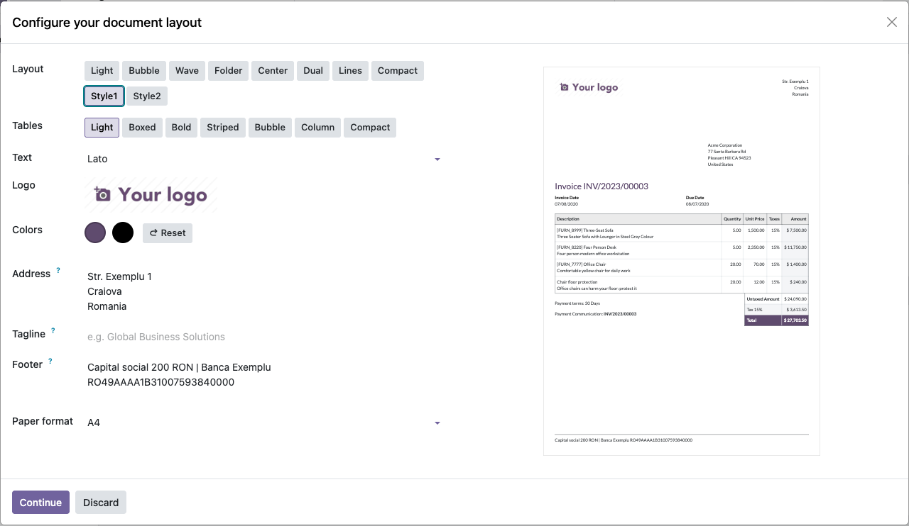
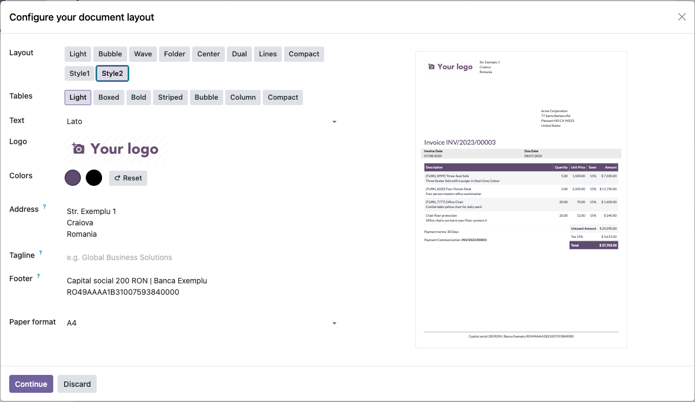
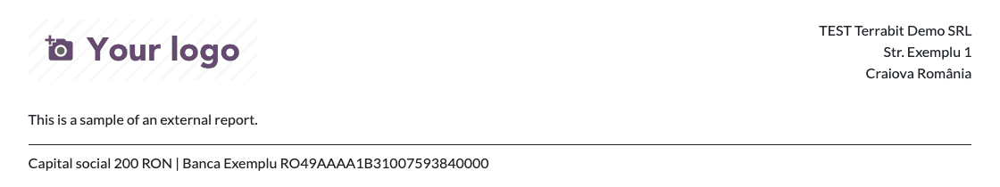
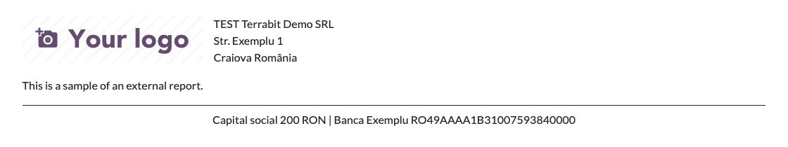

=============
Report Layout
=============

..
   !!!!!!!!!!!!!!!!!!!!!!!!!!!!!!!!!!!!!!!!!!!!!!!!!!!!
   !! This file is generated by oca-gen-addon-readme !!
   !! changes will be overwritten.                   !!
   !!!!!!!!!!!!!!!!!!!!!!!!!!!!!!!!!!!!!!!!!!!!!!!!!!!!
   !! source digest: sha256:be36ff23f55ade4d737341fe0bc4579cec436d2528f20921d9b8dd9c53b22f31
   !!!!!!!!!!!!!!!!!!!!!!!!!!!!!!!!!!!!!!!!!!!!!!!!!!!!

.. |badge1| image:: https://img.shields.io/badge/maturity-Production%2FStable-green.png
    :target: https://odoo-community.org/page/development-status
    :alt: Production/Stable
.. |badge2| image:: https://img.shields.io/badge/github-dhongu%2Fdeltatech-lightgray.png?logo=github
    :target: https://github.com/dhongu/deltatech/tree/19.0/deltatech_report_layout
    :alt: dhongu/deltatech
.. |badge_fisa| image:: https://img.shields.io/badge/-Fi%C8%99%C4%83%20consultant-2ea44f.png
    :target: https://github.com/dhongu/deltatech/blob/19.0/deltatech_report_layout/readme/FISA_CONSULTANT.md
    :alt: Fișă consultant

|badge1| |badge2| |badge_fisa|

Customized Report Layouts and Styles
====================================

This module provides specialized report layout styles for Odoo, allowing
businesses to customize the appearance of their printed documents
(Invoices, Quotations, Purchase Orders, etc.) with more modern and
professional designs.

Key Features
============

1. **Multiple Predefined Layouts**:

   - Adds several custom report template styles (Style 1, Style 2, etc.)
     to the system.
   - Provides more flexibility than the standard Odoo report layouts by
     offering different header, footer, and body designs.

2. **Centralized Layout Configuration**:

   - Includes a dedicated configuration for selecting and managing
     report layouts across the entire Odoo instance.
   - Ensures consistent branding and styling for all corporate
     communications.

3. **Modern Web Asset Integration**:

   - Leverages standard Odoo web and report assets for optimal
     performance and compatibility with Odoo's PDF generation engine.

Odoo Online
===========

The module contains no Python code, only views, report templates and
styles. Besides Odoo.sh and on-premise installations, it can be used on
Odoo Online (Custom plan): download the zip and load it from **Apps >
Import Module**.

**Table of contents**

.. contents::
   :local:

Usage
=====

1. Go to **Settings > General Settings** and, in the **Companies**
   section, click **Configure Document Layout**.

2. Under **Layout**, the two new layouts, **Style1** and **Style2**, are
   listed below the standard ones. Select **Style1**: the preview shows
   a sample invoice with the logo on the left and the company address
   aligned to the right.

   |Configure your document layout dialog with Style1 selected under
   Layout and the invoice preview on the right|

3. Select **Style2**: the company address sits next to the logo, and the
   table header and the total use the primary color of the company.
   Change the colors under **Colors** if needed, then click **Continue**
   to save.

   |Configure your document layout dialog with Style2 selected; the
   table header and the Total row use the primary color|

4. Print any document of the company (quotation, invoice, delivery
   slip). It uses the selected layout:

   |Header and footer of a document printed with Style1: logo on the
   left, company address on the right|

   |Header and footer of a document printed with Style2: company address
   next to the logo, centered footer|

Changelog
=========

19.0.1.1.2 (2026-11-09)
-----------------------

- The "(importable, Odoo Online)" suffix was removed from the module
  name. Odoo Apps already shows the module as available on Odoo Online
  (Manifest > Availability), and the Apps banner now carries an "Odoo
  Online" label instead.

19.0.1.1.1 (2026-11-08)
-----------------------

- Odoo Apps does not mark data-only modules as available on Odoo Online,
  so the module name, the summary, the banner and the Apps Store page
  now say it: "Report Layout (importable, Odoo Online)".

19.0.1.1.0 (2026-11-08)
-----------------------

- Data-only module: the empty ``__init__.py`` was removed, so the module
  has no Python code at all. It can be installed on Odoo Online (Custom
  plan) as a zip from Apps > Import Module, as well as on Odoo.sh and
  on-premise.
- Consultant sheet (readme/FISA_CONSULTANT.md), USAGE.md and
  screenshots; the usage steps moved from DESCRIPTION.md to USAGE.md.
- The report styles are listed one by one in the manifest assets: an
  imported module does not accept wildcards (``**/*``) in asset paths.

19.0.1.0.2 (2026-10-16)
-----------------------

- Development status raised from Beta to Production/Stable: the module
  has been in production use at customers for a long time.

19.0.1.0.1 (2026-09-29)
-----------------------

- Own module icon, instead of the generic gears it had.

Bug Tracker
===========

Bugs are tracked on `Terrabit Issues <https://www.terrabit.ro/helpdesk>`_.
In case of trouble, please check there if your issue has already been reported.

Do not contact contributors directly about support or help with technical issues.

Credits
=======

Authors
-------

* Terrabit
* Dorin Hongu

Maintainers
-----------

.. |maintainer-dhongu| image:: https://github.com/dhongu.png?size=40px
    :target: https://github.com/dhongu
    :alt: dhongu

Current maintainer:

|maintainer-dhongu| 

This module is part of the `dhongu/deltatech <https://github.com/dhongu/deltatech/tree/19.0/deltatech_report_layout>`_ project on GitHub.

You are welcome to contribute.