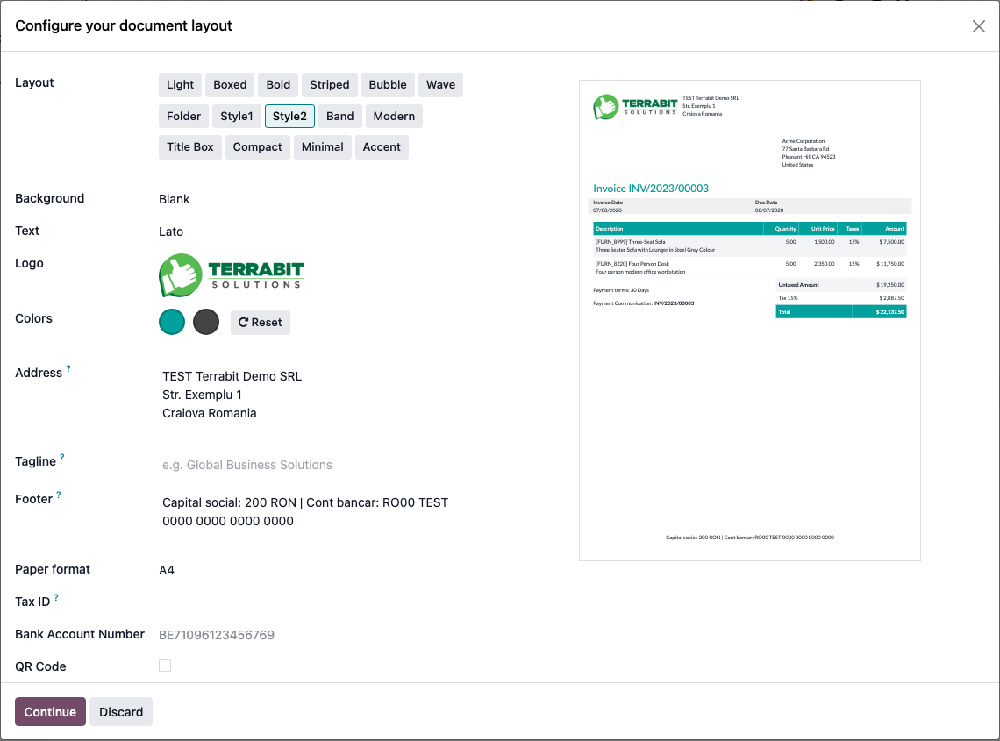
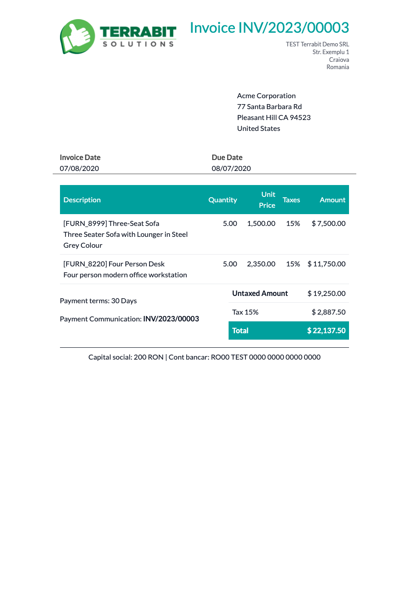
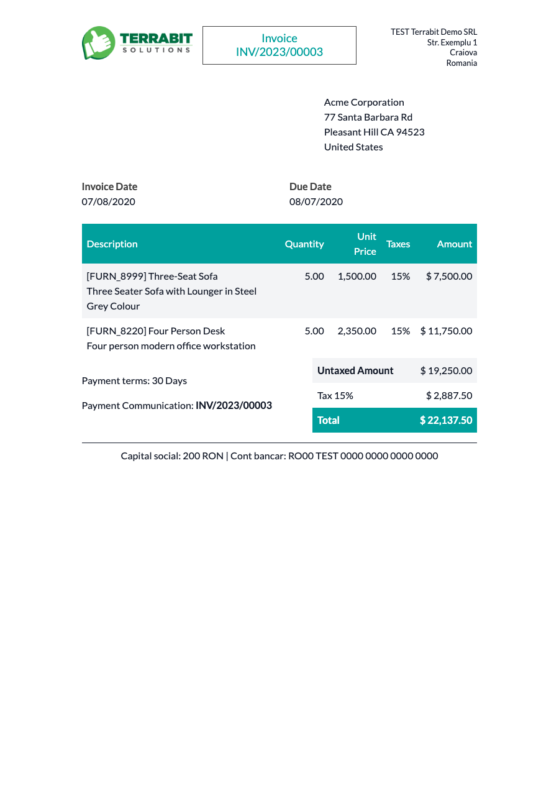
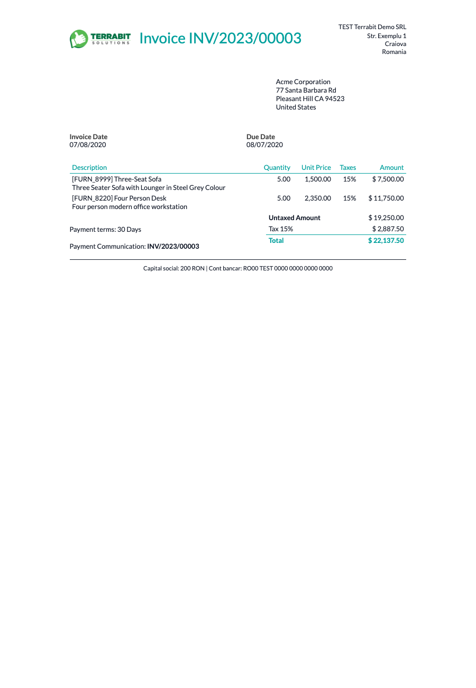
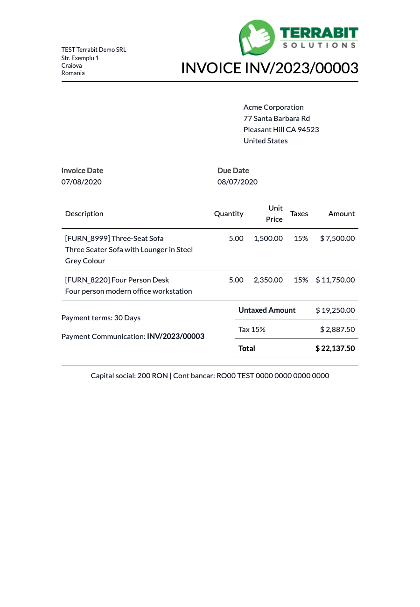
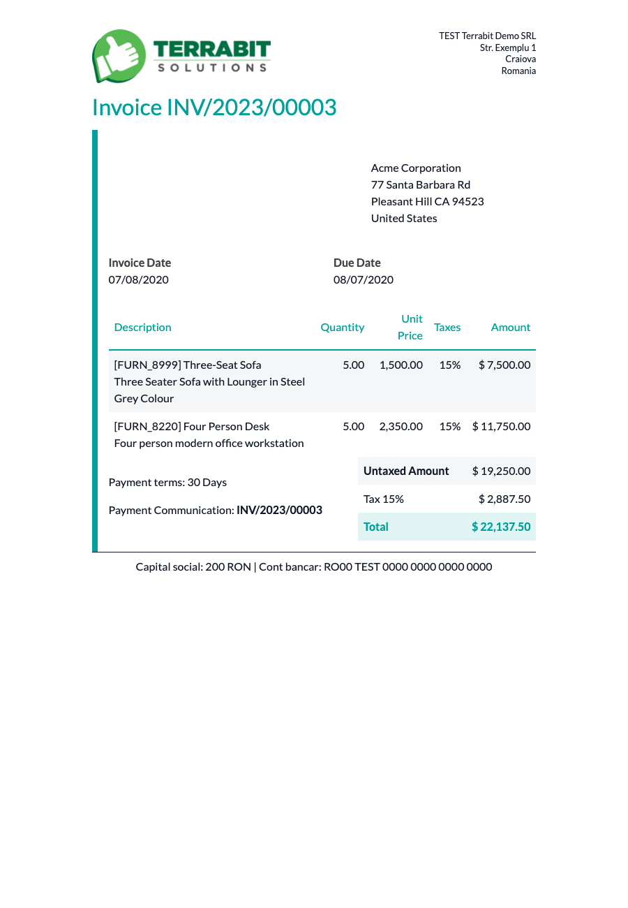
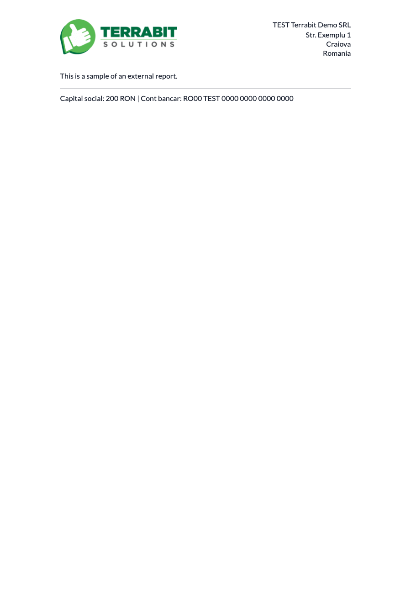
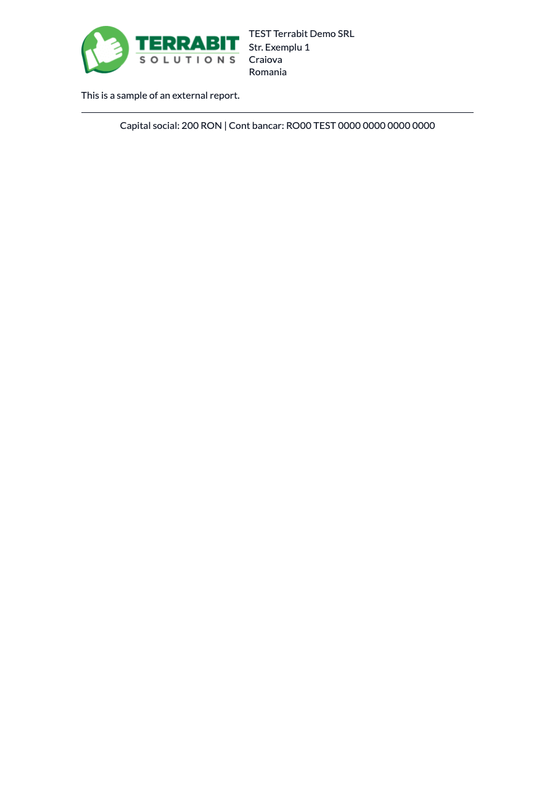

=============
Report Layout
=============

..
   !!!!!!!!!!!!!!!!!!!!!!!!!!!!!!!!!!!!!!!!!!!!!!!!!!!!
   !! This file is generated by oca-gen-addon-readme !!
   !! changes will be overwritten.                   !!
   !!!!!!!!!!!!!!!!!!!!!!!!!!!!!!!!!!!!!!!!!!!!!!!!!!!!
   !! source digest: sha256:be36ff23f55ade4d737341fe0bc4579cec436d2528f20921d9b8dd9c53b22f31
   !!!!!!!!!!!!!!!!!!!!!!!!!!!!!!!!!!!!!!!!!!!!!!!!!!!!

.. |badge1| image:: https://img.shields.io/badge/maturity-Production%2FStable-green.png
    :target: https://odoo-community.org/page/development-status
    :alt: Production/Stable
.. |badge2| image:: https://img.shields.io/badge/github-dhongu%2Fdeltatech-lightgray.png?logo=github
    :target: https://github.com/dhongu/deltatech/tree/20.0/deltatech_report_layout
    :alt: dhongu/deltatech
.. |badge_fisa| image:: https://img.shields.io/badge/-Fi%C8%99%C4%83%20consultant-2ea44f.png
    :target: https://github.com/dhongu/deltatech/blob/20.0/deltatech_report_layout/readme/FISA_CONSULTANT.md
    :alt: Fișă consultant

|badge1| |badge2| |badge_fisa|

Customized Report Layouts and Styles
====================================

This module provides specialized report layout styles for Odoo, allowing
businesses to customize the appearance of their printed documents
(Invoices, Quotations, Purchase Orders, etc.) with more modern and
professional designs.

Key Features
============

1. **Eight Predefined Layouts**:

   - Adds eight report layouts to the system: Style1, Style2, Band,
     Modern, Title Box, Compact Header, Minimal and Accent.
   - Each one has its own header, footer and table design: a full-width
     colored header band, a boxed title, a compact one-line header for
     long documents, a black-and-white minimal design or a colored
     accent bar along the left edge of the content.
   - Colors follow the primary and secondary colors of the company
     (except Minimal, which is black and white).

2. **Per-Company Layout Selection**:

   - The layouts are chosen per company from the standard **Configure
     Document Layout** dialog of Odoo.
   - Ensures consistent branding and styling for all corporate
     communications.

3. **Modern Web Asset Integration**:

   - Leverages standard Odoo web and report assets for optimal
     performance and compatibility with Odoo's PDF generation engine.

Odoo Online
===========

The module contains no Python code, only views, report templates and
styles. Besides Odoo.sh and on-premise installations, it can be used on
Odoo Online (Custom plan): download the zip and load it from **Apps >
Import Module**.

**Table of contents**

.. contents::
   :local:

Usage
=====

1. Go to **Settings > General Settings** and, in the **Companies**
   section, click **Configure Document Layout**.

2. Under **Layout**, the eight new layouts (**Style1**, **Style2**,
   **Band**, **Modern**, **Title Box**, **Compact Header**, **Minimal**
   and **Accent**) are listed after the standard ones. Select
   **Style1**: the preview shows a sample invoice with the logo on the
   left and the company address aligned to the right. The **Tables** row
   (Light, Boxed, Bold...) does not change Style1 and Style2: each of
   them has its own table style, so that choice only applies to the
   standard layouts.

   |Configure your document layout dialog with Style1 selected under
   Layout, next to the standard layouts and the other new layouts, and
   the invoice preview on the right|

3. Select **Style2**: the company address sits next to the logo, and the
   table header and the total use the primary color of the company.
   Change the colors under **Colors** if needed, then click **Continue**
   to save.

   |Configure your document layout dialog with Style2 selected; the
   table header and the Total row use the primary color|

4. Select **Band**: the document title and the company name sit on a
   full-width band in the primary color, the table header has a colored
   line and the footer is a colored band too.

   |Configure your document layout dialog with Band selected; the
   invoice preview has the title on a purple band and a purple footer
   band|

5. The other layouts differ in header, footer and table style:

   +--------------------+-------------------------------------------------+
   | Layout             | What it looks like                              |
   +====================+=================================================+
   | **Modern**         | Logo on the left, colored title and company     |
   |                    | details on the right, colored table header      |
   +--------------------+-------------------------------------------------+
   | **Title Box**      | Title in a box in the middle, logo on the left, |
   |                    | company details on the right                    |
   +--------------------+-------------------------------------------------+
   | **Compact Header** | Small font, tight margins and a one-line        |
   |                    | header, for documents with many lines           |
   +--------------------+-------------------------------------------------+
   | **Minimal**        | Black and white, no colored backgrounds, cheap  |
   |                    | to print (ignores the company colors)           |
   +--------------------+-------------------------------------------------+
   | **Accent**         | Colored vertical bar along the left edge of the |
   |                    | content, colored title                          |
   +--------------------+-------------------------------------------------+

   |Invoice preview with Modern: logo on the left, title and company
   address on the right, teal table header|

   |Invoice preview with Title Box: title in a box between the logo and
   the company address|

   |Invoice preview with Compact Header: one-line header, small font and
   tight margins|

   |Invoice preview with Minimal: black and white, company address on
   the left, logo and title on the right|

   |Invoice preview with Accent: teal vertical bar along the left edge
   of the content|

6. Print any document of the company (quotation, invoice, delivery
   slip). It uses the selected layout:

   |Header and footer of a document printed with Style1: logo on the
   left, company address on the right|

   |Header and footer of a document printed with Style2: company address
   next to the logo, centered footer|

.. |Configure your document layout dialog with Style1 selected under Layout, next to the standard layouts and the other new layouts, and the invoice preview on the right| image:: https://raw.githubusercontent.com/dhongu/deltatech/20.0/deltatech_report_layout/static/description/en/01_macheta_style1.png

.. |Configure your document layout dialog with Band selected; the invoice preview has the title on a purple band and a purple footer band| image:: https://raw.githubusercontent.com/dhongu/deltatech/20.0/deltatech_report_layout/static/description/en/05_macheta_style3.png

Changelog
=========

20.0.1.3.0 (2026-11-16)
-----------------------

- Three more report layouts: Compact Header (small font, tight margins,
  one-line header, for documents with many lines), Minimal (black and
  white, no color bands, cheap to print) and Accent (colored vertical
  bar along the left edge of the content, colored title).
- Consultant sheet, USAGE and DESCRIPTION updated for the eight layouts
  (Style1, Style2, Band, Modern, Title Box, Compact Header, Minimal,
  Accent), with new screenshots and a demo GIF.
- The Compact layout is named **Compact Header**, so it is not confused
  with the standard Odoo 20 **Compact** layout.

20.0.1.2.0 (2026-11-16)
-----------------------

- Three new report layouts: Band (full-width colored header band and
  footer band), Modern (logo left, title and company details right,
  colored total bar) and Title Box (boxed centered title, colored table
  header). Colors follow the company's primary/secondary colors.

20.0.1.1.2 (2026-11-09)
-----------------------

- The "(importable, Odoo Online)" suffix was removed from the module
  name. Odoo Apps already shows the module as available on Odoo Online
  (Manifest > Availability), and the Apps banner now carries an "Odoo
  Online" label instead.

20.0.1.1.1 (2026-11-08)
-----------------------

- Odoo Apps does not mark data-only modules as available on Odoo Online,
  so the module name, the summary, the banner and the Apps Store page
  now say it: "Report Layout (importable, Odoo Online)".

20.0.1.1.0 (2026-11-08)
-----------------------

- Migration to 20.0. Odoo 20 dropped the layout background
  (``layout_background`` on the company), so Style1 and Style2 no longer
  read it. The document body follows the standard
  ``web.external_layout_body`` of 20.0 (hidden heading for multiple
  invoice sending, ``hide_title``, custom address block), and the layout
  colors are inserted next to the other layout-specific styles of
  ``web.styles_company_report``.
- Still data-only, importable on Odoo Online from Apps > Import Module.

19.0.1.1.0 (2026-11-08)
-----------------------

- Data-only module: the empty ``__init__.py`` was removed, so the module
  has no Python code at all. It can be installed on Odoo Online (Custom
  plan) as a zip from Apps > Import Module, as well as on Odoo.sh and
  on-premise.
- Consultant sheet (readme/FISA_CONSULTANT.md), USAGE.md and
  screenshots; the usage steps moved from DESCRIPTION.md to USAGE.md.
- The report styles are listed one by one in the manifest assets: an
  imported module does not accept wildcards (``**/*``) in asset paths.

19.0.1.0.2 (2026-10-16)
-----------------------

- Development status raised from Beta to Production/Stable: the module
  has been in production use at customers for a long time.

19.0.1.0.1 (2026-09-29)
-----------------------

- Own module icon, instead of the generic gears it had.

Bug Tracker
===========

Bugs are tracked on `Terrabit Issues <https://www.terrabit.ro/helpdesk>`_.
In case of trouble, please check there if your issue has already been reported.

Do not contact contributors directly about support or help with technical issues.

Credits
=======

Authors
-------

* Terrabit
* Dorin Hongu

Maintainers
-----------

.. |maintainer-dhongu| image:: https://github.com/dhongu.png?size=40px
    :target: https://github.com/dhongu
    :alt: dhongu

Current maintainer:

|maintainer-dhongu| 

This module is part of the `dhongu/deltatech <https://github.com/dhongu/deltatech/tree/20.0/deltatech_report_layout>`_ project on GitHub.

You are welcome to contribute.