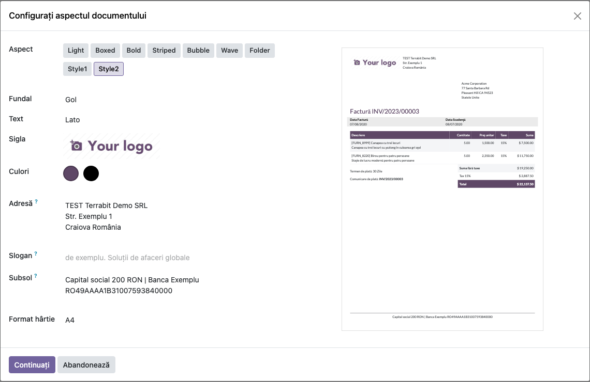

# Fișă Modul: Machete suplimentare pentru documentele tipărite

**Modul:** `deltatech_report_layout`
**Utilizator principal:** Administrator (configurează aspectul documentelor companiei)
**Prioritate:** 🟢 Scăzută (schimbă doar aspectul documentelor, nu datele de pe ele)

---

## 1. Scop business

Odoo oferă câteva machete pentru documentele tipărite (Light, Boxed, Bold, Striped, Bubble, Wave,
Folder). Modulul adaugă două machete noi, **Style1** și **Style2**, cu alt antet, alt subsol și alt
stil al tabelelor. Macheta aleasă se aplică tuturor documentelor externe ale companiei: oferte,
comenzi, facturi, avize și celelalte rapoarte care folosesc antetul standard.

Modulul nu are cod Python. Pe lângă Odoo.sh și instalările proprii, se poate folosi și pe Odoo
Online (planul Custom), încărcat ca arhivă zip: cu modul dezvoltator activ, din
**Aplicații → Importați Modulul**.

## 2. Bază legală și context

Modulul nu schimbă conținutul documentelor. Datele de identificare ale emitentului (denumire, CUI,
adresă) rămân cele din fișa companiei, iar mențiunile obligatorii de pe factură vin din rapoartele
modulelor de facturare. Machetele afișează în antet denumirea și adresa companiei sau textul din
câmpul **Adresă** al ferestrei de configurare: CUI-ul și numărul de la Registrul Comerțului apar
doar dacă sunt trecute acolo. Contextul este cel al identității vizuale a firmei pe documentele trimise
clienților și furnizorilor.

## 3. Utilizatori și roluri

| Rol | Ce face |
|---|---|
| Administrator (*Settings*) | Alege macheta, culorile, sigla, sloganul și subsolul companiei |
| Utilizatorii care tipăresc documente | Văd documentele în macheta aleasă; nu configurează nimic |

Modulul nu adaugă grupuri de drepturi. Pentru testare ajunge un utilizator administrator.

## 4. Conturi și date implicate

Nu se folosesc conturi contabile și nu se generează note contabile. Pentru demo sunt necesare:

- datele companiei completate în **Setări → Utilizatori & Companii → Companii** (denumire, adresă, CUI);
- opțional, o siglă, un slogan și un text de subsol (de exemplu capitalul social și contul bancar);
- un document de tipărit (ofertă, factură) sau previzualizarea din fereastra de configurare.

## 5. Configurare inițială

1. Instalați modulul `deltatech_report_layout` (depinde doar de `web`). Pe Odoo Online, activați
   modul dezvoltator și încărcați arhiva zip din **Aplicații → Importați Modulul**.
2. Completați datele companiei din **Setări → Configurări generale**, secțiunea **Companii →
   Actualizare informații**.
3. Dacă documentele trebuie să arate CUI-ul și numărul de la Registrul Comerțului, treceți-le în
   câmpul **Adresă** din fereastra de configurare a aspectului (pasul 1 de mai jos).

## 6. Flux de utilizare

### Pasul 1 — Alegerea machetei Style1

Deschideți **Setări → Configurări generale** și, în secțiunea **Companii**, apăsați
**Configurare aspect document**. În fereastra deschisă, **Configurați aspectul documentului**, la **Aspect**, apar cele două machete
noi, **Style1** și **Style2**, sub machetele standard. Alegeți **Style1**: previzualizarea din dreapta
arată o factură exemplu cu sigla în stânga, adresa companiei aliniată la dreapta și tabelul liniilor
cu chenar. Apăsați **Continuați** ca să salvați macheta.

Previzualizarea folosește factura exemplu standard Odoo (client Acme Corporation, sume în dolari),
indiferent de datele bazei.

### Pasul 2 — Alegerea machetei Style2

Deschideți din nou fereastra și alegeți **Style2**. În previzualizare, adresa companiei stă lângă siglă,
blocul cu data facturii și data scadentă are fundal gri, iar capul tabelului și totalul folosesc
culoarea principală a companiei. Culorile se schimbă din **Culori**. Pentru pașii următori,
reveniți pe **Style1** și apăsați **Continuați**.

### Pasul 3 — Documentul tipărit cu Style1

Tipăriți orice document al companiei (de exemplu o factură, din **Tipăriți**). Antetul are sigla în
stânga și adresa companiei la dreapta, iar subsolul arată textul din **Subsol**; în PDF apare și
numărul paginii, cu textul în engleză (Page x / y), pentru că modulul nu are traducere în română. Captura arată raportul de probă al machetei.

### Pasul 4 — Documentul tipărit cu Style2

Alegeți din nou **Style2** în fereastra de configurare și apăsați **Continuați**: același document are adresa companiei imediat lângă siglă, iar subsolul
este centrat.

### Note de monografie și raportare

Modulul nu generează note contabile (Dr/Cr): schimbă doar aspectul rapoartelor PDF.

## 7. Legături cu alte module / declarații

| Modul | Rol |
|---|---|
| `web` | Fereastra **Configurați aspectul documentului** și antetul standard al rapoartelor, în care se înscriu cele două machete |
| `account`, `sale`, `purchase`, `stock` | Rapoartele lor (factură, ofertă, comandă, aviz) folosesc macheta aleasă |
| `base_import_module` | Importul arhivei zip pe Odoo Online |

**Ce e automat:** toate documentele care folosesc antetul standard trec pe macheta aleasă; culorile,
sigla, sloganul și subsolul se preiau din configurarea companiei.

**Ce rămâne manual:** alegerea machetei pentru fiecare companie, din fereastra de configurare.

## 8. Verificări pentru consultant

- [ ] Fereastra deschisă din **Configurare aspect document** afișează **Style1** și **Style2** la **Aspect**.
- [ ] Previzualizarea se schimbă când treceți de la Style1 la Style2.
- [ ] După **Continuați**, o factură tipărită are antetul și subsolul machetei alese.
- [ ] Culoarea principală aleasă la **Culori** apare în capul tabelului și la total, în Style2.
- [ ] Textul din **Subsol** apare în subsolul documentului; în PDF apare și numărul paginii.
- [ ] Pe Odoo Online, după importul arhivei zip (modul dezvoltator, **Aplicații → Importați
  Modulul**), modulul apare în **Aplicații** și cele două machete
  sunt disponibile.
- [ ] Într-o bază cu mai multe companii, fiecare companie își păstrează macheta proprie.

## 9. Mesaje de eroare frecvente

| Mesaj | Cauză | Remediere |
|---|---|---|
| La import: *The assets path in the manifest of imported module ... cannot contain glob wildcards* | Arhiva provine dintr-o versiune mai veche a modulului, care încărca stilurile cu `**/*` | Folosiți versiunea 19.0.1.1.0 sau mai nouă |
| Machetele Style1 și Style2 nu apar în fereastră | Modulul nu este instalat în baza curentă | Instalați modulul sau importați arhiva zip |
| PDF-ul are sigla și liniile, dar nu are text | wkhtmltopdf nu a încărcat la timp fontul de la server | Verificați parametrul de sistem `report.url` și tipăriți din nou |

## 10. Capturi de ecran

Capturile sunt în `static/description/` (cele în engleză, pentru `readme/USAGE.md`, în
`static/description/en/`), făcute în română pe o bază de test cu modulul importat din zip:

| Fișier | Ce arată |
|---|---|
| `01_macheta_style1.png` | Fereastra de configurare cu macheta Style1 selectată și previzualizarea facturii |
| `02_macheta_style2.png` | Aceeași fereastră cu macheta Style2 selectată |
| `03_document_style1.png` | Raportul de probă al machetei Style1: antet și subsol |
| `04_document_style2.png` | Raportul de probă al machetei Style2: antet și subsol |

Modulul nu are `tests/test_screenshots.py`: un test Python ar contrazice varianta fără cod Python
pentru Odoo Online. Capturile s-au făcut cu Playwright, din fereastra de configurare și din
previzualizarea raportului (`/report/html/web.preview_externalreport/<id_companie>`).

## 11. Observații pentru manual

- Macheta se alege per companie: într-o bază cu mai multe companii, fiecare are macheta ei.
- Modulul nu schimbă rapoartele care nu folosesc antetul standard al companiei.
- Pe Odoo Online, importul unui modul cere planul Custom.
