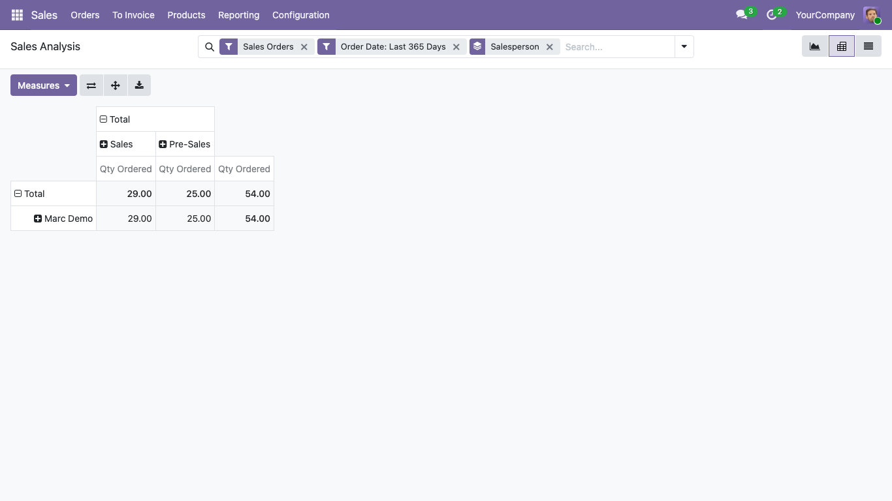
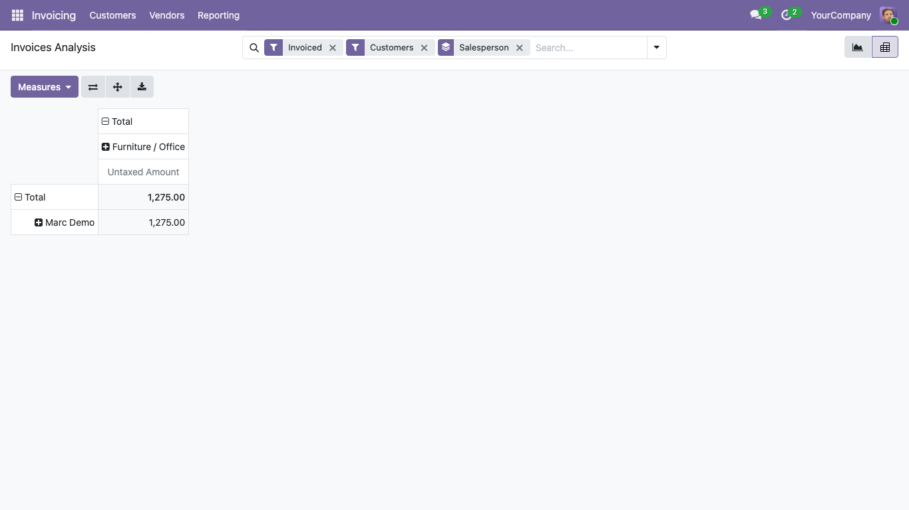

=======================
Restrict Reports Access
=======================

..
   !!!!!!!!!!!!!!!!!!!!!!!!!!!!!!!!!!!!!!!!!!!!!!!!!!!!
   !! This file is generated by oca-gen-addon-readme !!
   !! changes will be overwritten.                   !!
   !!!!!!!!!!!!!!!!!!!!!!!!!!!!!!!!!!!!!!!!!!!!!!!!!!!!
   !! source digest: sha256:02ea267cec75fcec7cf28d3d8486dcdd3eb574a7ba8fb0922cb326478b35b87b
   !!!!!!!!!!!!!!!!!!!!!!!!!!!!!!!!!!!!!!!!!!!!!!!!!!!!

.. |badge1| image:: https://img.shields.io/badge/maturity-Beta-yellow.png
    :target: https://odoo-community.org/page/development-status
    :alt: Beta
.. |badge2| image:: https://img.shields.io/badge/license-AGPL--3-blue.png
    :target: http://www.gnu.org/licenses/agpl-3.0-standalone.html
    :alt: License: AGPL-3
.. |badge3| image:: https://img.shields.io/badge/github-dhongu%2Fdeltatech-lightgray.png?logo=github
    :target: https://github.com/dhongu/deltatech/tree/19.0/deltatech_restrict_reports
    :alt: dhongu/deltatech
.. |badge_fisa| image:: https://img.shields.io/badge/-Fi%C8%99%C4%83%20consultant-2ea44f.png
    :target: https://github.com/dhongu/deltatech/blob/19.0/deltatech_restrict_reports/readme/FISA_CONSULTANT.md
    :alt: Fișă consultant

|badge1| |badge2| |badge3| |badge_fisa|

Restricts who can see the data of the **Sales Analysis** (Sales >
Reporting) and **Invoice Analysis** (Accounting/Invoicing > Reporting)
reports, independently of any other access a user already has
(Salesperson, Invoicing, Accounting...).

Two new groups control visibility:

- **Rapoarte Vânzări/Facturi: doar propriile înregistrări** - sees only
  his own records (Salesperson on the order / invoice).
- **Rapoarte Vânzări/Facturi: toate înregistrările** - sees every
  record.

A user assigned to neither group sees these two reports empty (no access
error). Nobody is granted either group automatically - assignment is
manual, from Settings > Users.

**Table of contents**

.. contents::
   :local:

Usage
=====

Give each user a report access level
------------------------------------

Go to **Settings → Users & Companies → Users**, open the user and, on
the **Access Rights** tab, find the **Restrict Reports** section. In its
**Restrict Reports** field choose:

- **Rapoarte Vânzări/Facturi: doar propriile înregistrări** (own records
  only);
- **Rapoarte Vânzări/Facturi: toate înregistrările** (all records);
- leave it empty for no data at all.

Right after installation nobody has either group, so everybody,
administrators included, sees the two reports empty until the groups are
assigned.

|User form, Access Rights tab: Sales is Administrator, Accounting is
Invoicing, and in the Restrict Reports section the field is set to own
records only|

Sales Analysis
--------------

Open **Sales → Reporting → Sales**, switch to the **Pivot** view and
group by **Salesperson**.

- With *own records only*, the pivot has a single row, the logged-in
  user, equal to the total.

|Sales Analysis pivot grouped by Salesperson for Marc Demo: a single
row, Marc Demo, 54 Qty Ordered in total|

- With *all records*, every salesperson appears, with the same figures
  for each of them.

|Sales Analysis pivot grouped by Salesperson for a user with all
records: Marc Demo 54 and Mitchell Admin 94, total 148 Qty Ordered|

Invoice Analysis
----------------

Open **Invoicing → Reporting → Management → Invoice Analysis** and group
by **Salesperson**. With *own records only*, only the invoices where the
user is the salesperson are counted; invoices of other salespersons or
without a salesperson are left out.

|Invoices Analysis pivot grouped by Salesperson for Marc Demo: a single
row, Marc Demo, 1,275.00 Untaxed Amount|

With *all records*, the other salespersons and the invoices without a
salesperson (None) appear too; the user's own row keeps the same amount.

|Invoices Analysis pivot grouped by Salesperson for a user with all
records: Marc Demo 1,275.00, Mitchell Admin 65,500.00 and None
63,549.00, total 130,324.00|

User without a group
--------------------

A user in neither group still sees the menus, but both reports open
empty, without an access error.

|Invoices Analysis for a user without any report group: no data, Odoo's
faded sample chart in the background and its help text for an empty
report|

Notes
-----

- The Sales → Reporting menu requires the **Sales: Administrator** right
  in standard Odoo; the module does not change menu access.
- These two analysis reports, and the figures computed from them (the
  **Invoiced** button on customers, the **Sold** button on products),
  are filtered; orders, invoices and accounting reports are not.

.. |User form, Access Rights tab: Sales is Administrator, Accounting is Invoicing, and in the Restrict Reports section the field is set to own records only| image:: https://raw.githubusercontent.com/dhongu/deltatech/19.0/deltatech_restrict_reports/static/description/en/01_grupuri_utilizator.png

.. |Sales Analysis pivot grouped by Salesperson for a user with all records: Marc Demo 54 and Mitchell Admin 94, total 148 Qty Ordered| image:: https://raw.githubusercontent.com/dhongu/deltatech/19.0/deltatech_restrict_reports/static/description/en/03_analiza_vanzari_toate.png

.. |Invoices Analysis pivot grouped by Salesperson for a user with all records: Marc Demo 1,275.00, Mitchell Admin 65,500.00 and None 63,549.00, total 130,324.00| image:: https://raw.githubusercontent.com/dhongu/deltatech/19.0/deltatech_restrict_reports/static/description/en/05_analiza_facturi_toate.png
.. |Invoices Analysis for a user without any report group: no data, Odoo's faded sample chart in the background and its help text for an empty report| image:: https://raw.githubusercontent.com/dhongu/deltatech/19.0/deltatech_restrict_reports/static/description/en/06_analiza_facturi_fara_grup.png

Changelog
=========

19.0.1.0.3 (2026-11-17)
-----------------------

- Consultant sheet (``readme/FISA_CONSULTANT.md``), ``readme/USAGE.md``
  and screenshots.
- DESCRIPTION.md no longer says that the report menus are hidden for a
  user in neither group: the menus stay visible and the reports open
  empty (dhongu/deltatech#4220).
- Apps banner: "Applies to dashboards and exports too" instead of
  "Reporting menus hidden per user".
- Romanian translation of the "Restrict Reports" privilege field on the
  user form.

19.0.1.0.2 (2026-11-14)
-----------------------

- Apps Store banner: the "Odoo Online" badge shows that the module has
  no Python code and installs on Odoo Online.

19.0.1.0.1
==========

- Own module icon, instead of the generic gears it had.

History
=======

19.0.1.0.0
----------

- Ported from 18.0 (18.0.1.0.0).
- Fixed two 19.0 breaking changes: ``res.groups.category_id`` was
  removed (a group's module category is now set via a
  ``res.groups.privilege`` record's ``category_id``, referenced from the
  group through ``privilege_id``), and
  ``ir.actions.act_window.groups_id`` was renamed to ``group_ids``.

Bug Tracker
===========

Bugs are tracked on `Terrabit Issues <https://www.terrabit.ro/helpdesk>`_.
In case of trouble, please check there if your issue has already been reported.

Do not contact contributors directly about support or help with technical issues.

Credits
=======

Authors
-------

* Terrabit
* Dorin Hongu

Maintainers
-----------

.. |maintainer-dhongu| image:: https://github.com/dhongu.png?size=40px
    :target: https://github.com/dhongu
    :alt: dhongu
.. |maintainer-danila12| image:: https://github.com/danila12.png?size=40px
    :target: https://github.com/danila12
    :alt: danila12

Current maintainers:

|maintainer-dhongu| |maintainer-danila12| 

This module is part of the `dhongu/deltatech <https://github.com/dhongu/deltatech/tree/19.0/deltatech_restrict_reports>`_ project on GitHub.

You are welcome to contribute.