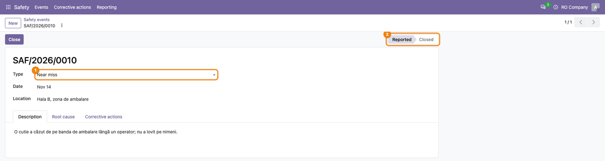
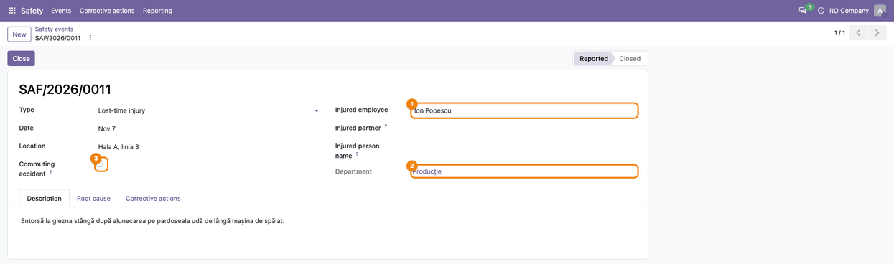
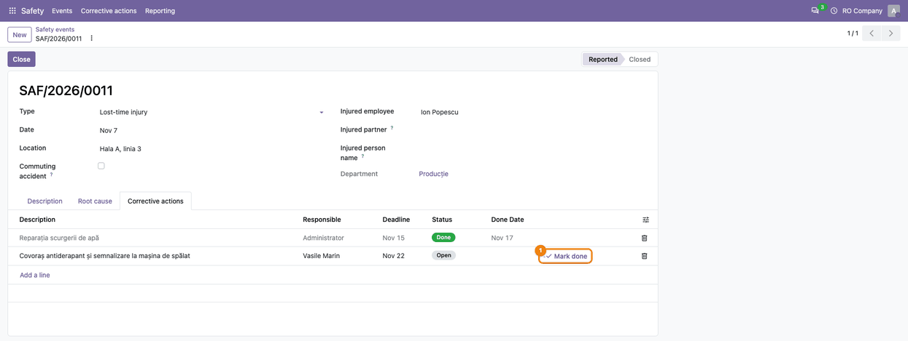
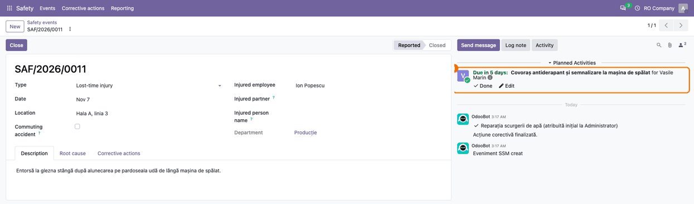
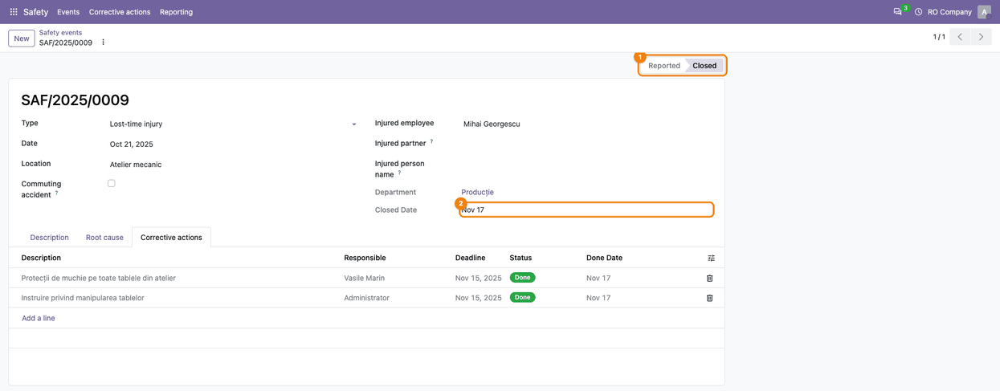
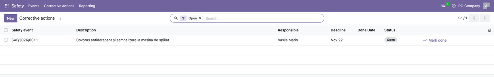
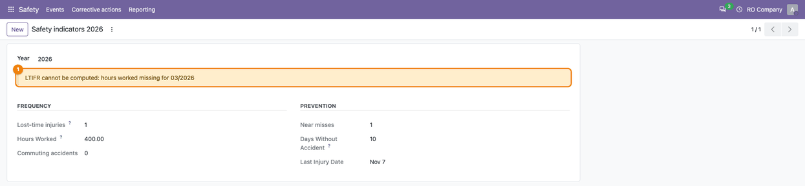

===============
Safety Register
===============

..
   !!!!!!!!!!!!!!!!!!!!!!!!!!!!!!!!!!!!!!!!!!!!!!!!!!!!
   !! This file is generated by oca-gen-addon-readme !!
   !! changes will be overwritten.                   !!
   !!!!!!!!!!!!!!!!!!!!!!!!!!!!!!!!!!!!!!!!!!!!!!!!!!!!
   !! source digest: sha256:6f17849f2aa404b30b3f58abcd6f8ec0d5669880378eb02bbcc81364c47cbe4e
   !!!!!!!!!!!!!!!!!!!!!!!!!!!!!!!!!!!!!!!!!!!!!!!!!!!!

.. |badge1| image:: https://img.shields.io/badge/maturity-Beta-yellow.png
    :target: https://odoo-community.org/page/development-status
    :alt: Beta
.. |badge2| image:: https://img.shields.io/badge/github-dhongu%2Fdeltatech-lightgray.png?logo=github
    :target: https://github.com/dhongu/deltatech/tree/20.0/deltatech_safety_register
    :alt: dhongu/deltatech
.. |badge_fisa| image:: https://img.shields.io/badge/-Fi%C8%99%C4%83%20consultant-2ea44f.png
    :target: https://github.com/dhongu/deltatech/blob/20.0/deltatech_safety_register/readme/FISA_CONSULTANT.md
    :alt: Fișă consultant

|badge1| |badge2| |badge_fisa|

Register of safety events for companies that run safety or World Class
Manufacturing programmes: near misses, incidents and work accidents,
each with its root cause and corrective actions, and the safety
indicators of the year.

**Key features:**

- **Safety events** classified as Near miss, Incident (no injury),
  Injury (no time lost), Lost-time injury or Fatal, numbered
  ``SAF/<year>/NNNN``, with location, description and root cause.
- **Injured person**: an employee, a partner (contractor, visitor) or a
  free-text name; the employee department is filled in automatically.
- **Commuting accidents** (accident de traseu) are flagged, kept in the
  register and excluded from LTIFR.
- **Corrective actions** with responsible and deadline; each action
  schedules a To-Do activity for its responsible user. An event can be
  closed only after all its actions are done, and a closed event can be
  changed only by a Safety manager.
- **Indicators** per company and year: LTIFR (lost-time injuries x
  1,000,000 / hours worked, the hours coming from Attendances), number
  of near misses, lost-time injuries and commuting accidents of the
  chosen year, plus the days without accident counted to today.
- Two access groups, Safety officer and Safety manager, with
  multi-company isolation.

**Table of contents**

.. contents::
   :local:

Usage
=====

Give the users the **Safety officer** or **Safety manager** access right
(Settings → Users, category *Human Resources*, field **Safety
register**). Users who export the register also need the **Export**
right. Hours worked for LTIFR come from the **Attendances** app, so the
employees must check in and out there.

1. **Safety → Events** lists the register: reference, date, type,
   location, injured employee, commuting flag, open actions and status.
   Lost-time injuries and fatalities are shown in red. Use the filters
   and **Export** (XLSX) to extract the register.

   |Safety events list with near misses, an incident, injuries and
   lost-time injuries, their SAF references by event year, injured
   employee, commuting flag, open actions and status|

2. **Safety → Events → New**: choose the **Type**, the **Date**, the
   **Location** and describe the event. On save it gets the reference
   ``SAF/<event year>/NNNN`` and the status **Reported**.

   |A near miss form: reference, type Near miss, date, location and
   description, status Reported|

3. For an injury (**Injury (no time lost)**, **Lost-time injury**,
   **Fatal**) set the injured person: **Injured employee**, **Injured
   partner** or **Injured person name**. The department comes from the
   employee. Tick **Commuting accident** when it happened on the way to
   or from work.

   |A lost-time injury form with the injured employee, the department
   filled in and the Commuting accident checkbox|

4. Write the **Root cause**, then add the **Corrective actions** with
   **Responsible** and **Deadline**. Each responsible receives a To-Do
   activity on the event. Press **Mark done** when the action is
   completed.

   |Corrective actions tab: one action done with its done date, one open
   action with the Mark done button|

   |Event chatter: the To-Do activity of the responsible user with the
   summary and deadline of the open action|

5. Press **Close** once every action is done. A closed event can only be
   changed by a Safety manager and cannot be deleted.

   |A closed event: status Closed, closed date and all corrective
   actions done|

6. **Safety → Corrective actions** shows the open actions of all events;
   use **My actions** or group by **Responsible**.

   |Corrective actions list filtered on Open, with event, description,
   responsible, deadline and Mark done|

7. **Safety → Reporting → Indicators**, choose the **Year**: LTIFR
   (lost-time injuries × 1,000,000 / hours worked), lost-time injuries,
   hours worked, commuting accidents and near misses of that year. Days
   without accident and the last injury date are counted to today,
   whatever the year.

   |Safety indicators for last year: LTIFR, lost-time injuries, hours
   worked, commuting accidents, near misses, days without accident and
   last injury date|

   When a month that has already started has no hours in Attendances,
   LTIFR is hidden and a warning lists the missing months.

   |Safety indicators for the current year with the warning that hours
   worked are missing for 03/2026|

.. |Safety events list with near misses, an incident, injuries and lost-time injuries, their SAF references by event year, injured employee, commuting flag, open actions and status| image:: https://raw.githubusercontent.com/dhongu/deltatech/20.0/deltatech_safety_register/static/description/en/01_lista_evenimente.png

.. |Safety indicators for last year: LTIFR, lost-time injuries, hours worked, commuting accidents, near misses, days without accident and last injury date| image:: https://raw.githubusercontent.com/dhongu/deltatech/20.0/deltatech_safety_register/static/description/en/08_indicatori.png

Changelog
=========

20.0.1.0.0
----------

- First version: safety events, corrective actions and indicators
  (LTIFR, near misses, days without accident).

Bug Tracker
===========

Bugs are tracked on `Terrabit Issues <https://www.terrabit.ro/helpdesk>`_.
In case of trouble, please check there if your issue has already been reported.

Do not contact contributors directly about support or help with technical issues.

Credits
=======

Authors
-------

* Terrabit
* Dorin Hongu

Maintainers
-----------

.. |maintainer-dhongu| image:: https://github.com/dhongu.png?size=40px
    :target: https://github.com/dhongu
    :alt: dhongu

Current maintainer:

|maintainer-dhongu| 

This module is part of the `dhongu/deltatech <https://github.com/dhongu/deltatech/tree/20.0/deltatech_safety_register>`_ project on GitHub.

You are welcome to contribute.