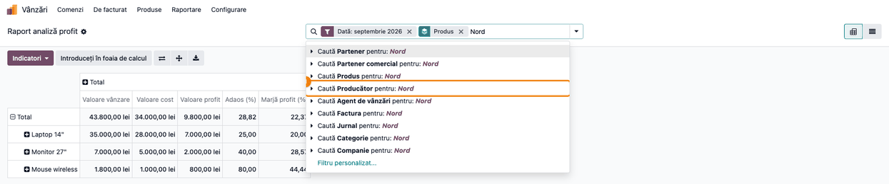
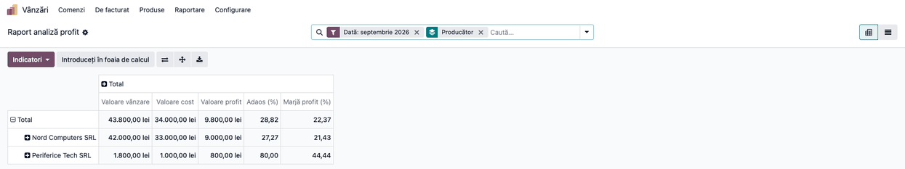

# Fișă Modul: Profitul pe producător în Raportul de analiză a profitului

**Modul:** `deltatech_sale_commission_manufacturer`
**Utilizator principal:** Managerul comercial sau directorul de vânzări (citește vânzarea, costul
și profitul pe producător)
**Prioritate:** 🟢 Scăzută (o grupare în plus într-un raport existent; nu schimbă calculele,
comisioanele sau contabilitatea)

---

## 1. Scop business

**Raport analiză profit** (din *Sale Margin*, extins de *Sale Commission*) arată, pe liniile facturilor client, valoarea
vânzării, costul mărfii livrate, profitul, adaosul și marja. Un distribuitor care lucrează cu mai
mulți producători vrea să vadă și **cât câștigă pe fiecare producător**: ce producători aduc
marja, la care trebuie renegociat prețul de achiziție, pe care merită împinse vânzările.

Modulul adaugă în acest raport producătorul produsului (câmpul **Producător** din *Products
Extension*): căutare după producător și **Grupează după > Producător**. Calculele raportului nu se
schimbă; se adaugă doar un criteriu de citire.

Modulul este o punte între *Sale Commission* (`deltatech_sale_commission`) și *Products
Extension* (`deltatech_product_extension`): se instalează singur în momentul în care se instalează
al doilea dintre ele. Pe o bază în care amândouă erau deja instalate, se instalează din
**Aplicații**.

## 2. Bază legală și context

Nu există un temei legal propriu. Raportul este un instrument de analiză de gestiune, nu o
situație contabilă sau fiscală.

## 3. Utilizatori și roluri

| Rol | Ce face | Drept Odoo |
|---|---|---|
| Manager comercial / director vânzări | citește profitul pe producător | **Vânzări / Administrator**, **Vizualizare comisioane**, **Administrator comisioane** sau grupul *Show purchase price on sale order lines and customer invoice* (afișat în engleză, fără traducere) |
| Responsabil nomenclator | completează producătorul pe produse | privilegiul **Produse** pe nivelul **Creează** |

Meniul **Raport analiză profit** apare doar utilizatorilor cu unul dintre aceste drepturi, la fel
ca înainte de instalarea modulului (fișele *Sale Margin* și *Sale Commission*, secțiunea 3).

Roluri recomandate pentru testare: un administrator de vânzări (vede raportul) și un vânzător
simplu (nu vede meniul).

## 4. Conturi și date implicate

Modulul nu are conturi proprii și nu creează note contabile. Cifrele vin din raportul existent:
vânzarea din liniile facturilor client postate, costul din livrări (fișa *Sale Margin*,
secțiunea 6, pașii 3 și 4).

Date minime pentru demo (folosite și în capturi; aceleași facturi ca în fișa *Sale Commission*):
- Companie **Demo Distribuție SRL**, plan de conturi RO, monedă RON.
- Producătorii **Nord Computers SRL** și **Periferice Tech SRL**, marcați **Este producător**.
- Trei facturi client din luna trecută, către **Birotica Plus SRL**, fiecare dintr-o comandă
  livrată:

| Produs | Producător | Vânzare | Cost | Profit |
|---|---|---|---|---|
| Laptop 14" (10 buc.) | Nord Computers SRL | 35.000,00 lei | 28.000,00 lei | 7.000,00 lei |
| Monitor 27" (5 buc.) | Nord Computers SRL | 7.000,00 lei | 5.000,00 lei | 2.000,00 lei |
| Mouse wireless (20 buc.) | Periferice Tech SRL | 1.800,00 lei | 1.000,00 lei | 800,00 lei |

## 5. Configurare inițială

1. Verificați că sunt instalate *Sale Commission* și *Products Extension*. Dacă al doilea dintre
   ele s-a instalat după apariția modulului, puntea s-a instalat singură. Altfel, în **Aplicații**
   apăsați **Actualizare listă aplicații** (în modul dezvoltator), scoateți filtrul **Aplicații** din
   căutare (modulul nu e o aplicație), căutați **Sale Margin Report by Manufacturer** și
   instalați-l.
2. Marcați producătorii și completați producătorul pe produse (fișa *Products Extension*, pașii 1–3).
3. Verificați că utilizatorii care trebuie să vadă raportul au drepturile din secțiunea 3.

## 6. Flux de utilizare

### Pasul 1 — Căutarea după producător

Deschideți **Vânzări → Raportare → Raport analiză profit**. Raportul se deschide pe luna trecută
(filtrul **Dată**), grupat pe produs. Tastați numele producătorului în caseta de căutare (în exemplu
„Nord”) și alegeți **Caută Producător pentru: Nord** (evidențiat în captură).

Raportul păstrează doar liniile cu produsele producătorilor găsiți. Pe demo rămân **Laptop 14"** și
**Monitor 27"**, ambele de la Nord Computers SRL; **Mouse wireless** dispare.



### Pasul 2 — Profitul grupat pe producător

Apăsați săgeata din dreapta casetei de căutare. În coloana **Grupează după**, apăsați **Produs** ca
să-l debifați, apoi apăsați **Producător**: rândurile devin direct producătorii. (✕ de pe eticheta
grupării din căutare ar șterge toate grupările odată, inclusiv **Producător**.)

1. **Găsiți pe ecran** — câte un rând pe producător, cu **Valoare vânzare**, **Valoare cost**,
   **Valoare profit**, **Adaos (%)** și **Marjă profit (%)**; rândul **Total** sus.
2. **Verificați**:
   - suma rândurilor de producător este egală cu **Total**; pe demo, vânzarea
     42.000,00 + 1.800,00 = 43.800,00 și profitul 9.000,00 + 800,00 = 9.800,00, aceleași ca în
     raportul grupat pe produs;
   - rândul unui producător este suma produselor lui; pe demo, Nord Computers = Laptop 7.000,00 +
     Monitor 2.000,00 = 9.000,00 profit;
   - adaosul și marja pe producător se recalculează din sume (Nord Computers: adaos
     9.000 / 33.000 = 27,27 %, marjă 9.000 / 42.000 = 21,43 %), nu sunt media produselor;
   - pe rândul **Fără** apar produsele fără producător, dar și liniile care nu au producător prin
     natura lor: transportul și discounturile globale de pe factură. Rândurile de producător arată
     deci vânzarea înainte de aceste discounturi. Completați producătorul doar pe produsele-marfă.
   Cu **+** de lângă un producător, rândul se desface pe produs, agent sau client.
3. **Treceți mai departe** — exportul (⬇) scoate tabelul în Excel; în Enterprise, **Introduceți
   în foaia de calcul** îl duce într-o foaie de calcul Odoo.



### Note de monografie și raportare

Modulul nu generează note contabile și nu modifică vânzarea, costul, profitul sau comisioanele.

Gruparea folosește producătorul **actual** al produsului, nu pe cel de la data facturii: dacă
schimbați producătorul unui produs, toate facturile lui trec la noul producător în raport. Pentru o
perioadă închisă, păstrați exportul raportului înainte de a corecta producătorii.

Notele de credit client scad din vânzarea și din costul producătorului, ca în restul raportului.

## 7. Legături cu alte module / declarații

| Modul / proces | Rol în flux | Tip legătură |
|---|---|---|
| `deltatech_sale_commission` | **Raport analiză profit** și căutarea lui, extinse cu producătorul | dependență (manifest) |
| `deltatech_sale_margin` | raportul de bază (vânzare, cost, profit) | prin `deltatech_sale_commission` |
| `deltatech_product_extension` | câmpul **Producător** de pe produs și marcarea producătorilor | dependență (manifest) |
| `deltatech_sale_margin_pos` | bonurile POS în raport, deocamdată fără producător (secțiunea 11) | opțional |

**Ce e automat:**
- instalarea modulului odată cu al doilea modul de bază;
- producătorul pe fiecare linie de factură din raport, luat din produs (bonurile POS nu îl au încă).

**Ce rămâne manual:**
- instalarea pe o bază pe care ambele module de bază erau deja instalate;
- marcarea producătorilor și completarea producătorului pe produse;
- alegerea grupării sau a căutării pe producător la fiecare deschidere a raportului (sau salvarea
  ei ca filtru favorit).

## 8. Verificări pentru consultant

- [ ] Modulul **Sale Margin Report by Manufacturer** este instalat (în **Aplicații**, scoateți
      filtrul **Aplicații** și alegeți filtrul **Instalat**).
- [ ] În **Raport analiză profit**, căutarea propune **Caută Producător pentru: …** și păstrează
      doar produsele producătorului.
- [ ] **Grupează după** conține **Producător**.
- [ ] Pe demo, gruparea arată Nord Computers SRL 42.000,00 / 33.000,00 / 9.000,00 și Periferice
      Tech SRL 1.800,00 / 1.000,00 / 800,00, cu totalul 43.800,00 / 34.000,00 / 9.800,00, egal cu
      totalul grupat pe produs.
- [ ] Adaosul și marja pe producător sunt calculate din sume (Nord Computers 27,27 % și 21,43 %).
- [ ] Un produs fără producător, transportul și discounturile globale apar pe rândul **Fără**.
- [ ] Comisioanele calculate (fișa *Sale Commission*) au aceleași valori înainte și după
      instalarea modulului.

## 9. Mesaje de eroare frecvente

| Mesaj / simptom | Cauză probabilă | Remediere |
|---|---|---|
| **Producător** nu apare în căutarea sau în **Grupează după** din raport | Modulul nu e instalat (ambele module de bază erau deja instalate, deci nu s-a instalat singur) | Instalați **Sale Margin Report by Manufacturer** din **Aplicații** |
| Modulul nu apare la căutarea în **Aplicații** | Lista de module nu e actualizată sau e activ filtrul **Aplicații** | **Actualizare listă aplicații**, apoi scoateți filtrul **Aplicații** (secțiunea 5) |
| Meniul **Raport analiză profit** nu apare | Utilizatorul nu are drepturile din secțiunea 3 | Dați-i unul dintre drepturile din secțiunea 3 (ex. **Vânzări / Administrator** sau **Vizualizare comisioane**) |
| Toate vânzările sunt pe rândul **Fără** | Producătorul nu e completat pe produse | Completați-l (fișa *Products Extension*) |
| Vânzări din **Punctul de vânzare** pe rândul **Fără** | Bonurile POS (cu *Sale Margin POS*) nu au încă producătorul în raport | Limitare cunoscută (secțiunea 11); citiți POS-ul separat |
| Totalul unui producător pe o lună trecută s-a schimbat | Producătorul unui produs a fost modificat după facturare | Raportul folosește producătorul actual; păstrați exportul perioadei închise |

## 10. Capturi de ecran

Capturile (`static/description/`) se generează automat din `tests/test_screenshots.py`, cu mixinul
`ScreenshotCase` din `l10n_ro_doc_screenshots` (import defensiv). Testul refolosește datele demo
ale fișei *Sale Commission* și adaugă producătorii. Sunt în **limba română**, pe compania **Demo
Distribuție SRL**, cu planul de conturi RO și datele din secțiunea 4.

| # | Fișier | Conținut |
|---|---|---|
| 1 | `01_raport_profit_cautare_producator.png` | **Raport analiză profit**, căutarea cu **Caută Producător pentru: Nord** |
| 2 | `02_raport_profit_grupare_producator.png` | **Raport analiză profit** grupat pe producător (pivot) |

Regenerare:

```bash
./odoo/odoo-bin -c odoo.conf -d <db> -i l10n_ro,l10n_ro_doc_screenshots,deltatech_sale_commission_manufacturer \
    --test-tags=fise_screenshots/deltatech_sale_commission_manufacturer --stop-after-init \
    --http-port=8987 --gevent-port=8988
```

## 11. Observații pentru manual

Prezentați modulul ca o continuare a fișei *Sale Margin*, pasul 4 (Analiza profitului): același
raport, cu un criteriu de grupare în plus. Ordinea de lucru:
1. producătorii marcați și completați pe produse (*Products Extension*);
2. raportul pe perioada dorită;
3. gruparea pe producător și verificarea totalului față de gruparea pe produs.

### Limitări cunoscute

- **Producător actual, nu istoric:** schimbarea producătorului pe produs mută și vânzările trecute.
- **Vânzări POS fără producător:** cu *Sale Margin POS* (`deltatech_sale_margin_pos`), bonurile POS
  nefacturate intră în raport, dar fără producător, deci apar pe rândul **Fără**, iar profitul pe
  producător nu le cuprinde.
- **Transport și discounturi globale:** sunt pe rândul **Fără**; vânzarea pe producător e înainte de
  ele.
- **Fără producător pe comision:** comisioanele se calculează la fel ca înainte; modulul nu
  introduce procente pe producător.
- **Instalare pe baze existente:** modulul se instalează singur doar odată cu al doilea modul de
  bază; dacă ambele erau deja instalate, se instalează din **Aplicații**.
