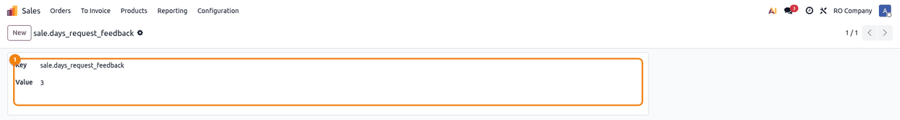
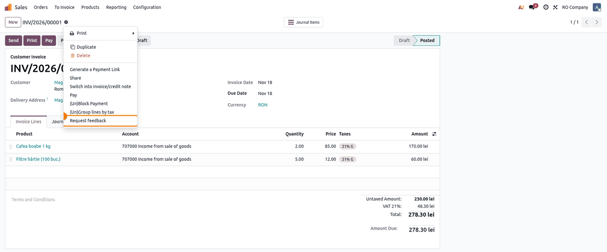
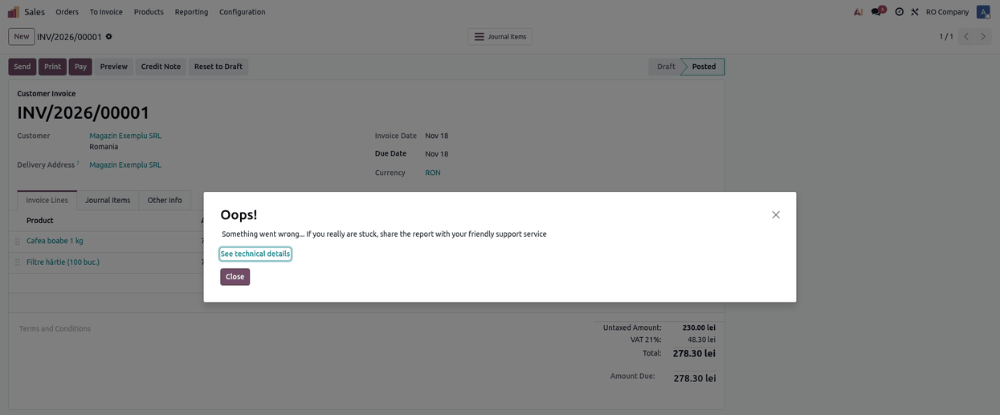

=============
Sale Feedback
=============

..
   !!!!!!!!!!!!!!!!!!!!!!!!!!!!!!!!!!!!!!!!!!!!!!!!!!!!
   !! This file is generated by oca-gen-addon-readme !!
   !! changes will be overwritten.                   !!
   !!!!!!!!!!!!!!!!!!!!!!!!!!!!!!!!!!!!!!!!!!!!!!!!!!!!
   !! source digest: sha256:5b0af58c0ea26176f2545f1bcae1b7ea458983670890610631897ed83a973340
   !!!!!!!!!!!!!!!!!!!!!!!!!!!!!!!!!!!!!!!!!!!!!!!!!!!!

.. |badge1| image:: https://img.shields.io/badge/maturity-Beta-yellow.png
    :target: https://odoo-community.org/page/development-status
    :alt: Beta
.. |badge2| image:: https://img.shields.io/badge/license-LGPL--3-blue.png
    :target: http://www.gnu.org/licenses/lgpl-3.0-standalone.html
    :alt: License: LGPL-3
.. |badge3| image:: https://img.shields.io/badge/github-dhongu%2Fdeltatech-lightgray.png?logo=github
    :target: https://github.com/dhongu/deltatech/tree/19.0/deltatech_sale_feedback
    :alt: dhongu/deltatech
.. |badge_fisa| image:: https://img.shields.io/badge/-Fi%C8%99%C4%83%20consultant-2ea44f.png
    :target: https://github.com/dhongu/deltatech/blob/19.0/deltatech_sale_feedback/readme/FISA_CONSULTANT.md
    :alt: Fișă consultant

|badge1| |badge2| |badge3| |badge_fisa|

Asks customers to rate the products they bought, by e-mail, a few days
after the invoice.

**Feedback e-mail per invoice.** The *Invoice: request feedback* e-mail
template lists the lines of a customer invoice, each with the product
image, a link to the product page, the quantity and three rating links
(*Satisfied*, *Not satisfied*, *Highly Dissatisfied*). Section and note
lines are shown as headings.

**Rating on the product.** Each product line gets its own rating record
on the product template, so a click on a rating link records the
customer's rating for that product through the standard ``/rate`` page
of Odoo.

**Scheduled sending.** The *Request Feedback* scheduled action (inactive
at install) runs once a day and sends the e-mail for the customer
invoices dated a given number of days ago, 3 by default. The delay is
read from the ``sale.days_request_feedback`` system parameter (*Settings
> Technical > Parameters > System Parameters*).

**Manual sending.** On customer invoices, *Actions > Request feedback*
sends the e-mail for the selected invoices.

**Links on the company website.** When no website domain applies to the
invoice, the links in the feedback e-mail are meant to use the company's
*Website* address instead of ``web.base.url`` (once the sending is
ported to 19.0). The other e-mails are not changed by the module and
keep the standard Odoo base URL.

Limitations
-----------

- On 19.0 the sending does not work: the code still calls
  ``xmlid_to_res_id`` and ``message_post_with_template``, which no
  longer exist in Odoo, so both the scheduled action and *Request
  feedback* stop with an error. The subject, sender, recipient and
  language of the template also use the old ``${...}`` syntax, which is
  no longer rendered.
- The *Email feedback after sale* option and its e-mail template in
  *Sales > Configuration > Settings* are stored but not used: the e-mail
  always uses the module's own template, whatever the option says.
- The scheduled action picks every customer invoice of that date, posted
  or not.

**Table of contents**

.. contents::
   :local:

Usage
=====

**Note:** on 19.0 the sending does not work yet (see *Limitations* in
the description). The steps below show the configuration and the current
behaviour.

1. In **Sales > Configuration > Settings**, section **Invoicing**, tick
   **Email feedback after sale**. The **Email Template Request
   Feedback** field shows the module's template, *Invoice: request
   feedback*. The option is stored but not used by the sending.

   |Sales settings, Invoicing section: Email feedback after sale is
   ticked and Email Template Request Feedback is set to Invoice: request
   feedback|

2. The delay after the invoice date is the
   ``sale.days_request_feedback`` system parameter (**Settings >
   Technical > Parameters > System Parameters**, developer mode), 3 days
   by default.

   |System parameter form with Key sale.days_request_feedback and Value
   3|

3. The **Request Feedback** scheduled action (**Settings > Technical >
   Automation > Scheduled Actions**) runs daily and is inactive at
   install. Once active, it sends the e-mail for the customer invoices
   dated that many days ago, whatever their state.

   |Request Feedback scheduled action on Journal Entry, run daily by
   OdooBot, with the Active toggle off and model.cron_request_feedback()
   in the Code tab|

4. To send it by hand, open a customer invoice, click the **Actions**
   gear and choose **Request feedback** (it also works on several
   invoices selected in the list).

   |Posted customer invoice INV/2026/00001 for Magazin Exemplu SRL with
   the Actions menu open and Request feedback highlighted|

5. On 19.0 this stops with the **Oops!** error dialog and no e-mail is
   sent: the code still calls Odoo functions that no longer exist.

   |The same invoice with the Oops! error dialog: Something went wrong,
   See technical details and Close|

6. The e-mail is the *Invoice: request feedback* template (**Settings >
   Technical > Email > Templates**): per invoice line, the product
   image, a link to the product page, the quantity and the three rating
   links. Its subject, sender, recipient and language still use the old
   ``${...}`` syntax. Previewing it creates an empty rating on each
   product shown.

   |Invoice: request feedback template on Journal Entry, with the
   subject in the old ${...} syntax and the body Dear, Please take a
   moment to rate our products|

.. |Sales settings, Invoicing section: Email feedback after sale is ticked and Email Template Request Feedback is set to Invoice: request feedback| image:: https://raw.githubusercontent.com/dhongu/deltatech/19.0/deltatech_sale_feedback/static/description/en/01_setari_feedback.png

.. |Request Feedback scheduled action on Journal Entry, run daily by OdooBot, with the Active toggle off and model.cron_request_feedback() in the Code tab| image:: https://raw.githubusercontent.com/dhongu/deltatech/19.0/deltatech_sale_feedback/static/description/en/03_actiune_programata.png

.. |Invoice: request feedback template on Journal Entry, with the subject in the old ${...} syntax and the body Dear, Please take a moment to rate our products| image:: https://raw.githubusercontent.com/dhongu/deltatech/19.0/deltatech_sale_feedback/static/description/en/06_sablon_email.png

Changelog
=========

19.0.1.0.10 (2026-11-18)
------------------------

- Consultant sheet (FISA_CONSULTANT.md) and usage page (USAGE.md), with
  screenshots in Romanian and English generated by
  tests/test_screenshots.py.
- Description: the company website address is documented as applying
  only when no website domain applies to the invoice, and only once the
  sending is ported to 19.0.
- Romanian translation: "Șablon" with diacritics in the template field
  labels.

19.0.1.0.9 (2026-11-18)
-----------------------

- Fixed: e-mails sent from any template (for example the AWB e-mail of a
  delivery) failed with *Base URL must be a string*, and the SMS sent
  right after failed on ``/sms/status``. The module read
  ``web.base.url`` from the wrong context key and kept the empty result
  in the parameter cache, so every later call of the same user got no
  base URL.
- The company website now replaces ``web.base.url`` only for the
  feedback e-mail; the other e-mails keep the database base URL, as in
  standard Odoo.

19.0.1.0.8 (2026-11-03)
-----------------------

- Description rewritten after the code: the per-line rating links, the
  scheduled action and the manual *Request feedback* action; the *Email
  feedback after sale* setting is documented as not used.
- Added a Limitations section: on 19.0 the sending fails on Odoo APIs
  that no longer exist.
- Summary and Apps banner no longer promise automatic sending configured
  from the settings.

19.0.1.0.7 (2026-10-09)
-----------------------

- Apps Store banner (banner.json).

19.0.1.0.6 (2026-09-29)
-----------------------

- Own module icon, instead of the generic gears it had.

Bug Tracker
===========

Bugs are tracked on `Terrabit Issues <https://www.terrabit.ro/helpdesk>`_.
In case of trouble, please check there if your issue has already been reported.

Do not contact contributors directly about support or help with technical issues.

Credits
=======

Authors
-------

* Terrabit
* Dorin Hongu

Maintainers
-----------

.. |maintainer-dhongu| image:: https://github.com/dhongu.png?size=40px
    :target: https://github.com/dhongu
    :alt: dhongu

Current maintainer:

|maintainer-dhongu| 

This module is part of the `dhongu/deltatech <https://github.com/dhongu/deltatech/tree/19.0/deltatech_sale_feedback>`_ project on GitHub.

You are welcome to contribute.