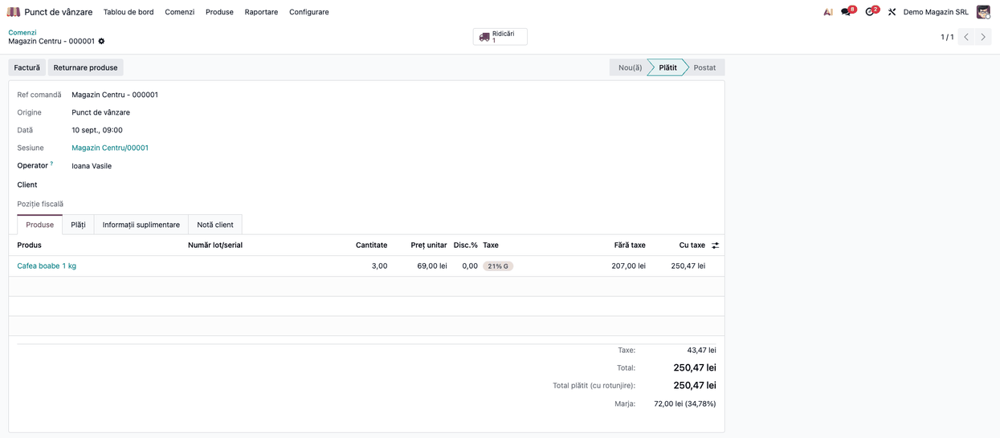
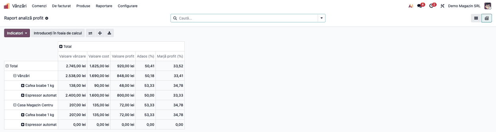
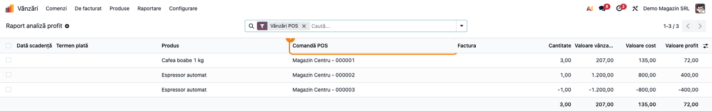

# Fișă Modul: Vânzările POS nefacturate în raportul de profit

**Modul:** `deltatech_sale_margin_pos`
**Utilizator principal:** Manager de vânzări, contabil (analiza profitului), responsabil comisioane
**Prioritate:** 🟢 Scăzută (nu generează note contabile; completează raportul de profit la firmele cu
casă de marcat)

---

## 1. Scop business

La un magazin cu casă de marcat, cele mai multe vânzări sunt **bonuri fără factură**. Odoo le
înregistrează în contabilitate la închiderea sesiunii, într-o singură notă, implicit cumulată pe cont și
TVA. Chiar cu opțiunea *Închidere pe produs*, nota nu leagă costul de vânzare pe produs, deci nu dă
marja. Raportul de analiză a profitului din `deltatech_sale_margin` citește doar facturile, deci
**nu vede vânzările de la casă**: lipsesc și vânzarea, și costul lor, iar profitul magazinului pare
mai mic decât este.

Modulul adaugă în raport **bonurile POS plătite și nefacturate**, linie cu linie, cu produsul,
cantitatea, vânzarea fără TVA și costul mărfii. Bonurile facturate rămân în raport prin factura lor,
deci **nu se numără de două ori**.

## 2. Bază legală și context

Modulul nu are bază legală proprie și nu generează note contabile. Contextul:
- profitul din raport este **marja comercială brută** (vânzare fără TVA minus costul mărfii), în moneda
  companiei: un indicator de gestiune, nu rezultatul contabil;
- bonul fiscal și raportul Z țin de casa de marcat și de modulele fiscale; modulul doar citește
  comenzile POS.

## 3. Utilizatori și roluri

| Rol | Ce face | Drept Odoo |
|---|---|---|
| Manager de vânzări / contabil | consultă raportul de profit, cu vânzările de la casă | grupul **Afișează prețul de achiziție în comanda de vânzare și factura client** (citire) sau rolul **Administrator** pe Vânzări |
| Responsabil comisioane | vede comisionul calculat pe bonuri (cu `deltatech_sale_commission`) | **Vizualizare comisioane** / **Administrator comisioane** |
| Casier | vinde la casă; nu vede raportul | rolul **Utilizator** pe Punct de vânzare |

Rândurile bonurilor sunt **doar pentru citire**: costul, agentul, comisionul real și *Comision plătit*
se pot modifica doar pe liniile de factură.

Roluri recomandate la testare: un manager de vânzări, pentru raport; un casier, ca să verificați că nu
vede raportul.

## 4. Conturi și date implicate

Modulul nu atinge conturi. Datele pe care se bazează:

| Date | Unde | Rol în raport |
|---|---|---|
| Bonul (comanda POS) | *Punct de vânzare → Comenzi → Comenzi* | o linie de raport pe fiecare linie de bon plătit (stare *Plătit* sau *Postat*), fără factură |
| Vânzarea | linia bonului, fără TVA | convertită în moneda companiei; retururile au cantitate și valoare negative |
| Costul | linia bonului | costul calculat de POS la închiderea sesiunii (din livrare, la produsele FIFO/medii); cât sesiunea e deschisă, costul curent al produsului |
| Data | data bonului | ziua, în fusul orar al casierului |
| Agentul | responsabilul bonului (*Operator*) | gruparea pe agent și ratele de comision |
| Jurnalul | jurnalul comenzilor casei (implicit *Point of Sale*, cod POSS) | gruparea pe jurnal |
| Ratele de comision | jurnalul de **facturi** al casei | cu `deltatech_sale_commission`, rata responsabilului bonului pe acest jurnal |

Date minime pentru demo (folosite și în capturi), compania **Demo Magazin SRL**, casa **Magazin
Centru** (jurnalul comenzilor redenumit *Casa Magazin Centru*), casiera **Ioana Vasile**, produse cu TVA
21 %. Raportul arată vânzarea **fără TVA**: bonul 000001 are 207,00 fără TVA și 250,47 cu TVA.

| Document | Produs | Vânzare | Cost | Profit | În raport |
|---|---|---|---|---|---|
| Factură client | 2 × Espressor automat la 1.200 | 2.400 | 1.600 | 800 | prin factură |
| Bon 000001 | 3 × Cafea boabe 1 kg la 69 | 207 | 135 | 72 | **da** |
| Bon 000002 | 1 × Espressor automat | 1.200 | 800 | 400 | **da** |
| Bon 000003 (retur) | −1 × Espressor automat | −1.200 | −800 | −400 | **da** |
| Bon 000004, facturat | 2 × Cafea boabe 1 kg | 138 | 90 | 48 | doar prin factura lui |

## 5. Configurare inițială

1. Instalați `deltatech_sale_margin_pos` (dependențe: `deltatech_sale_margin` și `point_of_sale`).
   Modulul **nu se instalează automat**: schimbă cifrele raportului, deci se instalează doar la cerere.
2. Verificați drepturile pe raport (secțiunea 3).
3. Cu `deltatech_sale_commission`: dacă vreți comision calculat pe bonuri, adăugați în *Vânzări →
   Configurare → Comisioane agenți* un rând pe casier și pe **jurnalul de facturi al casei**. Îl găsiți
   în *Punct de vânzare → Configurare → Setări*, cu casa aleasă în antet, blocul **Contabilitate**,
   rândul *Default Journals* (netradus în Odoo), câmpul **Facturi** (de obicei *Facturi clienți*). Jurnalul comenzilor (POSS)
   e de tip *Diverse* și nu poate fi ales pe o rată de comision.

## 6. Flux de utilizare

### Pasul 1 — Bonul de la casă, fără factură

Casiera vinde la casă și încasează. În **Punct de vânzare → Comenzi → Comenzi**, bonul apare *Plătit*
(sau *Postat*, după închiderea sesiunii), fără factură. Pe demo: bonul **Magazin Centru - 000001**, 3 ×
Cafea boabe 1 kg la 69,00 fără TVA, total 207,00 fără TVA și 250,47 cu TVA, marjă 72,00.

Nu e nimic de făcut în plus: bonul intră singur în raport, cu linia lui.



### Pasul 2 — Raportul de profit, cu vânzările de la casă

Accesați **Vânzări → Raportare → Raport analiză profit** și grupați rândurile pe **Jurnal**, apoi pe
**Produs** (în pivot, pe antetul *Total*).

1. **Găsiți pe ecran** — sub jurnalul de vânzări sunt facturile, sub jurnalul comenzilor casei (pe demo,
   *Casa Magazin Centru*) sunt bonurile nefacturate; pe fiecare rând, **Valoare vânzare**, **Valoare cost**, **Valoare
   profit**, **Adaos (%)** și **Marjă profit (%)**.
2. **Verificați**, pe demo:
   - la jurnalul casei, Cafea boabe 1 kg: vânzare 207,00, cost 135,00, profit 72,00;
   - la jurnalul casei, Espressor automat: 0,00 — vânzarea de 1.200,00 și returul ei se anulează;
   - bonul facturat (2 × Cafea, 138,00) apare **o singură dată**, la jurnalul de vânzări, prin factura
     lui, nu și la casă;
   - totalul: 2.745,00 vânzare, 1.825,00 cost, 920,00 profit.
3. **Treceți mai departe** — **Introduceți în foaia de calcul** sau exportul (⬇) scot tabelul în
   Excel.

Raportul se deschide pe luna trecută, grupat pe agent și produs; capturile sunt fără filtrul de dată,
ca să apară și bonul facturat azi. Pe demo sesiunea e încă deschisă, deci costul bonurilor este costul
curent al produsului.



### Pasul 3 — Doar vânzările de la casă

În același raport, treceți pe vizualizarea **listă**, scoateți din bara de căutare grupările implicite
(*Agent de vânzări*, *Produs*) și filtrul de dată, apoi alegeți filtrul **Vânzări POS** (meniul
filtrelor). Filtrul **Facturi** arată doar liniile de factură. Rândurile bonurilor au starea plății
*Plătit*, deci intră la filtrul **Plătit**.

1. **Găsiți pe ecran** — coloana **Comandă POS** arată bonul fiecărui rând; **Cantitate**, **Valoare
   vânzare**, **Valoare cost**, **Valoare profit**.
2. **Verificați**, pe demo:
   - trei rânduri, câte unul pe linie de bon nefacturat;
   - returul (000003) are cantitate −1,00 și valori negative;
   - bonul facturat (000004) **nu** apare;
   - totalul: 207,00 vânzare, 135,00 cost, 72,00 profit.
3. **Treceți mai departe** — gruparea **Comandă POS** (meniul *Grupare după*) adună liniile pe bon.

Rândurile bonurilor nu se pot modifica: orice salvare pe ele e refuzată („În raportul de profit se pot
modifica doar liniile de factură.”).



### Note de monografie și raportare

Modulul **nu generează note contabile** și nu schimbă nota de închidere a sesiunii POS. Vânzarea și
costul bonurilor sunt înregistrate de Odoo în **nota de închidere a sesiunii**:
- vânzarea: `Dr 5311` (numerar) sau `5125` (card), prin creanța POS 4111, `= Cr 707`
  (sau 701 la produsele finite, după contul de venit al categoriei) `+ Cr 4427` (TVA 21 %);
- costul, la produsele stocabile cu inventar permanent: `Dr 607 = Cr 371`, calculat din livrările
  sesiunii și înregistrat în aceeași notă.

La gestiunea ținută la preț de vânzare (371 cu adaos și TVA neexigibilă), descărcarea include și 378 și
4428. Raportul doar arată aceste sume pe produs; profitul lui este un indicator de gestiune.

## 7. Legături cu alte module / declarații

| Modul / proces | Rol în flux | Tip legătură |
|---|---|---|
| `deltatech_sale_margin` | raportul de profit, la care se adaugă bonurile | dependență (manifest) |
| `point_of_sale` | bonurile, sesiunile, costul la închiderea sesiunii | dependență (manifest) |
| `deltatech_sale_commission` | ratele de comision ale responsabilului bonului pe jurnalul de facturi al casei (comision calculat, informativ, vizibil în raport, nu în lista *Comision*) | opțional |

**Ce e automat:** includerea bonurilor plătite și nefacturate; excluderea celor facturate; costul din
sesiunea închisă; conversia în moneda companiei; ziua bonului în fusul orar al casierului.

**Ce rămâne manual:** instalarea modulului; ratele de comision pe jurnalul casei, dacă e cazul.

## 8. Verificări pentru consultant

- [ ] Un bon plătit, nefacturat, apare în raport cu filtrul **Vânzări POS**, cu bonul în coloana
      **Comandă POS**.
- [ ] Un bon facturat apare o singură dată, prin factura lui (filtrul **Facturi**), nu și la **Vânzări
      POS**.
- [ ] Un retur are cantitatea și valorile negative.
- [ ] Cu sesiunea deschisă, costul e costul curent al produsului; după închiderea sesiunii, costul
      calculat de POS.
- [ ] Un bon emis după miezul nopții (de exemplu la 01:00, ora României) apare în ziua lui, nu în ziua
      precedentă.
- [ ] Salvarea unui rând de bon e refuzată; **Marchează plătit** și asistenții de comision și de cost
      ignoră rândurile bonurilor.
- [ ] Cu `deltatech_sale_commission` și un rând de rată pe casier și pe jurnalul de facturi al casei,
      bonul are *Comision calculat* = rată × profit (în raport, nu în lista *Comision*).
- [ ] Un casier (*Punct de vânzare / Utilizator*) nu vede raportul.

## 9. Mesaje de eroare frecvente

| Mesaj / simptom | Cauză probabilă | Remediere |
|---|---|---|
| „În raportul de profit se pot modifica doar liniile de factură.” | S-a încercat salvarea unui rând de bon | Rândurile bonurilor sunt doar pentru citire |
| Bonurile nu apar în raport | Modulul nu e instalat, bonul nu e plătit sau e facturat | Instalați modulul; un bon facturat apare prin factură |
| Costul bonului este costul curent din fișa produsului | Sesiunea POS e încă deschisă | Închideți sesiunea; costul se recalculează din livrare |
| *Comision calculat* gol pe bonuri | Casierul nu are rând de rată pe jurnalul de facturi al casei | Adăugați rândul în *Comisioane agenți* |
| Bonurile de după miezul nopții apar în ziua precedentă | Casierul nu are fus orar setat (se ia UTC) | Setați fusul orar în preferințele casierului |

## 10. Capturi de ecran

Capturile (`static/description/`) se generează automat din `tests/test_screenshots.py`, cu mixinul
`ScreenshotCase` din `l10n_ro_doc_screenshots` (import defensiv). Sunt în **limba română**, pe compania
**Demo Magazin SRL**, cu planul de conturi RO și datele demo din secțiunea 4.

| # | Fișier | Conținut |
|---|---|---|
| 1 | `01_bon_pos_nefacturat.png` | Bonul **Magazin Centru - 000001**, plătit, fără factură |
| 2 | `02_raport_profit_pe_jurnal.png` | **Raport analiză profit** (pivot) grupat pe jurnal și produs: facturi și casa *Casa Magazin Centru* |
| 3 | `03_vanzari_pos_in_raport.png` | Lista raportului cu filtrul **Vânzări POS** și coloana **Comandă POS** |

Regenerare:

```bash
./odoo/odoo-bin -c odoo.conf -d <db> -i deltatech_sale_margin_pos,l10n_ro,l10n_ro_doc_screenshots \
    --test-tags=/deltatech_sale_margin_pos:TestSaleMarginPosScreenshots --stop-after-init \
    --http-port=8987 --gevent-port=8988
```

## 11. Observații pentru manual

Explicați de ce bonurile lipseau din raport (nota de închidere a sesiunii e cumulată, fără produs) și
că acum apar linie cu linie, fără dubluri cu facturile. Insistați pe două lucruri: costul real vine la
**închiderea sesiunii**, deci raportul unei zile cu sesiunea încă deschisă e provizoriu; și rândurile
bonurilor sunt **doar pentru citire**.

### Limitări cunoscute

- **Costul cât sesiunea e deschisă** este costul curent al produsului, nu costul livrării.
- **Comisionul real** nu se calculează pe bonuri: bonurile au doar comision calculat (informativ).
- **Bonurile neplătite sau anulate** nu intră în raport.
- **Rândurile bonurilor** au mereu starea plății *Plătit*: intră la filtrul **Plătit** și ies la
  **Deschise**.
