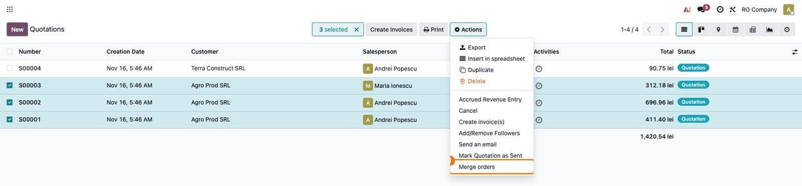
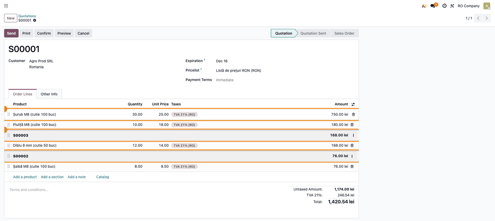
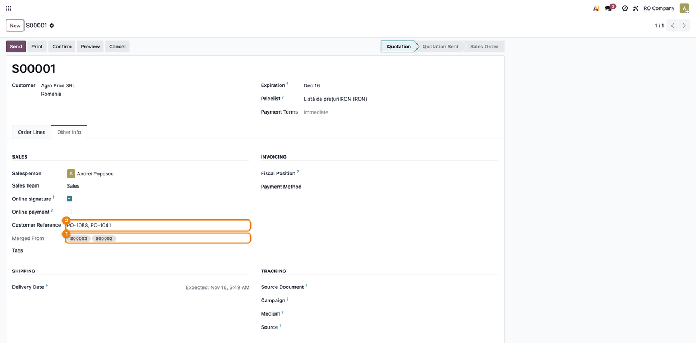
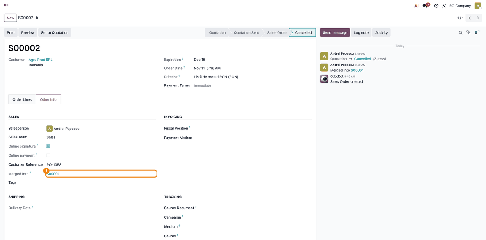

==========
Sale Merge
==========

..
   !!!!!!!!!!!!!!!!!!!!!!!!!!!!!!!!!!!!!!!!!!!!!!!!!!!!
   !! This file is generated by oca-gen-addon-readme !!
   !! changes will be overwritten.                   !!
   !!!!!!!!!!!!!!!!!!!!!!!!!!!!!!!!!!!!!!!!!!!!!!!!!!!!
   !! source digest: sha256:0746d484b6c05f8c0774c725274a8df266fd3b15fe88c87e126adfc3a1996b88
   !!!!!!!!!!!!!!!!!!!!!!!!!!!!!!!!!!!!!!!!!!!!!!!!!!!!

.. |badge1| image:: https://img.shields.io/badge/maturity-Beta-yellow.png
    :target: https://odoo-community.org/page/development-status
    :alt: Beta
.. |badge2| image:: https://img.shields.io/badge/license-LGPL--3-blue.png
    :target: http://www.gnu.org/licenses/lgpl-3.0-standalone.html
    :alt: License: LGPL-3
.. |badge3| image:: https://img.shields.io/badge/github-dhongu%2Fdeltatech-lightgray.png?logo=github
    :target: https://github.com/dhongu/deltatech/tree/20.0/deltatech_sale_merge
    :alt: dhongu/deltatech
.. |badge_fisa| image:: https://img.shields.io/badge/-Fi%C8%99%C4%83%20consultant-2ea44f.png
    :target: https://github.com/dhongu/deltatech/blob/20.0/deltatech_sale_merge/readme/FISA_CONSULTANT.md
    :alt: Fișă consultant
.. |badge_tests| image:: https://img.shields.io/badge/-16%20automated%20tests-2ea44f.png
    :target: https://github.com/dhongu/deltatech/tree/20.0/deltatech_sale_merge/tests
    :alt: 16 automated tests

|badge1| |badge2| |badge3| |badge_fisa| |badge_tests|

Merges several quotations of the same customer into one, from the
quotations list.

Select two or more quotations, choose *Actions > Merge orders* and pick
the target: the oldest selected quotation, one of the selected ones, or
a new quotation. Identical lines (same product, description, unit of
measure, price, discount, taxes and analytic distribution) can be added
up, or all lines can be kept. The merged quotations are cancelled, not
deleted, and linked to the target; the chatter of each one records what
happened.

The merge stops with a clear message, and nothing is changed, if the
quotations differ in company, customer or its addresses, currency,
pricelist, fiscal position, payment terms, warehouse (when Inventory is
installed) or incoterm, or if one was already signed or has an online
payment started.

**Table of contents**

.. contents::
   :local:

Usage
=====

1. Go to *Sales > Orders > Quotations*, remove the *My Quotations*
   filter if you also want to see your colleagues' quotations, and tick
   two or more quotations of the same customer. Open the *Actions* menu
   and choose *Merge orders*.

   |Quotations list with three quotations of the customer Agro Prod SRL
   ticked and the Actions menu open on the Merge orders entry|

2. Choose where to merge (*The oldest selected quotation*, *A selected
   quotation* or *A new quotation*) and how to treat the lines (*Add up
   identical lines* or *Keep all lines*). Tick *Add a Section per
   Quotation* to add a section with the number of each merged quotation
   before the lines copied from it. Lines that are added up into an
   existing line keep no trace of their origin. If the salespersons or
   sales teams differ, a warning tells you that the target quotation's
   value is kept.

   |Merge orders window with the warning about a different salesperson,
   the Merge Into and Lines options and the Add a Section per Quotation
   box ticked|

3. Click *Merge*. If the quotations differ in an important way (for
   example the customer), a message explains why and nothing is changed.

   |Invalid Operation message: the quotations cannot be merged, Customer
   is different, listing S00004 Terra Construct SRL and S00001 Agro Prod
   SRL|

4. Otherwise the target quotation opens with the merged lines.

   |Target quotation with the added-up lines Șurub M8 30 and Piuliță M8
   10, followed by a section per merged quotation|

   On the *Other Info* tab, *Merged From* lists the cancelled
   quotations, and *Customer Reference* and *Source Document* gather the
   values of all the merged quotations.

   |Other Info tab of the target quotation with the Customer Reference
   PO-1058, PO-1041 and the Merged From field|

5. The other quotations are cancelled, not deleted. Each shows *Merged
   Into* on the *Other Info* tab and a note in the chatter.

   |Cancelled quotation with the Merged Into field pointing to the
   target quotation and the chatter note Merged into S00001|

When identical lines are added up, the unit price may be recomputed by
the pricelist for the new quantity (quantity breaks).

.. |Merge orders window with the warning about a different salesperson, the Merge Into and Lines options and the Add a Section per Quotation box ticked| image:: https://raw.githubusercontent.com/dhongu/deltatech/20.0/deltatech_sale_merge/static/description/en/02_wizard_unire.png
.. |Invalid Operation message: the quotations cannot be merged, Customer is different, listing S00004 Terra Construct SRL and S00001 Agro Prod SRL| image:: https://raw.githubusercontent.com/dhongu/deltatech/20.0/deltatech_sale_merge/static/description/en/03_blocaj_client_diferit.png

Changelog
=========

19.0.1.0.0
----------

- Add: wizard *Merge orders* on the quotations list, with target
  (oldest, selected or new), add up or keep lines, optional section per
  quotation, and links *Merged Into* / *Merged From* on the cancelled
  quotations.
- Add: consultant sheet with screenshots, English usage guide with
  screenshots and demo GIF.

Bug Tracker
===========

Bugs are tracked on `Terrabit Issues <https://www.terrabit.ro/helpdesk>`_.
In case of trouble, please check there if your issue has already been reported.

Do not contact contributors directly about support or help with technical issues.

Credits
=======

Authors
-------

* Terrabit
* Dorin Hongu

Maintainers
-----------

.. |maintainer-dhongu| image:: https://github.com/dhongu.png?size=40px
    :target: https://github.com/dhongu
    :alt: dhongu

Current maintainer:

|maintainer-dhongu| 

This module is part of the `dhongu/deltatech <https://github.com/dhongu/deltatech/tree/20.0/deltatech_sale_merge>`_ project on GitHub.

You are welcome to contribute.