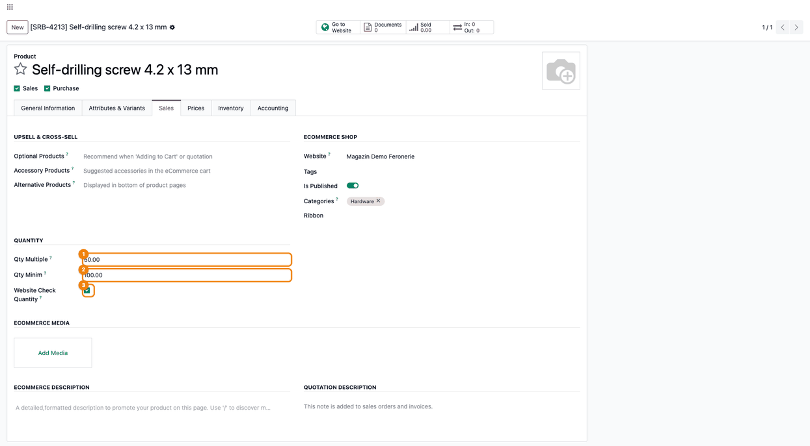
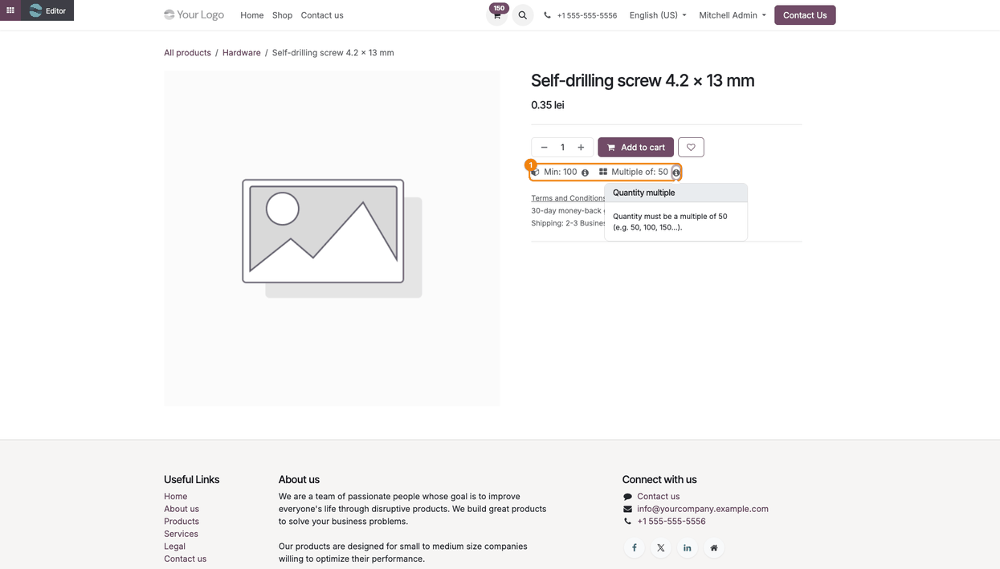
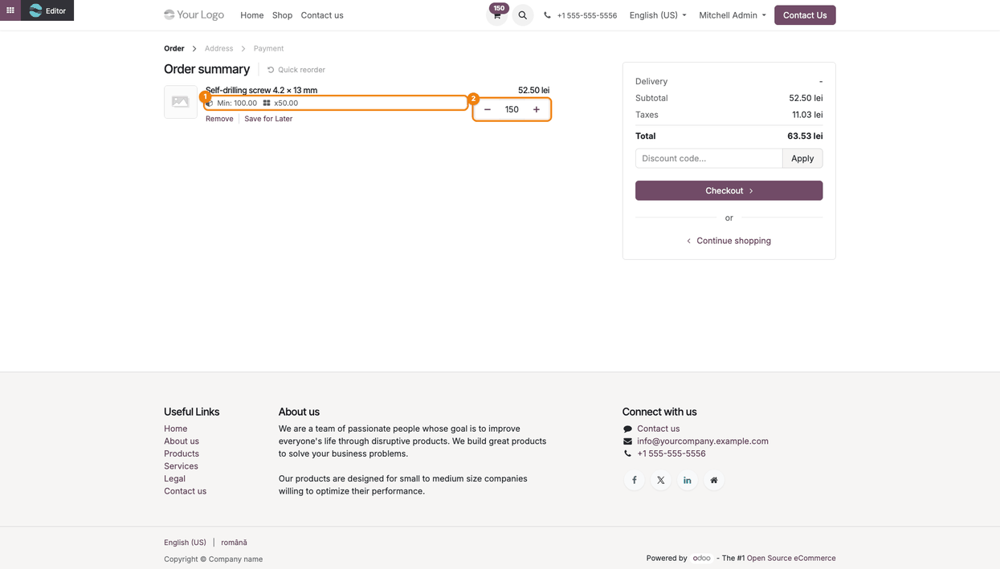
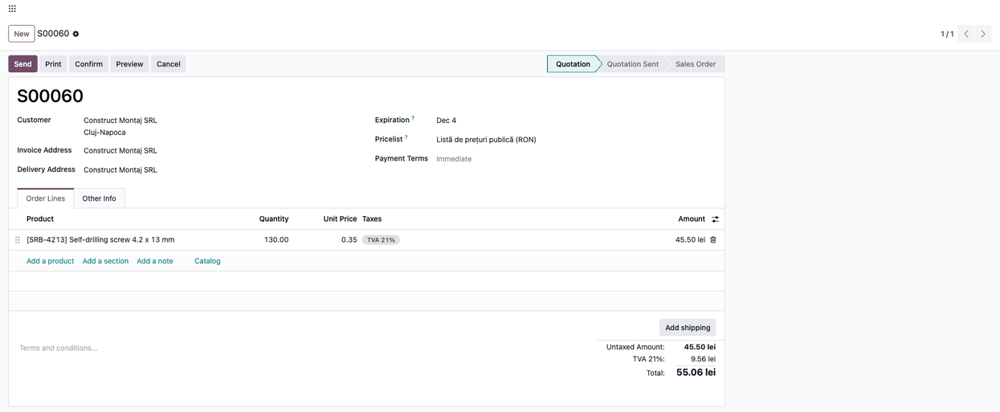

======================
eCommerce Qty Multiple
======================

..
   !!!!!!!!!!!!!!!!!!!!!!!!!!!!!!!!!!!!!!!!!!!!!!!!!!!!
   !! This file is generated by oca-gen-addon-readme !!
   !! changes will be overwritten.                   !!
   !!!!!!!!!!!!!!!!!!!!!!!!!!!!!!!!!!!!!!!!!!!!!!!!!!!!
   !! source digest: sha256:6e03174b78c69d3b84ea97c4b99e42fb8ff36b2b2bf92ed900d214048203bc0f
   !!!!!!!!!!!!!!!!!!!!!!!!!!!!!!!!!!!!!!!!!!!!!!!!!!!!

.. |badge1| image:: https://img.shields.io/badge/maturity-Beta-yellow.png
    :target: https://odoo-community.org/page/development-status
    :alt: Beta
.. |badge2| image:: https://img.shields.io/badge/license-LGPL--3-blue.png
    :target: http://www.gnu.org/licenses/lgpl-3.0-standalone.html
    :alt: License: LGPL-3
.. |badge3| image:: https://img.shields.io/badge/github-dhongu%2Fdeltatech-lightgray.png?logo=github
    :target: https://github.com/dhongu/deltatech/tree/20.0/deltatech_sale_multiple_website
    :alt: dhongu/deltatech
.. |badge_fisa| image:: https://img.shields.io/badge/-Fi%C8%99%C4%83%20consultant-2ea44f.png
    :target: https://github.com/dhongu/deltatech/blob/20.0/deltatech_sale_multiple_website/readme/FISA_CONSULTANT.md
    :alt: Fișă consultant

|badge1| |badge2| |badge3| |badge_fisa|

Extends sale quantity multiples to eCommerce. Product minimum and
multiple quantities can be enforced only for website carts or globally,
and the active restrictions are displayed on product and cart pages.

Cart quantities are normalized before Odoo checks stock. If stock
availability caps a request, the cart falls back to the greatest
available quantity that still satisfies both rules. Variant changes
refresh the displayed restrictions.

**Table of contents**

.. contents::
   :local:

Usage
=====

1. Open the product (*Website > eCommerce > Products > Products*), tab
   **Sales**. In the **Quantity** group, set **Qty Multiple** (for
   example 50) and **Qty Minim** (for example 100). Keep **Website Check
   Quantity** ticked to apply the rules only to website orders, or
   untick it to apply them to backend quotations too. Save the product.

   |Product form, Sales tab: Qty Multiple 50.00 (1), Qty Minim 100.00
   (2) and Website Check Quantity (3)|

2. On the product page of the shop, the restrictions are shown under the
   add to cart button (**Min: 100**, **Multiple of: 50**); the info icon
   explains each rule. For products with variants, the restrictions
   follow the selected variant.

   |The product page in the shop: the restrictions Min: 100 and Multiple
   of: 50 (1), with the explanation of the multiple open|

3. In the cart, the quantity is rounded up to the minimum and then to
   the next multiple: 130 units requested become 150. The rules are
   recalled under the product name.

   |The cart: the rules Min: 100.00 and x50.00 under the product (1) and
   the quantity 150 (2), rounded up from 130|

   When the available stock caps the quantity, the cart keeps the
   greatest quantity that fits in stock and still respects both rules;
   below the minimum, the product is not added.

4. With **Website Check Quantity** ticked, a quotation entered in the
   backend keeps the typed quantity (130 stays 130). Untick it to round
   backend quotations as well. Orders coming from the website keep the
   rules when edited in the backend.

   |A backend quotation: the line keeps Quantity 130.00, because the
   rule applies only to the website|

**Website Check Quantity** is ticked by default, so after installation
every product applies its rules only on the website. For products with
several variants, set the rules on each variant.

Changelog
=========

20.0.1.1.3 (2026-11-04)
-----------------------

- Migration to Odoo 20.0: the product page restrictions follow the new
  ``ProductPage`` interaction, the combination info hook is
  ``_get_additional_combination_info``, and "Website Check Quantity" is
  edited on the variant form (the variant easy-edit form no longer
  exists in Odoo 20).

19.0.1.1.3 (2026-10-18)
-----------------------

- Fix "Could not destroy interaction QuantityInfoPopover" when entering
  the website editor after changing a variant: the cleanup disposed a
  popover already replaced on combination change.

19.0.1.1.2 (2026-10-09)
-----------------------

- Apps Store banner (banner.json).

19.0.1.1.1 (2026-09-29)
-----------------------

- Own module icon, instead of the generic gears it had.

Bug Tracker
===========

Bugs are tracked on `Terrabit Issues <https://www.terrabit.ro/helpdesk>`_.
In case of trouble, please check there if your issue has already been reported.

Do not contact contributors directly about support or help with technical issues.

Credits
=======

Authors
-------

* Terrabit
* Dorin Hongu

Maintainers
-----------

.. |maintainer-dhongu| image:: https://github.com/dhongu.png?size=40px
    :target: https://github.com/dhongu
    :alt: dhongu

Current maintainer:

|maintainer-dhongu| 

This module is part of the `dhongu/deltatech <https://github.com/dhongu/deltatech/tree/20.0/deltatech_sale_multiple_website>`_ project on GitHub.

You are welcome to contribute.