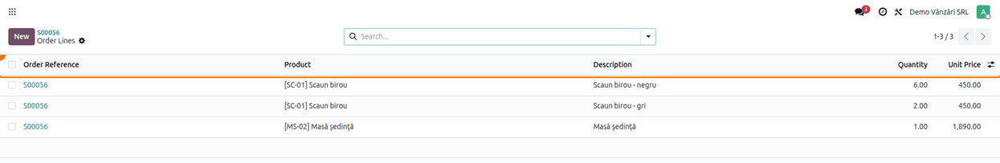
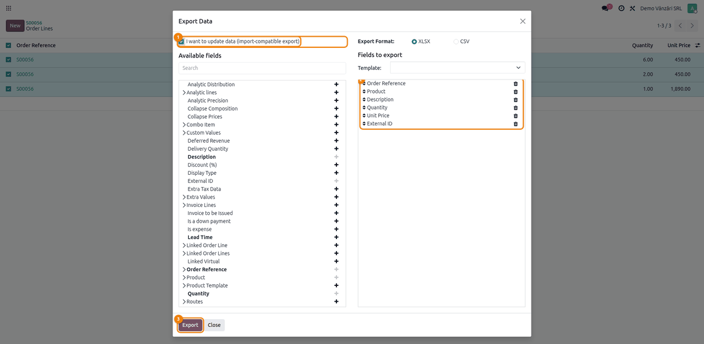
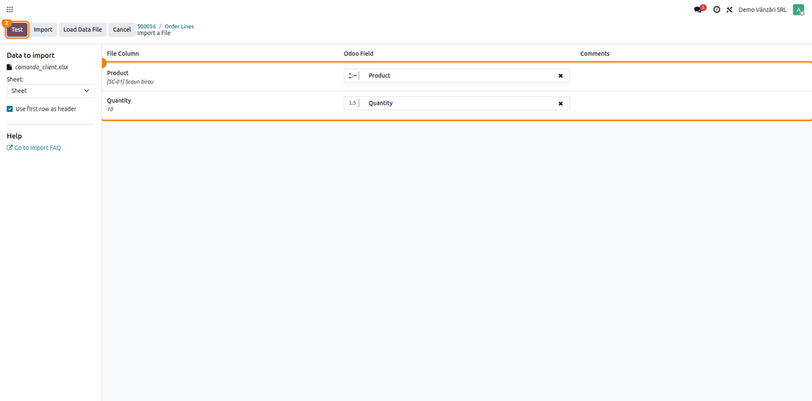
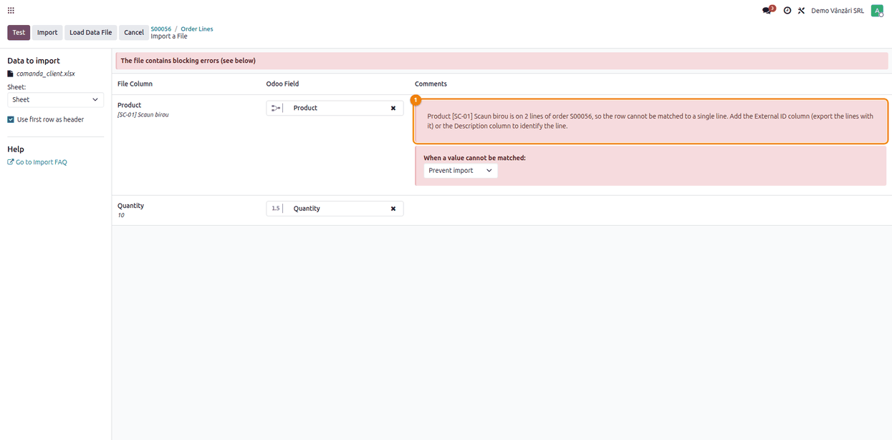
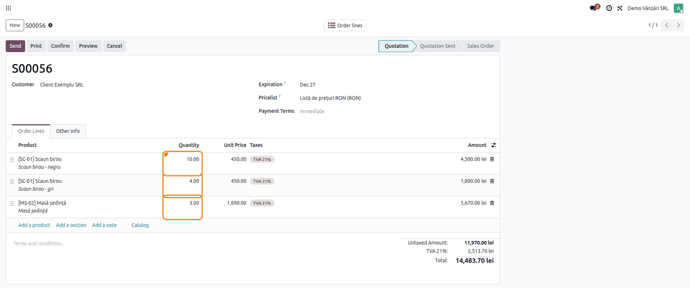

========
Sale XLS
========

..
   !!!!!!!!!!!!!!!!!!!!!!!!!!!!!!!!!!!!!!!!!!!!!!!!!!!!
   !! This file is generated by oca-gen-addon-readme !!
   !! changes will be overwritten.                   !!
   !!!!!!!!!!!!!!!!!!!!!!!!!!!!!!!!!!!!!!!!!!!!!!!!!!!!
   !! source digest: sha256:1123b349ae789d9587cf4d3469b3ec099cb2322d1b7388c8e8d20fedb6d9e52a
   !!!!!!!!!!!!!!!!!!!!!!!!!!!!!!!!!!!!!!!!!!!!!!!!!!!!

.. |badge1| image:: https://img.shields.io/badge/maturity-Mature-brightgreen.png
    :target: https://odoo-community.org/page/development-status
    :alt: Mature
.. |badge2| image:: https://img.shields.io/badge/github-dhongu%2Fdeltatech-lightgray.png?logo=github
    :target: https://github.com/dhongu/deltatech/tree/19.0/deltatech_sale_xls
    :alt: dhongu/deltatech
.. |badge_fisa| image:: https://img.shields.io/badge/-Fi%C8%99%C4%83%20consultant-2ea44f.png
    :target: https://github.com/dhongu/deltatech/blob/19.0/deltatech_sale_xls/readme/FISA_CONSULTANT.md
    :alt: Fișă consultant
.. |badge_tests| image:: https://img.shields.io/badge/-21%20automated%20tests%20%C2%B7%2098%25%20code%20coverage-2ea44f.png
    :target: https://app.codecov.io/gh/dhongu/deltatech/tree/19.0/deltatech_sale_xls
    :alt: 21 automated tests · 98% code coverage

|badge1| |badge2| |badge_fisa| |badge_tests|

Customers often send their order, or the changes to it, as a
spreadsheet. This module lets the salesperson export the lines of a
sales order to Excel and import them back into the same order, with the
standard Odoo export and import tools.

**Order lines button**: the **Order lines** smart button on the sales
order opens the list of its lines (**Order Lines**: order, product,
description, quantity, unit price). From this list the lines are
exported with the standard **Export**, and a file is loaded with
**Import records**; the imported lines go into this order.

**Import into an empty order**: when the order has no lines yet, every
row of the file becomes a new line of the order.

**Import into an order with lines**: when the order already has lines,
each row updates the existing line with the same product (quantity,
price and the other imported columns). The product is recognized by the
internal reference between square brackets (``[CODE] Name``, as in the
export) or, failing that, by its exact name. Rows with a product that is
not found or is not on the order are skipped. A row that has the **ID**
(or **External ID**) column filled in updates exactly that line, and two
rows with the same ID are an error, as is an ID that is not a line of
this order (a line deleted after the export, or the file of another
order). When the product is on several lines, the **Description** column
picks the line; if the row still matches several lines, or the file has
more rows for a product than the order has lines, the import stops with
an error on that row instead of updating an arbitrary line. The lines
named by an ID are taken first, so each line of the order is updated by
one row at most.

**Price formula hook**: the ``use_specific_price_formula`` method is
called on the imported unit prices of a new order, so a
customer-specific module can apply its own price rule.

Limitations
-----------

- When the order already has lines, a row for a new product is skipped
  without a message; it cannot add a line.
- If the order has two lines with the same product and the same
  description, the file must have the **ID** column (export the lines
  with it) to update them.
- Without the **Order lines** button, the order is read from the first
  row of the **Order Reference** column, by its reference (``S00039``)
  or its database id.

**Table of contents**

.. contents::
   :local:

Usage
=====

1. Open the sales order (**Sales > Orders > Quotations** or **Orders**)
   and click the **Order lines** smart button. It opens the **Order
   Lines** list of this order only.

   |Quotation form with the product [SC-01] Scaun birou on two lines,
   described Scaun birou - negru and Scaun birou - gri, and the Order
   lines button highlighted|

   |Order Lines list of the quotation with the columns Order Reference,
   Product, Description, Quantity and Unit Price|

2. To send the lines to the customer, select all the lines and click
   **Actions > Export**. Tick **I want to update data (import-compatible
   export)**, add the **External ID** field (**Description** is already
   listed), remove the two **Analytic lines/...** fields and click
   **Export**. In this mode the file headers are the technical field
   names (``id``, ``product_id``, ``name``, ``product_uom_qty``...): the
   customer changes only the values. The ``id`` column links each row to
   its line, even when the product is on several lines.

   |Export Data dialog in import-compatible mode, with Description and
   External ID among the fields to export and no analytic fields|

3. To load the customer's file, open the gear menu next to the **Order
   Lines** title, choose **Import records** and upload the file. Check
   that each file column is matched with the right Odoo field (Product,
   Quantity, Description...), then click **Test**.

   |Import a File screen with the Product and Quantity columns of the
   customer file matched to the Product and Quantity fields|

4. **Test** changes nothing. If a product is on several lines of the
   order and the file has neither the External ID nor a Description that
   picks the line, the test stops with an error next to the Product
   column. Import the file exported with the External ID, or add the
   Description column, and test again.

   |Import test error: the product is on 2 lines of the order, so the
   row cannot be matched to a single line|

5. Click **Import**. Each row updates its line, and the order totals are
   recomputed.

   |Quotation after the import: the two chair lines have the quantities
   10 and 4 and the table line 3|

How the rows are matched when the order already has lines:

- a row with an **External ID** (or database **ID**) updates exactly
  that line; two rows with the same ID, or an ID that is not a line of
  this order (deleted line, file of another order), are an error;
- otherwise the row updates the line with the same product, among the
  lines not taken by another row; when the product is on several of
  them, the **Description** column picks the line;
- a row that still matches several lines, or a product with more rows
  than order lines, is reported as an error and the order is not
  changed;
- a row with a product that is not on the order is skipped.

When the order has no lines yet, every row of the file becomes a new
line of the order.

.. |Quotation form with the product [SC-01] Scaun birou on two lines, described Scaun birou - negru and Scaun birou - gri, and the Order lines button highlighted| image:: https://raw.githubusercontent.com/dhongu/deltatech/19.0/deltatech_sale_xls/static/description/en/01_comanda_buton_linii.png

Changelog
=========

19.0.1.0.5 (2026-11-27)
-----------------------

- [FIX] Import into an order with lines no longer crashes with
  ``Expected singleton`` when the product is on several lines (#3510).
  The rows keep their ID / External ID when the file has them; otherwise
  the description narrows the match, and a row that still matches
  several lines, or a product with more rows than lines, is reported as
  an import error (next to the Product column of the import screen)
  instead of being assigned to an arbitrary line.
- [FIX] The lines named by an External ID are taken before the rows
  without ID, and two rows with the same ID are an error, so a line is
  updated by one row at most. An ID that is not a line of the order
  (deleted after the export, or from another order's file) is an error
  too, instead of creating a line or changing the other order.
- [FIX] The order read from the **Order Reference** column (import
  without the **Order lines** button) is found by its reference or
  database id; the text ``39`` no longer opened orders 3 and 9.
- The **Order Lines** list shows the **Description** column.
- Consultant sheet (``readme/FISA_CONSULTANT.md``), ``readme/USAGE.md``
  and screenshots generated by ``tests/test_screenshots.py``; the
  **Order lines** button and the **Order Lines** list are translated in
  Romanian.

19.0.1.0.4 (2026-11-03)
-----------------------

- Description and banner rewritten after the code: the lines open from
  the **Order lines** smart button in a separate list, not in a section
  of the form; the import loads sales order lines, not purchase lines;
  documented how existing lines are matched and updated.

19.0.1.0.3
----------

- Add unit tests covering the order lines action and the Excel import
  preprocessing of sale order lines (update existing lines, add lines to
  an empty order, order taken from the order_id column).

19.0.1.0.2
----------

- Own module icon, instead of the generic gears it had.

19.0.1.0.1
----------

- [FIX] ``sale.order.line.load()`` raised ``AttributeError`` when
  importing without ``default_order_id``/``active_id`` in context
  (``fields.index`` is a list method, not a dict)
- [FIX] iterating over ``data`` while calling ``data.remove(record)``
  skipped the record right after a removed one, so some unmatched lines
  silently passed validation

Bug Tracker
===========

Bugs are tracked on `Terrabit Issues <https://www.terrabit.ro/helpdesk>`_.
In case of trouble, please check there if your issue has already been reported.

Do not contact contributors directly about support or help with technical issues.

Credits
=======

Authors
-------

* Terrabit
* Voicu Stefan

Maintainers
-----------

.. |maintainer-dhongu| image:: https://github.com/dhongu.png?size=40px
    :target: https://github.com/dhongu
    :alt: dhongu
.. |maintainer-VoicuStefan2001| image:: https://github.com/VoicuStefan2001.png?size=40px
    :target: https://github.com/VoicuStefan2001
    :alt: VoicuStefan2001

Current maintainers:

|maintainer-dhongu| |maintainer-VoicuStefan2001| 

This module is part of the `dhongu/deltatech <https://github.com/dhongu/deltatech/tree/19.0/deltatech_sale_xls>`_ project on GitHub.

You are welcome to contribute.