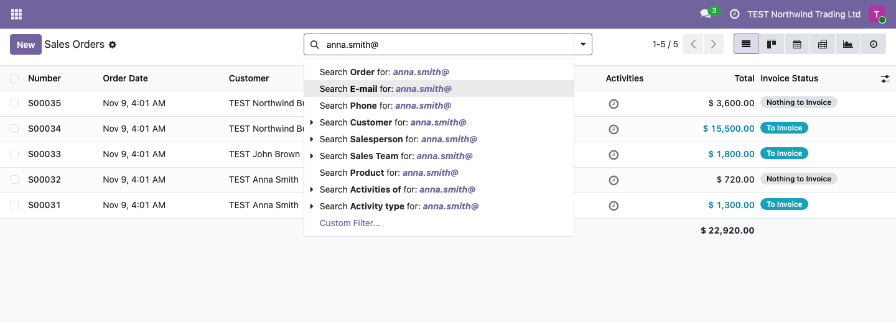
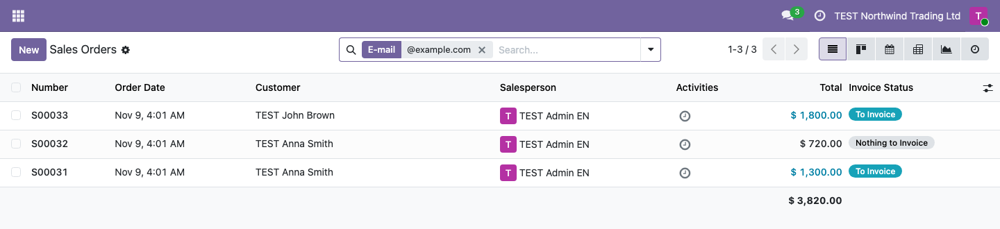
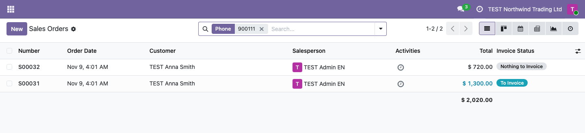

1. Open **Sales > Orders > Orders** (or **Quotations**). Type an e-mail address, or part of it, in
   the search bar and choose **Search E-mail for: ...**.

   

2. The list keeps the orders whose customer has an e-mail containing the text. A common part, such as
   the domain `@example.com`, finds the orders of every customer on that domain.

   

3. To search by phone, type the number or part of it and choose **Search Phone for: ...**. The text is
   matched as typed, so a short fragment without spaces or prefix finds the most variants.

   
