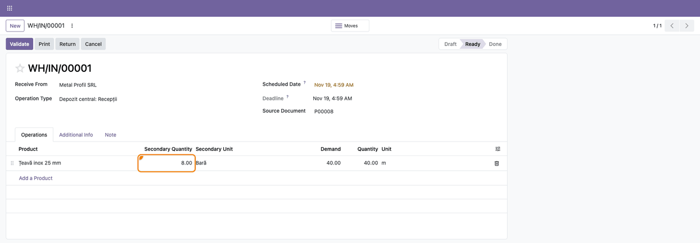

=====================
Product Secondary UoM
=====================

..
   !!!!!!!!!!!!!!!!!!!!!!!!!!!!!!!!!!!!!!!!!!!!!!!!!!!!
   !! This file is generated by oca-gen-addon-readme !!
   !! changes will be overwritten.                   !!
   !!!!!!!!!!!!!!!!!!!!!!!!!!!!!!!!!!!!!!!!!!!!!!!!!!!!
   !! source digest: sha256:139a3dfd2363ff507271cf475900e048e6dce357547768494921b87beb0fc25a
   !!!!!!!!!!!!!!!!!!!!!!!!!!!!!!!!!!!!!!!!!!!!!!!!!!!!

.. |badge1| image:: https://img.shields.io/badge/maturity-Beta-yellow.png
    :target: https://odoo-community.org/page/development-status
    :alt: Beta
.. |badge2| image:: https://img.shields.io/badge/github-dhongu%2Fdeltatech-lightgray.png?logo=github
    :target: https://github.com/dhongu/deltatech/tree/20.0/deltatech_secondary_uom
    :alt: dhongu/deltatech
.. |badge_fisa| image:: https://img.shields.io/badge/-Fi%C8%99%C4%83%20consultant-2ea44f.png
    :target: https://github.com/dhongu/deltatech/blob/20.0/deltatech_secondary_uom/readme/FISA_CONSULTANT.md
    :alt: Fișă consultant
.. |badge_tests| image:: https://img.shields.io/badge/-14%20automated%20tests%20%C2%B7%2092%25%20code%20coverage-2ea44f.png
    :target: https://app.codecov.io/gh/dhongu/deltatech/tree/20.0/deltatech_secondary_uom
    :alt: 14 automated tests · 92% code coverage

|badge1| |badge2| |badge_fisa| |badge_tests|

This module adds **product specific conversion factors** between units
of measure, following the SAP material master (MARM) pattern.

In standard Odoo the conversion factor belongs to the unit of measure
itself, so "1 box = 12 units" is global. With this module the factor is
defined **per product**, on the *Alternative Units* tab of the product
form:

- ``3 m² = 4 Units`` — each piece covers 0.75 m²
- ``1 kg = 2 Units`` — each piece weighs 0.5 kg

The stock is always kept in the product **base unit**. On sale order
lines, purchase order lines and stock moves the user can enter the
quantity in an alternative unit (kg, m², ...) and the line quantity is
computed automatically — and vice versa: changing the line quantity
updates the secondary quantity.

The **price always stays in the base unit**: the secondary quantity is
only an input/information helper, it never affects pricing, invoicing or
stock valuation.

Unlike creating dedicated UoM records per product, this approach keeps
the global UoM table clean and does not affect standard reports, stock
valuation or any code reading ``uom.factor`` directly in SQL. The other
side of this choice is that prices, received quantities, stock and
manufacturing stay in the base unit: see *Use Cases / Context* for the
limitations and for the standard alternative when the alternative unit
must be a real unit.

**Table of contents**

.. contents::
   :local:

Use Cases / Context
===================

Limitations
-----------

The secondary quantity is an input and information helper on the line.
The document itself stays in the line unit (usually the product base
unit), so the alternative unit does not reach:

- **Prices.** The unit price stays per line unit. A vendor price of 120
  per bar of 6 m must be entered as 20 per m, and the vendor pricelist
  cannot be expressed in bars. When the factor does not divide the price
  exactly (125 / 6 = 20.8333), the vendor bill and the received
  e-Invoice (in bars) can differ by rounding.
- **Received quantity.** On the receipt, the secondary column shows the
  demand, computed from the ordered quantity, not the quantity actually
  received. A short delivery of 8 bars out of 10 is entered as 48 m.
  Detailed operations and the Barcode app have no secondary unit.
- **Stock.** Stock and stock reports are only in the base unit; the
  quantity on hand is never shown in bars.
- **Manufacturing.** The module does not depend on ``mrp``: bills of
  materials and manufacturing orders have no secondary unit, and the
  consumption is in the base unit. Cutting, offcuts and bar remnants are
  not handled.
- **Rounding.** A quantity entered in the secondary unit is rounded
  **up** to a whole base unit only when the base unit counts pieces (the
  reference tree of *Units*). For continuous units (m, kg, m²) the exact
  quantity is kept.

Do not use the alternative unit as the line unit
------------------------------------------------

The conversion factor lives only in this module. If the generic unit
(e.g. “Bar”) is added to the product packagings, to a bill of materials
line or to a vendor pricelist line, Odoo converts it with the **global**
factor of the unit, not with the product factor, and no error is raised.

When the bar must be a real unit
--------------------------------

When the price, the receipt or the bill of materials must be in the
alternative unit, use a real unit of measure per factor instead of this
module, with standard Odoo:

1. Create one unit per distinct factor, with the base unit as reference
   unit: “Bar 6 m” (reference unit ``m``, ratio 6), “Bar 5 m” (reference
   unit ``m``, ratio 5). Products with the same bar length share the
   same unit.
2. Add the unit to the *Packagings* of each product (``uom_ids``).
3. Map the UNECE code of each such unit (``deltatech_uom_unece``),
   otherwise e-Invoicing declares ``C62`` (piece).
4. To keep the order unit on receipts and deliveries, enable the system
   parameter ``stock.propagate_uom``; it applies to all products.

Overriding ``uom.uom._compute_quantity`` with the product in the context
is not enough to obtain the same result: stock valuation at receipt
(``purchase_stock``), the purchase price, the sale, purchase and invoice
SQL reports and the product catalog in JS use ``uom.factor`` directly.

Generating these units automatically from the product factor lines is a
possible future evolution of this module.

Usage
=====

Enable **Units of Measure** in *Inventory → Configuration → Settings*
and create the alternative unit (e.g. **Bar**) in *Inventory →
Configuration → Units & Packagings*, without a reference unit: its
factor is set on each product, not on the unit.

1. Open the product (*Inventory → Products → Products*), tab
   **Alternative Units**, and add a line: **Alternative Quantity** 1,
   **Alternative Unit** Bar, **Base Quantity** 6. It reads "1 Bar = 6
   m"; **Base Unit** shows the product unit.

   |Alternative Units tab of the product Profil aluminiu 40x40: one line
   with Alternative Quantity 1, Alternative Unit Bar, Base Quantity 6
   and Base Unit m|

2. The same unit can have another factor on another product: on the
   stainless pipe, 1 Bar = 5 m.

   |Alternative Units tab of the product Țeavă inox 25 mm: one line with
   Alternative Quantity 1, Alternative Unit Bar, Base Quantity 5 and
   Base Unit m|

3. On a sale order line, choose **Secondary Unit** Bar and type 10 in
   **Secondary Quantity**: the line quantity becomes 60 m. Both columns
   are hidden by default; show them from the optional columns button of
   the lines list. The unit price stays per metre.

   |Sale order to Construct Vest SRL: the Profil aluminiu 40x40 line
   with Secondary Quantity 10 and Secondary Unit Bar, quantity 60 in m
   and the price per metre|

4. On a purchase order line, 8 Bar of pipe give 40 m. The price is per
   metre: a vendor price of 100 per 5 m bar is entered as 20 per metre.

   |Purchase order to Metal Profil SRL: the Țeavă inox 25 mm line with
   Secondary Quantity 8 and Secondary Unit Bar, quantity 40 in m and
   unit price 20 per metre|

5. The receipt (and the delivery of a sale order) keeps the secondary
   unit of the order line. The secondary quantity of the move is
   computed from the **Demand**; the quantity actually received is
   entered in the **Quantity** column, in the base unit. Do not edit the
   secondary quantity on a receipt: it changes the demand, not the
   received quantity.

   |Receipt of the purchase order: the Țeavă inox 25 mm move with
   Secondary Quantity 8 and Secondary Unit Bar, demand 40 m|

Stock, prices, invoices and stock valuation stay in the product base
unit. See *Use Cases / Context* for the limitations and for the standard
alternative (one real unit per factor) when the price, the receipt or
the bill of materials must be in bars.

.. |Alternative Units tab of the product Profil aluminiu 40x40: one line with Alternative Quantity 1, Alternative Unit Bar, Base Quantity 6 and Base Unit m| image:: https://raw.githubusercontent.com/dhongu/deltatech/20.0/deltatech_secondary_uom/static/description/en/01_produs_unitati_alternative.png
.. |Alternative Units tab of the product Țeavă inox 25 mm: one line with Alternative Quantity 1, Alternative Unit Bar, Base Quantity 5 and Base Unit m| image:: https://raw.githubusercontent.com/dhongu/deltatech/20.0/deltatech_secondary_uom/static/description/en/02_produs_b_unitati_alternative.png
.. |Sale order to Construct Vest SRL: the Profil aluminiu 40x40 line with Secondary Quantity 10 and Secondary Unit Bar, quantity 60 in m and the price per metre| image:: https://raw.githubusercontent.com/dhongu/deltatech/20.0/deltatech_secondary_uom/static/description/en/03_comanda_vanzare_bare.png
.. |Purchase order to Metal Profil SRL: the Țeavă inox 25 mm line with Secondary Quantity 8 and Secondary Unit Bar, quantity 40 in m and unit price 20 per metre| image:: https://raw.githubusercontent.com/dhongu/deltatech/20.0/deltatech_secondary_uom/static/description/en/04_comanda_achizitie_bare.png

Changelog
=========

20.0.1.2.5 (2026-11-24)
-----------------------

- Demo GIF for the Apps Store page recorded again: each screen opens
  through its menu, so the top bar shows Sales and Inventory.

20.0.1.2.4 (2026-11-19)
-----------------------

- A sale order line, purchase order line or stock move created with only
  the secondary quantity (API, import) gets its quantity before the
  amounts are computed: the line subtotal no longer stays at quantity 1
  (#4246).

20.0.1.2.3 (2026-11-19)
-----------------------

- A quantity entered in the secondary unit is rounded up to a whole base
  unit only when the base unit counts pieces. For metres, kilograms or
  square metres the exact quantity is kept: with 1 bar = 5.8 m, 3 bars
  now give 17.4 m instead of 18 m (#4242).

20.0.1.2.2 (2026-11-19)
-----------------------

- Documented the limitations of the secondary unit (prices, received
  quantities, stock, manufacturing, rounding) and the standard
  alternative of one real unit per factor ("Bar 6 m").
- Sale order lines: the *Secondary Quantity* and *Secondary Unit*
  columns are placed before the quantity column again; on 20.0 they were
  rendered inside another cell of the lines list.
- Consultant sheet, usage guide with screenshots and demo GIF.
- Romanian translation of the "alternative unit must be different"
  error.

20.0.1.2.1 (2026-10-09)
-----------------------

- Apps Store banner (banner.json).

19.0.1.2.0 (2026-10-01)
-----------------------

- Creating, editing or deleting a product unit conversion now recomputes
  the secondary quantity of the open sale order lines, purchase order
  lines and stock moves using it. Locked or cancelled orders and done or
  cancelled moves keep the quantity computed with the previous ratio.

19.0.1.1.1 (2026-09-29)
-----------------------

- Own module icon, instead of the generic gears it had.

19.0.1.1.0 (2026-08-06)
-----------------------

- Quantities entered in a secondary unit are rounded **up** to whole
  base units (no fractional pieces); the secondary quantity is
  recomputed from the rounded piece count.
- The secondary unit is propagated from the sale order line to the
  delivery move and from the purchase order line to the receipt move.

19.0.1.0.0 (2026-08-06)
-----------------------

- Initial version: product UoM conversion table (SAP MARM style),
  secondary quantity/unit on sale order lines, purchase order lines and
  stock moves.

Bug Tracker
===========

Bugs are tracked on `Terrabit Issues <https://www.terrabit.ro/helpdesk>`_.
In case of trouble, please check there if your issue has already been reported.

Do not contact contributors directly about support or help with technical issues.

Credits
=======

Authors
-------

* Terrabit
* Dorin Hongu

Maintainers
-----------

.. |maintainer-dhongu| image:: https://github.com/dhongu.png?size=40px
    :target: https://github.com/dhongu
    :alt: dhongu

Current maintainer:

|maintainer-dhongu| 

This module is part of the `dhongu/deltatech <https://github.com/dhongu/deltatech/tree/20.0/deltatech_secondary_uom>`_ project on GitHub.

You are welcome to contribute.