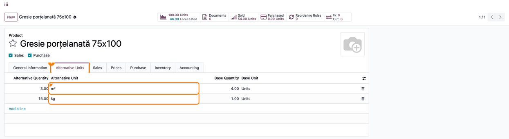
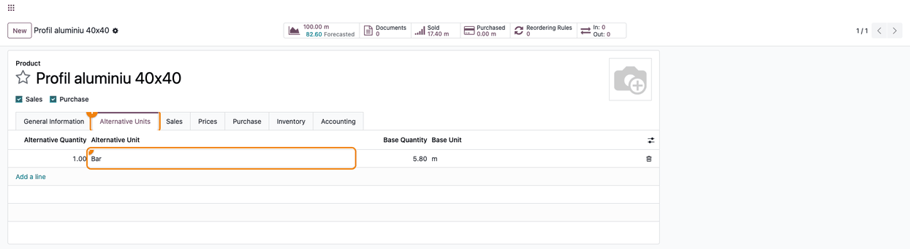
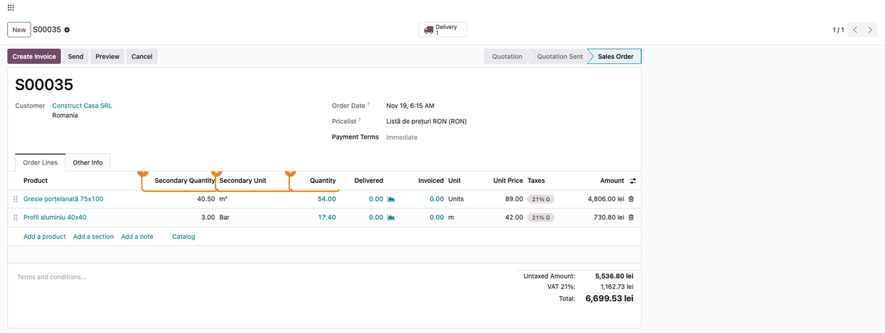
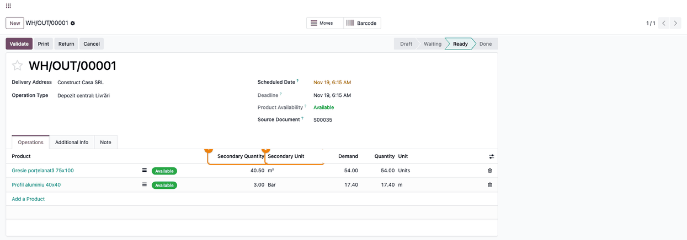
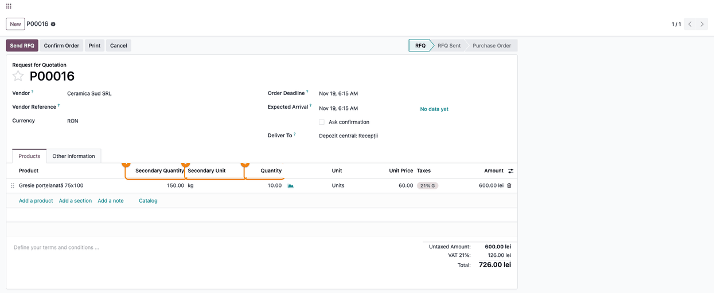

=====================
Product Secondary UoM
=====================

..
   !!!!!!!!!!!!!!!!!!!!!!!!!!!!!!!!!!!!!!!!!!!!!!!!!!!!
   !! This file is generated by oca-gen-addon-readme !!
   !! changes will be overwritten.                   !!
   !!!!!!!!!!!!!!!!!!!!!!!!!!!!!!!!!!!!!!!!!!!!!!!!!!!!
   !! source digest: sha256:139a3dfd2363ff507271cf475900e048e6dce357547768494921b87beb0fc25a
   !!!!!!!!!!!!!!!!!!!!!!!!!!!!!!!!!!!!!!!!!!!!!!!!!!!!

.. |badge1| image:: https://img.shields.io/badge/maturity-Beta-yellow.png
    :target: https://odoo-community.org/page/development-status
    :alt: Beta
.. |badge2| image:: https://img.shields.io/badge/github-dhongu%2Fdeltatech-lightgray.png?logo=github
    :target: https://github.com/dhongu/deltatech/tree/19.0/deltatech_secondary_uom
    :alt: dhongu/deltatech
.. |badge_fisa| image:: https://img.shields.io/badge/-Fi%C8%99%C4%83%20consultant-2ea44f.png
    :target: https://github.com/dhongu/deltatech/blob/19.0/deltatech_secondary_uom/readme/FISA_CONSULTANT.md
    :alt: Fișă consultant
.. |badge_tests| image:: https://img.shields.io/badge/-23%20automated%20tests%20%C2%B7%2091%25%20code%20coverage-2ea44f.png
    :target: https://app.codecov.io/gh/dhongu/deltatech/tree/19.0/deltatech_secondary_uom
    :alt: 23 automated tests · 91% code coverage

|badge1| |badge2| |badge_fisa| |badge_tests|

This module adds **product specific conversion factors** between units
of measure, following the SAP material master (MARM) pattern.

In standard Odoo 19 the conversion factor belongs to the unit of measure
itself, so "1 box = 12 units" is global. With this module the factor is
defined **per product**, on the *Alternative Units* tab of the product
form:

- ``3 m² = 4 Units`` — each piece covers 0.75 m²
- ``1 kg = 2 Units`` — each piece weighs 0.5 kg

The stock is always kept in the product **base unit**. On sale order
lines, purchase order lines and stock moves the user can enter the
quantity in an alternative unit (kg, m², ...) and the line quantity is
computed automatically — and vice versa: changing the line quantity
updates the secondary quantity.

The **price always stays in the base unit**: the secondary quantity is
only an input/information helper, it never affects pricing, invoicing or
stock valuation.

Unlike creating dedicated UoM records per product, this approach keeps
the global UoM table clean and does not affect standard reports, stock
valuation or any code reading ``uom.factor`` directly in SQL.

**Table of contents**

.. contents::
   :local:

Usage
=====

Define the conversions on the product
-------------------------------------

Open the product (**Inventory → Products → Products**) and go to the
**Alternative Units** tab. Each line says how many alternative units
correspond to how many base units, for example **3 m² = 4 Units** for a
tile kept in pieces, or **15 kg = 1 Units**. The **Base Unit** column is
the product unit, filled in automatically. A product has at most one
conversion per alternative unit, and the alternative unit must differ
from the base unit.

|Alternative Units tab of a tile kept in Units, with the lines 3 m² = 4
Units and 15 kg = 1 Units|

A product kept in a continuous unit works the same way: an aluminium
profile kept in **m** has the line **1 Bar = 5.8 m**. A unit that does
not exist yet (such as **Bar**) is created first in **Inventory →
Configuration → Products → Units & Packagings**. A counting unit that
will be the base unit of products (Bag, Roll, Box) must be created with
the **Units** reference, otherwise it is treated as a continuous unit
and quantities are not rounded up to whole pieces.

|Alternative Units tab of a profile kept in m, with the line 1 Bar = 5.8
m|

Enter the quantity in the secondary unit
----------------------------------------

On a quotation (**Sales → Orders → Quotations**), show the **Secondary
Quantity** and **Secondary Unit** columns from the optional columns menu
of the order lines (they are hidden by default). On each line, choose
the **Secondary Unit** among the product conversions, type the
**Secondary Quantity** and save: the line **Quantity** is computed in
the base unit when the order is saved.

- For a product kept in pieces, the quantity is rounded **up** to whole
  pieces: 40 m² of tiles give 54 Units, and the secondary quantity is
  realigned to 40.50 m².
- For a product kept in a continuous unit (m, kg, m²), the exact
  quantity is kept: 3 bars of 5.8 m give 17.40 m.

The unit price and the amounts stay in the base unit.

|Sales order with the Secondary Quantity and Secondary Unit columns:
tiles 40.50 m² for 54.00 Units, profile 3.00 Bar for 17.40 m|

Deliveries and receipts
-----------------------

The secondary unit follows the order on the delivery or the receipt. On
the **Operations** tab of the transfer, the same two optional columns
show the secondary quantity computed from the move quantity.

|Delivery of the order, Operations tab with the secondary quantity of
each move|

Purchase order lines work the same way: 150 kg of tiles give 10.00
Units.

|Request for quotation with the tiles entered in kg: 150.00 in Secondary
Quantity and 10.00 Units in Quantity|

Changelog
=========

19.0.1.2.3 (2026-11-19)
-----------------------

- A quantity entered in the secondary unit is rounded up to a whole base
  unit only when the base unit counts pieces. For metres, kilograms or
  square metres the exact quantity is kept: with 1 bar = 5.8 m, 3 bars
  now give 17.4 m instead of 18 m (#4242).
- A line created with a quantity in the secondary unit now gets its
  amounts (subtotal, taxes, total) from the computed line quantity.
  Before, the line subtotal kept the value of quantity 1, while the
  order total was right (#4247).
- Consultant sheet (FISA_CONSULTANT.md) with screenshots and demo GIF.

19.0.1.2.2 (2026-10-17)
-----------------------

- A secondary quantity entered on a line expressed in a coarser unit
  (e.g. Dozens for a product in Units) is now rounded **up** in the line
  unit, so the line covers the requested quantity, and the secondary
  quantity is recomputed from the final line quantity. Before, the line
  was rounded half-up and could represent less than the secondary
  quantity shown on sale order lines, purchase order lines and stock
  moves.

19.0.1.2.1 (2026-10-09)
-----------------------

- Apps Store banner (banner.json).

19.0.1.2.0 (2026-10-01)
-----------------------

- Creating, editing or deleting a product unit conversion now recomputes
  the secondary quantity of the open sale order lines, purchase order
  lines and stock moves using it. Locked or cancelled orders and done or
  cancelled moves keep the quantity computed with the previous ratio.

19.0.1.1.1 (2026-09-29)
-----------------------

- Own module icon, instead of the generic gears it had.

19.0.1.1.0 (2026-08-06)
-----------------------

- Quantities entered in a secondary unit are rounded **up** to whole
  base units (no fractional pieces); the secondary quantity is
  recomputed from the rounded piece count.
- The secondary unit is propagated from the sale order line to the
  delivery move and from the purchase order line to the receipt move.

19.0.1.0.0 (2026-08-06)
-----------------------

- Initial version: product UoM conversion table (SAP MARM style),
  secondary quantity/unit on sale order lines, purchase order lines and
  stock moves.

Bug Tracker
===========

Bugs are tracked on `Terrabit Issues <https://www.terrabit.ro/helpdesk>`_.
In case of trouble, please check there if your issue has already been reported.

Do not contact contributors directly about support or help with technical issues.

Credits
=======

Authors
-------

* Terrabit
* Dorin Hongu

Maintainers
-----------

.. |maintainer-dhongu| image:: https://github.com/dhongu.png?size=40px
    :target: https://github.com/dhongu
    :alt: dhongu

Current maintainer:

|maintainer-dhongu| 

This module is part of the `dhongu/deltatech <https://github.com/dhongu/deltatech/tree/19.0/deltatech_secondary_uom>`_ project on GitHub.

You are welcome to contribute.