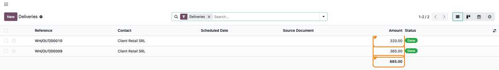
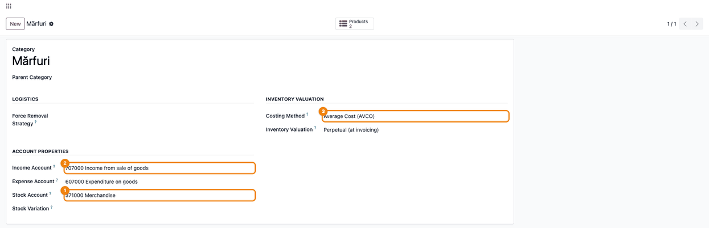
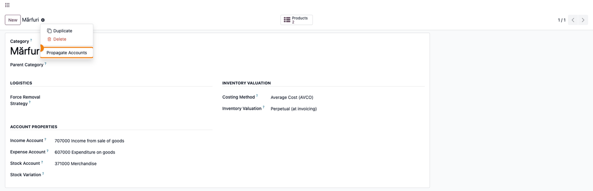
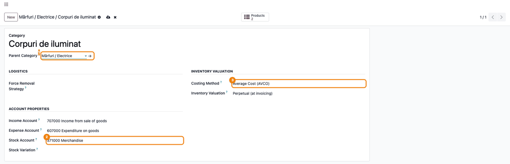
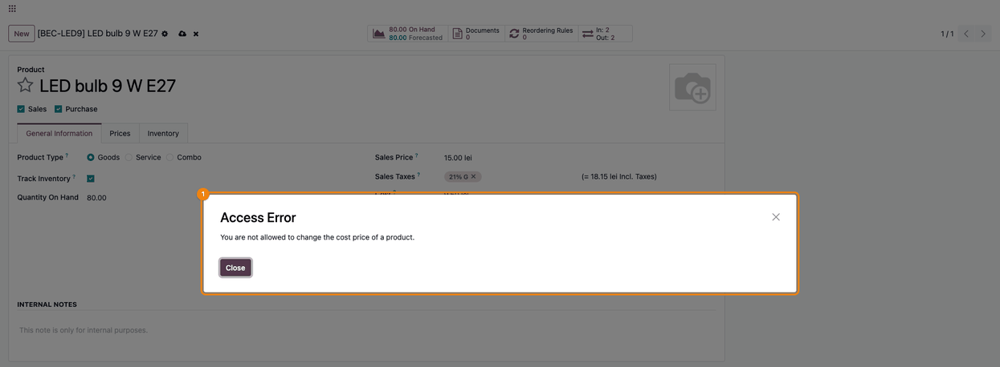
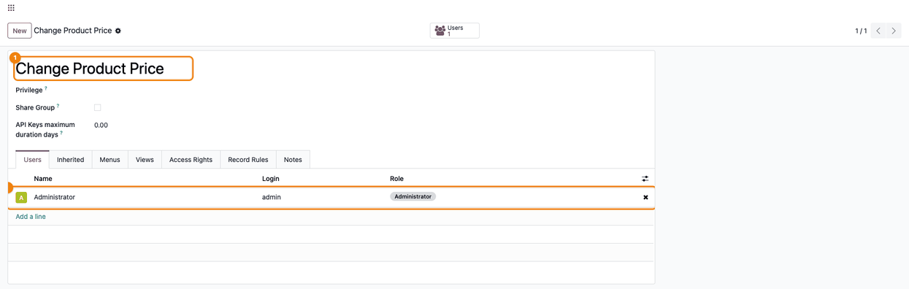

=======================
Stock Account Extension
=======================

..
   !!!!!!!!!!!!!!!!!!!!!!!!!!!!!!!!!!!!!!!!!!!!!!!!!!!!
   !! This file is generated by oca-gen-addon-readme !!
   !! changes will be overwritten.                   !!
   !!!!!!!!!!!!!!!!!!!!!!!!!!!!!!!!!!!!!!!!!!!!!!!!!!!!
   !! source digest: sha256:8b7f6a8b4264a5a849221c98e069ed37574eedbeac1807cb96d9af43f57608c8
   !!!!!!!!!!!!!!!!!!!!!!!!!!!!!!!!!!!!!!!!!!!!!!!!!!!!

.. |badge1| image:: https://img.shields.io/badge/maturity-Production%2FStable-green.png
    :target: https://odoo-community.org/page/development-status
    :alt: Production/Stable
.. |badge2| image:: https://img.shields.io/badge/github-dhongu%2Fdeltatech-lightgray.png?logo=github
    :target: https://github.com/dhongu/deltatech/tree/20.0/deltatech_stock_account
    :alt: dhongu/deltatech
.. |badge_fisa| image:: https://img.shields.io/badge/-Fi%C8%99%C4%83%20consultant-2ea44f.png
    :target: https://github.com/dhongu/deltatech/blob/20.0/deltatech_stock_account/readme/FISA_CONSULTANT.md
    :alt: Fișă consultant
.. |badge_tests| image:: https://img.shields.io/badge/-10%20automated%20tests-2ea44f.png
    :target: https://github.com/dhongu/deltatech/tree/20.0/deltatech_stock_account/tests
    :alt: 10 automated tests

|badge1| |badge2| |badge_fisa| |badge_tests|

Small additions to stock valuation: the value of each transfer in the
transfers list, accounting settings passed from a product category to
its subcategories, and control over who may change the cost of a product
that is in stock.

**Value of transfers.** Adds an **Amount** column to the transfers list
(for example *Inventory > Operations > Transfers > Receipts*), with the
total at the bottom. The amount is the sum of the valuation **Value** of
the stock moves of the transfer; moves that are not valued (for example
internal transfers) count as zero.

**Accounts propagated to subcategories.** When the **Stock Account** of
a product category is changed, the category's accounting settings are
copied to all its subcategories: **Income Account**, **Expense
Account**, **Stock Account**, **Price Difference Account**, **Stock
Journal**, **Costing Method** and **Inventory Valuation**. The same copy
can be run at any time with the **Propagate Accounts** action on the
category form (developer mode).

**Settings inherited from the parent category.** When you choose a
**Parent Category** on a category, the same accounting settings are
copied from the parent.

**Cost changes restricted.** Only users in the **Change Product Price**
group can change the **Cost** of a product that has quantity on hand.
Other users get an access error. The administrator is in the group by
default.

Configuration
-------------

Add users to the **Change Product Price** group in \*Settings > Users &
Companies

   Groups\* (developer mode).

Limitations
-----------

- The value of a transfer is shown only in the transfers list, not on
  the transfer form.
- The **Stock Variation Account** of the category is not propagated.

**Table of contents**

.. contents::
   :local:

Usage
=====

1. Open *Inventory > Operations > Transfers > Receipts*. The **Amount**
   column shows the valuation value of each receipt and the total at the
   bottom. A receipt that is not validated yet is worth 0.00.

   |Receipts list: the Amount column shows 0.00 for the Ready receipt,
   400.00 and 1,300.00 for the Done ones, with the total 1,700.00|

2. The same column in *Deliveries* shows the cost of the goods that left
   the stock, not the sales price.

   |Deliveries list: the Amount column shows 320.00 and 365.00 for the
   Done deliveries, with the total 685.00|

3. Open the top product category (*Inventory > Configuration > Products
   > Product Categories*), set **Income Account**, **Expense Account**,
   **Costing Method** and **Inventory Valuation**, then set **Stock
   Account** and save. Saving a new **Stock Account** copies all these
   settings to every subcategory.

   |The Mărfuri (goods) category: Stock Account 371000, Income Account
   707000 and Costing Method Average Cost (AVCO) highlighted|

4. Check a subcategory: it now has the same accounts, costing method and
   inventory valuation.

   |The Becuri (bulbs) subcategory, under Mărfuri / Electrice: Stock
   Account 371000 and Costing Method Average Cost (AVCO) copied from
   Mărfuri|

5. When you change another setting of the top category, copy the
   settings again with the gear icon > **Propagate Accounts** (developer
   mode).

   |The gear menu of the category form, with the Propagate Accounts
   action highlighted|

6. On a new category, choosing a **Parent Category** fills in the
   accounting settings of the parent.

   |A new category with Parent Category selected: Stock Account and
   Costing Method filled in from the parent|

7. A user who is not in the **Change Product Price** group cannot change
   the **Cost** of a product that has quantity on hand: saving shows an
   **Access Error**.

   |The product form of a product with 80.00 on hand: the Access Error
   dialog says the user is not allowed to change the cost price|

8. Manage who may change the cost in *Settings > Users & Companies >
   Groups* > **Change Product Price** (developer mode). The
   administrator is in the group by default.

   |The Change Product Price group, Users tab, with the Administrator as
   its only member|

The copy to subcategories overwrites their settings, empty values
included: set exceptions on a subcategory after the propagation. The
cost of products without stock and the automatic cost updates (for
example the average cost recomputed at a receipt) are not restricted.

.. |Receipts list: the Amount column shows 0.00 for the Ready receipt, 400.00 and 1,300.00 for the Done ones, with the total 1,700.00| image:: https://raw.githubusercontent.com/dhongu/deltatech/20.0/deltatech_stock_account/static/description/en/01_receptii_valoare.png

.. |The Becuri (bulbs) subcategory, under Mărfuri / Electrice: Stock Account 371000 and Costing Method Average Cost (AVCO) copied from Mărfuri| image:: https://raw.githubusercontent.com/dhongu/deltatech/20.0/deltatech_stock_account/static/description/en/04_subcategorie_conturi_copiate.png

Changelog
=========

19.0.1.0.10 (2026-11-03)
------------------------

- Description rewritten from the code: the transfer value is shown in
  the transfers list, not on the transfer form.
- Documented the account propagation to subcategories and the Change
  Product Price group, which the old description did not mention.
- Summary and banner corrected.

19.0.1.0.9 (2026-10-16)
-----------------------

- Development status raised from Beta to Production/Stable: the module
  has been in production use at customers for a long time.

19.0.1.0.8 (2026-10-09)
-----------------------

- Apps Store banner (banner.json).

19.0.1.0.7 (2026-10-08)
-----------------------

- Fixed STOCKACCOUNT-001: saving a stock valuation account on a
  category, the *Propagate Accounts* action and selecting a parent
  category raised ``AttributeError``, because they still used fields
  removed in Odoo 19 (old price difference account, stock input/output
  accounts). Propagation now uses the Odoo 19 fields: price difference,
  expense, income and stock valuation accounts, stock journal, costing
  method and inventory valuation.

19.0.1.0.6 (2026-09-29)
-----------------------

- Own module icon, instead of the generic gears it had.

Bug Tracker
===========

Bugs are tracked on `Terrabit Issues <https://www.terrabit.ro/helpdesk>`_.
In case of trouble, please check there if your issue has already been reported.

Do not contact contributors directly about support or help with technical issues.

Credits
=======

Authors
-------

* Terrabit
* Dorin Hongu

Maintainers
-----------

.. |maintainer-dhongu| image:: https://github.com/dhongu.png?size=40px
    :target: https://github.com/dhongu
    :alt: dhongu

Current maintainer:

|maintainer-dhongu| 

This module is part of the `dhongu/deltatech <https://github.com/dhongu/deltatech/tree/20.0/deltatech_stock_account>`_ project on GitHub.

You are welcome to contribute.