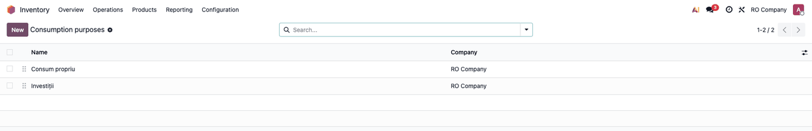
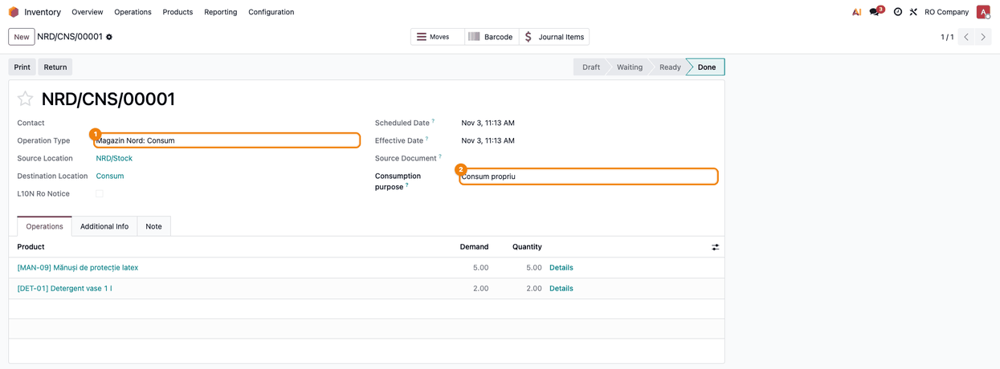
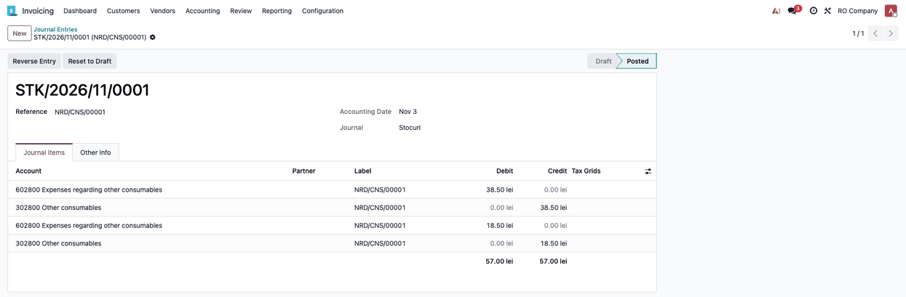
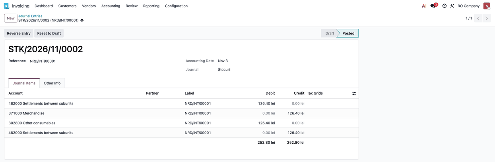
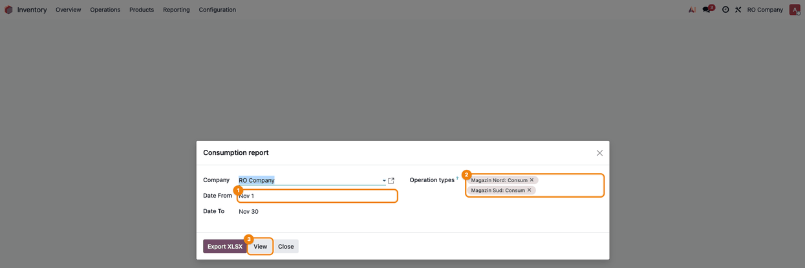
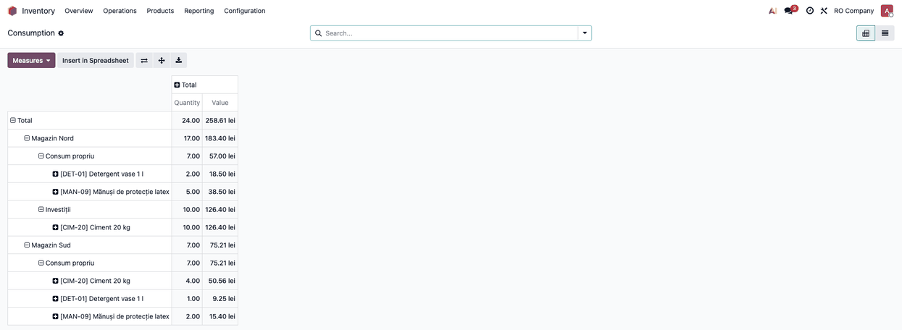
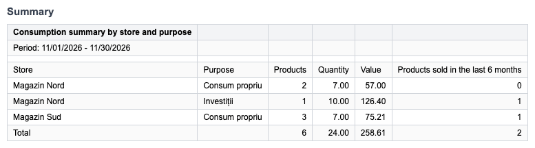
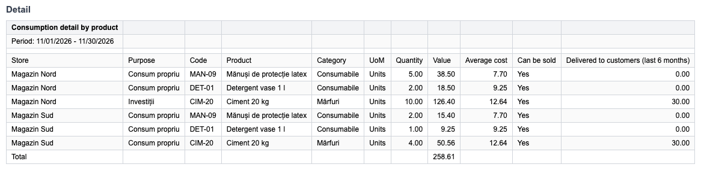

========================
Stock Consumption Report
========================

..
   !!!!!!!!!!!!!!!!!!!!!!!!!!!!!!!!!!!!!!!!!!!!!!!!!!!!
   !! This file is generated by oca-gen-addon-readme !!
   !! changes will be overwritten.                   !!
   !!!!!!!!!!!!!!!!!!!!!!!!!!!!!!!!!!!!!!!!!!!!!!!!!!!!
   !! source digest: sha256:a32bf5a4a0d5a85cd82005d837da2db0a70a9670e12df98eef57b67326992395
   !!!!!!!!!!!!!!!!!!!!!!!!!!!!!!!!!!!!!!!!!!!!!!!!!!!!

.. |badge1| image:: https://img.shields.io/badge/maturity-Beta-yellow.png
    :target: https://odoo-community.org/page/development-status
    :alt: Beta
.. |badge2| image:: https://img.shields.io/badge/github-dhongu%2Fdeltatech-lightgray.png?logo=github
    :target: https://github.com/dhongu/deltatech/tree/19.0/deltatech_stock_consumption_report
    :alt: dhongu/deltatech
.. |badge_fisa| image:: https://img.shields.io/badge/-Fi%C8%99%C4%83%20consultant-2ea44f.png
    :target: https://github.com/dhongu/deltatech/blob/19.0/deltatech_stock_consumption_report/readme/FISA_CONSULTANT.md
    :alt: Fișă consultant
.. |badge_tests| image:: https://img.shields.io/badge/-8%20automated%20tests%20%C2%B7%2097%25%20code%20coverage-2ea44f.png
    :target: https://app.codecov.io/gh/dhongu/deltatech/tree/19.0/deltatech_stock_consumption_report
    :alt: 8 automated tests · 97% code coverage

|badge1| |badge2| |badge_fisa| |badge_tests|

Monthly report of the consumption vouchers (transfers to consumption
locations), for the accountant. Opened from *Inventory → Reporting →
Consumption report*: pick the period and, optionally, the operation
types (one per store or warehouse), then *View* (pivot) or *Export
XLSX*.

Features:

- **Consumption purpose** on the consumption voucher (investments, own
  use...), chosen from the list in *Inventory → Configuration →
  Consumption purposes*; required on new vouchers and copied on returns.
- **Consumption locations**: with the Romanian localisation
  (``l10n_ro_stock_account``), the locations of type *Consumption* and
  *Usage giving*; other modules can extend the list
  (``stock.location._get_consumption_usages()``).
- **Value from accounting**: the value of a consumption is the credit of
  the product lines in the journal entry of the voucher (the stock
  leaving the stock account); without an entry, the stock value of the
  move.
- **XLSX export** with two sheets: a summary by store and purpose
  (products, quantity, value) and a detail by store, purpose and
  product, with category, average cost, *can be sold* flag and the
  quantity delivered to customers in the last 6 months, so goods meant
  for sale are easy to spot.

**Table of contents**

.. contents::
   :local:

Configuration
=============

- The report reads the transfers to **consumption locations**. With the
  Romanian localisation (``l10n_ro_stock_account``) these are the
  locations of type *Consumption* and *Usage giving*. Other location
  types can be added by overriding
  ``stock.location._get_consumption_usages()``.
- Access: the report is available to *Inventory / Administrator*; the
  purposes can be read by every inventory user (to pick them on the
  voucher) and changed by administrators.

Usage
=====

1. **Define the consumption purposes** in *Inventory → Configuration →
   Consumption purposes* (e.g. *Own use*, *Investments*). The list is
   empty after installation; archive a purpose that is no longer used
   instead of deleting it.

   |Consumption purposes list with the Name and Company columns|

2. **Pick the purpose on the consumption voucher.** On a transfer to a
   consumption location the *Consumption purpose* field appears under
   *Source Document*; it is required until the transfer is validated and
   can still be filled in on validated vouchers. A return keeps the
   purpose of the original voucher.

   |Validated consumption voucher with the operation type and the
   consumption purpose highlighted|

3. **The journal entry of the voucher** is posted at validation. The
   report takes the value of each consumption from it (the credit of the
   product lines); a voucher without an entry is valued at the stock
   value of the move.

   |Journal entry of the consumption voucher: expense account debited,
   stock accounts credited|

4. **Goods used internally** are not issued for consumption straight
   from the sale stock (that books them on the cost of goods sold). Move
   them first with an internal transfer to a materials location of the
   store (with its own stock and expense accounts; with the Romanian
   localisation the entry is Dr 3028 = Cr 371 at cost), then issue the
   consumption voucher from that location.

   |Journal entry of the internal transfer of goods to the materials
   location|

5. **Open the report** from *Inventory → Reporting → Consumption
   report*. The period defaults to the current month and the operation
   types whose default destination is a consumption location are
   preselected; empty the field to include every consumption of the
   period.

   |Consumption report wizard with the period, the operation types and
   the Export XLSX and View buttons|

6. **Check the figures on screen** with *View*: a pivot by store,
   purpose and product, with quantity and value. Rows marked *Undefined*
   are vouchers without a purpose.

   |Consumption pivot by store, purpose and product|

7. **Export XLSX** for the accountant. The *Summary* sheet has one row
   per store and purpose; its total equals the total of the pivot.

   |Summary sheet of the XLSX export, by store and purpose|

8. The *Detail* sheet has one row per store, purpose and product, with
   category, average cost, *Can be sold* and the quantity delivered to
   customers in the last 6 months, to spot goods meant for sale that
   were issued for consumption straight from the sale stock.

   |Detail sheet of the XLSX export, by store, purpose and product|

Changelog
=========

History
=======

19.0.1.0.1
----------

- Consultant sheet and screenshots: goods used internally go first to a
  materials location (Dr 3028 = Cr 371 at cost) and are then issued for
  consumption; goods issued straight from the sale stock (Dr 607 = Cr
  371) are shown as an anomaly found with the *Delivered to customers*
  column. The *Consumption account* on 607 is no longer recommended.

19.0.1.0.0
----------

- First version: consumption purpose on the consumption voucher, report
  by store and purpose (pivot and XLSX, summary and detail).
- The value of a consumption is taken from the journal entry of the
  voucher (the credit of the product lines, i.e. the stock leaving the
  stock account); the stock value of the move is used only when there is
  no entry.
- Consumption purposes are per company (multi-company record rule;
  purposes without a company are shared).

Bug Tracker
===========

Bugs are tracked on `Terrabit Issues <https://www.terrabit.ro/helpdesk>`_.
In case of trouble, please check there if your issue has already been reported.

Do not contact contributors directly about support or help with technical issues.

Credits
=======

Authors
-------

* Terrabit
* Dorin Hongu

Maintainers
-----------

.. |maintainer-dhongu| image:: https://github.com/dhongu.png?size=40px
    :target: https://github.com/dhongu
    :alt: dhongu

Current maintainer:

|maintainer-dhongu| 

This module is part of the `dhongu/deltatech <https://github.com/dhongu/deltatech/tree/19.0/deltatech_stock_consumption_report>`_ project on GitHub.

You are welcome to contribute.