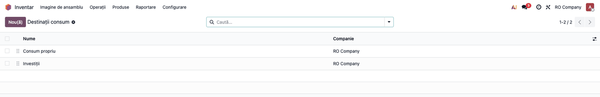
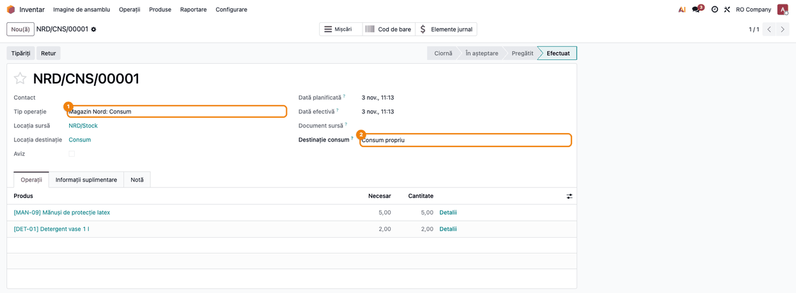
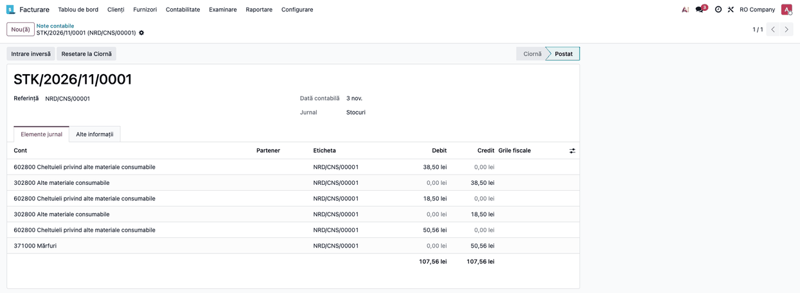
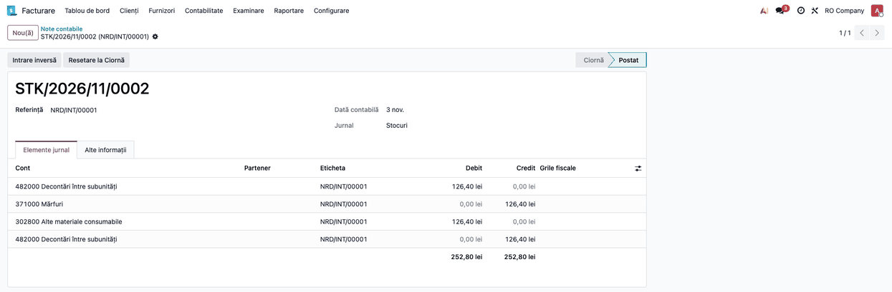
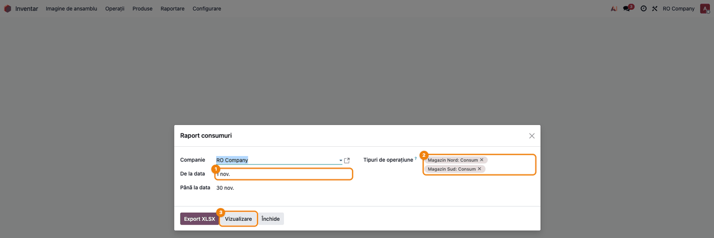
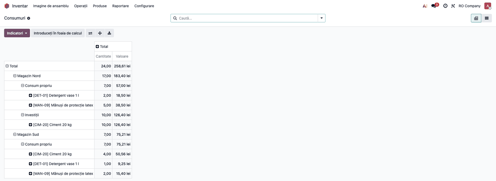
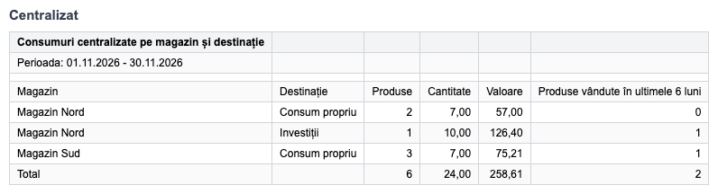
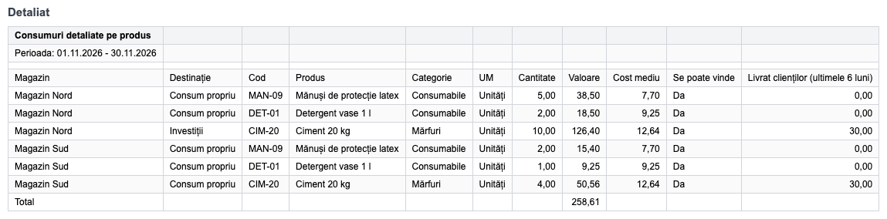
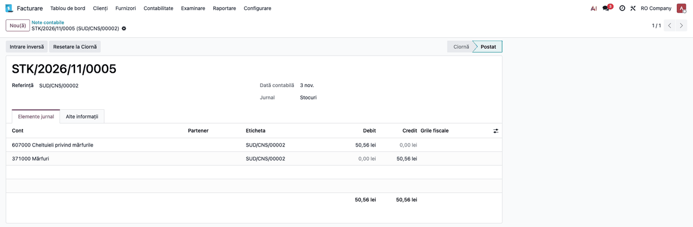

# Fișă Modul: Raportul lunar al bonurilor de consum

**Modul:** `deltatech_stock_consumption_report`
**Utilizator principal:** Contabil (închiderea de lună), gestionar / administrator stoc
**Prioritate:** 🟡 Medie (contabilitatea nu vedea consumurile din magazine; nu blochează operarea)

---

## 1. Scop business

Bonurile de consum se operează în **Inventar**, de regulă separat pe fiecare magazin sau depozit, dar
contabilitatea nu are o vedere de ansamblu asupra lor la sfârșit de lună. Modulul adaugă un **raport al consumurilor dintr-o perioadă** (implicit luna
curentă), cu **cantitate și valoare de stoc**, grupat pe **magazin** și pe **destinația consumului**
(investiții, consum propriu…), aleasă de gestionar pe fiecare bon dintr-o listă întreținută de client.
Raportul are două variante:

- **centralizat pe magazin și destinație** — câte produse s-au dat pe consum, ce cantitate și ce
  valoare;
- **detaliat pe produs** în cadrul magazinului și al destinației — cu categorie, cost mediu, marcajul „se poate vinde"
  și cantitatea livrată clienților în ultimele 6 luni, ca să se vadă dacă pe consum a ieșit **marfă
  care de fapt se vinde**, nu doar consumabile.

Raportul se vede pe ecran (pivot) și se descarcă în **Excel (XLSX)**.

## 2. Bază legală și context

Modulul **nu generează documente și nu înregistrează nimic în contabilitate** — citește mișcările
de stoc deja validate și adaugă pe bon câmpul *Destinație consum*. Contextul:

- **Bonul de consum** (formular 14-3-4A, tipărit de `l10n_ro_picking_report`) este documentul
  justificativ al ieșirii din gestiune; nota contabilă a consumului o face `l10n_ro_stock_account`
  la validarea transferului.
- **Bon de consum** înseamnă, pentru raport, un transfer validat către o locație de consum. Pe
  localizarea română sunt locațiile de tip **Consum** și **Utilizare** (dare în folosință)
  (din `l10n_ro_stock`, instalat de `l10n_ro_stock_account`); fără ea, lista de tipuri se extinde dintr-un modul de legătură.
- **Valoarea** din raport este **creditul liniilor produsului din nota contabilă a bonului**
  (ieșirea din contul de stoc, oricare ar fi contul de stoc al locației sau al depozitului), adică exact suma care a ieșit din gestiune în contabilitate — nu ultimul preț de
  achiziție și nici prețul de vânzare. Dacă bonul nu are notă contabilă (de exemplu produs cu
  valorizare periodică), raportul ia **valoarea de stoc a mișcării**.
- **Perimetrul:** raportul ia mișcările validate spre locațiile de tip **Consum** și, în plus, spre
  locațiile de tip **Utilizare** (dare în folosință) (obiecte de inventar date în folosință). Retururile din
  consum (de la locația de consum înapoi în stoc) **nu** intră.
- **Destinația consumului** este informativă: grupează raportul, dar **nu schimbă nota contabilă**
  a bonului. Conturile rămân cele din categoria produsului (secțiunea 4), indiferent dacă destinația
  e *Investiții* sau *Consum propriu*.
- **Marfa nu se dă direct pe consum.** Mărfurile sunt bunurile cumpărate în vederea revânzării sau
  produsele predate spre vânzare magazinelor proprii (OMFP 1802/2014, pct. 276 alin. (1) lit. a)), iar
  materialele consumabile sunt cele care ajută la procesul de exploatare (lit. c)). În relația cu 371,
  contul 607 primește doar marfa vândută, lipsă la inventar sau depreciată ireversibil. Marfa luată din vânzare pentru uz intern își schimbă destinația: se
  transferă întâi, la cost, într-o gestiune de materiale (Dr 3028 = Cr 371), apoi se dă în consum din
  materiale (Dr 6028 = Cr 3028). Reclasificarea Dr 3028 = Cr 371 nu e prevăzută expres în funcțiunea
  conturilor 302 și 371; se justifică prin schimbarea destinației bunului (pct. 276 alin. (1) lit. a)
  → lit. c)) și trebuie prevăzută în politica contabilă a firmei. Un bon de consum care scoate marfa direct din stoc (Dr 607 = Cr 371)
  este o **anomalie**: umflă costul mărfurilor vândute și strică marja comercială. Raportul o scoate
  în evidență prin coloana *Livrat clienților*; corecția rămâne la contabil.

## 3. Utilizatori și roluri

| Rol | Ce face |
|-----|---------|
| **Contabil** | Rulează raportul la închiderea lunii, compară totalul cu rulajul conturilor de stoc din notele bonurilor de consum (nu din tot jurnalul de stoc) și verifică lista detaliată. |
| **Gestionar / responsabil magazin** | Operează bonurile de consum (Inventar → transfer de tip Consum) ca până acum și alege, pe fiecare bon, *Destinație consum*. |
| **Administrator stoc** | Întreține lista destinațiilor și are acces la raport (vezi mai jos). |

**Drept de acces:** wizard-ul este permis doar grupului **Inventar / Administrator**
(`stock.group_stock_manager`). Un contabil fără acest grup **nu vede meniul**. La testare folosiți
un utilizator cu Inventar → Administrator. Utilizatorul de Inventar vede destinațiile **doar în
lista de alegere de pe bon**; meniul *Destinații consum* și modificarea listei sunt doar pentru
administratori.

## 4. Conturi și date implicate

Raportul nu are conturi proprii; consumurile pe care le citește au fost contate de
`l10n_ro_stock_account` astfel:

| Operațiune | Debit | Credit |
|-----------|-------|--------|
| Consum materiale consumabile | 6028 Cheltuieli privind alte materiale consumabile | 3028 Alte materiale consumabile |
| Marfă trecută în materiale (transfer intern, la cost) | 3028 Alte materiale consumabile (prin 482, contul de transfer al companiei) | 371 Mărfuri |
| Consum din gestiunea de materiale (marfa de mai sus) | 6028 Cheltuieli privind alte materiale consumabile | 3028 Alte materiale consumabile |
| **Anomalie:** marfă dată în consum direct din stoc | 607 Cheltuieli privind mărfurile | 371 Mărfuri |
| Dare în folosință obiecte de inventar | 603 Cheltuieli privind obiectele de inventar | 303 Materiale de natura obiectelor de inventar |
| Retur din consum (storno în roșu) | contul de cheltuieli, sumă negativă | contul de stoc, sumă negativă |

Debitul este **contul de cheltuieli al produsului** (din categorie) sau, dacă e setat, contul de
cheltuieli al locației din care iese bonul. Pentru marfa folosită intern:

- pe categoria mărfii se bifează **schimbarea contului de stoc după gestiune**, iar locația de
  materiale a magazinului (ex. *Materiale uz intern*) are cont de stoc **3028** (sau alt 302x, după
  politica contabilă) și cont de cheltuieli **6028**; transferul intern Stoc → Materiale face nota
  Dr 3028 = Cr 371, iar bonul de consum din locația de materiale face Dr 6028 = Cr 3028;
- transferul trece prin **contul de transfer stoc al companiei** (implicit 482 în localizarea
  română): Dr 482 = Cr 371 și Dr 3028 = Cr 482, în aceeași notă. Aici 482 e un **tranzit tehnic**
  al localizării, nu o decontare între subunități cu contabilitate proprie (funcțiunea lui din OMFP):
  soldul rămâne 0, dar contul are rulaj pe ambele laturi, vizibil în balanță și în D406. Contul de
  transfer se alege cu contabilul (eventual un analitic dedicat), iar la închiderea lunii se verifică
  soldul 0;
- **nu** se setează *Cont consum* = 6028 pe contul 607 ca soluție implicită: dă Dr 6028 = Cr 371,
  acceptabil doar dacă politica contabilă a firmei prevede explicit această simplificare;
- **nu** se setează niciodată *Cont consum* pe conturile de stoc (371, 3028): dă note în oglindă.

Conturile exacte se verifică în baza de date a clientului, cu contabilul.

La darea în folosință, Odoo înregistrează contul extrabilanțier 8035 **simultan pe debit și pe credit**
în aceeași notă (sold 0). Monografia corectă este **Dr 8035** la darea în folosință și **Cr 8035**
la scoaterea din uz; cum Odoo nu o face, evidența extracontabilă a obiectelor date în folosință se ține separat și se
verifică cu contabilul.

**Date minime pentru demo:**

- un depozit (magazin) cu un **tip de operațiune** al cărui *locație destinație implicită* este de tip
  **Consum** (în capturi: `NRD/CNS` — Magazin Nord și `SUD/CNS` — Magazin Sud);
- 2 consumabile (3028) și o marfă (371, categorie cu schimbarea contului de stoc), cu stoc și cost;
- o locație de materiale în magazin, cu cont de stoc 3028 și cont de cheltuieli 6028;
- două **destinații de consum** (ex. *Consum propriu* și *Investiții*);
- cel puțin două bonuri de consum **validate** în luna raportată, pe destinații diferite.

## 5. Configurare inițială

1. Instalați modulul (depinde de `stock_account`). Pentru tipurile de locație *Consum* și *Dare în
   folosință* trebuie instalat și `l10n_ro_stock_account`.
2. Dați utilizatorului care rulează raportul grupul **Inventar → Administrator**.
3. Verificați că fiecare magazin are un tip de operațiune pentru consum, cu destinația implicită o
   locație de tip **Consum** (Inventar → Configurare → Tipuri de operațiuni). Raportul preselectează
   automat toate tipurile de operațiune ale companiei care au o astfel de destinație (sau una de tip *Utilizare* (dare în folosință)).
4. Dacă magazinele folosesc intern marfă din vânzare: activați **Locații de depozitare** (Inventar →
   Configurare → Setări), bifați pe categoria mărfii schimbarea contului de stoc după gestiune, verificați
   cu contabilul contul de transfer stoc al companiei (implicit 482, vezi secțiunea 4) și creați în
   fiecare magazin o locație de materiale (Inventar → Configurare → Locații), cu cont de stoc 3028 și
   cont de cheltuieli 6028. Marfa se mută acolo cu un transfer
   intern, apoi se dă în consum din locația de materiale (vezi secțiunea 4 și Pasul 4).
5. Definiți **destinațiile consumului** — **Inventar → Configurare → Destinații consum** (pasul 1 din
   fluxul de mai jos). Lista e **goală la instalare** și trebuie completată înainte de primul bon
   nou, altfel bonul nu se poate salva.
6. Verificați denumirea depozitelor (Inventar → Configurare → Depozite): în raport, **magazinul** apare
   cu numele depozitului tipului de operațiune.

## 6. Flux de utilizare

### Pasul 1 — Lista destinațiilor consumului

**Inventar → Configurare → Destinații consum.** Administratorul stocului adaugă destinațiile pe care
le folosesc magazinele (ex. *Consum propriu*, *Investiții*), direct în listă, cu **Nou**. Ordinea se
schimbă trăgând de mânerul din stânga; o destinație care nu mai e folosită se **arhivează**, nu se
șterge, ca bonurile vechi să o păstreze.



### Pasul 2 — Bonul de consum, cu destinația

Gestionarul operează consumul ca până acum: **Inventar → Imagine de ansamblu → cardul
*Magazin Nord: Consum*** (sau *Magazin Sud: Consum*) → **Nou**, produsele și cantitățile, apoi **Validează**.
Nou este câmpul **Destinație consum**, în dreapta, sub *Document sursă*:

- apare **doar pe bonurile de consum** (destinația transferului e o locație de consum: pe localizarea
  română, de tip *Consum* sau *Utilizare* (dare în folosință));
- este **obligatoriu** pe orice bon de consum nevalidat (inclusiv pe cele vechi aflate în ciornă sau
  gata) — fără el bonul nu se poate salva;
- se poate completa și pe bonurile **deja validate**, ca să fie încadrate consumurile de dinainte de
  instalarea câmpului;
- la **Retur**, bonul de retur preia destinația bonului inițial. Pe formularul returului câmpul nu
  se vede (returul intră în stoc, nu în consum); destinația lui se vede în **Inventar → Operații →
  Transferuri**, grupat după *Destinație consum* (gruparea e în meniul de căutare).

La validare, mișcarea primește **valoarea de stoc** cu care a ieșit produsul și se face nota contabilă. Raportul ia în calcul
**doar bonurile validate** (starea *Efectuat*).



### Pasul 3 — Nota contabilă a bonului

La validare, `l10n_ro_stock_account` înregistrează nota de consum în jurnalul de stoc: debit contul
de consum, credit contul de stoc al produsului, cu **aceeași valoare** care apare apoi în raport.
Nota se deschide din bon (butonul **Elemente jurnal** din partea de sus) sau din **Contabilitate (sau
Facturare) → Contabilitate → Elemente jurnal**, căutând după referința bonului (ex. `NRD/CNS/00001`).
Destinația consumului nu schimbă conturile notei.

În exemplu, bonul `NRD/CNS/00001` are o notă de 57,00 lei: mănușile și detergentul (materiale
consumabile) merg Dr 6028 = Cr 3028. Raportul ia valoarea din această notă (creditul pe 3028), deci
aceeași sumă, 57,00, apare pe rândul *Consum propriu* al magazinului *Magazin Nord* din pivotul de la
Pasul 6.



### Pasul 4 — Marfă folosită intern: transferul în gestiunea de materiale

Când magazinul folosește intern o marfă din vânzare (în exemplu, 10 saci de ciment pentru o
investiție), marfa nu se dă direct pe consum. Gestionarul o mută întâi cu un **transfer intern**
(**Inventar → Operații → Transferuri → Nou**, tip *Transferuri interne*) din stocul magazinului în
locația de materiale (*Materiale uz intern*), apoi face bonul de consum **din locația de materiale**
(câmpul *Locația sursă* pe bon), cu destinația potrivită.

Transferul face nota la cost: Dr 482 = Cr 371 și Dr 3028 = Cr 482, adică net **Dr 3028 = Cr 371**
(482 e tranzitul tehnic al localizării și rămâne cu sold 0; din cauza lui, totalul de jos al notei
arată 252,80 lei, dublul valorii transferate de 126,40). Bonul de consum din materiale face apoi
Dr 6028 = Cr 3028, 126,40 lei. Transferul nu apare în raportul de consumuri (nu e consum); apare doar bonul.



### Pasul 5 — Deschiderea raportului

**Inventar → Raportare → Raport consumuri.** Se deschide fereastra raportului, cu:

- **Companie** — apare doar dacă lucrați în mai multe companii;
- **De la data** / **Până la data** — implicit prima și ultima zi a lunii curente; pentru închiderea
  lunii trecute, schimbați ambele date;
- **Tipuri de operațiune** — implicit toate tipurile ale căror destinație implicită este o locație
  de consum sau de dare în folosință (în capturi: Magazin Nord și Magazin Sud). Puteți păstra doar unul, ca
  să rulați raportul pe un singur magazin. Dacă goliți câmpul, intră **toate** mișcările spre locații
  de consum / dare în folosință din perioadă, indiferent de tipul de operațiune.



### Pasul 6 — Verificarea pe ecran (pivot)

Apăsați **Vizualizare**. Se deschide un **pivot** pe mișcările de consum din perioadă:

1. **Găsiți pe ecran** — pe rânduri, fiecare **magazin** (depozitul tipului de operațiune), desfăcut pe
   **destinație** și apoi pe **produse**; pe coloane, **Cantitate** și **Valoare**. Rândul *Total* de
   sus este suma tuturor magazinelor. Totalul de *Cantitate* adună unități de măsură diferite și e
   orientativ; se reconciliază doar *Valoare*. Pivotul și Excel-ul au aceleași cifre (sunt calculate
   o singură dată, la apăsarea butonului).
2. **Verificați:**
   - apar **toate magazinele** care au avut consumuri în lună (dacă lipsește unul, verificați
     tipurile de operațiune selectate la Pasul 5);
   - **nu există rânduri *Nedefinit*** — ele sunt bonuri fără destinație; completați destinația pe
     bonurile respective (Pasul 2) și rulați din nou raportul;
   - **nicio valoare nu este 0** pe un produs cu cantitate — o valoare 0 înseamnă o mișcare fără
     cost (produs fără cost la momentul ieșirii) și trebuie lămurită înainte de închidere;
   - **totalul valorii** (minus retururile din consum ale lunii) este egal cu rulajul creditor net al
     conturilor de stoc din **notele bonurilor de consum** ale lunii — **Contabilitate (sau Facturare) →
     Contabilitate → Elemente jurnal**, filtrat pe perioadă și pe *Etichetă* care conține prefixul tipului de
     consum (ex. `/CNS/`), grupat pe cont. Dacă tipul de consum are configurat un tip de retur separat, includeți în filtru
     și prefixul acestuia. Nu luați tot jurnalul de stoc: el conține și livrările
     (Dr 607 = Cr 371), deci rulajul lui 371 ar include costul mărfurilor vândute. Retururile din
     consum sunt storno în roșu, deci micșorează rulajul creditor.
3. **Treceți mai departe** — dacă cifrele sunt confirmate, închideți pivotul și reveniți la
   fereastra raportului pentru export. Din pivot se poate descărca și direct un Excel standard Odoo
   (butonul de descărcare din pivot), dar exportul de mai jos are formatul pentru contabilitate.

În exemplu, Magazin Nord are 183,40 lei, din care *Consum propriu* 57,00 și *Investiții* 126,40 (10
saci de ciment, din locația de materiale), iar Magazin Sud 75,21 lei, tot *Consum propriu*, în care
intră și 4 saci de ciment dați direct din stoc (anomalia de la Pasul 8); total 258,61 lei.



### Pasul 7 — Exportul XLSX: foaia centralizată

Din fereastra raportului apăsați **Export XLSX**. Fișierul (`consumuri_<de la>_<până la>.xlsx`)
apare în fereastră, gata de descărcat. Prima foaie, **Centralizat**, are câte un rând pe **magazin ×
destinație**:

1. **Găsiți** — coloanele *Magazin*, *Destinație*, *Produse* (câte produse distincte pe rând; pe
   rândul *Total* se adună contoarele rândurilor, deci un produs consumat în ambele magazine sau pe
   două destinații e numărat de mai multe ori), *Cantitate*, *Valoare* și *Produse vândute în
   ultimele 6 luni* (câte dintre produse s-au și vândut clienților); ultimul rând este **Total**.
2. **Verificați** — totalul din *Valoare* este **același** cu totalul din pivotul de la Pasul 6 și cu
   contabilitatea; perioada din antet (*Perioada*) este luna corectă; nu există rânduri cu destinația
   *Nedefinit*.
3. **Treceți mai departe** la foaia de detaliu dacă *Produse vândute în ultimele 6 luni* nu este 0.

Capturile sunt pe date demonstrative.



### Pasul 8 — Exportul XLSX: foaia detaliată pe produs

A doua foaie, **Detaliat**, are câte un rând pe **magazin × destinație × produs**:

1. **Găsiți** — *Magazin*, *Destinație*, *Cod*, *Produs*, *Categorie*, *UM*, *Cantitate*, *Valoare*,
   *Cost mediu* (valoare / cantitate), *Se poate vinde* (bifa produsului) și *Livrat clienților
   (ultimele 6 luni)* — cantitatea livrată clienților **pe toată compania** (nu doar din magazinul
   rândului), începând cu 6 luni înainte de sfârșitul perioadei, **brută** (retururile de la clienți
   nu se scad). Rulat retroactiv, raportul include și livrările de după perioadă.
2. **Verificați** — un produs cu **cantitate livrată clienților** este marfă. Pe un rând de consum el
   e corect doar dacă a trecut întâi prin gestiunea de materiale (Pasul 4); dacă a ieșit direct din
   stocul de vânzare, nota bonului e Dr 607 = Cr 371 și e o **anomalie**. În exemplu, rândul *Magazin
   Sud / Consum propriu / Ciment 20 kg* (4 saci, 50,56 lei, 30 livrați clienților) e un astfel de bon:
   rândul arată la fel ca *Magazin Nord / Investiții / Ciment*, care e corect, pentru că raportul nu
   are locația sursă. Testul care decide: **Contabilitate (sau Facturare) → Contabilitate → Elemente
   jurnal**, filtrat pe perioadă, pe contul **607** și pe *Etichetă* care conține `/CNS/`: fiecare
   linie găsită e un bon-anomalie (sau deschideți bonul și verificați *Locația sursă*). Corecția:
   (1) **storno în roșu** al notei bonului, Dr 607 = Cr 371 cu −50,56 (în practică, returul bonului);
   (2) transferul intern în locația de materiale, Dr 3028 = Cr 371, 50,56; (3) bonul de consum din
   materiale, Dr 6028 = Cr 3028, 50,56. **Nu** se adaugă doar o reclasificare Dr 3028 = Cr 371: marfa
   a ieșit deja din 371, iar 607 ar rămâne umflat. După corecție, raportul lunii arată și bonul-anomalie
   (50,56), și bonul nou din materiale (50,56), dar nu și returul: la reconciliere scădeți returul, ca
   la orice retur din consum (Pasul 6). Dacă luna bonului-anomalie e închisă, storno-ul și notele noi
   se fac în perioada curentă, deschisă. Când categoriile nu separă consumabilele de
   marfă (de exemplu sunt pe furnizor) și aproape toate produsele au bifa „Se poate vinde",
   **coloana relevantă este cea cu livrările către clienți**, nu categoria.
3. **Treceți mai departe** — fișierul se transmite contabilității / se arhivează cu închiderea lunii.



Nota bonului-anomalie, găsită în Elemente jurnal pe contul 607:



### Note de monografie și raportare

Raportul **nu creează note contabile**. Notele pe care le reflectă sunt cele ale bonurilor de consum:

```
Consum materiale consumabile:   Dr 6028 = Cr 3028
Marfă trecută în materiale:     Dr 3028 = Cr 371   (transfer intern, la cost, prin 482)
Consum din materiale:           Dr 6028 = Cr 3028
Anomalie, marfă direct pe consum: Dr 607 = Cr 371  (de corectat de contabil)
Dare în folosință:              Dr 603  = Cr 303
                                extracontabil corect: Dr 8035 (la scoaterea din uz Cr 8035);
                                Odoo pune 8035 pe ambele laturi, evidența se ține separat
Retur din consum:               storno în roșu al notei de consum (sume negative)
```

După destinație:

- **Consum propriu în activitate:** notele de mai sus; fără TVA colectată, pentru că preluarea
  bunurilor pentru propria activitate economică nu e livrare (HG 1/2016, Titlul VII, pct. 7 alin. (1));
  cheltuială deductibilă, fiind efectuată în scopul activității. Aceeași regulă susține lipsa TVA la
  investiția în regie proprie.
- **Investiție în regie proprie:** notele de mai sus, plus lunar (sau la finalizare) Dr 231 = Cr 722
  la costul acumulat, apoi Dr 21x = Cr 231 la recepție. Nota Dr 231 = Cr 371 direct **nu** e corectă.
- **Utilizare în afara activității** (uz personal, dat gratuit, preluat de asociat): livrare asimilată,
  cu TVA colectată, **doar dacă TVA aferentă a fost dedusă total sau parțial** (Codul fiscal art. 270
  alin. (4) lit. a) pentru scopuri fără legătură cu activitatea, lit. b) pentru bunuri puse gratuit la
  dispoziția altor persoane, alin. (5) pentru distribuirea de bunuri către asociați). Nu constituie
  livrare (alin. (8)):
  - bunurile acordate gratuit în scop de reclamă, stimularea vânzărilor (inclusiv mostre) sau în alte
    scopuri legate de activitate (lit. b));
  - bunurile de mică valoare din sponsorizare, mecenat sau protocol (lit. c)), în limitele din HG
    1/2016, Titlul VII, pct. 7 alin. (12): la protocol cel mult 100 lei pe cadou, fără TVA; la
    sponsorizare și mecenat 3‰ din cifra de afaceri;
  - alimentele aproape de expirare, în condițiile legii risipei alimentare (lit. d)).

  Baza de impozitare e prețul de cumpărare sau, în lipsă, prețul de cost (art. 286 alin. (1) lit.
  c)); cota standard e 21% pentru operațiunile de după 1 august 2025 (art. 291 alin. (1), modificat
  prin L 141/2025). Nota Dr 635 = Cr 4427 se face doar la bunurile date gratuit sau folosite în scop
  personal, pe costul firmei; la preluarea de către asociat, TVA se recuperează odată cu creanța
  (Dr 4xx = Cr 4427), nu prin 635.

  Acestea **nu sunt consum propriu**: donația se înregistrează Dr 6582 = Cr 371; protocolul pe 623,
  deși funcțiunea lui 623 nu prevede contrapartida 371/302, deci modul de înregistrare se stabilește
  prin politica contabilă; preluarea de către asociat, ca distribuire sau creanță. Nu folosiți pentru
  ele bonul de consum pe 6028 fără acordul contabilului; modulul nu calculează TVA.

Retururile din consum **nu** intră în raport: el ia doar mișcările cu destinația locație de consum /
dare în folosință. Dacă în lună au existat retururi, totalul raportului este mai mare decât rulajul
net al notelor de consum.

## 7. Legături cu alte module / declarații

| Modul | Rol |
|-------|-----|
| `stock_account` / `l10n_ro_stock_account` (pe localizarea RO) | Face nota contabilă a bonului; raportul ia valoarea din ea (creditul liniilor produsului). |
| `l10n_ro_stock_account` (opțional) | Aduce tipurile de locație *Consum* / *Utilizare* (dare în folosință) și notele de consum pe conturile RO. |
| `l10n_ro_picking_report` (dacă este instalat) | Tipărește bonul de consum (14-3-4A) pe fiecare transfer; raportul este varianta cumulată pe lună. |
| `stock` | Transferurile, tipurile de operațiune, locațiile de consum și depozitele (magazinele); câmpul *Destinație consum* stă pe transfer. |

**Ce e automat:** preselecția tipurilor de operațiune de consum, perioada implicită (luna curentă),
gruparea pe magazin și destinație, preluarea destinației pe bonul de retur, calculul costului mediu și al livrărilor către clienți din ultimele 6 luni.

**Ce rămâne manual:** întreținerea listei de destinații, alegerea destinației pe fiecare bon (și
completarea ei pe bonurile vechi), alegerea perioadei la închiderea lunii trecute, reconcilierea totalului cu
contabilitatea și decizia asupra produselor de vânzare ieșite pe consum.

## 8. Verificări pentru consultant

- [ ] **Inventar → Configurare → Destinații consum** permite adăugarea unei destinații unui
      administrator; un utilizator de Inventar fără drept de administrator nu vede meniul, dar poate
      alege destinația pe bon.
- [ ] Pe un bon de consum nou, *Destinație consum* este obligatorie (bonul nu se salvează fără ea);
      pe o recepție sau o livrare câmpul nu apare.
- [ ] Returul unui bon de consum are aceeași destinație ca bonul inițial (Inventar → Operații →
      Transferuri, grupat după *Destinație consum*).
- [ ] Meniul **Inventar → Raportare → Raport consumuri** apare pentru un utilizator cu Inventar →
      Administrator și **nu** apare pentru unul fără acest grup.
- [ ] La deschidere, perioada este luna curentă și tipurile de operațiune de consum ale companiei
      sunt preselectate.
- [ ] Pivotul (**Vizualizare**) arată fiecare magazin desfăcut pe destinații și produse; totalul
      valorii pe magazin și destinație este egal cu suma bonurilor de consum validate în perioadă cu
      acea destinație.
- [ ] Un bon fără destinație apare pe rândul *Nedefinit*; după completarea destinației trece pe
      rândul destinației.
- [ ] Un bon de consum **nevalidat** (ciornă / gata) nu apare în raport.
- [ ] Un bon validat în prima zi a lunii, după miezul nopții ora României, intră în luna respectivă
      (perioada se aplică pe fusul orar al utilizatorului).
- [ ] **Export XLSX** produce fișierul cu foile *Centralizat* și *Detaliat*, ambele cu coloana
      *Destinație*; totalul din *Centralizat* = totalul din pivot = suma *Valoare* din *Detaliat*.
- [ ] Coloana *Livrat clienților (ultimele 6 luni)* este completată pentru un produs care s-a
      vândut în ultimele 6 luni și 0 pentru unul care nu s-a vândut.
- [ ] Nota contabilă a unui bon de consum are aceeași valoare ca rândul bonului în pivot.
- [ ] Totalul valorii din raport, minus retururile din consum ale lunii, = rulajul creditor net
      (cu storno) al conturilor de stoc din notele bonurilor de consum / dare în folosință ale lunii
      (filtrate după prefixul tipului de operațiune, ex. `/CNS/` — nu tot jurnalul de stoc).
- [ ] Transferul intern al unei mărfi în locația de materiale face nota Dr 3028 = Cr 371 (prin 482),
      iar bonul de consum din locația de materiale face Dr 6028 = Cr 3028.
- [ ] Un bon de consum cu marfă scoasă direct din stocul de vânzare apare în Elemente jurnal pe contul
      607 cu eticheta `/CNS/` (Dr 607 = Cr 371); un bon din locația de materiale nu apare acolo.
- [ ] La închiderea lunii, soldul contului de transfer stoc (482) este 0.

## 9. Mesaje de eroare frecvente

| Mesaj / simptom | Cauză probabilă | Remediere |
|-----------------|-----------------|-----------|
| Bonul de consum nu se salvează: câmpul *Destinație consum* e marcat cu roșu | Destinația este obligatorie pe bonurile de consum noi | Alegeți destinația; dacă lista e goală, administratorul o completează în Inventar → Configurare → Destinații consum |
| Destinația dorită nu apare în listă pe bon | Destinația este arhivată sau e pe altă companie | Dezarhivați-o / corectați compania în Inventar → Configurare → Destinații consum |
| Rânduri *Nedefinit* în raport | Bonuri validate fără destinație: cele de dinainte de instalarea câmpului sau cele create prin import, API ori Barcode, unde câmpul nu e obligatoriu | Completați *Destinație consum* pe bonurile respective și rulați din nou raportul |
| Meniul *Raport consumuri* nu apare | Utilizatorul nu are grupul Inventar → Administrator | Adăugați grupul în Setări → Utilizatori |
| Lipsește un magazin din raport | Tipul lui de operațiune nu are destinația implicită o locație de tip *Consum* sau *Utilizare* (dare în folosință), deci nu e preselectat | Corectați destinația implicită a tipului de operațiune sau adăugați-l manual în *Tipuri de operațiune* |
| Valoare 0 pe un produs cu cantitate | Bonul nu are notă contabilă (valorizare periodică) și produsul nu avea cost la momentul ieșirii | Verificați costul produsului și mișcarea; corecția valorii se face în contabilitate, nu în raport |
| Totalul nu se potrivește cu contabilitatea | În lună au existat retururi din consum (storno în roșu) sau consumuri pe alte tipuri de operațiune decât cele selectate | Goliți *Tipuri de operațiune* (toate consumurile) și scădeți retururile din consum din total |
| Consumul de marfă apare pe 607 (Dr 607 = Cr 371) | Marfa a fost dată pe consum direct din stocul de vânzare | Returul bonului (storno Dr 607 = Cr 371), transfer intern în locația de materiale, bon nou din materiale (Pasul 8); pe viitor marfa trece întâi prin locația de materiale — secțiunea 5, pasul 4 |
| Contul 482 are sold la închiderea lunii | Un transfer intern între gestiuni cu conturi de stoc diferite nu s-a încheiat (ex. tranzit neajuns) | Verificați transferurile interne ale lunii; nota de transfer trebuie să închidă 482 în aceeași notă |
| Eroare „Object stock.consumption.report.wizard doesn't exist" după instalare | Modulul a fost instalat din shell, iar serverul web nu și-a reîncărcat registry-ul | Reporniți serverul (pe odoo.sh: `odoosh-restart http`) |

## 10. Capturi de ecran

Capturile (`static/description/`) se **generează automat** din `tests/test_screenshots.py` (mixinul
`ScreenshotCase` din `deltatech_doc_screenshots`, import defensiv), în **limba română**, pe planul de
conturi RO, cu `l10n_ro_stock_account` instalat. Din aceleași shot-uri se generează și capturile în
engleză din `static/description/en/`, pentru `readme/USAGE.md`:

1. `01_destinatii_consum.png` — lista destinațiilor consumului (Consum propriu, Investiții).
2. `02_bon_consum.png` — bonul de consum validat, cu *Tip operație* și *Destinație consum* marcate.
3. `03_nota_consum.png` — nota contabilă a bonului: Dr 6028, Cr 3028.
4. `04_transfer_marfa.png` — nota transferului de marfă în locația de materiale: Dr 3028 = Cr 371, prin 482.
5. `05_wizard_raport.png` — fereastra raportului: perioada și tipurile de operațiune de consum.
6. `06_pivot_consumuri.png` — pivotul consumurilor, magazin × destinație × produs, cu cantitate și valoare.
7. `07_xlsx_centralizat.png` — exportul XLSX, foaia centralizată pe magazin și destinație.
8. `08_xlsx_detaliat.png` — exportul XLSX, foaia detaliată pe magazin, destinație și produs, cu bonul-anomalie.
9. `09_nota_anomalie.png` — nota bonului-anomalie: Dr 607 = Cr 371.

Regenerare:

```bash
./odoo/odoo-bin -c odoo.conf -d <db> \
    -i deltatech_stock_consumption_report,deltatech_doc_screenshots,l10n_ro_stock_account \
    --without-demo=all --test-tags=fise_screenshots --stop-after-init
```

## 11. Observații pentru manual

- Etichetele (meniuri, butoane, coloanele din Excel) sunt **în română** pentru utilizatorii cu limba
  română; un utilizator cu limba engleză vede *Consumption report*, *Consumption purposes*, foile
  *Summary* / *Detail*.
- Destinația consumului **nu schimbă nota contabilă**. Dacă clientul vrea ca investițiile să meargă
  pe alt cont decât consumul, e o cerință separată, de stabilit cu contabilul.
- Totalul pe destinația *Investiții* este baza notei de capitalizare a investiției în regie proprie
  (Dr 231 = Cr 722), care se face manual, cu contabilul: e componenta de materiale; manopera și
  celelalte costuri directe se adaugă separat.
- Destinațiile pentru scopuri fără legătură cu activitatea economică (ex. uz personal) pot cere
  colectarea TVA (livrare asimilată); se stabilesc cu contabilul, modulul nu calculează TVA.
- **Magazinul** din raport este depozitul tipului de operațiune de consum; denumirea depozitelor
  trebuie să fie cea pe care o recunoaște contabilul.
- Insistați pe ordinea **verificare pe ecran → export**: contabilul confirmă întâi totalul din pivot
  cu contabilitatea, abia apoi trimite Excel-ul.
- Capturile foilor Excel (07, 08) sunt randate ca tabel simplu: datele și formatul numerelor sunt cele
  din fișier, dar fără culorile și lățimile de coloană din Excel.
- Coloana *Livrat clienților (ultimele 6 luni)* este „semnalul" pentru marfa de vânzare dată pe
  consum, când categoria și bifa „Se poate vinde" nu ajută (aproape toate produsele sunt vandabile).
- Prezentați marfa dată direct pe consum ca **anomalie**, nu ca flux: fluxul corect e transferul în
  gestiunea de materiale, apoi bonul de consum din materiale.
