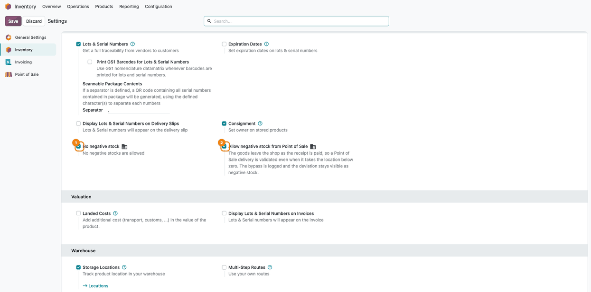
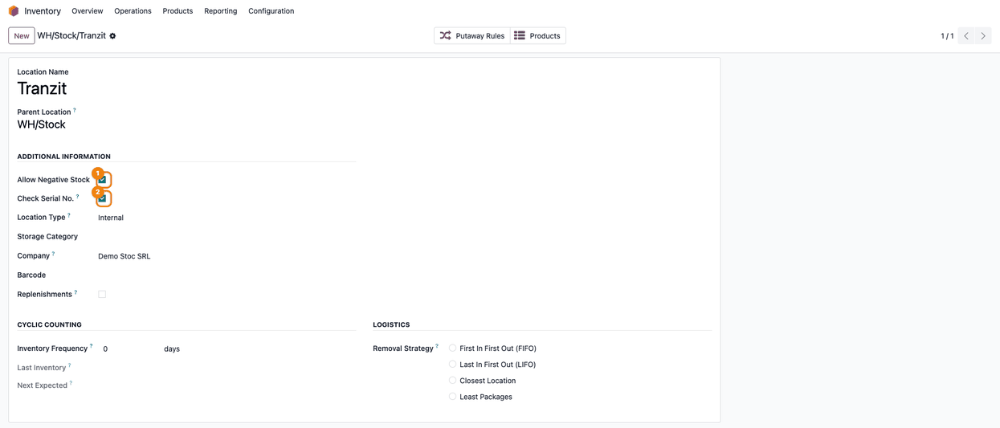
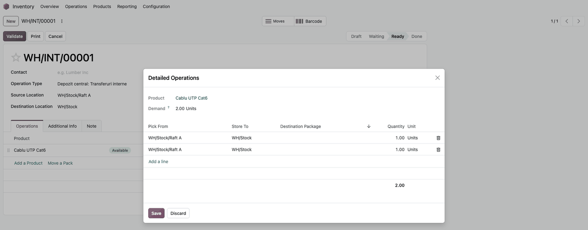
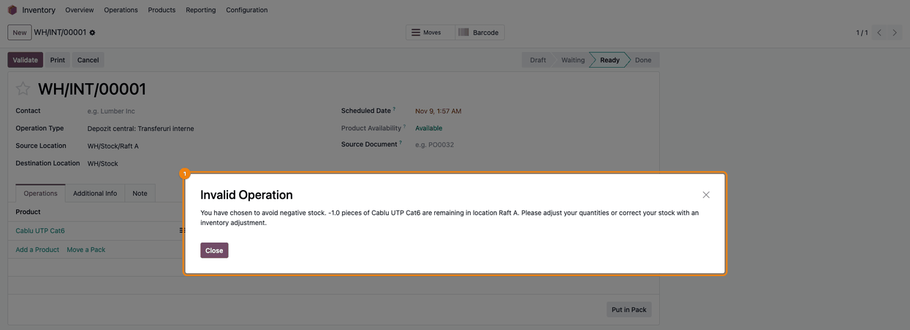
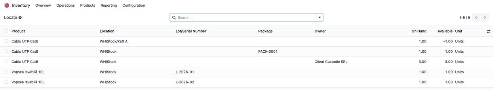
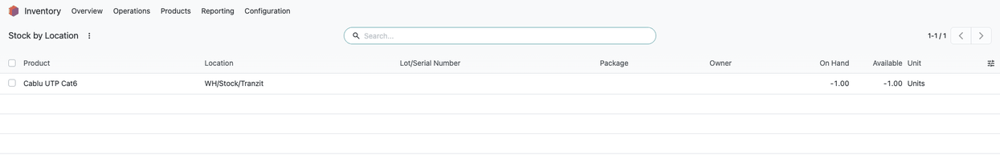
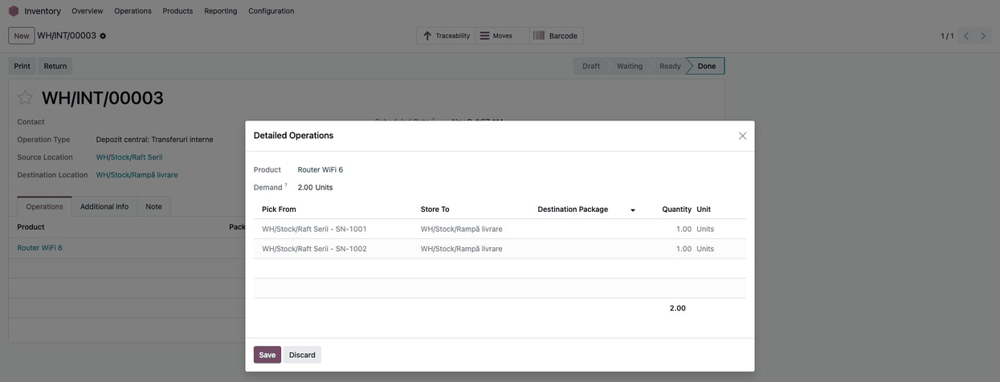
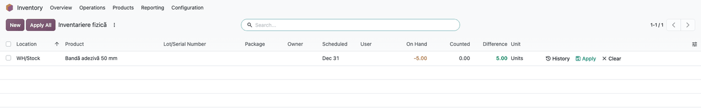

=================
No Negative Stock
=================

..
   !!!!!!!!!!!!!!!!!!!!!!!!!!!!!!!!!!!!!!!!!!!!!!!!!!!!
   !! This file is generated by oca-gen-addon-readme !!
   !! changes will be overwritten.                   !!
   !!!!!!!!!!!!!!!!!!!!!!!!!!!!!!!!!!!!!!!!!!!!!!!!!!!!
   !! source digest: sha256:61c29f8e7c848a7e48d4d6cdaa8fd573f7a7a2f332e90165b307fc8e591e33f7
   !!!!!!!!!!!!!!!!!!!!!!!!!!!!!!!!!!!!!!!!!!!!!!!!!!!!

.. |badge1| image:: https://img.shields.io/badge/maturity-Mature-brightgreen.png
    :target: https://odoo-community.org/page/development-status
    :alt: Mature
.. |badge2| image:: https://img.shields.io/badge/github-dhongu%2Fdeltatech-lightgray.png?logo=github
    :target: https://github.com/dhongu/deltatech/tree/20.0/deltatech_stock_negative
    :alt: dhongu/deltatech
.. |badge_fisa| image:: https://img.shields.io/badge/-Fi%C8%99%C4%83%20consultant-2ea44f.png
    :target: https://github.com/dhongu/deltatech/blob/20.0/deltatech_stock_negative/readme/FISA_CONSULTANT.md
    :alt: Fișă consultant
.. |badge_tests| image:: https://img.shields.io/badge/-40%20automated%20tests%20%C2%B7%2096%25%20code%20coverage-2ea44f.png
    :target: https://app.codecov.io/gh/dhongu/deltatech/tree/20.0/deltatech_stock_negative
    :alt: 40 automated tests · 96% code coverage

|badge1| |badge2| |badge_fisa| |badge_tests|

By default, Odoo lets a transfer be validated even when the stock is not
there, and the quantity on hand quietly goes below zero. The error
surfaces weeks later, at the next inventory count. This module stops the
move at validation instead, and tells the user what is actually left in
the location.

- **Blocks negative stock at validation**: A transfer that would take an
  internal location below zero cannot be validated.
- **Clear message**: The user sees the product, the location and the
  quantity that would remain, and is pointed to adjust the quantities or
  correct the stock.
- **Exceptions per location**: Allow negative stock on the locations
  where you need it, such as a production floor or a transit area.
- **Checked on the physical stock**: The quantity on hand in the
  location, per lot, package and owner, not the forecast.
- **Safe for multi-line transfers**: Several lines of the same product
  in one validation are added up, so they cannot overdraw the stock
  together.
- **Serial numbers, strict or by total**: Per location, check
  serial-tracked products on the serial number of the line or on the
  total of the location.
- **Point of Sale friendly**: Goods sold at the register have already
  left the shop, so Point of Sale receipts go through by default; each
  bypass is logged and the shortfall stays visible as negative stock to
  correct.
- **Only products with tracked stock**: Consumables without *Track
  Inventory* are not checked, since Odoo keeps no stock for them.
- **Company setting**: Turn the rule on or off separately for each
  company.

**Table of contents**

.. contents::
   :local:

Configuration
=============

1. Go to *Inventory > Configuration > Settings*, section *Traceability*,
   and enable **No negative stock**. The setting applies to the current
   company; in a multi-company database, enable it on each company.

2. Right below it, decide on **Allow negative stock from Point of Sale**
   (enabled by default). Point of Sale validates the delivery of a
   receipt in the background and does not show the cashier an error, so
   a refused delivery would only leave the stock undeducted:

   - enabled: a receipt's delivery is validated even when it takes the
     location below zero; the bypass is logged and the location shows
     negative stock to correct;
   - disabled: the rule applies to receipts as well, and their
     deliveries stay unvalidated until the stock is there.

   A Point of Sale delivery is recognised by the operation type set on
   the Point of Sale (by default the warehouse's *PoS Orders*): a
   transfer created by hand with that same operation type is treated as
   a register delivery too, so keep that type for Point of Sale only.
   The setting has no effect when Point of Sale is not installed.

|No negative stock and Allow negative stock from Point of Sale in
Settings|

3. Enable *Storage Locations* (section *Warehouse*) to see the location
   options. Open *Inventory > Configuration > Locations* and, on the
   internal locations where stock may go below zero (transit, work in
   progress), check **Allow Negative Stock**.

4. For products tracked by serial number, **Check Serial No.** (enabled
   by default) checks the serial number of the line. Uncheck it on a
   location to check the total of all serial numbers there; reservation
   then also ignores the serial number.

|Location form with Allow Negative Stock and Check Serial No.|

5. Before enabling the rule on an existing database, review the negative
   positions (*Inventory > Reporting > Stock by Location*, filter
   *Negative Stock*): record the missing receipts or transfers first,
   and use an inventory adjustment only for the real differences.
   Negative positions left in place block every outgoing move from them.

Usage
=====

Work with transfers as usual. The check runs when a transfer is
**validated**, on every line that takes stock out of an internal
location, and on all lines together.

1. **Prepare a transfer.** In this example the location *Raft A* holds 1
   unit of the product, and the transfer picks it twice, 1 unit per
   line, in *Detailed Operations*. Each line alone would fit; together
   they need 2 units.

   |Detailed Operations with two lines of 1 unit picked from Raft A, on
   a stock of 1 unit|

2. **Validate.** The lines are added up per location, lot, package and
   owner, after converting the units of measure. When the location would
   go below zero, validation stops with an *Invalid Operation* message
   naming the product, the location and the quantity that would remain
   (here -1). Nothing is moved: lower the quantities, pick from another
   location or lot, or validate the missing receipt first.

   |Invalid Operation dialog: you have chosen to avoid negative stock,
   with the product, the remaining quantity and the location|

3. **Check the stock positions.** *Inventory > Reporting > Stock by
   Location* shows the positions the check compares against: one row per
   product, location, lot or serial number, package and owner. The check
   uses *On Hand*, not *Available*: a line on one lot, package or owner
   cannot use the stock of another.

   |Stock positions per location, lot, package and owner|

4. **Locations allowed to go negative.** On a location with **Allow
   Negative Stock**, the same transfer is validated and the position
   stays negative. Incoming moves are never checked, only the source
   location of a move.

   |Negative position on WH/Stock/Tranzit, the location that allows
   negative stock|

5. **Serial numbers.** With **Check Serial No.** unchecked on the
   location, the stock is checked on the total of all serial numbers
   there: two lines on two serial numbers pass when the location holds
   two units. Note that a line on a serial number that is not in the
   location also passes when the total is enough; that serial number
   then goes to -1 and has to be corrected by an inventory adjustment.

   |Done transfer from Raft Serii, Detailed Operations on SN-1001 and
   SN-1002|

6. **Bring a negative position back to zero.** Once the cause is found
   and the missing documents are recorded, open *Inventory > Operations
   > Physical Inventory*, filter *Negative Stock*, enter the counted
   quantity (0 when the shelf is empty) and click **Apply**. An increase
   is an incoming move and is not blocked; a count that would take the
   stock below zero is blocked like any other outgoing move.

   |Physical Inventory on a negative position: On Hand -5, Counted 0,
   Difference +5, before Apply|

Not checked: products without *Track Inventory*, non-internal locations,
and Point of Sale receipts while **Allow negative stock from Point of
Sale** is enabled. Every Point of Sale bypass is written to the server
log with the transfer, product, quantity and location.

Changelog
=========

20.0.2.1.2
----------

- *Allow negative stock from Point of Sale* now actually lets Point of
  Sale receipts through. In Odoo 20, ``pos_stock`` creates the delivery
  of a receipt with neither its session nor its order and validates it
  at once, linking the session (and the order, for real-time receipts)
  only afterwards; the bypass looked for the order, so it never applied
  there and receipts kept leaving their deliveries unvalidated. The
  delivery is now recognised by the operation type of the Point of Sale
  while it is validated, and by its session once linked (a delivery
  validated later). A transfer created by hand with the Point of Sale
  operation type is treated the same way. Receipts shipped later are
  excluded: their goods are still in the shop, so their delivery follows
  the rule like any other.
- Consultant sheet, description, configuration and usage updated for the
  *Allow negative stock from Point of Sale* setting and for products
  without *Track Inventory*. The setting is now translated in Romanian;
  screenshots regenerated in Romanian for the sheet and in English for
  the Apps Store page.

20.0.2.1.1
----------

- Deliveries containing consumable products without stock tracking
  (*Track Inventory* off) can be validated again when *No negative
  stock* is enabled. Odoo keeps no stock for such products, so the check
  compared them against zero and refused the whole transfer; it now
  applies only to products whose stock is tracked.

20.0.2.1.0
----------

- A Point of Sale receipt no longer leaves its goods on the stock. Point
  of Sale validates its own delivery in the background and swallows any
  ``UserError`` that validation raises, so the refusal issued here when
  a location would go below zero never reached the cashier: the receipt
  was closed, the customer walked out with the goods, and the transfer
  stayed unvalidated with the stock never decreased - silently, with
  nothing to act on but a stray open transfer nobody was looking for.
  Refusing the move does not keep the goods on the shelf; it only stops
  the system from recording what already happened at the register.
- New company setting *Allow negative stock from Point of Sale*
  (``no_negative_stock_pos_bypass``, on by default, shown only when *No
  negative stock* is enabled): a Point of Sale delivery is validated
  even when it takes the location below zero. Every bypass is logged as
  a warning naming the transfer, the quantity, the product and the
  location, and the deviation stays visible as negative stock to be
  corrected by an inventory adjustment. Turn the setting off to apply
  the rule to Point of Sale as well, accepting that such receipts will
  not decrease the stock.
- The check also honours a ``skip_negative_stock_check`` context key,
  for callers that have to force a validation knowingly.

20.0.2.0.11 (2026-10-01)
------------------------

- Migration to 20.0: move lines and moves now carry their unit of
  measure in ``uom_id`` (was ``product_uom_id`` / ``product_uom``), used
  when converting the line quantity to the product unit in the
  no-negative-stock check.
- Consultant sheet updated for 20.0: the stock positions report is the
  untranslated **Inventory → Reporting → Stock by Location** menu;
  screenshots regenerated on 20.0.

19.0.2.0.11 (2026-10-01)
------------------------

- **Serialized stock is no longer blocked when Check Serial No. is
  off.** On a location with the serial check disabled, the
  no-negative-stock check cleared the line's serial number and then
  searched explicitly for quants *without* a serial, so it excluded the
  very quants holding the stock and blocked a legitimate transfer,
  although reservation had gone through. The lot filter is now left out
  entirely in that case: the physical quantity is summed across all
  serial numbers of the location (product, package and owner filters
  kept), and every line of the product consumes from that same
  aggregate. With the serial check on (the default), the check stays per
  serial number. (STOCK-001)
- Romanian translations brought in line with the current strings: the
  blocking message was shown in English (its translation matched an
  older wording), the setting read "Fară stoc negativ" and Check Serial
  No. had no translation. A post-migration reloads them over the old
  ones on existing databases.
- The help of Check Serial No. described a reservation check the module
  does not do; it now says what the option changes.
- Consultant sheet (``readme/FISA_CONSULTANT.md``) with screenshots
  generated by ``tests/test_screenshots.py``, covering every case of the
  check.

19.0.2.0.10 (2026-09-29)
------------------------

- Own module icon, instead of the generic gears it had.

19.0.2.0.9 (2026-09-23)
-----------------------

- Translatable strings in code use ``self.env._()`` instead of ``_()``,
  the Odoo 19 convention (pylint-odoo ``prefer-env-translation``). The
  translated messages are unchanged.

19.0.2.0.8 (2026-09-22)
-----------------------

- **Several lines of one validation no longer share the same stock.**
  The check runs over the whole recordset before
  ``super()._action_done()`` writes anything to the quants, so every
  line used to read the same untouched quantity. Taken one by one, two
  lines of 1 against a stock of 1 are each legal, and the transfer still
  landed at -1. It now carries what the earlier lines of the same batch
  already took from each quant, keyed by product, location, lot, package
  and owner -- so lines on different quants still do not add up.
  Reported twice from the shop floor: 2 pieces picked to shelve when
  only 1 was on hand.

Bug Tracker
===========

Bugs are tracked on `Terrabit Issues <https://www.terrabit.ro/helpdesk>`_.
In case of trouble, please check there if your issue has already been reported.

Do not contact contributors directly about support or help with technical issues.

Credits
=======

Authors
-------

* Terrabit
* Dorin Hongu

Maintainers
-----------

.. |maintainer-dhongu| image:: https://github.com/dhongu.png?size=40px
    :target: https://github.com/dhongu
    :alt: dhongu

Current maintainer:

|maintainer-dhongu| 

This module is part of the `dhongu/deltatech <https://github.com/dhongu/deltatech/tree/20.0/deltatech_stock_negative>`_ project on GitHub.

You are welcome to contribute.