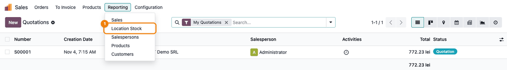
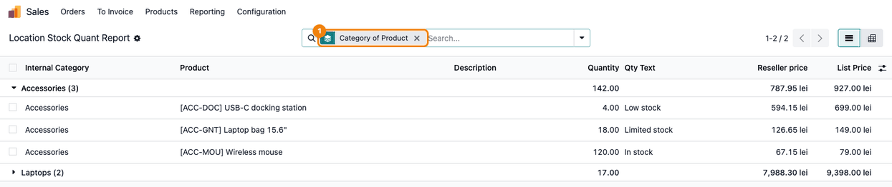

==========================
Stock Report for Resellers
==========================

..
   !!!!!!!!!!!!!!!!!!!!!!!!!!!!!!!!!!!!!!!!!!!!!!!!!!!!
   !! This file is generated by oca-gen-addon-readme !!
   !! changes will be overwritten.                   !!
   !!!!!!!!!!!!!!!!!!!!!!!!!!!!!!!!!!!!!!!!!!!!!!!!!!!!
   !! source digest: sha256:8870d56436ae232dae27449785c0b6c9eb073c57c783637475f44b02343f29e1
   !!!!!!!!!!!!!!!!!!!!!!!!!!!!!!!!!!!!!!!!!!!!!!!!!!!!

.. |badge1| image:: https://img.shields.io/badge/maturity-Production%2FStable-green.png
    :target: https://odoo-community.org/page/development-status
    :alt: Production/Stable
.. |badge2| image:: https://img.shields.io/badge/github-dhongu%2Fdeltatech-lightgray.png?logo=github
    :target: https://github.com/dhongu/deltatech/tree/20.0/deltatech_stock_reseller
    :alt: dhongu/deltatech
.. |badge_fisa| image:: https://img.shields.io/badge/-Fi%C8%99%C4%83%20consultant-2ea44f.png
    :target: https://github.com/dhongu/deltatech/blob/20.0/deltatech_stock_reseller/readme/FISA_CONSULTANT.md
    :alt: Fișă consultant
.. |badge_tests| image:: https://img.shields.io/badge/-7%20automated%20tests-2ea44f.png
    :target: https://github.com/dhongu/deltatech/tree/20.0/deltatech_stock_reseller/tests
    :alt: 7 automated tests

|badge1| |badge2| |badge_fisa| |badge_tests|

Features:

- Report with positions from stock location, with pricelist
- Choose stock location
- Choose partner or pricelist for price computation
- Two thresholds can be set for "text" quantities (i.e. Low stock,
  Limited stock, Stock) with their respective stock texts

**Table of contents**

.. contents::
   :local:

Usage
=====

1. Open *Sales > Reporting > Location Stock*. The **Reporting** menu of
   Sales is shown to sales administrators; the Sales menu is available
   once the Sales application (``sale_management``) is installed.

   |The Sales app with the Reporting menu open and the Location Stock
   entry (1) added by the module|

2. In the **Location Stock** window choose the **Source Location** and
   the **Partner**: the **Reseller Price List** is filled in from the
   partner's pricelist (you can also pick it directly; left empty, the
   reseller price equals the list price). Tick **Show text instead of
   stock** to replace the quantities with stock level labels: up to the
   **1st threshold** the report shows the **1st threshold text**, up to
   the **2nd threshold** the **2nd threshold text**, above it the
   **Above 2nd threshold text**. Keep **Refresh Report** ticked to
   recompute from the current stock, then press **Apply**.

   |The Location Stock window: Source Location (1), Partner (2),
   Reseller Price List (3), Show text instead of stock (4) with the two
   thresholds and their texts, Refresh Report (5) and the Apply button
   (6)|

3. The **Location Stock Quant Report** lists every product with free
   quantity in the location (reserved quantities excluded), with its
   **Quantity**, the stock level text (**Qty Text**), the **Reseller
   price** and the **List Price**. Check the labels and prices, then
   select the lines and use **Actions > Export**; leave the **Quantity**
   column out when the partner should only see the stock level texts.
   The **Description** column shows the internal product description
   with its HTML tags, so leave it out of the export as well.

   |The report lines; on the first one, USB-C docking station, Quantity
   4.00 (1), Qty Text Low stock (2), Reseller price 594.15 lei (3) and
   List Price 699.00 lei (4)|

4. Group the lines by **Category of Product** (or **Product**) from the
   search options, or switch to the pivot view. On the group rows, the
   price columns add up unit prices and are not meaningful.

   |The same report grouped by Category of Product (1): the first
   category unfolded with its products and its total quantity|

.. |The Location Stock window: Source Location (1), Partner (2), Reseller Price List (3), Show text instead of stock (4) with the two thresholds and their texts, Refresh Report (5) and the Apply button (6)| image:: https://raw.githubusercontent.com/dhongu/deltatech/20.0/deltatech_stock_reseller/static/description/en/02_fereastra_raport_stoc.png
.. |The report lines; on the first one, USB-C docking station, Quantity 4.00 (1), Qty Text Low stock (2), Reseller price 594.15 lei (3) and List Price 699.00 lei (4)| image:: https://raw.githubusercontent.com/dhongu/deltatech/20.0/deltatech_stock_reseller/static/description/en/03_raport_stoc_revanzator.png

Changelog
=========

20.0.1.0.7 (2026-11-04)
-----------------------

- Migration to Odoo 20.0: stock thresholds compared with
  ``uom.compare``, access rights in ``security/ir.access.csv``, tests on
  the 20.0 pricelist rules (``discount``).

19.0.1.0.7 (2026-10-22)
-----------------------

- Listed on Odoo Apps as *Stock Report for Resellers* (was *Stock Report
  Reseller*). The technical name ``deltatech_stock_reseller`` does not
  change.

19.0.1.0.6 (2026-10-17)
-----------------------

- Fix: a report generated without a reseller pricelist shows the
  reseller price in the company currency, instead of leaving it without
  currency (RESELLER-002).

19.0.1.0.5 (2026-10-09)
-----------------------

- Apps Store banner (banner.json).

19.0.1.0.4 (2026-10-01)
-----------------------

- Fix: a cached report is reused only when it was generated with the
  same partner, reseller pricelist and threshold settings
  (RESELLER-001).

19.0.1.0.3 (2026-09-29)
-----------------------

- Own module icon, instead of the generic gears it had.

Bug Tracker
===========

Bugs are tracked on `Terrabit Issues <https://www.terrabit.ro/helpdesk>`_.
In case of trouble, please check there if your issue has already been reported.

Do not contact contributors directly about support or help with technical issues.

Credits
=======

Authors
-------

* Terrabit
* Dorin Hongu

Maintainers
-----------

.. |maintainer-dhongu| image:: https://github.com/dhongu.png?size=40px
    :target: https://github.com/dhongu
    :alt: dhongu

Current maintainer:

|maintainer-dhongu| 

This module is part of the `dhongu/deltatech <https://github.com/dhongu/deltatech/tree/20.0/deltatech_stock_reseller>`_ project on GitHub.

You are welcome to contribute.