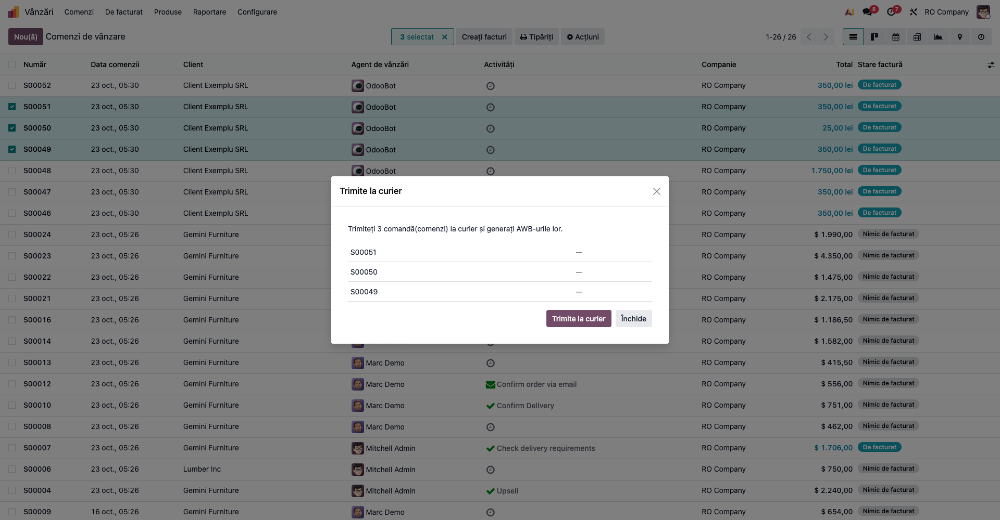
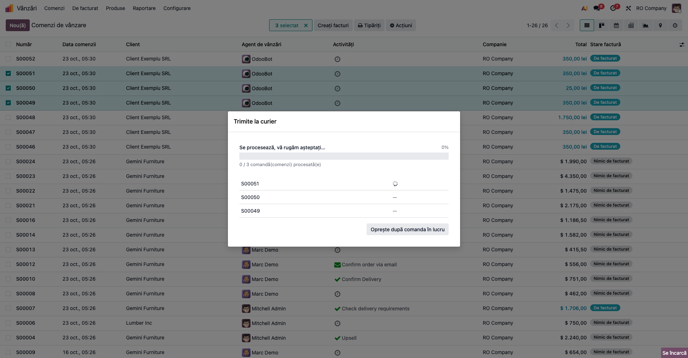
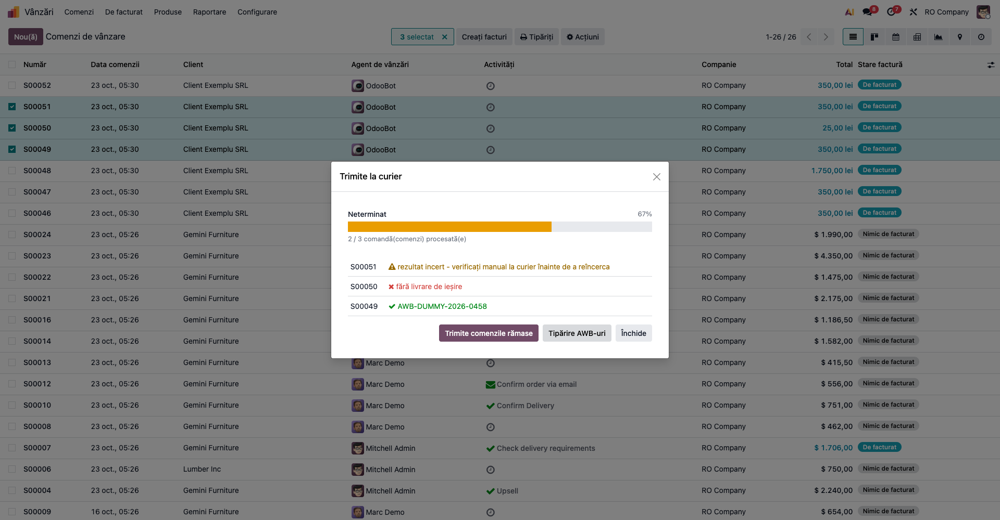

# Fișă Modul: Dialogul de progres al operațiilor lungi

**Modul:** `deltatech_task_progress`
**Utilizator principal:** Consultantul de implementare (modulul nu are meniuri proprii; dialogul îl văd
operatorii modulelor care îl folosesc: achiziții, expediere, contabilitate)
**Prioritate:** 🟢 Scăzută (nu schimbă date și nu creează documente; decide doar cum se rulează și cum
se raportează o operație lungă)

---

## 1. Scop business

Unele operații prelucrează multe elemente deodată: o factură PDF de 19 pagini citită cu AI, 40 de
comenzi trimise la curier, un export contabil cu mii de documente, un import de câteva mii de
parteneri. Rulate într-o singură cerere, ele depășesc timpul de lucru al serverului (pe odoo.sh, câteva
minute) și se opresc la jumătate, iar operatorul nu vede nimic cât așteaptă și nu știe ce s-a
prelucrat.

`deltatech_task_progress` este un **modul tehnic** care împarte operația în elemente și le rulează pe
rând, fiecare în cererea și tranzacția lui, într-un **dialog de progres comun**. Dialogul arată:

- bara de progres și timpul estimat rămas;
- contorul elementelor terminate și, unde are sens, ce au produs (linii citite, înregistrări);
- elementele care nu au reușit, cu motivul fiecăruia, și butonul care le rulează din nou;
- butonul care oprește operația după elementele aflate în lucru.

Un element terminat rămâne salvat chiar dacă un altul eșuează sau dacă operatorul închide browserul.
**Modulul nu are meniuri, câmpuri, date sau acțiuni programate și nu face nimic singur.** Fiecare modul
care îl folosește decide ce înseamnă un element și ce se întâmplă la final.

## 2. Bază legală și context

Nu există un temei legal propriu: modulul nu creează documente, nu face note contabile și nu întocmește
declarații. Contextul este tehnic:

- o cerere către server are o durată maximă (`limit_time_real`, pe odoo.sh câteva minute); o operație
  mai lungă e întreruptă și tranzacția ei e anulată, deci nimic nu se salvează;
- împărțită în elemente, fiecare element se salvează imediat ce e gata, iar o întrerupere pierde cel
  mult elementul aflat în lucru.

## 3. Utilizatori și roluri

Modulul nu are grupuri de drepturi. Dialogul rulează cu drepturile utilizatorului care pornește
operația, în modulul care îl folosește:

| Modul care îl folosește | Operația din dialog | Cine o pornește |
|---|---|---|
| `deltatech_ai_purchase_pdf` | citirea pe părți a unei facturi PDF de furnizor, cu AI | responsabilul de achiziții, cu drepturi pe comenzile de achiziție |
| `deltatech_delivery` | **Trimite la curier** din lista comenzilor de vânzare | operatorul de expediere, cu drepturi pe comenzi și livrări |
| exportul contabil pe bucăți și importul de clienți / furnizori din programul de contabilitate | generarea fișierelor pe bucăți, importul pe loturi | contabilul |

Rol recomandat la testare: administratorul, care are acces la toate cele trei operații.

## 4. Conturi și date implicate

Modulul nu folosește conturi contabile și nu creează note contabile. Datele prelucrate (comenzi,
facturi, parteneri, documente exportate) aparțin modulului care pornește dialogul.

Ce trebuie să știe consultantul despre rezultatul fiecărui element:

| Starea rândului | Semn | Ce înseamnă | Se rulează din nou? |
|---|---|---|---|
| În așteptare | — | elementul nu a fost încă rulat | da, la pornire sau la **Rulează elementele rămase** |
| În lucru | rotiță | cererea pentru element e în curs | — |
| Reușit | ✅ verde, cu mesajul (ex. numărul AWB) | elementul e terminat și salvat | nu |
| De verificat | ⚠️ galben, cu mesajul | elementul e terminat, dar rezultatul trebuie verificat de mână (ex. curierul nu a confirmat răspunsul, rânduri cu date greșite într-un lot de import) | **nu**, ca să nu se dubleze (ex. un al doilea AWB) |
| Eșuat | ❌ roșu, cu motivul | elementul nu a produs rezultatul așteptat | da, după ce s-a corectat cauza |

Câte elemente rulează în același timp decide modulul care folosește dialogul:

| Operația | Elemente în paralel | De ce |
|---|---|---|
| Citirea PDF cu AI | 3, parametrul de sistem `deltatech_ai_purchase_pdf.parallel_calls` | paginile sunt independente; mai multe deodată scurtează așteptarea |
| Trimiterea la curier | 1 | ca să nu încarce interfața curierului cu cereri simultane |
| Exportul și importul contabil | 1 | loturile importului scriu aceleași înregistrări (parteneri, coduri); exportul nu a fost validat pentru rulare în paralel |

## 5. Configurare inițială

Modulul nu are setări. Se instalează automat ca dependență a modulelor care îl folosesc (la actualizarea
acestora), deci nu trebuie instalat separat.

Pe baza demo, pentru a vedea dialogul:

1. Instalați `deltatech_delivery` și un modul de curier de test (`deltatech_delivery_dummy`).
2. Confirmați câteva comenzi de vânzare cu livrare la acest curier. Pentru un rezultat **Eșuat**,
   confirmați și o comandă care conține doar servicii (nu are livrare de ieșire). Rezultatul **De
   verificat** apare doar când curierul real nu confirmă răspunsul; pe baza demo nu se poate provoca.
3. Pentru rularea mai multor elemente în paralel, configurați citirea PDF cu AI din
   `deltatech_ai_purchase_pdf` (fișa acelui modul) și pregătiți un PDF de factură de cel puțin două
   pagini.

## 6. Flux de utilizare

Dialogul e același în toate modulele care îl folosesc; diferă textele butoanelor și ce înseamnă un
element. Pașii de mai jos folosesc trimiterea la curier, unde fiecare element are un rând cu rezultatul
lui, și citirea PDF cu AI, unde dialogul pornește singur și se închide singur la final.

### Pasul 1 — Deschiderea dialogului, înainte de pornire

Din **Vânzări → Comenzi → Comenzi**, selectați comenzile și alegeți **Acțiuni (⚙) → Trimite la
curier**. Dialogul arată introducerea („Trimiteți 3 comandă(comenzi) la curier și generați AWB-urile
lor.”) și câte un rând pe comandă, toate în așteptare. Nimic nu a pornit încă: operatorul verifică
selecția și apasă **Trimite la curier**.



La alte operații dialogul pornește singur, fără acest pas (citirea PDF, exportul contabil).

### Pasul 2 — Rularea

Cât rulează, dialogul arată starea („Se procesează, vă rugăm așteptați…”), bara de progres, contorul
(„0 / 3 comandă(comenzi) procesată(e)”) și, pe rânduri, elementul în lucru cu o rotiță. Cât rulează,
butonul **Închide** și X-ul din colț nu se afișează, iar Escape nu închide dialogul, ca operatorul să nu
lase elemente nerulate.

**Oprește după comanda în lucru** oprește operația fără să întrerupă elementul aflat deja la server:
acesta se termină, iar celelalte rămân în așteptare.



### Pasul 3 — Rezultatul pe rânduri

La final, fiecare rând arată rezultatul lui.

**Găsește pe ecran:**

- starea din stânga sus: **Gata** cu bara verde când toate elementele au reușit; **Gata** cu bara
  galbenă când există rânduri de verificat; **Neterminat** când există rânduri eșuate; **Oprit** când
  operația a fost oprită și au rămas elemente în așteptare;
- contorul, de exemplu „2 / 3 comandă(comenzi) procesată(e)”. Un rând de verificat se numără ca
  procesat, unul eșuat nu;
- rândurile: ✅ cu numărul AWB, ⚠️ „rezultat incert - verificați manual la curier înainte de a
  reîncerca”, ❌ „fără livrare de ieșire”.

**Verifică:**

- fiecare comandă selectată are un rând cu un rezultat, niciuna nu a rămas cu „—”;
- rândurile ⚠️ se verifică la curier înainte de orice altă trimitere;
- rândurile ❌ au o cauză care se poate corecta (livrare lipsă, curier lipsă pe livrare).

**Treci mai departe:**

- **Trimite comenzile rămase** rulează din nou **doar** rândurile ❌ și pe cele oprite. Rândurile ⚠️
  nu se mai trimit;
- **Tipărire AWB-uri** (butonul de final al acestei operații) descarcă etichetele generate; o comandă
  fără AWB nu apare în PDF. Dialogul rămâne deschis;
- **Închide** închide dialogul. Ce s-a terminat rămâne salvat.



### Pasul 4 — Elemente rulate în paralel, cu final automat

La citirea unei facturi PDF de mai multe pagini cu AI (**Achiziții → Comenzi → Comenzi de achiziție**,
butonul **Import factură** pe comandă, apoi **Previzualizare**), dialogul **Citirea facturii PDF cu
AI** pornește singur și citește mai multe părți deodată (implicit trei, parametrul
`deltatech_ai_purchase_pdf.parallel_calls`). Contorul arată și ce au produs pașii: „2 / 3 părți
citite (3 pagini) — 8 linii”. Aici nu se afișează un rând pe element; un element eșuat apare în lista
de erori de sub bară, cu numele părții.

Când toate părțile sunt citite, dialogul se închide singur și deschide previzualizarea importului.
Dacă o parte eșuează, previzualizarea **nu** se deschide până când nu e citită și ea (**Citește
părțile rămase**), ca nicio linie de factură să nu lipsească.


Exportul contabil pe bucăți și importul de clienți / furnizori din programul de contabilitate
funcționează la fel. Dialogul pregătește întâi lucrul („Se colectează documentele perioadei…”), apoi
rulează bucățile, una câte una. La final deschide formularul exportului, cu arhiva de descărcat și
lista fișierelor ei, sau rezultatul importului, cu toate erorile pe rânduri.

### Note de monografie și raportare

Modulul nu generează note contabile și nu apare în rapoarte. Notele contabile, dacă există, aparțin
operației din modulul care folosește dialogul.

## 7. Legături cu alte module / declarații

| Modul | Rol |
|---|---|
| `deltatech_ai_purchase_pdf` | citirea pe părți a facturilor PDF de furnizor, cu final automat (previzualizarea importului) |
| `deltatech_delivery` | **Trimite la curier** din lista comenzilor, cu rând pe comandă și **Tipărire AWB-uri** la final |
| exportul și importul cu programul de contabilitate | exportul pe bucăți (pregătire, bucăți, arhivă) și importul de clienți / furnizori pe loturi |

**Ce e automat:** împărțirea în elemente, rularea pe rând sau în paralel, salvarea fiecărui element,
estimarea timpului, reluarea doar a elementelor eșuate, blocarea închiderii cât rulează.

**Ce rămâne manual:** verificarea rândurilor ⚠️, corectarea cauzei rândurilor ❌ înainte de reluare,
pornirea operației acolo unde dialogul cere confirmare (trimiterea la curier).

## 8. Verificări pentru consultant

- [ ] **Trimite la curier** pe trei comenzi deschide dialogul cu introducerea și trei rânduri „—”;
      nimic nu se trimite până la apăsarea butonului de pornire.
- [ ] În timpul rulării, butonul **Închide** și X-ul din colț nu se afișează, iar Escape nu închide
      dialogul.
- [ ] **Oprește după comanda în lucru** termină comanda în curs și lasă restul în așteptare; contorul
      nu le numără.
- [ ] La final, fiecare comandă are un rând cu rezultat: ✅ cu AWB, ⚠️ cu mesaj de verificare sau ❌ cu
      motiv.
- [ ] **Trimite comenzile rămase** rulează doar rândurile ❌ și pe cele oprite, niciodată pe cele ⚠️.
- [ ] **Tipărire AWB-uri** descarcă etichetele comenzilor ✅; o comandă fără AWB nu apare în PDF.
- [ ] Un PDF de cel puțin două pagini deschide dialogul citirii, cu contorul de părți, pagini și linii,
      și se închide singur deschizând previzualizarea.
- [ ] O parte eșuată la citirea PDF ține previzualizarea închisă până la **Citește părțile rămase**.
- [ ] După închiderea browserului în mijlocul unei operații, elementele deja ✅ rămân salvate (ex.
      comenzile au AWB pe livrare).

## 9. Mesaje de eroare frecvente

Modulul nu are mesaje de eroare proprii: un rând ❌ arată mesajul primit de la operație. Situațiile
frecvente:

| Mesaj / situație | Cauză | Remediere |
|---|---|---|
| Starea **Neterminat**, cu rânduri ❌ (sau, la operațiile fără listă pe rânduri, cum e citirea PDF, mesajul „N element(e) nu au reușit. Rulați-le din nou pentru a continua.”) | cel puțin un element a eșuat (timp depășit, eroare la serviciul extern, date lipsă) | corectați cauza din mesajul rândului, apoi **Rulează elementele rămase** (sau butonul echivalent al operației) |
| Un rând ⚠️ nu se reia la **Rulează elementele rămase** | rezultatul e de verificat de mână, nu e o eroare (ex. răspunsul curierului s-a pierdut) | verificați la serviciul extern; dacă operația nu s-a făcut, porniți-o din nou din modulul ei |
| Mesaj roșu după butonul de final (ex. **Tipărire AWB-uri** când nicio comandă nu are etichetă) | finalul operației a eșuat; starea devine **Neterminat** deși toate rândurile au rezultat | verificați că elementele reușite au rezultatul (AWB, etichetă), apoi apăsați din nou butonul |
| Finalul (previzualizarea, arhiva) nu se deschide | finalul automat așteaptă ca toate elementele să reușească | rulați elementele eșuate |
| Mesaj de eroare roșu în locul listei, înainte de rulare (exportul și importul contabil) | pregătirea lucrului a eșuat (ex. fișierul de import nu poate fi citit, baza afișează un mesaj de mentenanță) | corectați cauza și porniți operația din nou |
| Elementele în paralel nu merg mai repede, timpul rămas nu scade | paralelismul operației depășește numărul de procese web ale serverului: cererile în plus doar așteaptă | scădeți parametrul de paralelism al operației (ex. `deltatech_ai_purchase_pdf.parallel_calls`) |

## 10. Capturi de ecran

Modulul nu are ecrane proprii; dialogul se vede în modulele care îl folosesc. Capturile din
`static/description/` sunt copii ale capturilor acelor module, în română, pe planul de conturi RO:

| Pasul | Fișier | Ce arată | Sursa |
|---|---|---|---|
| 1 | `01_dialog_pornire_lista.png` | dialogul **Trimite la curier** înainte de pornire | `deltatech_delivery/readme/screenshots/06_dialog_send_to_carrier_initial.png` |
| 2 | `02_dialog_in_lucru.png` | rularea: starea, bara, elementul în lucru, butonul de oprire | `deltatech_delivery/readme/screenshots/07_dialog_send_to_carrier_progres.png` |
| 3 | `03_dialog_rezultat_pe_randuri.png` | finalul: rânduri ✅, ⚠️ și ❌, reluarea și **Tipărire AWB-uri** | `deltatech_delivery/readme/screenshots/08_dialog_send_to_carrier_finalizat_print.png` |
| 4 | `04_dialog_citire_pdf.png` | citirea PDF cu AI: dialogul pornit singur, contorul de părți, pagini și linii, butonul de oprire | `deltatech_ai_purchase_pdf/readme/screenshots/05_progres_citire.png` |

Capturile sunt generate automat de testele `tests/test_screenshots.py` ale modulelor sursă (mixinul
`ScreenshotCase` din `l10n_ro_doc_screenshots`). La o regenerare acolo, se copiază din nou aici.
Regenerarea pentru pașii 1–3:

```bash
./odoo/odoo-bin -c odoo.conf -d <db> \
    -i deltatech_delivery,deltatech_delivery_dummy,l10n_ro_doc_screenshots \
    --test-tags=fise_screenshots/deltatech_delivery --stop-after-init
```

Pentru pasul 4 (captura sursă e făcută cu `parallel_calls = 1`, ca dialogul să fie prins la
jumătate):

```bash
./odoo/odoo-bin -c odoo.conf -d <db> \
    -i deltatech_ai_purchase_pdf,l10n_ro_doc_screenshots \
    --test-tags=fise_screenshots/deltatech_ai_purchase_pdf --stop-after-init
```

## 11. Observații pentru manual

- Modulul nu are un capitol propriu în manual. Comportamentul dialogului (stările unui rând, reluarea,
  oprirea) se descrie o dată și se trimite la el din capitolele operațiilor care îl folosesc.
- Mesajul pentru client: „Operațiile lungi rulează pe bucăți. Ce s-a terminat rămâne salvat, chiar dacă
  închideți fereastra, iar ce n-a mers se poate rula din nou fără să refaceți totul.”
- Diferența dintre ⚠️ și ❌ este importantă la curier: ⚠️ înseamnă că expedierea poate exista deja la
  curier, deci nu se retrimite din dialog, ca să nu apară un AWB dublu.
- Paralelismul e o setare a fiecărei operații, nu a modulului. Numai citirea PDF cu AI rulează mai
  multe elemente deodată.
- Testele automate ale dialogului: `deltatech_task_progress/tests/test_task_progress.py` (Python) și
  `static/tests/task_progress.test.js` (Hoot, prin `tests/test_js.py`).
