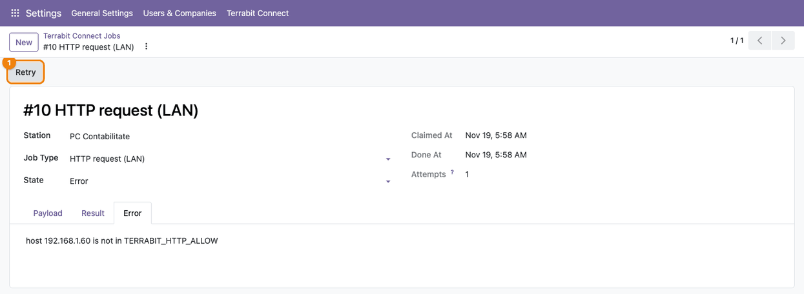

=======================
Terrabit Connect - Base
=======================

..
   !!!!!!!!!!!!!!!!!!!!!!!!!!!!!!!!!!!!!!!!!!!!!!!!!!!!
   !! This file is generated by oca-gen-addon-readme !!
   !! changes will be overwritten.                   !!
   !!!!!!!!!!!!!!!!!!!!!!!!!!!!!!!!!!!!!!!!!!!!!!!!!!!!
   !! source digest: sha256:951c29a0e8387da1c074aed9ba072557ed3c55b5711bb7d37ed6b634f792e14d
   !!!!!!!!!!!!!!!!!!!!!!!!!!!!!!!!!!!!!!!!!!!!!!!!!!!!

.. |badge1| image:: https://img.shields.io/badge/maturity-Production%2FStable-green.png
    :target: https://odoo-community.org/page/development-status
    :alt: Production/Stable
.. |badge2| image:: https://img.shields.io/badge/github-dhongu%2Fdeltatech-lightgray.png?logo=github
    :target: https://github.com/dhongu/deltatech/tree/20.0/deltatech_tc
    :alt: dhongu/deltatech
.. |badge_fisa| image:: https://img.shields.io/badge/-Fi%C8%99%C4%83%20consultant-2ea44f.png
    :target: https://github.com/dhongu/deltatech/blob/20.0/deltatech_tc/readme/FISA_CONSULTANT.md
    :alt: Fișă consultant
.. |badge_tests| image:: https://img.shields.io/badge/-62%20automated%20tests%20%C2%B7%2087%25%20code%20coverage-2ea44f.png
    :target: https://app.codecov.io/gh/dhongu/deltatech/tree/20.0/deltatech_tc
    :alt: 62 automated tests · 87% code coverage

|badge1| |badge2| |badge_fisa| |badge_tests|

Base module for **Terrabit Connect** — the lightweight native agent that
runs on a workstation and bridges Odoo with local hardware and services
it cannot reach directly from the cloud: the ANAF token (PKCS#11 / mTLS
to SPV), fiscal printers (Datecs), label printers (Zebra ZPL) and
declaration validation (DUKIntegrator).

Terrabit Connect is a desktop application for Windows, macOS and Linux,
built with Tauri (Rust core, the operating system's own web view).
Installers and signed automatic updates are published at:

``https://github.com/dhongu/terrabit-connect-releases/releases/latest``

|Terrabit Connect main window: the TC service running, the Odoo
connection and the unlocked token marked Connected, the ANAF / SPV job
queue with 2 jobs in progress and 1 error, and the quick actions Open
Odoo and Sync SPV|

|Terrabit Connect job queue: a declaration validation (DUK) in Error, an
SPV message sync Pending, a document download Claimed and a finished SPV
sync|

The agent's interface is in Romanian and English. By default (**Auto**)
it follows the language of the station's company in Odoo; it can also be
fixed per workstation profile.

This module is the **generic foundation** every Terrabit Connect feature
builds on: the connection layer, the job protocol, and the one job type
that is pure transport rather than a specific device — an HTTP call
inside the customer's network.

**✨ What it gives you**

- **Station registry** (``deltatech.tc.station``) — one record per
  workstation running Terrabit Connect, each with a unique API key, a
  last-seen timestamp and reported metadata (TC version, operating
  system, enabled features).
- **Outbound job queue** (``deltatech.tc.job``) — Odoo enqueues
  ``pending`` jobs; the station claims them, executes them locally, and
  reports back the result (``done`` / ``error``).
- **REST endpoints** authenticated with the ``X-Station-Key`` header:
  ``/tc/heartbeat``, ``/tc/poll``, ``/tc/result``, ``/tc/config/<id>``.
- **``http_request`` job type** — Odoo asks the station to call a device
  that answers only inside the local network (a sorting line, a scale, a
  PLC, a label server) and reports the response back. Queue it with
  ``_tc_enqueue_http()`` and read the answer with ``response_dict()`` /
  ``response_json()``.
- **``pg_query`` job type** — for the *Terrabit Connect PostgreSQL*
  agent (a Windows service, separate from the desktop app): Odoo asks
  for one page of a **read-only query** on a database in the customer's
  network (e.g. orders from a local production database) — SQL written
  in the feature module, or a named query installed on the station — and
  receives the rows; the next pages are queued automatically. Queue it
  with ``_tc_enqueue_pg_query()`` and read the rows with ``pg_rows()``.

**Cloud model — no inbound ports.** The station always initiates the
connection to Odoo; Odoo never connects back to the workstation. The
same agent works with on-premise and cloud deployments without opening
any port on the client side.

**Extensible.** Feature modules add device-specific job types
(``selection_add`` on ``job_type``) and turn the station's result into
business records by extending the ``_process_result`` hook — keeping the
registry, queue and transport in one place.

**Security of ``http_request`` — read this before using it.** The
allow-list of reachable hosts is configured **in the agent, on the
workstation**, never from Odoo. Without that rule, a job saying "call
this URL" would let anyone able to create a job in Odoo reach any
address inside the customer's network. Odoo only validates the shape of
the request (scheme, host present, known method); the decision to
actually place the call belongs to the machine sitting in that network.

**Security of ``pg_query``.** Odoo names a profile (a database
configured on the station, never a host or a user) and sends either SQL
or the name of a query file installed there. SQL is accepted only on
profiles where the station allows it (``allow_sql``). Each page is a
single ``SELECT`` with bound parameters, in a read-only transaction with
a timeout, under a database user that should only be able to read what
Odoo needs: **that user's grants are the boundary** of what Odoo can
read.

Callbacks are restricted to methods whose name starts with **``_tc_``**.
The method name is stored in the database, so without that rule a
modified record could call any ORM method. The prefix also makes
"reachable from a job" a property you can grep for.

.. |Terrabit Connect main window: the TC service running, the Odoo connection and the unlocked token marked Connected, the ANAF / SPV job queue with 2 jobs in progress and 1 error, and the quick actions Open Odoo and Sync SPV| image:: https://raw.githubusercontent.com/dhongu/deltatech/20.0/deltatech_tc/static/description/11_tc_app_principal.png
.. |Terrabit Connect job queue: a declaration validation (DUK) in Error, an SPV message sync Pending, a document download Claimed and a finished SPV sync| image:: https://raw.githubusercontent.com/dhongu/deltatech/20.0/deltatech_tc/static/description/12_tc_app_joburi.png

**Table of contents**

.. contents::
   :local:

Configuration
=============

Security groups
---------------

Assign users to the appropriate group under **Settings → Users &
Companies → Users** (field *Terrabit Connect*):

+-------------+--------------------------------------------------------+
| Group       | Access                                                 |
+=============+========================================================+
| **User**    | Can view stations and jobs (read-only)                 |
+-------------+--------------------------------------------------------+
| **Manager** | Full access: create/edit stations, download config,    |
|             | regenerate keys, view job details                      |
+-------------+--------------------------------------------------------+

The administrator (``base.user_admin``) is a Manager by default.

Only Managers can access the **Settings → Terrabit Connect** menus and
download ``station.conf`` files (the endpoint ``/tc/config/<id>`` checks
the Manager group).

Station registration
--------------------

Each physical workstation that runs Terrabit Connect needs **one station
record** in Odoo:

1. Go to **Settings → Terrabit Connect → Stations → New**.
2. Set **Name** (identifies the workstation in job logs and
   notifications).
3. Set **Company** (defaults to the user's company; used for
   multi-company job routing).
4. Save to generate the **API Key** automatically.

The API key is the credential the agent uses in the ``X-Station-Key``
HTTP header. It is displayed masked in the form and visible only to
system administrators.

Station configuration file (``station.conf``)
---------------------------------------------

After registering a station, click **Download config** on the station
form. The downloaded file contains two environment variables consumed by
Terrabit Connect:

+--------------------------+-------------------------------------------+
| Variable                 | Description                               |
+==========================+===========================================+
| ``TERRABIT_ODOO_BASE``   | Base URL of the Odoo instance (e.g.       |
|                          | ``https://yourcompany.odoo.com``)         |
+--------------------------+-------------------------------------------+
| ``TERRABIT_STATION_KEY`` | The station's API key — treat it as a     |
|                          | secret                                    |
+--------------------------+-------------------------------------------+

In Terrabit Connect, import ``station.conf`` from **Settings → Import
config** (**Setări → Importă config** in the Romanian interface). The
values are stored in the active profile of the workstation
(``~/.terrabit-anaf-agent/profiles/<profile>.conf``) and applied without
a restart.

The agent's interface language is set in **Settings → Appearance →
Language**: **Auto** (default) follows the language of the station
company's partner, sent by Odoo in the heartbeat answer (Romanian for
``ro_RO``, English otherwise); **Română** or **English** fix it for the
workstation profile (``TERRABIT_LANG=ro`` / ``en``). No other network
configuration is required: the agent initiates all connections outbound
to Odoo (no inbound port needs to be opened on the client side).

|Terrabit Connect settings: configuration profile Default, active, on
firma-demo.odoo.com with a station, and the features ANAF signature and
Odoo bridge enabled|

|Terrabit Connect settings, Odoo connection: Odoo instance
firma-demo.odoo.com, the API key masked, browser access and the token /
ANAF section|

Job polling and heartbeat (workstation side)
--------------------------------------------

The heartbeat runs on its own: once at start-up, then every 300 seconds.
**Job polling is off until you turn it on** in the station profile:

+-----------------------------+---------+-----------------------------+
| Variable                    | Default | Effect                      |
+=============================+=========+=============================+
| ``TERRABIT_POLL_JOBS``      | off     | ``1`` lets the station      |
|                             |         | claim and run jobs from     |
|                             |         | ``/tc/poll``. While it is   |
|                             |         | off, jobs queued in Odoo    |
|                             |         | stay ``pending``            |
+-----------------------------+---------+-----------------------------+
| ``TERRABIT_POLL_SEC``       | 30      | Seconds between             |
|                             |         | ``/tc/poll`` calls (minimum |
|                             |         | 5)                          |
+-----------------------------+---------+-----------------------------+

Queue settings (Odoo side)
--------------------------

System parameters (**Settings → Technical → System Parameters**), all
optional:

+----------------------------------------+---------+-----------------------------+
| Parameter                              | Default | Effect                      |
+========================================+=========+=============================+
| ``deltatech_tc.claim_timeout_minutes`` | 15      | A claimed job without       |
|                                        |         | result after this long      |
|                                        |         | counts as lost. ``0`` turns |
|                                        |         | recovery off                |
+----------------------------------------+---------+-----------------------------+
| ``deltatech_tc.max_attempts``          | 3       | Offers of a retry-safe job  |
|                                        |         | before it fails             |
+----------------------------------------+---------+-----------------------------+
| ``deltatech_tc.done_ttl_days``         | 30      | Finished jobs older than    |
|                                        |         | this are deleted by the     |
|                                        |         | hourly cleanup (``0`` =     |
|                                        |         | keep)                       |
+----------------------------------------+---------+-----------------------------+
| ``deltatech_tc.done_ttl_hours``        | 0       | When set, finished jobs go  |
|                                        |         | after this many hours       |
|                                        |         | instead (``0`` = use the    |
|                                        |         | days)                       |
+----------------------------------------+---------+-----------------------------+
| ``deltatech_tc.pg_done_ttl_hours``     | 6       | Finished ``pg_query`` pages |
|                                        |         | go after this many hours    |
|                                        |         | (``0`` = like the other     |
|                                        |         | jobs)                       |
+----------------------------------------+---------+-----------------------------+
| ``deltatech_tc.error_ttl_days``        | 90      | Same for jobs in error      |
+----------------------------------------+---------+-----------------------------+
| ``deltatech_tc.pending_ttl_hours``     | 0       | Pending jobs no station     |
|                                        |         | picked up expire after this |
|                                        |         | long. ``0`` = never         |
+----------------------------------------+---------+-----------------------------+

Keep the claim timeout above the longest job you run (a DUKIntegrator
validation, a slow device): a retry-safe job that is still running when
it expires is executed twice.

Hosts reachable by ``http_request`` (workstation side)
------------------------------------------------------

``http_request`` jobs are refused unless the target host is allow-listed
**on the workstation**. The list is deliberately not manageable from
Odoo: it is the last line of defence if an Odoo account is compromised.

::

   TERRABIT_HTTP_ALLOW=192.168.1.50:8080,unisorter.local

Comma-separated ``host`` or ``host:port`` entries. An entry without a
port allows any port on that host; with a port, the match is exact.
**The default is empty — until a host is listed there, every
``http_request`` job comes back as an error.** Keep it as narrow as the
job actually needs.

Terrabit Connect PostgreSQL (workstation side)
----------------------------------------------

The PostgreSQL agent is a separate Windows service (``tc-postgresql``),
installed from the release zip with ``install.ps1``, with its own
station and key. Its configuration lives in
``%ProgramData%\Terrabit\tc-postgresql\``:

- ``station.conf`` downloaded from the station (or ``[odoo]`` in
  ``config.toml``);
- ``config.toml``: one ``[profiles.<name>]`` per database (host,
  database, a **read-only** user, timeouts, page limits); passwords
  encrypted with ``tc-postgresql secret set <profile>`` (Windows DPAPI).
  ``allow_sql = true`` lets Odoo send SQL for the profile (feature
  ``pg_sql:<profile>``): give that database user ``SELECT`` only, only
  on the schema or tables Odoo needs — its grants are what Odoo can
  read;
- ``queries\<profile>\*.sql`` (optional): named queries, for profiles
  without ``allow_sql``.

``tc-postgresql check`` verifies the files, the database and the Odoo
connection. The station form then shows **Agent** ``tc-postgresql``, the
features ``postgresql,pg:<profile>`` and the installed queries. The
agent updates itself from signed releases.

On the Odoo side, ``deltatech_tc.pg_done_ttl_hours`` (default 6) sets
how long finished ``pg_query`` pages are kept: their data is already in
the records of the calling module, and a synchronization reads thousands
of them. The former ``deltatech_tc.pg_done_ttl_days`` still counts (in
days) when only it is set; ``0`` there, as before, keeps the pages like
the other jobs.

The server applies a 60-second throttle on ``last_seen`` writes to
reduce database load when many stations are polling frequently; online
detection remains accurate within the throttle window.

.. |Terrabit Connect settings: configuration profile Default, active, on firma-demo.odoo.com with a station, and the features ANAF signature and Odoo bridge enabled| image:: https://raw.githubusercontent.com/dhongu/deltatech/20.0/deltatech_tc/static/description/13_tc_app_setari.png
.. |Terrabit Connect settings, Odoo connection: Odoo instance firma-demo.odoo.com, the API key masked, browser access and the token / ANAF section| image:: https://raw.githubusercontent.com/dhongu/deltatech/20.0/deltatech_tc/static/description/14_tc_app_conexiune_odoo.png

Usage
=====

Registering a station
---------------------

1. Go to **Settings → Terrabit Connect → Stations**. The list shows, for
   each station, when it was **Last Seen**, its **TC Version** and
   whether it runs in **Simulation** (highlighted rows).

   |Terrabit Connect Stations list: Casa 1 Magazin (test) highlighted
   with Simulation ticked, PC Contabilitate and Server ERP (the
   PostgreSQL agent, version 0.1.0)|

2. Click **New** and give the station a descriptive name (e.g.
   ``Accounting PC``).

3. Select the company the station belongs to (multi-company
   installations).

4. Save. An **API Key** is generated automatically and is visible to
   administrators only (shown masked in the form).

5. Click **Download config** (download icon in the header) — Odoo serves
   a pre-filled ``station.conf`` file containing:

   ::

      TERRABIT_ODOO_BASE=<your Odoo URL>
      TERRABIT_STATION_KEY=<the generated key>

6. Copy ``station.conf`` to the workstation and import it in Terrabit
   Connect (**Setări → Importă config**). The agent authenticates with
   the ``X-Station-Key`` header on every call.

   |Station form PC Contabilitate: Ping and Download config in the
   header, Last Seen, TC Version 1.8.2, Operating System Windows 11,
   Features and Fiscal Driver fiscalwire|

Verifying connectivity
----------------------

Once Terrabit Connect is running with the downloaded config:

1. Open the station form (**Settings → Terrabit Connect → Stations**,
   click the station).
2. The **Last Seen** field updates at the first heartbeat, sent as soon
   as the agent starts, and then at every heartbeat or job poll.
3. Click **Ping** in the header to enqueue a round-trip test job. The
   job appears in the **Jobs** smart button and reaches state ``Done``
   at the next poll — provided job polling is enabled on the workstation
   (``TERRABIT_POLL_JOBS=1``, see CONFIGURE).
4. Terrabit Connect managers also receive a browser notification when
   the agent sends a manual heartbeat.

Simulated stations
------------------

When Terrabit Connect runs in simulation mode, the station reports at
every heartbeat the fiscal driver ``simulated`` and the simulated
devices: ``fiscal`` for the cash register and ``terminal:<id>`` for each
card terminal. The station form then shows a **Simulation** ribbon and a
warning listing the simulated devices; receipts and card payments made
through them are not real. The marking comes from the station: it
disappears on its own at the first heartbeat sent without simulated
devices.

|Station form Casa 1 Magazin (test): Simulation ribbon, the warning with
the simulated devices fiscal,terminal:demo and Fiscal Driver simulated|

Monitoring jobs
---------------

Navigate to **Settings → Terrabit Connect → Jobs** to see all jobs
across all stations. You can filter by state (``Pending``, ``Claimed``,
``Done``, ``Error``) or group by station or job type.

The job list uses colour coding:

- Green row — ``Done``
- Red row — ``Error`` (open the form to read the error detail)
- Muted row — ``Claimed`` (the station picked it up; result not yet
  reported)

|Terrabit Connect Jobs list: a Ping Done (green), an HTTP request (LAN)
in Error (red), one Claimed (muted), a Ping Pending and three PostgreSQL
query (LAN) pages on Server ERP, two Done and the third Pending|

Open a job to read its **Payload**, **Result** and **Error** tabs.

|An HTTP request (LAN) job in Error, Error tab open with the message
returned by the station, Retry button in the header|

Lost results and retries
~~~~~~~~~~~~~~~~~~~~~~~~

A job whose result never came back (agent restarted, network down
between execution and reply) is handled after the claim timeout (see
CONFIGURE):

- **retry-safe jobs** (``ping``, ``http_request`` with ``GET`` or
  ``HEAD``) are offered to the station again, then fail after the
  maximum number of attempts;
- **all other jobs** stay ``Claimed``, because they may already have
  run. Find them with the **Claimed** filter, check on the device or at
  ANAF whether the operation happened, and only then use **Retry** on
  the job form (managers only).

**Retry** also puts a job in ``Error`` back in the queue.

A feature module whose job type only reads can declare it retry-safe:

.. code:: python

   def _tc_is_retry_safe(self):
       return self.job_type == "sync_messages" or super()._tc_is_retry_safe()

Rotating the API key
--------------------

If a station key is compromised:

1. Open the station form.
2. Click **Regenerate key** and confirm the prompt.
3. Download the updated ``station.conf`` and deploy it to the
   workstation. Terrabit Connect will fail to authenticate until it is
   reconfigured with the new key.

Staging and other copies of the database
----------------------------------------

When the database is copied and neutralized (an odoo.sh staging or
development branch, or ``odoo-bin neutralize``), every station of the
copy gets a **new key**, so the agents of production never serve the
copy and an agent set up for the copy can not authenticate on
production. Jobs that were still **Pending** or **Claimed** are closed
in **Error** instead of being run a second time. To test on the copy,
download ``station.conf`` from the copy and use it on a test station
(for the PostgreSQL agent: a ``[connections.staging]`` entry).

Calling a device on the local network
-------------------------------------

Queue the call from a feature module:

.. code:: python

   station = self.env["deltatech.tc.station"].search([("company_id", "=", self.env.company.id)], limit=1)
   self.env["deltatech.tc.job"]._tc_enqueue_http(
       station,
       "http://192.168.1.50/api/Lines/1/Lots",
       headers={"X-API-KEY": self.api_key},
       timeout=30,
       callback=(self, "_tc_apply_lots"),
   )

Handle the response on the record that asked for it:

.. code:: python

   def _tc_apply_lots(self, job):
       response = job.response_dict()
       if response.get("status") != 200:
           raise UserError(self.env._("The device answered %(code)s.", code=response.get("status")))
       for payload in job.response_json() or []:
           ...

The callback method **must** start with ``_tc_`` — see DESCRIPTION.
Before the first job can succeed, the target host has to be allow-listed
on the workstation (see CONFIGURE).

**The call is asynchronous.** It runs when the station next polls, not
when the job is created. Interactive buttons must therefore show a
pending state and let the result arrive later; do not queue a job and
read its result in the same transaction.

Reading a PostgreSQL database in the local network
--------------------------------------------------

Install the *Terrabit Connect PostgreSQL* agent on a server that reaches
the database (its own station, not the one of the desktop app), with
``allow_sql = true`` on the profile, and queue pages from a feature
module; the SQL lives in the module:

.. code:: python

   ORDERS_SINCE = """
       SELECT id, name, confirmed_at
         FROM erp.orders
        WHERE confirmed_at >= %(since)s
          AND (%(after)s::bigint IS NULL OR id > %(after)s)
        ORDER BY id
   """

   station = self.env["deltatech.tc.station"]._tc_find("pg:erp")
   if not station._tc_has_pg_sql("erp"):
       raise UserError(self.env._("The ERP station does not accept SQL from Odoo (allow_sql)."))
   self.env["deltatech.tc.job"]._tc_enqueue_pg_query(
       station,
       "erp",
       sql=ORDERS_SINCE,
       key="id",
       params={"since": "2026-11-01 00:00:00"},
       page_size=500,
       callback=(self, "_tc_receive_orders"),
   )

``%(name)s`` parameters are bound by the station, never pasted into the
SQL; PostgreSQL infers their types, so add a cast where it cannot
(``%(after)s::bigint IS NULL``). With ``key``, the SQL must page on that
column with ``%(after)s``. On a profile without ``allow_sql``, name a
query file installed in its ``queries\<profile>\`` folder instead
(``_tc_enqueue_pg_query(station, "erp", "orders_since", params=...)``,
checked with ``_tc_has_pg_query``).

The station form then shows the agent and the installed queries:

|Station Server ERP: Agent tc-postgresql (1), Features postgresql,pg:erp
and PostgreSQL queries erp: articles, offers_since, orders_since (2)|

The callback runs once per page, and once more if a page fails:

.. code:: python

   def _tc_receive_orders(self, job):
       if job.state == "error":
           self.message_post(body=job.pg_error().get("message"))
           return
       for row in job.pg_rows():
           ...  # idempotent: a page may arrive twice after a lost result

The next page is queued after the callback returns; if it raises, the
page is marked **Error** and **Retry** takes the chain up from that
page. ``numeric`` values arrive as text (no precision lost), dates and
timestamps as ISO text.

|A PostgreSQL query (LAN) job on Server ERP, Done, Result tab (2):
columns code, name, price and the rows of the page, prices as text
(41.2500)|

Adding feature modules
----------------------

This base module does not talk to any device by itself. Install the
relevant Terrabit Connect feature module (e.g. ANAF messages, fiscal
printer, Zebra labels, DUKIntegrator) to activate additional job types.
They appear automatically in the **Job Type** column of the job list
once the feature module is installed.

.. |Terrabit Connect Stations list: Casa 1 Magazin (test) highlighted with Simulation ticked, PC Contabilitate and Server ERP (the PostgreSQL agent, version 0.1.0)| image:: https://raw.githubusercontent.com/dhongu/deltatech/20.0/deltatech_tc/static/description/en/01_lista_statii.png
.. |Station form PC Contabilitate: Ping and Download config in the header, Last Seen, TC Version 1.8.2, Operating System Windows 11, Features and Fiscal Driver fiscalwire| image:: https://raw.githubusercontent.com/dhongu/deltatech/20.0/deltatech_tc/static/description/en/02_formular_statie.png
.. |Station form Casa 1 Magazin (test): Simulation ribbon, the warning with the simulated devices fiscal,terminal:demo and Fiscal Driver simulated| image:: https://raw.githubusercontent.com/dhongu/deltatech/20.0/deltatech_tc/static/description/en/03_statie_simulata.png
.. |Terrabit Connect Jobs list: a Ping Done (green), an HTTP request (LAN) in Error (red), one Claimed (muted), a Ping Pending and three PostgreSQL query (LAN) pages on Server ERP, two Done and the third Pending| image:: https://raw.githubusercontent.com/dhongu/deltatech/20.0/deltatech_tc/static/description/en/04_lista_joburi.png

.. |Station Server ERP: Agent tc-postgresql (1), Features postgresql,pg:erp and PostgreSQL queries erp: articles, offers_since, orders_since (2)| image:: https://raw.githubusercontent.com/dhongu/deltatech/20.0/deltatech_tc/static/description/en/07_statie_postgresql.png
.. |A PostgreSQL query (LAN) job on Server ERP, Done, Result tab (2): columns code, name, price and the rows of the page, prices as text (41.2500)| image:: https://raw.githubusercontent.com/dhongu/deltatech/20.0/deltatech_tc/static/description/en/06_pg_query_pagina.png

Changelog
=========

20.0.1.5.0 (2026-11-26)
-----------------------

- **Finished ``pg_query`` pages go after 6 hours**
  (``deltatech_tc.pg_done_ttl_hours``), not 3 days: their data is
  already in the records of the calling module, and a synchronization
  reads thousands of them (on a trial odoo.sh database, one day of
  Winarhi pages took 300 MB of the 1 GB).
  ``deltatech_tc.pg_done_ttl_days`` still counts when only it is set
  (``0`` = no early deletion, as before).
- ``deltatech_tc.done_ttl_hours``: finished jobs of any type can go
  after a number of hours.
- The queue cleanup runs every hour (was daily); the migration moves the
  existing cron.

20.0.1.4.1 (2026-11-19)
-----------------------

- Documentation, examples, tests and screenshots use a neutral ``erp``
  profile and a ``Server ERP`` station instead of a customer's names; no
  functional change.

20.0.1.4.0 (2026-11-19)
-----------------------

- ``pg_query`` accepts **SQL written in the calling module**
  (``_tc_enqueue_pg_query(station, profile, sql=..., key=...)``), with
  psycopg2-style ``%(name)s`` parameters bound by the station and
  ``key`` for keyset pagination (``%(after)s`` in the SQL). The station
  runs it only on a profile with ``allow_sql`` (Terrabit Connect
  PostgreSQL 0.2.0, feature ``pg_sql:<profile>``;
  ``station._tc_has_pg_sql(profile)``). The read-only database user of
  the profile bounds what Odoo can read. Named query files on the
  station remain available.
- The station form lists a profile without query files by its name.

20.0.1.3.1 (2026-11-19)
-----------------------

- Database neutralization (odoo.sh staging / development copies,
  ``odoo-bin neutralize``) gives every station a new random key, so
  production's agents never serve the copy and an agent set up for the
  copy can not authenticate on production. Jobs still pending or claimed
  are closed in error instead of being run a second time.

20.0.1.3.0 (2026-11-18)
-----------------------

- New job type **``pg_query``** for the *Terrabit Connect PostgreSQL*
  agent (``terrabit-solutions/terrabit-connect-postgresql``), a Windows
  service that runs **named, read-only** queries on a PostgreSQL
  database in the customer's network. Odoo sends only the profile name,
  the query name and its parameters, never SQL; the ``.sql`` files live
  on the station. One page per job, keyset pagination (``after`` = key
  of the last row).
- ``_tc_enqueue_pg_query()`` queues the first page; with ``follow`` the
  next page is queued automatically once the callback of the current one
  succeeded. The callback also receives a failed page
  (``job.state == "error"``, ``job.pg_error()`` gives
  ``{code, message}``), including one failed after the retry limit.
  ``pg_rows()`` returns the rows of a page. Pages are retry-safe.
- Heartbeat: the agent name (``agent``) and the installed queries
  (``pg_profiles``) are stored on the station (**Agent**, **PostgreSQL
  queries**). ``_tc_find(feature)`` returns the company's active station
  announcing a feature (whole element, e.g. ``pg:erp``);
  ``_tc_has_pg_query(profile, query)`` checks an installed query.
- Daily cleanup: finished ``pg_query`` pages are deleted after 3 days
  (``deltatech_tc.pg_done_ttl_days``).

20.0.1.2.7 (2026-11-15)
-----------------------

- The heartbeat answer (``/tc/heartbeat``) carries ``lang``, the
  language of the station company's partner (``en_US`` when it has
  none). Terrabit Connect set to **Auto** uses it for its interface:
  Romanian for ``ro_*``, English otherwise. Older agents ignore the key.
- Docs: the agent's interface is available in Romanian and English.
- Port of 19.0.1.2.7 (dhongu/deltatech#4186).

20.0.1.2.6 (2026-11-15)
-----------------------

- Docs: screenshots of the Terrabit Connect app (main window, job queue,
  settings) in the description, the configuration section and the
  consultant sheet. The download address is now written out in full,
  because the Odoo Apps page turns links in the description into plain
  text. No code change.

20.0.1.2.5 (2026-11-15)
-----------------------

- Port of 19.0.1.2.5.
- The station shows the fiscal driver and the devices Terrabit Connect
  simulates (from the heartbeat): a **Simulation** ribbon and a warning
  on the form, highlighted rows in the list.
- Consultant sheet (``readme/FISA_CONSULTANT.md``), usage with
  screenshots, and the test that generates them
  (``tests/test_screenshots.py``).

20.0.1.2.4 (2026-10-11)
-----------------------

- Docs: emoji symbols added to the bold headings of the module
  description, for a uniform look on the Odoo Apps page. No code change.

20.0.1.2.3 (2026-10-04)
-----------------------

- TC-001 (security): downloading a station config
  (``/tc/config/<station_id>``) read the station as superuser, so a
  Terrabit Connect manager limited to company A could download the
  config, including the API key, of a station of company B by changing
  the id in the URL. The station is now looked up with the manager's own
  rights: a station of a company the manager does not have access to
  answers 404, like a missing one; the API key itself is still read as
  superuser.
- Port of 19.0.1.2.3 (dhongu/deltatech#3116). In 20 the 404 answers of
  the endpoint are raised (``raise request.not_found()``) instead of
  returned: Odoo 20 logs a warning for an endpoint that returns an
  HTTPException.
- Tests: the invalid queue setting test expects the warning
  ``get_int()`` logs for a non-numeric value (an unexpected warning
  fails the CI run). No functional change.

20.0.1.2.2 (2026-09-30)
-----------------------

- New Apps Store banner, with the module icon, and the job retry and
  queue cleanup feature.

20.0.1.2.1 (2026-09-29)
-----------------------

- Own module icon, instead of the generic gears it had.

19.0.1.2.0 (2026-09-29)
-----------------------

- **Atomic claim.** ``/tc/poll`` locks the rows it hands out
  (``FOR UPDATE SKIP LOCKED``). Two simultaneous polls with the same key
  (a second workstation installed by copying the profile) could both
  receive, and run, the same job.
- **Lost results.** A job claimed longer than
  ``deltatech_tc.claim_timeout_minutes`` (15) without a result used to
  stay ``claimed`` for ever. A retry-safe job (``ping``, an
  ``http_request`` with ``GET``/``HEAD``; extend ``_tc_is_retry_safe()``
  for other read-only types) is offered again, up to
  ``deltatech_tc.max_attempts`` (3), then fails. Any other job is left
  ``claimed``: it may have run, and its late result is still accepted.
- **Retry** button on the job (managers): error or stuck jobs go back to
  ``pending``. No ``sudo``, so a read-only user cannot re-run a job over
  RPC either.
- **Daily cleanup** cron: ``done`` jobs older than 30 days and ``error``
  jobs older than 90 are deleted; pending jobs can expire after
  ``deltatech_tc.pending_ttl_hours`` (off by default).
- New field ``attempt_count``, new **Claimed** filter.

19.0.1.1.3 (2026-09-29)
-----------------------

- The endpoints accept only the ``X-Station-Key`` header. The legacy
  ``X-Agent-Key`` fallback is removed: every Terrabit Connect release
  since 1.5 sends ``X-Station-Key``.
- Documentation describes the Tauri desktop agent (Windows, macOS,
  Linux) and where to download it, how to import ``station.conf``, and
  that job polling must be enabled on the workstation
  (``TERRABIT_POLL_JOBS=1``). ``TERRABIT_HEARTBEAT_SEC`` is no longer
  documented: the heartbeat interval is fixed at 300 seconds.
- New ``readme/ROADMAP.md``.

19.0.1.1.2 (2026-09-25)
-----------------------

- Security: ``/tc/poll`` returns only the jobs queued for the calling
  station. It used to claim every pending job of the station's company
  and reassign it, so one station could take (and read the payload of)
  jobs meant for another workstation.
- Security: ``/tc/result`` accepts a result only for a job in state
  ``claimed`` (409 otherwise). A finished job could be re-posted,
  overwriting its result and replaying the callback.
- ``/tc/poll`` caps ``limit`` to 1–50; ``/tc/result`` rejects a
  non-integer ``job_id`` with 400.

19.0.1.1.1 (2026-08-15)
-----------------------

- Fix: added the missing ``bus`` dependency. The manual heartbeat
  notification uses ``self.env["bus.bus"]._sendone()``, which is defined
  in ``bus``. The module only worked when another addon in the same
  database brought ``bus`` in.

19.0.1.1.0 (2026-08-11)
-----------------------

- **New job type ``http_request``** — the station performs an HTTP call
  inside the customer's local network on Odoo's behalf, so cloud-hosted
  Odoo can reach devices that answer only on the LAN (sorting lines,
  scales, PLCs, label servers) without a VPN, a fixed IP or an inbound
  port.
- ``_tc_enqueue_http()`` helper, ``response_dict()`` /
  ``response_json()`` readers, payload validation (scheme, host, HTTP
  method).
- Callbacks: ``_process_result`` now invokes ``(record, method)``
  registered on the job. Only methods prefixed ``_tc_`` may be called,
  checked both when queuing and at call time.
- The allow-list of reachable hosts is configured on the workstation
  (``TERRABIT_HTTP_ALLOW``), never from Odoo.

19.0.1.0.0
----------

- Station registry, outbound job queue, REST endpoints
  (``/tc/heartbeat``, ``/tc/poll``, ``/tc/result``, ``/tc/config/<id>``)
  and the ``ping`` job type.

Bug Tracker
===========

Bugs are tracked on `Terrabit Issues <https://www.terrabit.ro/helpdesk>`_.
In case of trouble, please check there if your issue has already been reported.

Do not contact contributors directly about support or help with technical issues.

Credits
=======

Authors
-------

* Terrabit
* Dorin Hongu

Maintainers
-----------

.. |maintainer-dhongu| image:: https://github.com/dhongu.png?size=40px
    :target: https://github.com/dhongu
    :alt: dhongu

Current maintainer:

|maintainer-dhongu| 

This module is part of the `dhongu/deltatech <https://github.com/dhongu/deltatech/tree/20.0/deltatech_tc>`_ project on GitHub.

You are welcome to contribute.