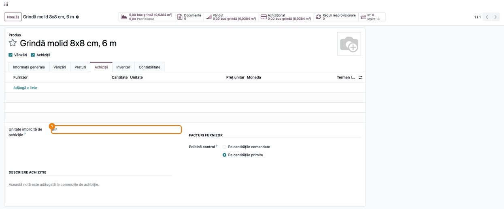
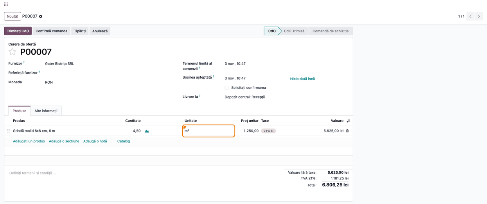
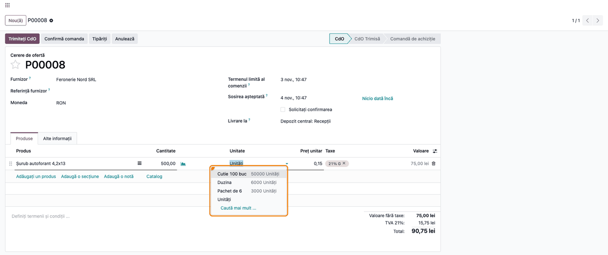
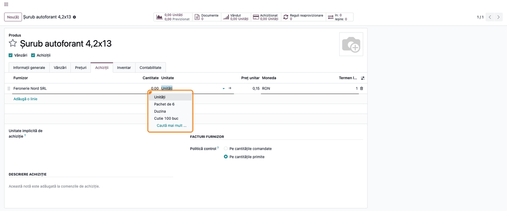

# Fișă Modul: Unitățile de măsură pe achiziții și unitatea implicită de achiziție

**Modul:** `deltatech_uom_domain`
**Utilizator principal:** Responsabilul cu achizițiile și cel care întreține nomenclatorul de produse
**Prioritate:** 🟡 Medie (fără modul, după migrarea la Odoo 19 unitățile de achiziție dispar din liste
și comenzile pot intra în stoc în unitatea greșită, fără nicio eroare)

---

## 1. Scop business

Până în Odoo 18, pe o comandă de achiziție se putea alege orice unitate din categoria unității
produsului: o unitate „Cutie 100 buc" creată o dată era disponibilă pe toate produsele în bucăți.
Odoo 19 a eliminat categoriile. Pe comandă apar doar unitatea produsului și ambalajele legate de el
unul câte unul, iar unitățile existente nu mai apar până nu sunt legate de fiecare produs.

Tot în Odoo 19 a dispărut unitatea de achiziție de pe produs. Unitatea de pe comandă vine doar de pe
linia de furnizor valabilă. Dacă linia lipsește, a expirat sau e pentru alt furnizor, comanda pune
tăcut unitatea produsului. Exemplu real: cherestea cumpărată la m³ și ținută în stoc la bucată, la
care 4,894 m³ au intrat în stoc ca 4,894 bucăți.

Modulul reface comportamentul dinainte, pe trei planuri:

- pe comenzile și facturile de achiziție, lista de unități conține **orice unitate convertibilă** la
  unitatea produsului (același arbore de unități, cum era aceeași categorie);
- pe **linia de furnizor**, unde standardul permite orice unitate (și una dintr-un alt arbore, de
  exemplu ml pentru un cablu în metri), apar doar unitățile din arborele produsului;
- pe produs apare câmpul **Unitate implicită de achiziție**. Când e completat, comanda și linia de
  furnizor iau această unitate și nu se mai poate alege alta.

Vânzările, facturile de client și mișcările de stoc rămân cu listele standard.

## 2. Bază legală și context

Nu există un temei legal propriu. Contextul este evidența cantitativă a stocurilor: recepția trebuie
să intre în stoc în cantitatea reală, convertită corect din unitatea furnizorului în unitatea de
gestiune a produsului.

Extinderea nu se aplică facturilor de vânzare, deliberat. Facturile emise pleacă la ANAF prin
e-Factura, cu codul UNECE al unității. O unitate fără cod mapat ajunge cu codul pentru bucată (C62),
deci o factură emisă în „Cutie 100 buc" ar declara cantitatea greșit. Comenzile și facturile de
achiziție nu se transmit de către cumpărător.

Excepția este **e-Transport** la achizițiile intracomunitare, unde recepția se declară de cumpărător.
Mișcarea de stoc preia unitatea de pe comandă, iar codul ei UNECE ajunge în declarație: o recepție de
5 „Cutie 100 buc" fără cod mapat ar pleca la ANAF ca 5 bucăți. Pe aceste achiziții folosiți doar
unități cu cod UNECE mapat (modulul `deltatech_uom_unece`).

## 3. Utilizatori și roluri

| Rol | Ce face | Drept Odoo |
|---|---|---|
| Responsabil achiziții | alege unitatea pe cererile de ofertă, comenzi și facturi de furnizor | **Achiziții / Utilizator** sau **Administrator** |
| Responsabil nomenclator | completează unitatea implicită de achiziție și liniile de furnizor | **Achiziții / Administrator** (sau **Inventar / Administrator**) |

Câmpul **Unitate implicită de achiziție** și coloanele de unitate apar doar cu opțiunea **Unități de
măsură** activată (grupul `uom.group_uom`).

Roluri recomandate pentru testare: un responsabil achiziții care face cererile de ofertă și un
administrator care completează produsul.

## 4. Conturi și date implicate

Modulul nu are conturi proprii și nu creează note contabile. Unitatea aleasă pe comandă decide doar
cum se convertește cantitatea în unitatea produsului la recepție.

Date minime pentru demo (folosite și în capturi):
- Companie **Demo UM SRL**, plan de conturi RO, monedă RON, cu **Unități de măsură** activat;
  depozitul **Depozit central**.
- Furnizorii **Gater Bistrița SRL** și **Feronerie Nord SRL**.
- Două unități proprii, neadăugate ca ambalaj pe niciun produs: **buc grindă (0,0384 m³)**, cu
  unitatea de referință m³ (unitatea de stoc a grinzii), și **Cutie 100 buc**, cu unitatea de
  referință Unități.
- **Grindă molid 8x8 cm, 6 m** — în stoc la **buc grindă (0,0384 m³)**, cost 48 lei pe bucată,
  **Unitate implicită de achiziție** m³, fără linie de furnizor; o cerere de ofertă de 4,50 m³ la
  Gater Bistrița SRL.
- **Șurub autoforant 4,2x13** — în **Unități**, fără ambalaje pe produs, cu o linie de furnizor la
  Feronerie Nord SRL (0,15 lei); o cerere de ofertă de 500 de bucăți.

## 5. Configurare inițială

1. Instalați `deltatech_uom_domain` (se instalează și singur, ca dependență a modulului
   `deltatech_change_uom`).
2. În **Inventar → Configurare → Setări** activați **Unități de măsură**.
3. Verificați unitățile din **Inventar → Configurare → Unități și ambalaje**. O unitate nouă se
   leagă de arborele potrivit prin unitatea de referință (de exemplu „Cutie 100 buc", cu referința
   Unități și raportul 100). Nu e nevoie să fie adăugată pe fiecare produs.
4. Pe produsele cumpărate în altă unitate decât cea de stoc, completați **Unitate implicită de
   achiziție** (pasul 1).

## 6. Flux de utilizare

### Pasul 1 — Unitatea implicită de achiziție pe produs

Deschideți produsul din **Achiziții → Produse → Produse** (sau din **Inventar → Produse → Produse**),
tab-ul **Achiziții**. Completați **Unitate implicită de achiziție** cu unitatea în care cumpărați
(aici **m³**). Lista conține doar unitățile convertibile la unitatea produsului; o unitate din alt
arbore e refuzată și la import.

În exemplu, grinda e în stoc la **buc grindă (0,0384 m³)** și nu are linie de furnizor.



### Pasul 2 — Cererea de ofertă ia unitatea implicită

Creați o cerere de ofertă din **Achiziții → Comenzi → Cereri de ofertă**, **Nou**, la furnizorul
Gater Bistrița SRL, și adăugați grinda. Linia ia **m³** chiar dacă furnizorul nu are linie de preț
pentru produs, iar coloana **Unitate** nu mai oferă altă unitate. Prețul propus e costul produsului
convertit pe m³ (48 lei / 0,0384 = 1.250 lei).

La recepție, cele 4,50 m³ intră în stoc convertite în bucăți. Fără modul, linia ar fi ieșit în
bucăți și cantitatea ar fi intrat ca 4,50 bucăți.



### Pasul 3 — Lista de unități pe cererea de ofertă

Pe o cerere de ofertă pentru un produs fără unitate implicită de achiziție (aici șurubul, în
**Unități**), deschideți lista din coloana **Unitate**. Apar toate unitățile din arborele Unități:
**Cutie 100 buc**, **Duzina**, **Pachet de 6** și **Unități**. Nu apar kg, m sau m³.

În dreptul fiecărei unități apare cât ar însemna cantitatea liniei în unitatea produsului: 500 Cutie
100 buc = 50000 Unități. Schimbarea unității **nu recalculează cantitatea**: 500 rămâne 500, deci
corectați cantitatea odată cu unitatea. În standardul Odoo 19 lista ar conține doar **Unități**,
pentru că produsul nu are ambalaje.

Aceeași listă apare pe liniile facturilor de furnizor.



### Pasul 4 — Lista de unități pe linia de furnizor

Pe produs, tab-ul **Achiziții**, deschideți lista din coloana **Unitate** a liniei de furnizor. Apar
doar unitatea produsului și unitățile din același arbore (**Unități**, **Pachet de 6**, **Duzina**,
**Cutie 100 buc**). Standardul permite aici orice unitate, inclusiv una neconvertibilă.

Dacă produsul are **Unitate implicită de achiziție**, linia de furnizor nouă o preia și nu se mai
poate alege alta. Liniile existente nu se modifică: dacă au altă unitate, corectați unitatea și
prețul împreună, pentru că prețul e exprimat în unitatea liniei.



### Note de monografie și raportare

Modulul nu generează note contabile. Recepția și factura de furnizor se înregistrează ca în
standard; diferența e doar că unitatea aleasă e corectă, deci și cantitatea convertită în unitatea
produsului:

- stocul crește cu cantitatea reală (4,50 m³ = 117,19 bucăți de 0,0384 m³), nu cu 4,50 bucăți;
- valoarea recepției și a facturii rămâne cea de pe comandă (5.625,00 lei fără TVA);
- rapoartele de achiziții arată cantitatea în unitatea liniei, iar cele de stoc în unitatea
  produsului.

## 7. Legături cu alte module / declarații

| Modul / proces | Rol în flux | Tip legătură |
|---|---|---|
| `purchase` | liniile comenzilor de achiziție și liniile de furnizor | dependență (manifest) |
| `account` | liniile facturilor de furnizor | dependență (prin `purchase`) |
| `uom` | unitățile și arborii de conversie | dependență (prin `purchase`) |
| `purchase_stock` / Inventar | recepția convertește cantitatea în unitatea produsului | nu e dependență; trebuie instalat pentru recepții |
| e-Transport (`l10n_ro_edi_stock`) | recepțiile intracomunitare declară unitatea de pe comandă, prin codul UNECE | proces (secțiunea 2) |
| `deltatech_uom_unece` | pune codul UNECE pe unitățile proprii | recomandat la achiziții intracomunitare |
| `deltatech_change_uom` | schimbă și unitatea implicită de achiziție, odată cu unitatea produsului | modul care depinde de acesta |
| e-Factura | facturile de client rămân cu lista standard de unități | proces |

**Ce e automat:**
- lărgirea listei de unități pe comenzi și facturi de achiziție, fără nicio configurare pe produs;
- restrângerea listei pe linia de furnizor la arborele unității produsului;
- preluarea unității implicite de achiziție pe linia de comandă și pe linia de furnizor nouă.

**Ce rămâne manual:**
- completarea **Unitate implicită de achiziție** pe produsele cumpărate în altă unitate;
- corectarea liniilor de furnizor existente într-o unitate greșită (unitatea și prețul);
- legarea ambalajelor pe produs, unde contează pentru regulile de reaprovizionare și codurile de
  bare pe ambalaj, care citesc ambalajele produsului, nu lista de unități.

## 8. Verificări pentru consultant

- [ ] **Unități de măsură** e activat, iar pe produs apare **Unitate implicită de achiziție** în
      tab-ul **Achiziții**.
- [ ] Pe un produs în Unități, fără ambalaje, lista coloanei **Unitate** de pe cererea de ofertă
      conține și unitățile proprii din arborele Unități (ex. „Cutie 100 buc") și nu conține kg.
- [ ] Pe linia de furnizor nu se poate alege o unitate din alt arbore.
- [ ] Un produs cu **Unitate implicită de achiziție** m³ și fără linie de furnizor iese pe cererea
      de ofertă în m³, la costul convertit pe m³.
- [ ] La recepția acelei comenzi, cantitatea intră în stoc convertită în unitatea produsului.
- [ ] Pe o comandă de vânzare și pe o factură de client lista de unități e cea standard.

## 9. Mesaje de eroare frecvente

| Mesaj | Cauză | Remediere |
|---|---|---|
| „Unitatea implicită de achiziție … a produsului … nu poate fi convertită în unitatea lui, …" | unitatea de achiziție e din alt arbore decât unitatea produsului (de obicei la import sau după schimbarea unității produsului) | alegeți o unitate din arborele produsului sau goliți câmpul; la schimbarea unității unui produs folosit deja, folosiți asistentul din `deltatech_change_uom`, care o golește singur |
| Unitatea dorită nu apare în listă | unitatea nu are ca referință o unitate din arborele produsului | în **Unități și ambalaje**, setați unitatea de referință corectă |
| Pe recepție, unitatea m³ apare, dar nu mai poate fi aleasă din listă | mișcările de stoc păstrează lista standard (unitatea produsului, ambalajele, unitățile de pe furnizori) | e comportamentul standard; cantitatea e deja convertită corect |
| După schimbarea unității pe linie, cantitatea nu mai corespunde (de exemplu de 100 de ori mai mare la Cutie 100 buc) | schimbarea unității nu recalculează cantitatea | corectați cantitatea odată cu unitatea (pasul 3) |
| Pe comandă nu se poate alege altă unitate decât cea implicită | produsul are **Unitate implicită de achiziție** | e comportamentul dorit; pentru altă unitate, schimbați câmpul pe produs |

## 10. Capturi de ecran

Capturile sunt generate automat din `tests/test_screenshots.py` (mixinul `ScreenshotCase` din
`l10n_ro_doc_screenshots`, import defensiv), pe compania „Demo UM SRL", plan de conturi RO, în RON,
cu interfața în română. Aceleași ecrane, în engleză, sunt în `static/description/en/` pentru
`readme/USAGE.md`.

1. `01_produs_um_implicita_achizitie.png` — produsul, tab-ul Achiziții, cu unitatea implicită m³.
2. `02_cerere_oferta_um_implicita.png` — cererea de ofertă fără linie de furnizor, cu linia în m³.
3. `03_cerere_oferta_lista_um.png` — lista de unități de pe cererea de ofertă a șurubului.
4. `04_furnizor_lista_um.png` — lista de unități de pe linia de furnizor a șurubului.

Regenerare:

```bash
./odoo/odoo-bin -c odoo.conf -d <db> -i deltatech_uom_domain,l10n_ro,l10n_ro_doc_screenshots \
    --test-tags=/deltatech_uom_domain:TestUomDomainScreenshots --stop-after-init
```

## 11. Observații pentru manual

- Explicați diferența față de Odoo 18 doar o dată, la configurare: utilizatorii migrați caută
  unitatea de achiziție pe produs și n-o mai găsesc fără modul.
- Insistați pe pasul 2: comanda fără linie de furnizor valabilă este cazul în care cantitatea intră
  greșit în stoc, fără nicio eroare.
- La liniile de furnizor existente, prețul e în unitatea liniei: o corectură de unitate fără
  corectura prețului dă un cost greșit.
- Nu recomandați unitățile proprii pe vânzări fără cod UNECE (secțiunea 2).
- Pe achizițiile intracomunitare cu e-Transport, folosiți doar unități cu cod UNECE mapat sau
  instalați `deltatech_uom_unece`.
