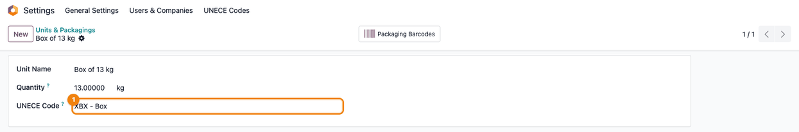
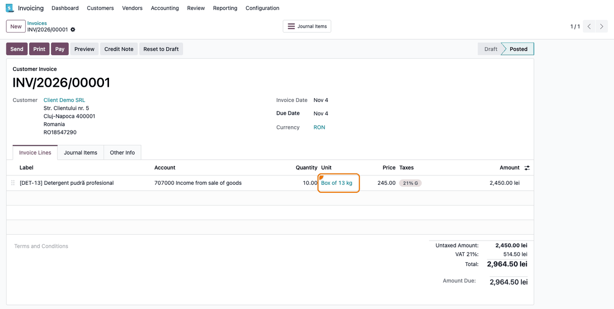

===============
UoM UNECE Codes
===============

..
   !!!!!!!!!!!!!!!!!!!!!!!!!!!!!!!!!!!!!!!!!!!!!!!!!!!!
   !! This file is generated by oca-gen-addon-readme !!
   !! changes will be overwritten.                   !!
   !!!!!!!!!!!!!!!!!!!!!!!!!!!!!!!!!!!!!!!!!!!!!!!!!!!!
   !! source digest: sha256:a66216f1ad06d3d2365baae23a0b41af7b2422a6dcbdac73c3022d453a070b60
   !!!!!!!!!!!!!!!!!!!!!!!!!!!!!!!!!!!!!!!!!!!!!!!!!!!!

.. |badge1| image:: https://img.shields.io/badge/maturity-Beta-yellow.png
    :target: https://odoo-community.org/page/development-status
    :alt: Beta
.. |badge2| image:: https://img.shields.io/badge/github-dhongu%2Fdeltatech-lightgray.png?logo=github
    :target: https://github.com/dhongu/deltatech/tree/20.0/deltatech_uom_unece
    :alt: dhongu/deltatech
.. |badge_fisa| image:: https://img.shields.io/badge/-Fi%C8%99%C4%83%20consultant-2ea44f.png
    :target: https://github.com/dhongu/deltatech/blob/20.0/deltatech_uom_unece/readme/FISA_CONSULTANT.md
    :alt: Fișă consultant
.. |badge_tests| image:: https://img.shields.io/badge/-22%20automated%20tests-2ea44f.png
    :target: https://github.com/dhongu/deltatech/tree/20.0/deltatech_uom_unece/tests
    :alt: 22 automated tests

|badge1| |badge2| |badge_fisa| |badge_tests|

Lets you pick the UN/ECE code sent as the unit of measure in electronic
documents (e-invoice, eTransport) on each unit, from the nomenclature
ANAF publishes, and lets several units share the same code.

Since Odoo 20, ``account_edi_ubl_cii`` has a standard **UN/ECE Code**
field on the unit, filled in for the units shipped by Odoo (square
metres, square feet and millilitres included), and every electronic
document reads the code through ``uom.uom._get_unece_code()``. The
module is an extension over that field, for what it does not cover:

- **A nomenclature instead of free text.** The standard field is typed
  by hand. Here the code is picked from the list ANAF publishes with the
  SAF-T schema, at
  https://static.anaf.ro/static/10/Anaf/Informatii_R/RO_SAFT_SchemaDefCod_16.02.2026.xlsx
  (sheet ``Unitati_masura``): over two thousand entries from UN/ECE
  Recommendation 20 (units) and 21 (packaging), with the English name
  and ANAF's Romanian translation. Both names load from the same data
  file, using the ``name@ro`` column syntax Odoo also uses for the
  Romanian chart of accounts. They go into a model of their own rather
  than a selection field, so a consultant can add or correct an entry
  from the interface when ANAF republishes the list, with no code change
  and no deployment.
- **A code shared by several units.** The standard field is unique: "Box
  of 13 kg" and "Box of 5 kg" cannot both be ``XBX`` there. The code
  picked here can be used on any number of units.

A code picked here takes precedence over the standard field; when it is
empty, the standard field applies, and then Odoo's built-in mapping
(``C62`` — one piece — for any unit it does not recognise). Leaving the
field empty keeps exactly the behaviour you have today, which is what
makes the module safe to install on a running database.

**Table of contents**

.. contents::
   :local:

Configuration
=============

The codes are in **Settings → UNECE Codes**, a menu of its own in the
Settings top bar, filterable by source: Recommendation 20 for units,
Recommendation 21 for packaging (the codes prefixed with ``X``). Both
are accepted by UBL/Peppol BIS 3, by CIUS-RO and by the eTransport
schema. The menu and the field are visible to administrators (Settings
group) only.

The full nomenclature is loaded on install from the SAF-T schema
published by ANAF, English and Romanian names together, so you should
not need to add anything. When ANAF republishes the list, regenerate the
data with ``scripts/import_unece_from_saft.py``.

One caveat on code length: the nomenclature holds ``XLTR``, four
characters, while eTransport's own ``CodUMType`` accepts only two or
three. Such a code is reportable in SAF-T but will be rejected on a
transport declaration.

The code itself goes on the unit, in the **Units & Packagings** list
(from **Invoicing → Configuration → Settings**, block **Units &
Packagings**, once **Units of Measure & Packagings** is ticked; also
under **Configuration** in Sales and Inventory), field **UNECE Code**.
The field is also available as an optional column in the list view,
which is the quicker way to fill it in for many units at once.

A code set on a unit takes precedence over the standard **UN/ECE Code**
field of the unit and over Odoo's built-in mapping. That is deliberate:
it lets you correct a wrong standard value, and use one code on several
units, which the standard field (unique per unit) does not allow.

Usage
=====

Nothing to do day to day: once a unit carries a code, every electronic
document built from it uses that code. The work is a one-off check of
the units, at go-live.

**1. Open the list of units.** In **Invoicing → Configuration →
Settings**, block **Units & Packagings**, tick **Units of Measure &
Packagings** and save; the **Units & Packagings** link below it opens
the list of units. With Sales or Inventory installed, the same list is
also in their **Configuration** menu.

|Invoicing settings scrolled to the Units & Packagings block: Units of
Measure & Packagings is ticked (1) and the Units & Packagings link (2)
opens the list of units|

**2. Find the right code.** The nomenclature is in **Settings → UNECE
Codes**, a menu of its own in the Settings top bar. **Code** is the
value sent in the XML, **Source** tells a unit of measure (Rec 20) from
a packaging (Rec 21, codes prefixed with ``X``). Use **Packaging (Rec
21)** for units that pack a quantity (box ``XBX``, bag ``XBG``, pallet
``XPX``; search by code or by the ANAF name) and **Units (Rec 20)** for
actual units of measure (``KGM``, ``MTR``, ``MTK``).

|UNECE Codes list opened from the Settings top bar (1), filtered on
Packaging (Rec 21) (2): 377 codes with their Code, Name and Source, such
as X4A Box, steel and X4H Box, plastic|

**3. Check the units.** In the units list, show the optional **UNECE
Code** column from the optional-columns icon at the right of the header.
Every unit of your own needs a code. An empty cell means the standard
**UN/ECE Code** of the unit applies — Odoo fills it in for the units it
ships (square metres ``MTK`` and millilitres ``MLT`` included) — and,
failing that, ``C62`` (one piece).

|Units & Packagings list with the UNECE Code column shown: m² has MTK -
square metre, ml has MLT - millilitre and the custom unit Box of 13 kg
has XBX - Box (1); standard units such as Units, kg or L are left empty|

**4. Set the code on the unit.** Open the unit and pick the value in
**UNECE Code**. Nothing changes on products or invoices.

|Form of the unit Box of 13 kg, 13 kg, with UNECE Code (1) set to XBX -
Box|

**5. Invoice as usual.** Without the Sales app, the **Quantity** and
**Unit** columns of invoice lines are hidden by default; show them from
the optional-columns icon of the lines. In the e-invoice XML, the line's
``cbc:InvoicedQuantity`` now carries ``unitCode="XBX"`` instead of
``C62``.

|Posted customer invoice INV/2026/00001: the line is 10.00 of Box of 13
kg (1) at 245.00, VAT 21%|

.. code:: xml

   <cbc:InvoicedQuantity unitCode="XBX">10.0</cbc:InvoicedQuantity>

The code applies to every electronic document: eTransport and UBL/CII
invoices (CIUS-RO included) all read it through
``uom.uom._get_unece_code()``.

.. |Invoicing settings scrolled to the Units & Packagings block: Units of Measure & Packagings is ticked (1) and the Units & Packagings link (2) opens the list of units| image:: https://raw.githubusercontent.com/dhongu/deltatech/20.0/deltatech_uom_unece/static/description/en/01_setare_unitati_ambalaje.png
.. |UNECE Codes list opened from the Settings top bar (1), filtered on Packaging (Rec 21) (2): 377 codes with their Code, Name and Source, such as X4A Box, steel and X4H Box, plastic| image:: https://raw.githubusercontent.com/dhongu/deltatech/20.0/deltatech_uom_unece/static/description/en/02_coduri_unece_ambalaje.png
.. |Units & Packagings list with the UNECE Code column shown: m² has MTK - square metre, ml has MLT - millilitre and the custom unit Box of 13 kg has XBX - Box (1); standard units such as Units, kg or L are left empty| image:: https://raw.githubusercontent.com/dhongu/deltatech/20.0/deltatech_uom_unece/static/description/en/03_unitati_coloana_cod_unece.png

Changelog
=========

20.0.1.0.1
----------

- Migration to 20.0. Odoo now has a standard UN/ECE Code field on the
  unit and reads the code through ``uom.uom._get_unece_code()`` for
  every electronic document: the override on ``account.edi.common`` is
  gone, and so is the data that fixed square metres, square feet and
  millilitres, which the standard now covers. The code picked from the
  nomenclature still wins over the standard field.

19.0.1.0.1 (2026-09-29)
-----------------------

- Own module icon, instead of the generic gears it had.

Bug Tracker
===========

Bugs are tracked on `Terrabit Issues <https://www.terrabit.ro/helpdesk>`_.
In case of trouble, please check there if your issue has already been reported.

Do not contact contributors directly about support or help with technical issues.

Credits
=======

Authors
-------

* Terrabit
* Dorin Hongu

Maintainers
-----------

.. |maintainer-dhongu| image:: https://github.com/dhongu.png?size=40px
    :target: https://github.com/dhongu
    :alt: dhongu

Current maintainer:

|maintainer-dhongu| 

This module is part of the `dhongu/deltatech <https://github.com/dhongu/deltatech/tree/20.0/deltatech_uom_unece>`_ project on GitHub.

You are welcome to contribute.