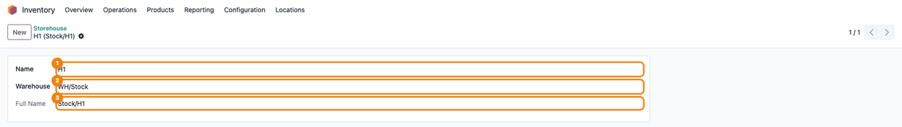
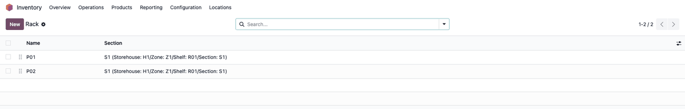
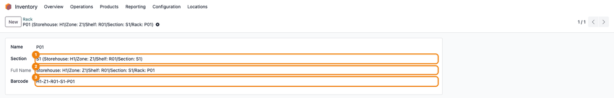
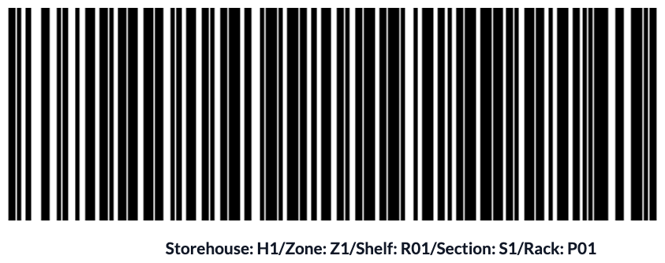
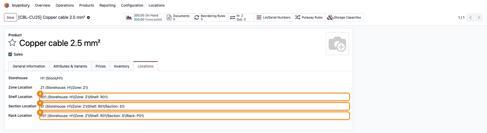
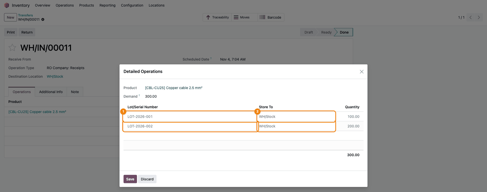
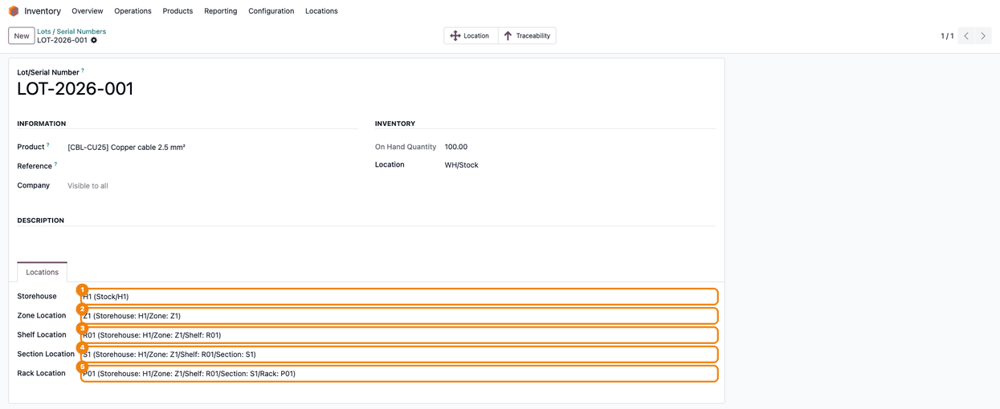
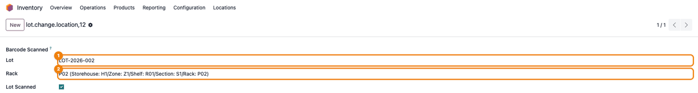
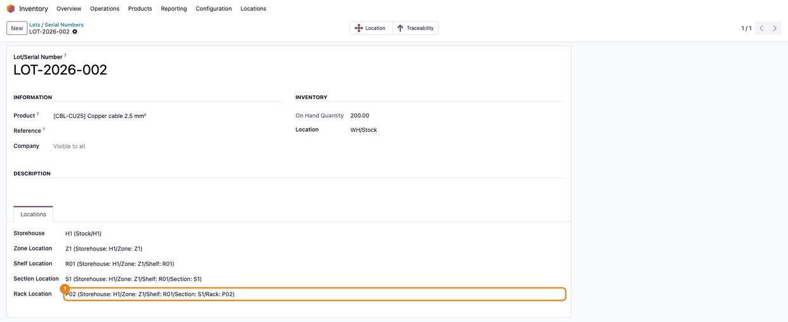
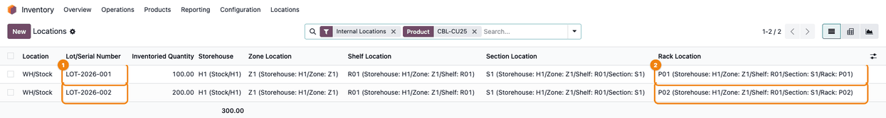

=====================
Warehouse Arrangement
=====================

..
   !!!!!!!!!!!!!!!!!!!!!!!!!!!!!!!!!!!!!!!!!!!!!!!!!!!!
   !! This file is generated by oca-gen-addon-readme !!
   !! changes will be overwritten.                   !!
   !!!!!!!!!!!!!!!!!!!!!!!!!!!!!!!!!!!!!!!!!!!!!!!!!!!!
   !! source digest: sha256:8ba8d80c830f1893b6ab507caed81f7c2f63da47791d3add7056b714ab72081b
   !!!!!!!!!!!!!!!!!!!!!!!!!!!!!!!!!!!!!!!!!!!!!!!!!!!!

.. |badge1| image:: https://img.shields.io/badge/maturity-Beta-yellow.png
    :target: https://odoo-community.org/page/development-status
    :alt: Beta
.. |badge2| image:: https://img.shields.io/badge/github-dhongu%2Fdeltatech-lightgray.png?logo=github
    :target: https://github.com/dhongu/deltatech/tree/19.0/deltatech_warehouse_arrangement
    :alt: dhongu/deltatech
.. |badge_fisa| image:: https://img.shields.io/badge/-Fi%C8%99%C4%83%20consultant-2ea44f.png
    :target: https://github.com/dhongu/deltatech/blob/19.0/deltatech_warehouse_arrangement/readme/FISA_CONSULTANT.md
    :alt: Fișă consultant
.. |badge_tests| image:: https://img.shields.io/badge/-21%20automated%20tests%20%C2%B7%20100%25%20code%20coverage-2ea44f.png
    :target: https://app.codecov.io/gh/dhongu/deltatech/tree/19.0/deltatech_warehouse_arrangement
    :alt: 21 automated tests · 100% code coverage

|badge1| |badge2| |badge_fisa| |badge_tests|

Keeps the physical arrangement of the warehouse in parallel with the
standard Odoo stock locations, on five levels: storehouse, zone, shelf,
section and rack. The goods are found on the right rack without creating
an Odoo stock location for each of them.

Features:

- Storehouse → Zone → Shelf → Section → Rack hierarchy (menu *Inventory
  > Locations*), each level showing its full path; a storehouse is
  linked to its main Odoo stock location.
- Rack barcode and printable rack labels (Code128 barcode and full
  path).
- Default arrangement on the product; every lot / serial number keeps
  its own arrangement.
- A new lot takes the arrangement of its product; a lot received into
  the main location of the storehouse takes it again, and its
  arrangement is cleared when the lot runs out in that location.
- Arrangement columns, search fields and group-by options in the stock
  list (*Inventory > Reporting > Locations*).
- Barcode screen to scan a lot and its new rack (*Inventory > Operations
  > Adjustments > Change lot*).
- Only the *Warehouse Locations manager* group can create or change the
  hierarchy.

**Table of contents**

.. contents::
   :local:

Usage
=====

1. Create the storehouse (*Inventory > Locations > Storehouse*): its
   **Name** (1) and, in **Warehouse** (2), the Odoo stock location where
   it stands (e.g. ``WH/Stock``). Receipts into this location fill in
   the arrangement of the lots. Then create the zones, shelves and
   sections, each linked to the level above.

   |Storehouse form: Name H1 (1), Warehouse WH/Stock (2) and Full Name
   Stock/H1 (3)|

2. Create the racks (*Inventory > Locations > Rack*). The section of
   each rack shows the full path.

   |Rack list: P01 and P02 in section S1, with the path Storehouse:
   H1/Zone: Z1/Shelf: R01/Section: S1|

   On the rack, choose the **Section** (1); **Full Name** (2) shows the
   whole path, and **Barcode** (3) is the code scanned when moving lots.

   |Rack P01: Section S1 (1), Full Name (2) and Barcode H1-Z1-R01-S1-P01
   (3)|

3. Print the rack labels: in the list, select the racks, then **Print**
   > **Rack Labels**; on a rack form, the gear ⚙ next to the title >
   **Rack Labels**.

   |Rack label: Code128 barcode and the full path of rack P01|

4. On the product (*Inventory > Products > Products*), tab
   **Locations**, choose the default arrangement: **Storehouse**, **Zone
   Location**, **Shelf Location**, **Section Location** and **Rack
   Location**. Each list only shows the items of the level above.

   |Product Copper cable 2.5 mm², tab Locations: Storehouse H1 to Rack
   Location P01 (1-5)|

5. Receive the lots into the main location of the storehouse (*Inventory
   > Operations > Receipts*, **Details** on the product line) and
   validate the receipt.

   |Done receipt, Detailed Operations: lots LOT-2026-001 and
   LOT-2026-002 (1) stored in WH/Stock (2)|

6. On the lot (*Inventory > Products > Lots / Serial Numbers*), tab
   **Locations**, check that the lot took the arrangement of the
   product. It can be changed here by hand at any time.

   |Lot LOT-2026-001, tab Locations: the arrangement H1 / Z1 / R01 / S1
   / P01 (1-5) taken from the product|

7. To move a lot to another rack, open *Inventory > Operations >
   Adjustments > Change lot* and scan the lot label, then the new rack
   label: **Lot** (1) and **Rack** (2) are filled in.

   |Change lot screen after scanning: Lot LOT-2026-002 (1) and Rack P02
   (2), Lot Scanned checked|

   In Odoo 19 this screen opens full page and its **Apply** / **Reset**
   buttons are not shown, so the scan does not change the lot. Until
   this is fixed, choose the new rack directly on the lot, tab
   **Locations**, field **Rack Location**, and save.

   |Lot LOT-2026-002, tab Locations: Rack Location (1) is now P02|

8. Find the stock by rack in *Inventory > Reporting > Locations* (shown
   only with the *Storage Locations* option, the consignment option or
   in developer mode; otherwise use the **On Hand** button of the
   product, which opens the same list): each lot (1) shows its
   storehouse, zone, shelf, section and rack (2). Search or group by
   **Storehouse**, **Zone**, **Shelf**, **Section** or **Rack**.

   |Locations list for CBL-CU25: LOT-2026-001 on rack P01 and
   LOT-2026-002 on rack P02, both in WH/Stock|

When the whole quantity of a lot leaves the main location of the
storehouse, the arrangement of the lot is cleared (only moves out of the
main location itself trigger this, not moves out of its sublocations).
The arrangement is informative only: it does not change the Odoo stock
locations, the quantities or the stock valuation.

Only users of the *Warehouse Locations manager* group can create or
change the storehouses, zones, shelves, sections and racks; the other
internal users can read them.

Changelog
=========

19.0.0.1.8 (2026-10-04)
-----------------------

- Fix the full name of storehouses: it showed only the stock location
  name, without the storehouse name.
- Fix the full name of zones, shelves, sections and racks when a parent
  level is not set: the missing level is now skipped instead of raising
  an error when the record name was displayed.
- Fix lot creation: locations given explicitly for the lot are no longer
  replaced by the product's ones (ARRANGE-002), each lot in a batch now
  takes the locations of its own product, and creating a lot without a
  product no longer fails with an internal error.
- Lot change location wizard: scanning a new lot clears the rack chosen
  for the previous one, so it cannot be applied to the wrong lot by
  mistake (ARRANGE-001); an ambiguous lot name now shows an error
  instead of being ignored.

19.0.0.1.7 (2026-10-04)
-----------------------

- Add unit tests covering the location hierarchy names, lot location
  defaults on create, the lot location update on stock moves into/out of
  the master location and the lot change location barcode wizard.

19.0.0.1.6 (2026-09-29)
-----------------------

- Own module icon, instead of the generic gears it had.

19.0.0.1.5 (2026-09-24)
-----------------------

- Romanian translations for the messages recovered in the previous
  release (messages that babel could not extract while the file
  contained an f-string inside ``_()``); the ``.pot`` now lists them
  too.

19.0.0.1.4 (2026-09-24)
-----------------------

- Translatable messages built with f-strings inside ``_()`` /
  ``self.env._()`` now use a fixed text with named placeholders. An
  f-string can never be translated, and babel stopped at the first one,
  dropping every other message of the file from the ``.pot``: those
  messages are now exported for translation again.

19.0.0.1.3 (2026-09-23)
-----------------------

- Translatable strings in code use ``self.env._()`` instead of ``_()``,
  the Odoo 19 convention (pylint-odoo ``prefer-env-translation``). The
  translated messages are unchanged.

Bug Tracker
===========

Bugs are tracked on `Terrabit Issues <https://www.terrabit.ro/helpdesk>`_.
In case of trouble, please check there if your issue has already been reported.

Do not contact contributors directly about support or help with technical issues.

Credits
=======

Authors
-------

* Terrabit
* Dan Stoica

Maintainers
-----------

This module is part of the `dhongu/deltatech <https://github.com/dhongu/deltatech/tree/19.0/deltatech_warehouse_arrangement>`_ project on GitHub.

You are welcome to contribute.