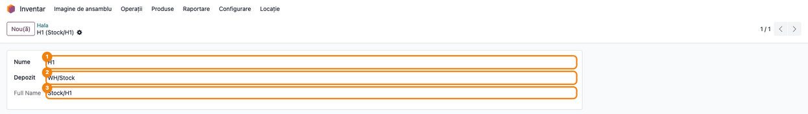
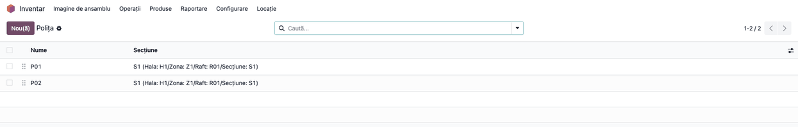
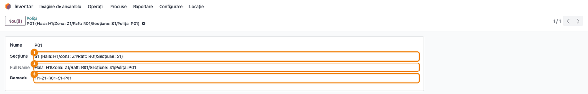
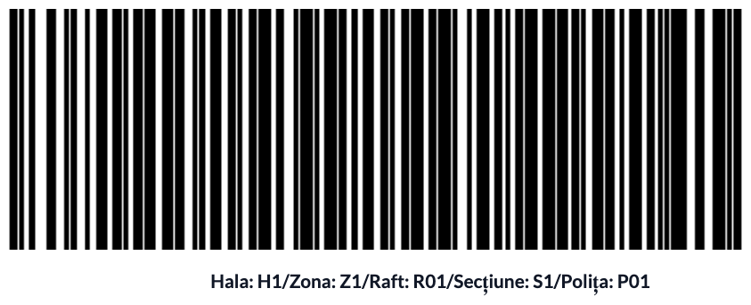
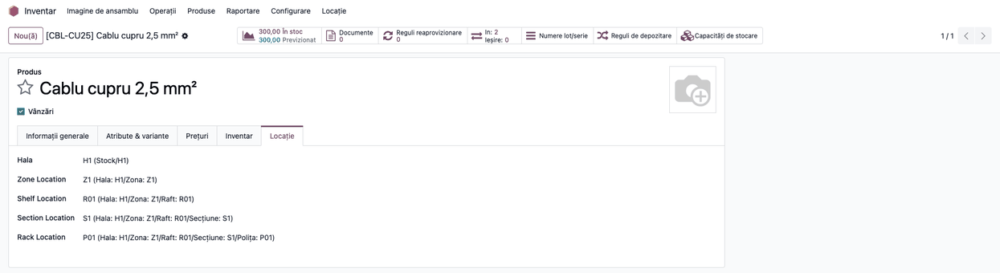
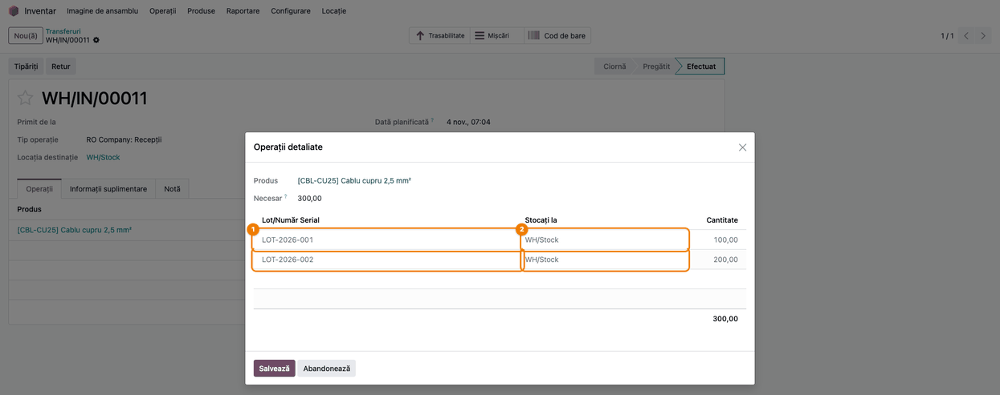
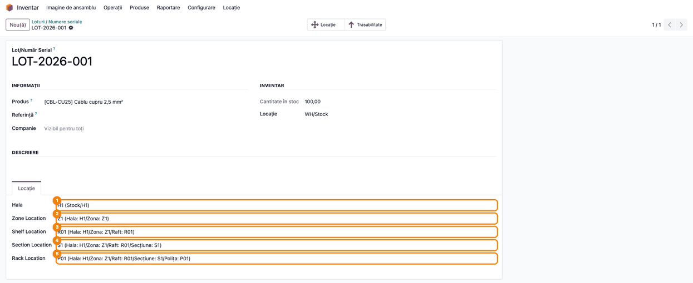
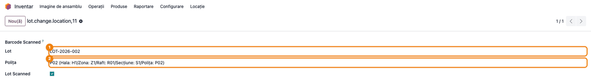
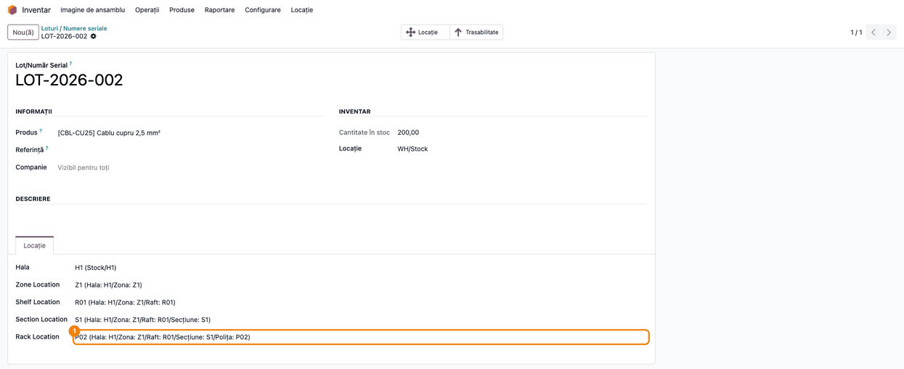
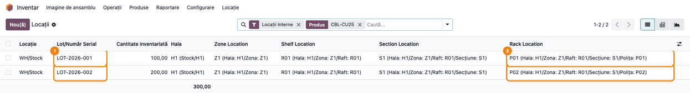

# Fișă Modul: Amplasarea în depozit (hală, zonă, raft, secțiune, poliță)

**Modul:** `deltatech_warehouse_arrangement`
**Utilizator principal:** Gestionar / magaziner, responsabil de depozit
**Prioritate:** 🟢 Scăzută (ajută la găsirea fizică a mărfii; nu are efect contabil și nu schimbă stocul)

---

## 1. Scop business

În multe depozite, locațiile de stoc din Odoo rămân puține (de exemplu doar `WH/Stock`), dar marfa
stă fizic pe sute de polițe. A crea câte o locație Odoo pentru fiecare poliță complică recepțiile,
transferurile și inventarul. Modulul `deltatech_warehouse_arrangement` ține **amplasarea fizică în
paralel** cu locațiile Odoo, pe cinci niveluri: **Hală → Zonă → Raft → Secțiune → Poliță**.

Fiecare produs primește o amplasare implicită (unde se pune de obicei), iar fiecare lot sau număr de
serie își ține propria amplasare. La recepția unui lot în locația principală a halei, lotul preia
automat amplasarea produsului; când lotul se consumă complet din acea locație, amplasarea i se
golește. Polițele au cod de bare și etichetă tipăribilă, iar lista de stoc arată, pe fiecare lot,
hala, zona, raftul, secțiunea și polița.

## 2. Bază legală și context

Modulul nu are temei legal specific: este un instrument operațional de organizare a depozitului.
Amplasarea pe polițe nu schimbă cantitățile, locațiile de stoc Odoo, valoarea stocului sau
documentele de gestiune (NIR, bon de consum, aviz); acestea rămân pe locațiile standard Odoo.

## 3. Utilizatori și roluri

| Rol | Ce face |
|---|---|
| Responsabil depozit, cu grupul **Manager locații** (*Warehouse Locations manager*) | Definește halele, zonele, rafturile, secțiunile și polițele; tipărește etichetele polițelor |
| Gestionar / magaziner (utilizator intern cu acces la Inventar) | Vede ierarhia (doar citire), completează amplasarea pe produse și loturi, mută loturile pe alte polițe |
| Orice utilizator cu drept *Inventar / Utilizator* | Vede amplasarea în lista de stoc și o folosește la căutare și grupare |

**Roluri recomandate la testare:** administratorul de Inventar cu grupul **Manager locații**, pentru
configurare; un utilizator *Inventar / Utilizator* fără acest grup, pentru a verifica faptul că nu
poate modifica ierarhia.

Grupul **Manager locații** nu are categorie proprie: se atribuie din *Setări → Utilizatori și companii
→ Grupuri* (în modul dezvoltator), adăugând utilizatorul în grup.

## 4. Conturi și date implicate

Modulul **nu generează note contabile** și nu atinge conturi. Date minime pentru demo:

- locația de stoc a depozitului, `WH/Stock`;
- o ierarhie: hala **H1** (legată de `WH/Stock`) → zona **Z1** → raftul **R01** → secțiunea **S1** →
  polițele **P01** (cod de bare `H1-Z1-R01-S1-P01`) și **P02** (cod de bare `H1-Z1-R01-S1-P02`);
- un produs stocabil urmărit pe loturi, de exemplu **Cablu cupru 2,5 mm²** (cod `CBL-CU25`), cu
  amplasarea implicită H1 / Z1 / R01 / S1 / P01;
- o recepție a două loturi (`LOT-2026-001`, 100 buc., și `LOT-2026-002`, 200 buc.) în `WH/Stock`.

## 5. Configurare inițială

1. Instalați modulul (depinde de **Inventar**, `stock`, și de **Coduri de bare**, `barcodes`).
2. Pentru lucrul pe loturi activați *Inventar → Configurare → Setări → Loturi & Numere seriale*.
3. Adăugați responsabilul de depozit în grupul **Manager locații** (vezi secțiunea 3).
4. Creați ierarhia, de sus în jos: hale, zone, rafturi, secțiuni, polițe (pașii 1–3).

## 6. Flux de utilizare

### Pasul 1 — Definiți hala

**Meniu:** *Inventar → Locație → Hala*, butonul **Nou(ă)**.

Completați **Nume** (1) și, în **Depozit** (2), locația de stoc Odoo în care se află fizic hala (de
regulă locația principală a depozitului, `WH/Stock`). Această locație este **locația principală a
halei**: recepțiile în ea completează automat amplasarea loturilor (pasul 5). **Full Name** (3) se
calculează din numele locației Odoo și al halei. Apoi, din meniurile *Zona*, *Raft* și *Secțiune*,
creați nivelurile următoare, fiecare legat de nivelul de deasupra.



### Pasul 2 — Creați polițele

**Meniu:** *Inventar → Locație → Polița*.

Lista arată fiecare poliță cu secțiunea ei; numele secțiunii conține întreaga cale (hală, zonă, raft,
secțiune), deci se vede imediat unde se află polița.



Deschideți o poliță (sau **Nou(ă)**): alegeți **Secțiune** (1), iar **Full Name** (2) arată calea
completă. În **Barcode** (3) scrieți codul de bare al poliței, cel scanat la mutarea loturilor (pasul
7). Dacă îl lăsați gol, eticheta folosește numele poliței.



### Pasul 3 — Tipăriți etichetele polițelor

**Meniu:** *Inventar → Locație → Polița*. Din listă: selectați polițele → butonul **Tipăriți** →
**Rack Labels**; din formularul unei polițe: roata ⚙ de lângă titlu → **Rack Labels**.

Se generează un PDF cu câte o pagină pe poliță: codul de bare (Code128) și, sub el, calea completă.
Lipiți eticheta pe poliță.



### Pasul 4 — Amplasarea implicită pe produs

**Meniu:** *Inventar → Produse → Produse*, deschideți produsul, tabul **Locație**.

Alegeți pe rând **Hala** (1), **Zone Location** (2), **Shelf Location** (3), **Section Location** (4)
și **Rack Location** (5). Fiecare listă arată doar elementele nivelului de deasupra (zonele halei
alese, rafturile zonei alese etc.). Aceasta este amplasarea în care se pune de obicei produsul; o
preiau loturile noi și loturile recepționate în locația principală a halei.



### Pasul 5 — Recepționați lotul în locația principală a halei

**Meniu:** *Inventar → Operații → Recepții*, recepția produsului, cu **Locația destinație** egală cu
locația principală a halei (aici `WH/Stock`).

Completați loturile ca de obicei (butonul **Detalii** de pe linia produsului) și validați recepția. La
validare, fiecare lot primit direct în locația principală a halei preia amplasarea produsului (hală,
zonă, raft, secțiune, poliță), chiar dacă avea alta înainte.



### Pasul 6 — Verificați amplasarea lotului

**Meniu:** *Inventar → Produse → Loturi / Numere seriale*, deschideți lotul, tabul **Locație**.

1. **Găsiți pe ecran** cele cinci câmpuri ale amplasării, în tabul **Locație** din josul formularului.
2. **Verificați** că sunt cele ale produsului (H1 / Z1 / R01 / S1 / P01) și că în secțiunea
   **Inventar** lotul are cantitate în locația principală a halei (`WH/Stock`).

Amplasarea lotului se poate corecta manual aici, oricând, ca la produs.



### Pasul 7 — Mutați lotul pe altă poliță

**Meniu:** *Inventar → Operații → Ajustări → Change lot*.

Ecranul se deschide pe toată pagina; în titlu (breadcrumb) apare numele tehnic
`lot.change.location`, iar deasupra câmpurilor eticheta **Barcode Scanned**, fără câmp de completat.
Cu cititorul de coduri de bare, scanați întâi **eticheta lotului**, apoi **eticheta poliței** noi.
Câmpul **Lot** (1) se completează la prima scanare, iar **Polița** (2), la a doua; bifa **Lot Scanned**
arată că lotul a fost recunoscut. Dacă scanați alt lot, polița aleasă pentru lotul anterior se golește.



> **Atenție (Odoo 19):** ecranul se deschide pe toată pagina, iar butoanele **Apply** și **Reset**
> definite de modul nu sunt afișate (Odoo arată butoanele din subsolul unui asistent doar când
> acesta e deschis ca fereastră de dialog). Scanarea completează câmpurile, dar amplasarea lotului
> **nu se schimbă**. Până la corectare, mutați lotul manual: deschideți lotul (*Inventar → Produse →
> Loturi / Numere seriale*), tabul **Locație**, și alegeți polița nouă în **Rack Location** (și, dacă e
> cazul, celelalte niveluri), apoi salvați.



### Pasul 8 — Găsiți stocul pe polițe

**Meniu:** *Inventar → Raportare → Locații*. Meniul apare doar dacă este activată opțiunea *Locații de
stocare* (sau *Consignație*), ori în modul dezvoltator. Fără ele (de exemplu, un singur
depozit cu `WH/Stock`), deschideți aceeași listă din fișa produsului, butonul **În stoc**: are aceleași
coloane de amplasare, filtrate pe produs.

1. **Găsiți pe ecran** coloanele adăugate de modul, la dreapta: **Hala**, **Zone Location**, **Shelf
   Location**, **Section Location** și **Rack Location**. Fiecare rând este un lot (1) într-o locație
   Odoo, cu polița lui (2).
2. **Verificați** că loturile apar pe polițele așteptate (aici `LOT-2026-001` pe P01 și
   `LOT-2026-002` pe P02) și că locația Odoo rămâne aceeași (`WH/Stock`): amplasarea nu mută stocul.
3. Pentru o listă de culegere pe polițe, folosiți căutarea după **Hala**, **Zone Location** sau
   **Rack Location**, ori gruparea **Hala** / **Zona** / **Raft** / **Secțiune** / **Polița** din
   meniul de căutare.



### Golirea automată a amplasării (fără ecran nou)

Când un lot iese din locația principală a halei (livrare, transfer, consum) și cantitatea lui rămasă
în această locație și în sublocațiile ei interne ajunge la zero, amplasarea lotului se golește
automat (toate cele cinci niveluri). Golirea are loc doar la ieșirile din locația principală însăși,
nu și la cele din sublocațiile ei (de exemplu `WH/Stock/Raft 1`). O nouă recepție a lotului în locația principală îi dă din nou
amplasarea produsului.

### Note de monografie și raportare

Modulul nu generează note contabile și nu modifică stocul sau valoarea lui. Nu există monografie
contabilă asociată.

## 7. Legături cu alte module / declarații

| Modul | Rol |
|---|---|
| `stock` (Inventar) | Locațiile de stoc, loturile, recepțiile și lista de stoc (*Raportare → Locații*), în care apar coloanele de amplasare |
| `barcodes` | Scanarea lotului și a poliței în ecranul *Change lot* |
| `product` | Amplasarea implicită pe fișa produsului (tabul Locație) |

**Ce e automat:** amplasarea implicită pe loturile noi (de la produs); amplasarea lotului la recepția
în locația principală a halei; golirea amplasării când lotul se termină în această locație; calea
completă a fiecărui nivel; codul de bare pe etichetă.

**Ce rămâne manual:** definirea ierarhiei și a codurilor de bare; amplasarea pe produse; mutarea unui
lot pe altă poliță (vezi avertismentul de la pasul 7); amplasarea loturilor recepționate în alte
locații decât locația principală a halei.

## 8. Verificări pentru consultant

- [ ] Meniul *Inventar → Locație* are submeniurile **Hala**, **Zona**, **Raft**, **Secțiune**, **Polița**.
- [ ] Un utilizator fără grupul **Manager locații** vede ierarhia, dar nu poate crea sau modifica
      elemente.
- [ ] **Full Name** al poliței conține toate nivelurile: `Hala: …/Zona: …/Raft: …/Secțiune: …/Polița: …`.
- [ ] Eticheta **Rack Labels** are codul de bare al poliței (sau numele, dacă nu are cod) și calea
      completă.
- [ ] Pe produs, tabul **Locație**: lista **Zone Location** arată doar zonele halei alese (la fel
      pentru nivelurile următoare).
- [ ] Un lot nou al produsului primește amplasarea produsului.
- [ ] După validarea unei recepții în locația principală a halei (`WH/Stock`), lotul are amplasarea
      produsului, chiar dacă înainte avea alta (modificată manual pe lot).
- [ ] Un lot existent, cu amplasarea modificată manual, recepționat într-o sublocație (de exemplu
      `WH/Stock/Raft 1`) își păstrează amplasarea.
- [ ] După ce tot stocul lotului iese din locația principală a halei, amplasarea lotului este goală;
      o ieșire dintr-o sublocație a ei nu golește amplasarea.
- [ ] Fără opțiunea *Locații de stocare*, lista de stoc cu amplasarea se deschide din produs,
      butonul **În stoc**.
- [ ] În *Raportare → Locații*, coloanele **Hala** … **Rack Location** arată amplasarea pe fiecare lot;
      gruparea după **Polița** funcționează.
- [ ] Ecranul *Change lot* recunoaște scanarea lotului și a poliței (câmpurile se completează); notați
      că butoanele **Apply** / **Reset** lipsesc (pasul 7).

## 9. Mesaje de eroare frecvente

Mesajele apar în ecranul *Change lot*, la scanare.

| Mesaj | Cauză | Remediere |
|---|---|---|
| Lotul/numărul de serie … nu a fost găsit | Primul cod scanat nu este numele unui lot (de exemplu ați scanat întâi polița) | Scanați întâi eticheta lotului, apoi pe cea a poliței |
| Locația … nu a fost găsită | Codul scanat după lot nu este codul de bare al niciunei polițe | Verificați câmpul **Barcode** al poliței și retipăriți eticheta |
| Au fost găsite mai multe loturi/numere de serie …, scanați altul | Același nume de lot există la mai multe produse | Mutați lotul manual, din formularul lotului (tabul **Locație**) |

## 10. Capturi de ecran

Capturile sunt **generate automat** de testul `tests/test_screenshots.py` (mixinul `ScreenshotCase`
din `deltatech_doc_screenshots`, import defensiv), în română, pe compania „RO Company"; recepția și
loturile sunt create de test. Regenerare:

```bash
./odoo/odoo-bin -c odoo.conf -d <db> -i deltatech_warehouse_arrangement,deltatech_doc_screenshots \
    --test-tags=/deltatech_warehouse_arrangement:TestWarehouseArrangementScreenshots --stop-after-init
```

| Fișier | Ce arată |
|---|---|
| `01_hala_formular.png` | Formularul halei, legată de locația de stoc `WH/Stock` |
| `02_lista_polite.png` | Lista polițelor, cu secțiunea și calea lor |
| `03_polita_formular.png` | Formularul poliței: secțiunea, calea completă și codul de bare |
| `04_eticheta_polita.png` | Eticheta tipăribilă a poliței (Rack Labels) |
| `05_produs_locatii.png` | Amplasarea implicită pe produs, tabul Locație |
| `06_receptie_loturi.png` | Recepția efectuată în `WH/Stock`, cu cele două loturi |
| `07_lot_locatii_receptie.png` | Lotul recepționat, cu amplasarea preluată de la produs |
| `08_schimbare_locatie_lot.png` | Ecranul Change lot după scanarea lotului și a poliței |
| `09_lot_polita_noua.png` | Lotul mutat pe polița P02 |
| `10_stoc_pe_polite.png` | Lista Locații cu amplasarea pe fiecare lot |

Capturile în engleză pentru `readme/USAGE.md` (Odoo Apps) se generează din aceleași shot-uri, în
`static/description/en/`.

## 11. Observații pentru manual

- Explicați diferența dintre **locația de stoc Odoo** (contabilă și de gestiune) și **amplasarea pe
  poliță** (doar informativă, pentru găsirea mărfii). Pe formularul lotului, „Locație" apare de trei
  ori: butonul **Locație** și câmpul **Locație** din secțiunea *Inventar* sunt locația de stoc Odoo,
  iar tabul **Locație** este amplasarea pe poliță.
- Un lot nou primește amplasarea produsului la creare, oriunde ar fi recepționat. Un lot existent o
  primește din nou doar la recepția **direct** în locația principală a halei (nu și într-o sublocație
  a ei); atunci amplasarea modificată manual pe lot se pierde și revine la cea a produsului.
- În lista de stoc, coloana **Hala** vine de la produs, iar celelalte niveluri (zonă … poliță) vin de
  la lot: pentru produsele fără loturi, doar **Hala** este completată.
- Mai multe etichete sunt încă în engleză în interfața română (**Zone Location**, **Rack Location**,
  **Full Name**, **Barcode**, **Change lot**, **Rack Labels**, **Lot Scanned**): păstrați-le în
  manual exact așa până la completarea traducerii.
- Până la corectarea ecranului *Change lot* (pasul 7), prezentați mutarea manuală din formularul
  lotului ca procedura de lucru.
