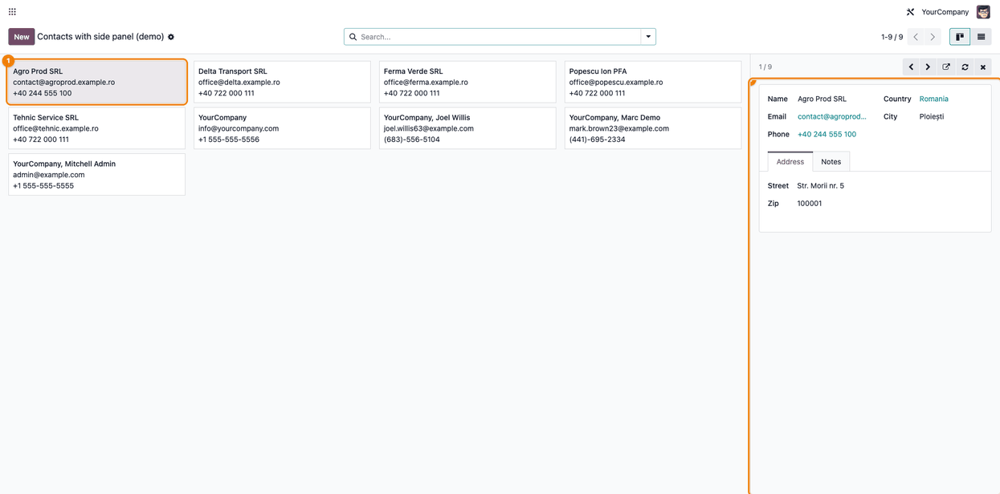
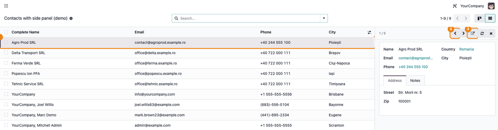
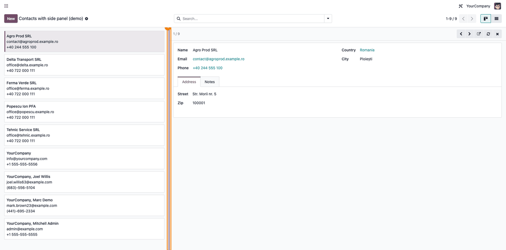

==========
Side Panel
==========

..
   !!!!!!!!!!!!!!!!!!!!!!!!!!!!!!!!!!!!!!!!!!!!!!!!!!!!
   !! This file is generated by oca-gen-addon-readme !!
   !! changes will be overwritten.                   !!
   !!!!!!!!!!!!!!!!!!!!!!!!!!!!!!!!!!!!!!!!!!!!!!!!!!!!
   !! source digest: sha256:10cc1460627bdde90b22a2983c454af2bc323b6a80017710ade4bbe770dc10dd
   !!!!!!!!!!!!!!!!!!!!!!!!!!!!!!!!!!!!!!!!!!!!!!!!!!!!

.. |badge1| image:: https://img.shields.io/badge/maturity-Beta-yellow.png
    :target: https://odoo-community.org/page/development-status
    :alt: Beta
.. |badge2| image:: https://img.shields.io/badge/license-LGPL--3-blue.png
    :target: http://www.gnu.org/licenses/lgpl-3.0-standalone.html
    :alt: License: LGPL-3
.. |badge3| image:: https://img.shields.io/badge/github-dhongu%2Fdeltatech-lightgray.png?logo=github
    :target: https://github.com/dhongu/deltatech/tree/19.0/deltatech_web_side_panel
    :alt: dhongu/deltatech
.. |badge_fisa| image:: https://img.shields.io/badge/-Fi%C8%99%C4%83%20consultant-2ea44f.png
    :target: https://github.com/dhongu/deltatech/blob/19.0/deltatech_web_side_panel/readme/FISA_CONSULTANT.md
    :alt: Fișă consultant
.. |badge_tests| image:: https://img.shields.io/badge/-3%20automated%20tests-2ea44f.png
    :target: https://github.com/dhongu/deltatech/tree/19.0/deltatech_web_side_panel/tests
    :alt: 3 automated tests

|badge1| |badge2| |badge3| |badge_fisa| |badge_tests|

A technical module: a panel on the right of a kanban or a list that
shows the form of the record the user selected, without leaving the
screen.

- **One click selects** — a click on a card or on a row shows the record
  in the panel and highlights it, instead of opening its full form. The
  panel has buttons to move to the previous or the next record, open the
  full form, refresh and close.
- **The form is yours** — the panel embeds a form view, read-only, so a
  module defines what the panel shows in XML (header, fields, notebook,
  buttons) and the usual widgets work.
- **Kanban and list, one behaviour** — the views ``side_panel_kanban``
  and ``side_panel_list`` share the same panel and the same behaviour: a
  click selects the record in either view.
- **Resizable** — drag the handle on the left edge of the panel to
  change its width; the width is remembered in the browser.
- **Small screens keep the usual views** — below the extra-large
  breakpoint the click opens the form as before.

**Table of contents**

.. contents::
   :local:

Usage
=====

For a module developer:

1. Give the view the js class: ``js_class="side_panel_kanban"`` on a
   ``<kanban>``, or ``js_class="side_panel_list"`` on a ``<list>``.
2. Define the form the panel shows (a form view of the same model) and
   put its xml id in the context of the action:
   ``{'side_panel_view_ref': 'my_module.view_my_model_form_quick'}``.
   Without it, the panel shows the default form view of the model.
3. To switch the panel off for an action, add
   ``'disable_side_panel': True`` to its context.

The demo data of this module has a working example on contacts: open the
action *Contacts with side panel (demo)*
(``deltatech_web_side_panel.action_demo_partners``).

For the user: click a card or a row to see the record on the right. Use
the arrows in the header of the panel to move through the records, the
arrow-out button to open the full form and the cross to close the panel.
To change the width of the panel, drag the handle on its left edge (or
focus it and use the left and right arrow keys); a double click on the
handle restores the default width. The chosen width is remembered in the
browser.

Select a record in a kanban card to see it in the panel:

|Kanban view with the selected card highlighted and its form in the side
panel|

The list view uses the same panel and the same behaviour; the arrows in
the header move to the previous or the next record, and the arrow-out
button opens the full form:

|List view with the selected row highlighted and its form in the side
panel|

The handle on the left edge of the panel changes its width (drag it, or
use the arrow keys):

|Kanban view with a wider side panel and the resize handle highlighted|

Changelog
=========

19.0.1.1.1 (2026-11-13)
-----------------------

- The form of the panel follows the width of the panel on a wide window.
  On a window of 1500px or more the form sheet kept the width of the
  window (up to 1500px) and overflowed the panel: the right-hand fields
  were cut off and resizing the panel changed nothing in the form. The
  sheet and the levels above it may now shrink to the panel.

19.0.1.1.0 (2026-11-13)
-----------------------

- The side panel can be resized: drag the handle on its left edge (or
  use the arrow keys on it, Home and End for the limits). The width
  stays between 300 px and 70% of the content area, a double click on
  the handle restores the default width, and the chosen width is
  remembered in the browser for every view that uses the panel. On a
  wide window (extra-large and up) the form sheet now follows the width
  of the panel instead of keeping the width of its content.

19.0.1.0.0 (2026-11-13)
-----------------------

- First release: a side panel with the form of the selected record, for
  kanban (``side_panel_kanban``) and list (``side_panel_list``) views. A
  click selects the record, the panel moves between records, opens the
  full form, refreshes and closes. The form comes from the action
  context key ``side_panel_view_ref``.

Bug Tracker
===========

Bugs are tracked on `Terrabit Issues <https://www.terrabit.ro/helpdesk>`_.
In case of trouble, please check there if your issue has already been reported.

Do not contact contributors directly about support or help with technical issues.

Credits
=======

Authors
-------

* Terrabit
* Dorin Hongu

Maintainers
-----------

.. |maintainer-dhongu| image:: https://github.com/dhongu.png?size=40px
    :target: https://github.com/dhongu
    :alt: dhongu

Current maintainer:

|maintainer-dhongu| 

This module is part of the `dhongu/deltatech <https://github.com/dhongu/deltatech/tree/19.0/deltatech_web_side_panel>`_ project on GitHub.

You are welcome to contribute.