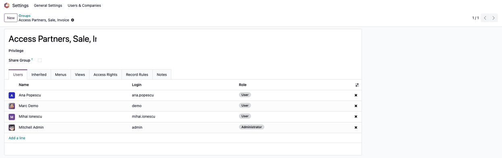
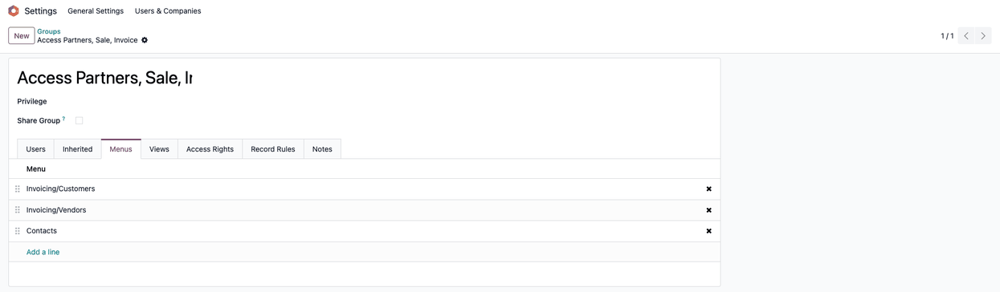
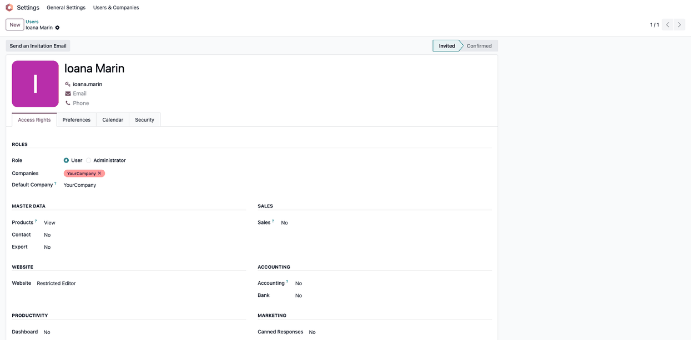
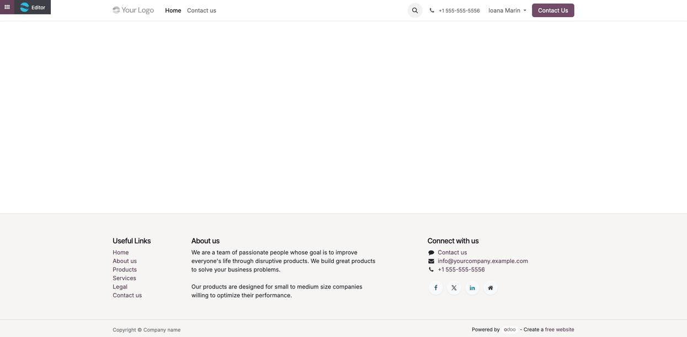

===========================
Website web designer access
===========================

..
   !!!!!!!!!!!!!!!!!!!!!!!!!!!!!!!!!!!!!!!!!!!!!!!!!!!!
   !! This file is generated by oca-gen-addon-readme !!
   !! changes will be overwritten.                   !!
   !!!!!!!!!!!!!!!!!!!!!!!!!!!!!!!!!!!!!!!!!!!!!!!!!!!!
   !! source digest: sha256:9302c3bfd475712e4a316d8f5f42a000eb37c55e0b14a54510cf819ba3fe898b
   !!!!!!!!!!!!!!!!!!!!!!!!!!!!!!!!!!!!!!!!!!!!!!!!!!!!

.. |badge1| image:: https://img.shields.io/badge/maturity-Mature-brightgreen.png
    :target: https://odoo-community.org/page/development-status
    :alt: Mature
.. |badge2| image:: https://img.shields.io/badge/github-dhongu%2Fdeltatech-lightgray.png?logo=github
    :target: https://github.com/dhongu/deltatech/tree/19.0/deltatech_website_access_design
    :alt: dhongu/deltatech
.. |badge_fisa| image:: https://img.shields.io/badge/-Fi%C8%99%C4%83%20consultant-2ea44f.png
    :target: https://github.com/dhongu/deltatech/blob/19.0/deltatech_website_access_design/readme/FISA_CONSULTANT.md
    :alt: Fișă consultant
.. |badge_tests| image:: https://img.shields.io/badge/-6%20automated%20tests%20%C2%B7%2083%25%20code%20coverage-2ea44f.png
    :target: https://app.codecov.io/gh/dhongu/deltatech/tree/19.0/deltatech_website_access_design
    :alt: 6 automated tests · 83% code coverage

|badge1| |badge2| |badge_fisa| |badge_tests|

Hides the back-office menus for partners, sales and invoices from users
who should only work on the website, such as a web designer. The
designer edits the website with the standard *Website: Restricted
Editor* right, without being a website administrator, and does not see
the commercial menus.

**Dedicated access group.** The module creates the group *Access
Partners, Sale, Invoice*. At installation every internal user existing
at that moment joins the group, so nobody loses a menu when the module
is installed.

**Restricted menus.** At installation, once, the following menus are
reserved to that group, replacing the groups they had before:

- **Contacts** (the Contacts app);
- **Sales** (the Sales app);
- **Invoicing > Customers**;
- **Invoicing > Vendors**.

An update of this module no longer touches these menus, so groups you
add on them yourself are kept.

**Setting up a web designer.** In **Settings > Users & Companies >
Users**, on the designer's user, set **Website** to *Restricted Editor*:
the designer edits the website pages and content but does not manage the
website configuration. Then remove the designer from the group *Access
Partners, Sale, Invoice*, in **Settings > Users & Companies > Groups**
(developer mode), tab **Users**.

The module hides menus only. It does not change record rules or access
rights, so the records stay reachable through other menus, links or
smart buttons.

Limitations
-----------

- Internal users created after the installation are not in the group
  *Access Partners, Sale, Invoice*: add each one who needs the Contacts,
  Sales and Invoicing > Customers / Vendors menus to the group.
- Odoo adds groups to a menu when the module that defines it is updated.
  After an update of Contacts, the Contacts menu is visible again to all
  internal users. Remove the group *Internal User* from the menu again,
  in **Settings > Technical > Menu Items**.
- Uninstalling the module gives the four menus back the groups set by
  their own module.

**Table of contents**

.. contents::
   :local:

Usage
=====

Check the access group after installation
-----------------------------------------

Open **Settings > Users & Companies > Groups** (developer mode) and
search for *Access Partners, Sale, Invoice*. The **Users** tab lists
every internal user that existed at installation, so nobody lost the
Contacts, Sales or Invoicing menus.

|Group Access Partners, Sale, Invoice, Users tab: the internal users
existing at installation, each with their login and role|

The **Menus** tab lists the menus reserved to the group:
Invoicing/Customers, Invoicing/Vendors, Contacts and, when the Sales app
(``sale_management``) is installed, Sales.

|Group Access Partners, Sale, Invoice, Menus tab: Invoicing/Customers,
Invoicing/Vendors and Contacts|

Set up the web designer
-----------------------

1. In **Settings > Users & Companies > Users**, open the designer's
   user. In the **Access Rights** tab, set **Website** to **Restricted
   Editor** and save.
2. In the group *Access Partners, Sale, Invoice*, **Users** tab, remove
   the designer and save.

|User form of the designer, Access Rights tab: role User, Website
Restricted Editor, Sales and Accounting No|

The designer now opens the website with the **Editor** button and edits
the pages, without seeing Contacts, Sales or Invoicing > Customers /
Vendors.

|Website opened by the designer, with the Editor button at the top left|

Internal users created after the installation are not in the group: add
each one who needs these menus.

Changelog
=========

19.0.1.1.0 (2026-11-07)
-----------------------

- Installation no longer hides Contacts, Sales and Invoicing > Customers
  / Vendors from every user except the administrator: all internal users
  existing at installation join the group *Access Partners, Sale,
  Invoice*. The menus are restricted once, at installation, and a module
  update no longer overwrites their groups. Uninstalling gives the menus
  back their standard groups. Existing installations keep their current
  setup. The description explains how to give the web designer the
  standard *Website: Restricted Editor* right.

19.0.1.0.2 (2026-11-03)
-----------------------

- Description rewritten from the code: the module grants no website
  rights; it reserves the Contacts, Sales and Invoicing > Customers /
  Vendors menus to the group *Access Partners, Sale, Invoice*.
  Documented the limitations after a Contacts update and at uninstall.

19.0.1.0.1
==========

- Own module icon, instead of the generic gears it had.

History
=======

19.0.1.0.0 (2026-09-24)
-----------------------

- Port from 18.0. Fixed by CI: ``data/data.xml`` used
  ``res.groups.users`` and ``ir.ui.menu.groups_id``, both renamed on
  Odoo 19 (``user_ids`` and ``group_ids`` respectively) —
  ``ValueError: Invalid field 'users' in 'res.groups'`` at registry
  load. No other API removed in Odoo 19 is touched (no
  ``attrs``/``states``, no ``target="inline"``, no search-view
  ``<group>``). Ported for a customer, who installs it standalone (not
  as a dependency of a customer module) to restrict the
  Contacts/Sales/Finance menus to a dedicated internal-access group.

Bug Tracker
===========

Bugs are tracked on `Terrabit Issues <https://www.terrabit.ro/helpdesk>`_.
In case of trouble, please check there if your issue has already been reported.

Do not contact contributors directly about support or help with technical issues.

Credits
=======

Authors
-------

* Terrabit
* Dorin Hongu

Maintainers
-----------

.. |maintainer-dhongu| image:: https://github.com/dhongu.png?size=40px
    :target: https://github.com/dhongu
    :alt: dhongu

Current maintainer:

|maintainer-dhongu| 

This module is part of the `dhongu/deltatech <https://github.com/dhongu/deltatech/tree/19.0/deltatech_website_access_design>`_ project on GitHub.

You are welcome to contribute.