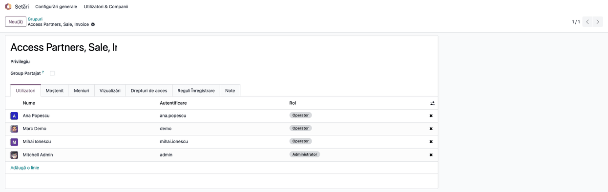
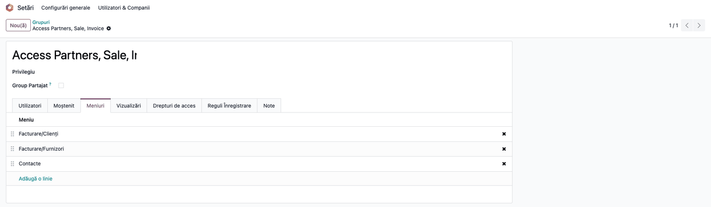
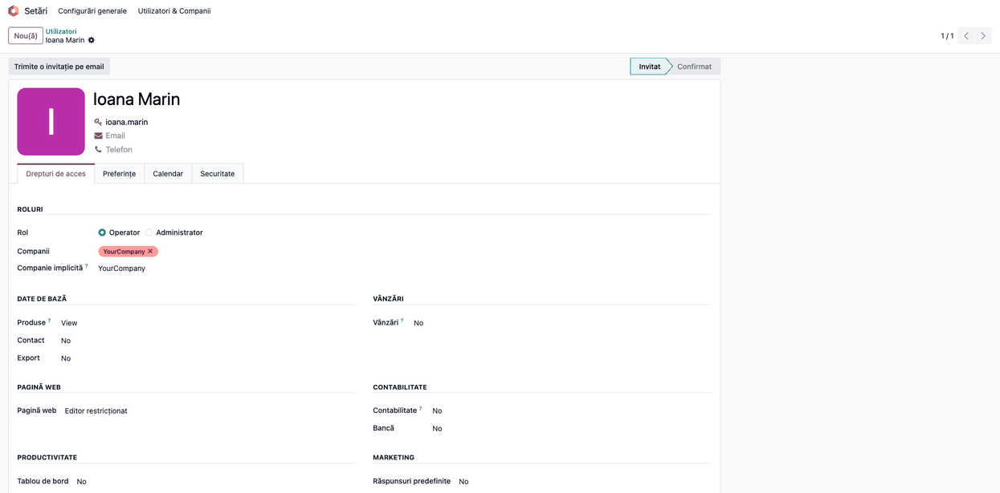
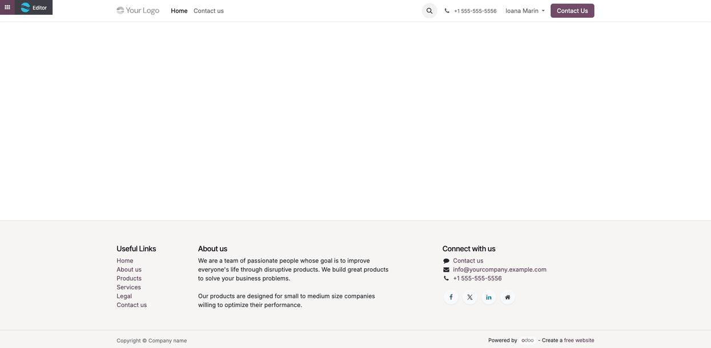

# Fișă Modul: Acces de web designer fără meniurile comerciale

**Modul:** `deltatech_website_access_design`
**Utilizator principal:** Administratorul Odoo al clientului (configurează drepturile designerului)
**Prioritate:** 🟢 Scăzută (ascunde patru meniuri; nu schimbă drepturile de acces la înregistrări și
nu atinge contabilitatea)

---

## 1. Scop business

O firmă care își administrează site-ul în Odoo lucrează des cu un web designer extern sau cu un
coleg care se ocupă doar de site. Acesta are nevoie de un utilizator intern ca să editeze paginile,
dar nu trebuie să vadă agenda de parteneri, vânzările și facturile clienților și furnizorilor.

Modulul rezervă meniurile **Contacte**, **Vânzări**, **Facturare → Clienți** și **Facturare →
Furnizori** unui grup dedicat, *Access Partners, Sale, Invoice*. Utilizatorii interni existenți la
instalare intră toți în grup, deci nimeni nu pierde meniurile. Administratorul scoate din grup doar
designerul, căruia îi dă dreptul standard de editare a site-ului (**Pagină web: Editor
restricționat**).

## 2. Bază legală și context

Nu există un temei legal propriu. Modulul ține de organizarea internă a accesului, pe principiul
„fiecare utilizator vede doar ce îi trebuie”. Nu înlocuiește drepturile de acces la date (vezi
secțiunea 11, „Limitări cunoscute”).

## 3. Utilizatori și roluri

| Rol | Ce face | Drept Odoo |
|---|---|---|
| Administrator Odoo | dă dreptul de editare a site-ului și scoate designerul din grup | **Rol** = **Administrator**, modul de dezvoltare pentru meniul **Grupuri** |
| Web designer | editează paginile site-ului; nu vede meniurile comerciale | **Pagină web: Editor restricționat**, în afara grupului *Access Partners, Sale, Invoice* |
| Vânzător, contabil, ceilalți utilizatori interni | lucrează ca înainte | membri ai grupului *Access Partners, Sale, Invoice*, plus drepturile lor obișnuite |

Roluri recomandate pentru testare: un administrator, un vânzător existent la instalare și un
designer.

## 4. Conturi și date implicate

Modulul nu are conturi contabile și nu creează note contabile.

Date minime pentru demo (folosite și în capturi):
- vânzătoarea **Ana Popescu** (`ana.popescu`) și contabilul **Mihai Ionescu** (`mihai.ionescu`),
  utilizatori interni existenți la instalarea modulului;
- designerul **Ioana Marin** (`ioana.marin`), utilizator intern existent la instalare, scos apoi din
  grup și cu dreptul **Pagină web: Editor restricționat**.

## 5. Configurare inițială

1. Instalați modulul din **Aplicații** (scoateți filtrul **Aplicații** din căutare; modulul nu e o
   aplicație). La instalare, toți utilizatorii interni existenți, activi sau arhivați, intră în grupul
   *Access Partners, Sale, Invoice*.
2. Activați modul de dezvoltare (**Setări → Activează modul de dezvoltare**), necesar pentru
   meniul **Grupuri**.

## 6. Flux de utilizare

### Pasul 1 — Grupul de acces după instalare

Deschideți **Setări → Utilizatori & Companii → Grupuri** și căutați *Access Partners, Sale,
Invoice*. Tab-ul **Utilizatori** arată toți utilizatorii interni existenți la instalare.

1. **Găsiți pe ecran** — lista din tab-ul **Utilizatori**, cu numele, autentificarea și rolul.
2. **Verificați** — fiecare utilizator intern care lucra deja cu Contacte, Vânzări sau Facturare
   este în listă. Pe demo, captura e făcută după pasul 3: apar Ana Popescu, Mihai Ionescu,
   utilizatorul demo Marc Demo și administratorul; Ioana Marin a fost deja scoasă din grup.



### Pasul 2 — Meniurile rezervate grupului

În același grup, deschideți tab-ul **Meniuri**.

1. **Găsiți pe ecran** — meniurile rezervate: **Facturare/Clienți**, **Facturare/Furnizori**,
   **Contacte** și, dacă e instalată aplicația **Vânzări** (`sale_management`), **Vânzări**. Fără
   ea, meniul Vânzări există, dar e inactiv și nu apare în listă.
2. **Verificați** — meniurile apar aici doar o dată, la instalare. Dacă lipsește unul (de exemplu
   **Contacte**, după o actualizare a modulului Contacte), vedeți secțiunea 9.



### Pasul 3 — Designerul: drept de editare, fără meniurile comerciale

Deschideți **Setări → Utilizatori & Companii → Utilizatori** și alegeți designerul. În tab-ul
**Drepturi de acces**, secțiunea **Pagină web**, alegeți **Editor restricționat**. Salvați.

Apoi, în grupul *Access Partners, Sale, Invoice* (pasul 1), tab-ul **Utilizatori**, apăsați ✕ pe
rândul designerului și salvați grupul.

1. **Găsiți pe ecran** — pe fișa designerului: **Rol** = **Operator**, **Pagină web** = **Editor
   restricționat**, **Vânzări** = **No**, **Contabilitate** = **No**.
2. **Verificați** — designerul nu mai apare în tab-ul **Utilizatori** al grupului.



### Pasul 4 — Ce vede designerul

Designerul se conectează și deschide site-ul. În stânga sus are butonul **Editor**, cu care
modifică paginile. În backend, meniul de aplicații îi arată doar aplicațiile la care are drept: nu
apar **Contacte**, **Vânzări** și nici **Facturare → Clienți / Furnizori**. Verificarea se face
conectat ca designer (secțiunea 8); testele automate ale modulului verifică meniul **Contacte**.



### Note de monografie și raportare

Modulul nu generează note contabile.

Comportamentul la instalare, actualizare și dezinstalare:
- **instalare:** utilizatorii interni existenți intră în grup; cele patru meniuri se rezervă
  grupului, o singură dată;
- **actualizarea modulului:** nu mai atinge meniurile și nici membrii grupului; grupurile adăugate
  de mână pe meniuri rămân;
- **dezinstalare:** meniurile primesc înapoi grupurile standard (**Contacte**: *Rol / Operator* și
  *Contact / Creare*; celelalte trei: fără grup propriu), iar grupul se șterge.

## 7. Legături cu alte module / declarații

| Modul / proces | Rol în flux | Tip legătură |
|---|---|---|
| `website` | dreptul **Pagină web: Editor restricționat** al designerului | dependență (manifest) |
| `contacts` | meniul **Contacte** | dependență (manifest) |
| `sale` | creează meniul **Vânzări** (inactiv) | dependență (manifest) |
| `sale_management` | activează meniul **Vânzări** (aplicația Vânzări) | opțional |
| `account` | meniurile **Facturare → Clienți** și **Facturare → Furnizori** | dependență (manifest) |

**Ce e automat:**
- utilizatorii interni existenți la instalare intră în grup;
- rezervarea celor patru meniuri, la instalare;
- revenirea la grupurile standard ale meniurilor, la dezinstalare.

**Ce rămâne manual:**
- adăugarea în grup a fiecărui utilizator intern creat după instalare care are nevoie de meniuri;
- dreptul **Editor restricționat** al designerului și scoaterea lui din grup;
- refacerea restricției pe **Contacte** după o actualizare a modulului Contacte (secțiunea 9).

## 8. Verificări pentru consultant

- [ ] După instalare, tab-ul **Utilizatori** al grupului conține toți utilizatorii interni
      existenți; niciun utilizator nu a pierdut Contacte, Vânzări sau Facturare.
- [ ] Tab-ul **Meniuri** al grupului conține Contacte, Facturare/Clienți, Facturare/Furnizori și
      (cu aplicația Vânzări, `sale_management`) Vânzări.
- [ ] Designerul are **Pagină web: Editor restricționat** și nu e în grup.
- [ ] Conectat ca designer: butonul **Editor** apare pe site; Contacte, Vânzări și Facturare →
      Clienți / Furnizori nu apar în meniu.
- [ ] Un utilizator intern nou, creat după instalare, nu vede meniurile până nu e adăugat în grup.
- [ ] După o actualizare a modulului, grupurile meniurilor și membrii grupului sunt neschimbați.

## 9. Mesaje de eroare frecvente

| Mesaj / simptom | Cauză probabilă | Remediere |
|---|---|---|
| Un utilizator nou nu vede Contacte, Vânzări sau Facturare → Clienți / Furnizori | A fost creat după instalarea modulului și nu e în grup | Adăugați-l în grupul *Access Partners, Sale, Invoice*, tab-ul **Utilizatori** |
| Designerul vede din nou **Contacte** | Modulul Contacte a fost actualizat și a pus la loc grupurile lui pe meniu | **Setări → Tehnic → Elemente meniu**, meniul **Contacte**, câmpul **Vizibilitate**: lăsați doar grupul *Access Partners, Sale, Invoice* |
| Meniul **Grupuri** nu apare în **Setări → Utilizatori & Companii** | Modul de dezvoltare nu e activ | **Setări → Activează modul de dezvoltare** |
| Designerul deschide totuși un partener sau o factură dintr-un link | Modulul ascunde doar meniuri, nu schimbă drepturile de acces | Limitați drepturile designerului (**Vânzări**, **Contabilitate**, **Contact** = **No**) |

## 10. Capturi de ecran

Capturile (`static/description/`) se generează automat din `tests/test_screenshots.py`, cu mixinul
`ScreenshotCase` din `deltatech_doc_screenshots` (import defensiv), în **limba română**, pe datele
din secțiunea 4. Aceleași shot-uri, în engleză, sunt în `static/description/en/`, pentru
`readme/USAGE.md`.

| # | Fișier | Conținut |
|---|---|---|
| 1 | `01_grup_acces_utilizatori.png` | grupul *Access Partners, Sale, Invoice*, tab-ul **Utilizatori** |
| 2 | `02_grup_acces_meniuri.png` | același grup, tab-ul **Meniuri** |
| 3 | `03_utilizator_designer.png` | fișa designerului, **Pagină web: Editor restricționat** |
| 4 | `04_website_designer.png` | site-ul deschis de designer, cu butonul **Editor** |

Regenerare:

```bash
FISE_SCREENSHOTS=1 ./odoo/odoo-bin -c odoo.conf -d <db> -i deltatech_website_access_design \
    --test-tags=/deltatech_website_access_design:TestWebsiteAccessDesignScreenshots --stop-after-init
```

## 11. Observații pentru manual

Prezentați modulul în capitolul despre utilizatori și drepturi, la „Utilizatori pentru site”.
Ordinea de lucru: instalare, verificarea grupului, dreptul **Editor restricționat** pe designer,
scoaterea designerului din grup.

### Limitări cunoscute

- **Utilizatorii noi nu intră automat în grup:** fiecare utilizator intern creat după instalare
  trebuie adăugat de mână dacă are nevoie de meniuri.
- **Actualizarea modulului Contacte** pune la loc grupurile standard pe meniul **Contacte**.
- **Doar meniuri:** înregistrările rămân accesibile prin alte meniuri, linkuri sau butoane
  inteligente, în limita drepturilor utilizatorului.
