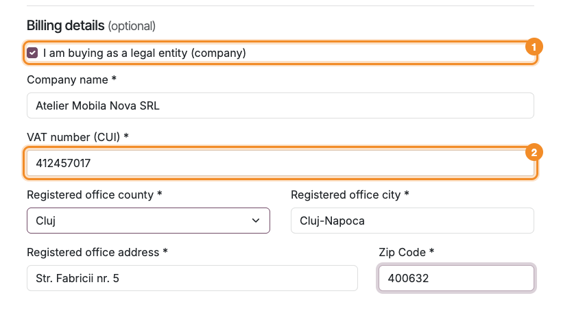
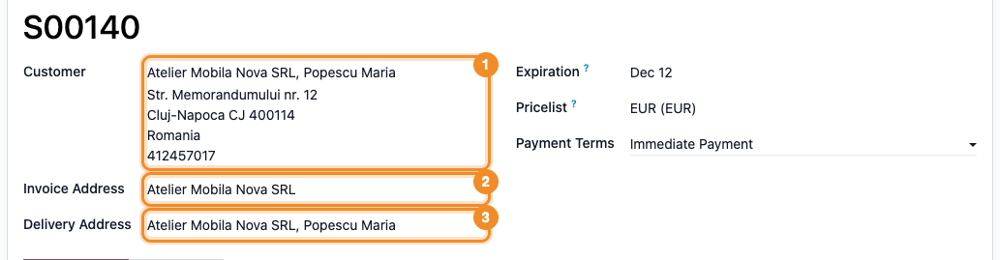
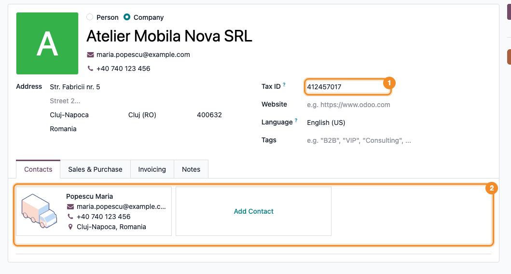

========================
Website Checkout Company
========================

..
   !!!!!!!!!!!!!!!!!!!!!!!!!!!!!!!!!!!!!!!!!!!!!!!!!!!!
   !! This file is generated by oca-gen-addon-readme !!
   !! changes will be overwritten.                   !!
   !!!!!!!!!!!!!!!!!!!!!!!!!!!!!!!!!!!!!!!!!!!!!!!!!!!!
   !! source digest: sha256:85e6a473e335f1c5648e6350875021f4e4f955dcd60a59faa7bfc364976aeada
   !!!!!!!!!!!!!!!!!!!!!!!!!!!!!!!!!!!!!!!!!!!!!!!!!!!!

.. |badge1| image:: https://img.shields.io/badge/maturity-Beta-yellow.png
    :target: https://odoo-community.org/page/development-status
    :alt: Beta
.. |badge2| image:: https://img.shields.io/badge/github-dhongu%2Fdeltatech-lightgray.png?logo=github
    :target: https://github.com/dhongu/deltatech/tree/19.0/deltatech_website_checkout_company
    :alt: dhongu/deltatech
.. |badge_fisa| image:: https://img.shields.io/badge/-Fi%C8%99%C4%83%20consultant-2ea44f.png
    :target: https://github.com/dhongu/deltatech/blob/19.0/deltatech_website_checkout_company/readme/FISA_CONSULTANT.md
    :alt: Fișă consultant

|badge1| |badge2| |badge_fisa|

Checkout address form for Romanian shops, with optional company billing.

- The address is asked in the Romanian order: last name, first name,
  country, county, street, city, zip code, then email and phone. The
  last name and the first name are kept together in the name of the
  contact.
- Below the address, an optional **Billing details** section: a customer
  who buys as a company ticks *I am buying as a legal entity (company)*
  and types the company name, its VAT number (CUI) and its registered
  office (county, city, street, zip code). The CUI is checked (checksum)
  before the order goes further.
- When no company is recorded with this CUI, the company is created as a
  company partner, with its registered office, and the customer becomes
  one of its delivery addresses, keeping its own address. The order is
  invoiced to the company and delivered to the customer.
- When a company is already recorded with this CUI (with or without the
  RO prefix), a new invoice address is created under it with the name
  and the registered office typed by the customer, and the order is
  invoiced to it; the checkout shows it as the selected billing address.
  Of the recorded company only its name shows (as the parent of the
  address, a public data of the CUI); its recorded address and contacts
  do not, and the customer is **not** attached to it: typing a CUI must
  not give a visitor the documents of another company. The form asks the
  same fields whether or not the CUI is known. An invoice address with
  the same name and registered office under that company is reused, so
  the same data typed again do not add duplicates.
- The company billing is available only for deliveries in Romania: the
  fiscal position of the order follows the customer and the delivery
  address, not the invoice address, and the domestic VAT of a Romanian
  company applies to goods delivered in Romania.
- The CUI is saved as typed, without spaces, dots and hyphens (with or
  without the RO prefix); whether the company is registered for VAT is
  not checked with ANAF, so the accountant reviews the new companies
  before invoicing.
- Customers who already belong to a company, or are one, keep the
  standard company name and VAT fields.

**Table of contents**

.. contents::
   :local:

Usage
=====

1. In the shop, add a product to the cart and go to checkout. On the
   **Address** step, fill in **Last name** and **First name** (two
   fields, saved together as "Last name First name"), then **Country**,
   **State / Province**, **Street and Number**, **City**, **Zip Code**,
   **Email** and **Phone**. A private person leaves **Billing details
   (optional)** unticked.

   |Checkout address form: Last name and First name in separate fields,
   then the address, email and phone; below, the optional Billing
   details section with its checkbox unticked|

2. To be invoiced as a company, tick *I am buying as a legal entity
   (company)* and fill in **Company name**, **VAT number (CUI)** (with
   or without the RO prefix) and the registered office: **Registered
   office county**, **Registered office city**, **Registered office
   address** and **Zip Code**. The registered office is in Romania.

   |Billing details section ticked, with the company name, its VAT
   number and the registered office filled in|

3. Click **Confirm**. A VAT number with a wrong check digit stops the
   form with *The company VAT number (CUI) is not valid.*; missing
   company data (name, VAT number, registered office city, address or
   zip code) shows *Fill in the company details: name, VAT number (CUI)
   and registered office.* Company billing is available only for
   deliveries in Romania; otherwise the form shows *Billing to a company
   is available only for deliveries in Romania.* No partner is created
   until the data is corrected.

   |Address form after Confirm with the VAT number 12345678: the field
   is red and the message The company VAT number (CUI) is not valid
   shows above the form|

4. With a VAT number that is not recorded yet, the company is created
   with its registered office and becomes the selected **Billing
   address**; the customer becomes one of its delivery addresses and
   keeps its own address as **Delivery address**.

   |Delivery step of the checkout: the new company is the selected
   billing address, with its registered office; the customer is the
   delivery address|

5. In the backend (**Sales > Orders > Quotations**, or **Orders** once
   confirmed), the order has the customer as **Customer** and **Delivery
   Address**, and the company as **Invoice Address**. The fiscal
   position and the taxes follow the customer and the delivery address,
   not the invoice address.

   |Sales order header: Customer and Delivery Address are the customer,
   Invoice Address is the company|

6. In **Contacts**, the new company has the typed **Tax ID** and
   registered office, and the customer is listed in its **Contacts** tab
   as a delivery address.

   |The new company in Contacts: Tax ID and registered office, with the
   customer as a delivery address in the Contacts tab|

7. With the VAT number of a company already recorded (with or without
   RO), the form asks the same fields and does not show the recorded
   data. A new invoice address is created under that company, with the
   name and the registered office typed by the customer, and is selected
   as **Billing address**. The customer is **not** attached to the
   company.

   |Delivery step for a recorded company: the selected billing address
   is Ana Agro SRL, Ana Agro SRL, with the typed registered office; the
   delivery address is the customer alone|

8. On that order, **Customer** and **Delivery Address** are the
   customer, and **Invoice Address** is the new address under the
   recorded company. Each such order adds an invoice address to the
   company; backend users can merge the duplicates from **Contacts**.

   |Sales order header for a recorded company: Customer and Delivery
   Address are the customer, Invoice Address is Ana Agro SRL, Ana Agro
   SRL|

The **Billing details** section shows only on the main billing address
of a customer who does not belong to a company and is not a company
itself; the others keep the standard company name and VAT fields. The
company is created only from the shop checkout: the address form of the
customer portal shows the section too, but saving it there does not
create a company.

.. |Checkout address form: Last name and First name in separate fields, then the address, email and phone; below, the optional Billing details section with its checkbox unticked| image:: https://raw.githubusercontent.com/dhongu/deltatech/19.0/deltatech_website_checkout_company/static/description/en/01_formular_adresa.png

.. |Address form after Confirm with the VAT number 12345678: the field is red and the message The company VAT number (CUI) is not valid shows above the form| image:: https://raw.githubusercontent.com/dhongu/deltatech/19.0/deltatech_website_checkout_company/static/description/en/03_cui_invalid.png
.. |Delivery step of the checkout: the new company is the selected billing address, with its registered office; the customer is the delivery address| image:: https://raw.githubusercontent.com/dhongu/deltatech/19.0/deltatech_website_checkout_company/static/description/en/04_checkout_facturare_firma.png

.. |Delivery step for a recorded company: the selected billing address is Ana Agro SRL, Ana Agro SRL, with the typed registered office; the delivery address is the customer alone| image:: https://raw.githubusercontent.com/dhongu/deltatech/19.0/deltatech_website_checkout_company/static/description/en/07_checkout_firma_inregistrata.png
.. |Sales order header for a recorded company: Customer and Delivery Address are the customer, Invoice Address is Ana Agro SRL, Ana Agro SRL| image:: https://raw.githubusercontent.com/dhongu/deltatech/19.0/deltatech_website_checkout_company/static/description/en/08_comanda_firma_inregistrata.png

Changelog
=========

19.0.1.0.0 (2026-11-12)
-----------------------

- First version: checkout address in the Romanian order (last name and
  first name, country, county, city, street, email, phone) and an
  optional *Billing details* section that invoices the order to a
  company: created from the name, the CUI and the registered office
  typed, or, for a CUI already recorded, a new invoice address under
  that company with the typed data, without attaching the customer to it
  and without showing the recorded company data.
- The county of the registered office is accepted only from Romania.

Bug Tracker
===========

Bugs are tracked on `Terrabit Issues <https://www.terrabit.ro/helpdesk>`_.
In case of trouble, please check there if your issue has already been reported.

Do not contact contributors directly about support or help with technical issues.

Credits
=======

Authors
-------

* Terrabit
* Dorin Hongu

Maintainers
-----------

.. |maintainer-dhongu| image:: https://github.com/dhongu.png?size=40px
    :target: https://github.com/dhongu
    :alt: dhongu

Current maintainer:

|maintainer-dhongu| 

This module is part of the `dhongu/deltatech <https://github.com/dhongu/deltatech/tree/19.0/deltatech_website_checkout_company>`_ project on GitHub.

You are welcome to contribute.