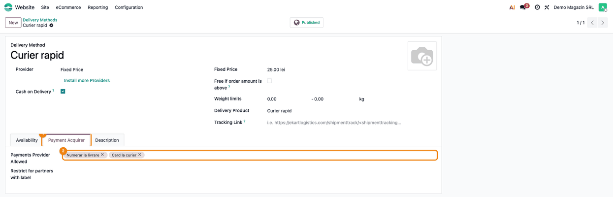
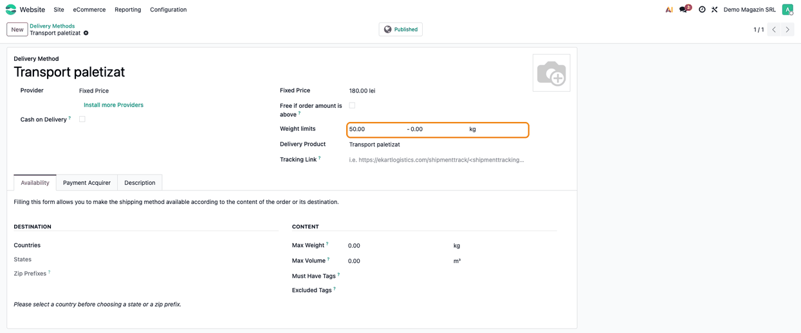
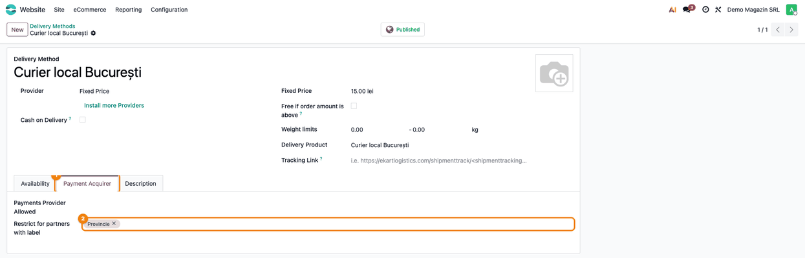
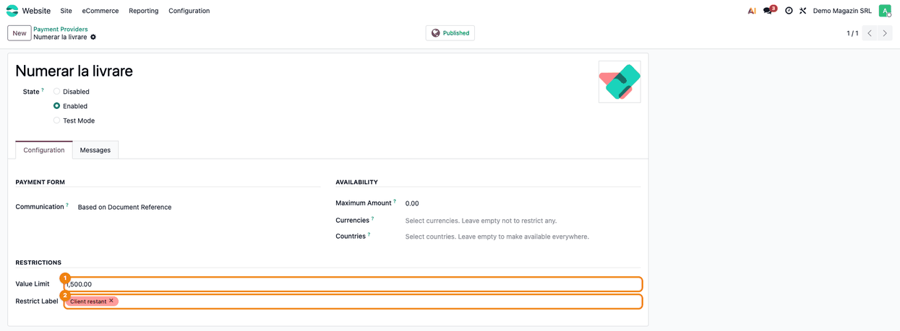
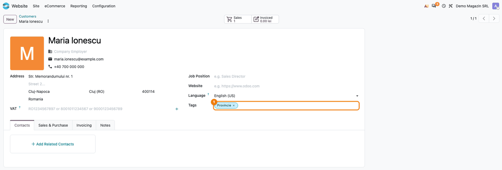
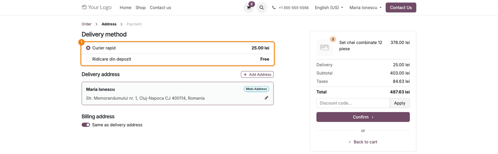
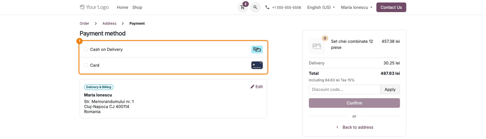
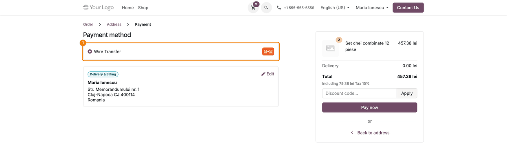
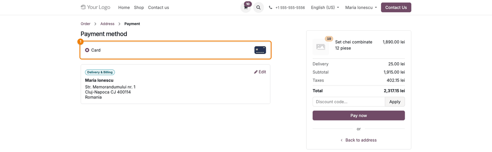

====================
Delivery and Payment
====================

..
   !!!!!!!!!!!!!!!!!!!!!!!!!!!!!!!!!!!!!!!!!!!!!!!!!!!!
   !! This file is generated by oca-gen-addon-readme !!
   !! changes will be overwritten.                   !!
   !!!!!!!!!!!!!!!!!!!!!!!!!!!!!!!!!!!!!!!!!!!!!!!!!!!!
   !! source digest: sha256:5e7bb5028682c2c21267c0319261a3bb8a902ac855168b18c9ac513cbe820a27
   !!!!!!!!!!!!!!!!!!!!!!!!!!!!!!!!!!!!!!!!!!!!!!!!!!!!

.. |badge1| image:: https://img.shields.io/badge/maturity-Mature-brightgreen.png
    :target: https://odoo-community.org/page/development-status
    :alt: Mature
.. |badge2| image:: https://img.shields.io/badge/github-dhongu%2Fdeltatech-lightgray.png?logo=github
    :target: https://github.com/dhongu/deltatech/tree/19.0/deltatech_website_delivery_and_payment
    :alt: dhongu/deltatech
.. |badge_fisa| image:: https://img.shields.io/badge/-Fi%C8%99%C4%83%20consultant-2ea44f.png
    :target: https://github.com/dhongu/deltatech/blob/19.0/deltatech_website_delivery_and_payment/readme/FISA_CONSULTANT.md
    :alt: Fișă consultant
.. |badge_tests| image:: https://img.shields.io/badge/-10%20automated%20tests%20%C2%B7%2086%25%20code%20coverage-2ea44f.png
    :target: https://app.codecov.io/gh/dhongu/deltatech/tree/19.0/deltatech_website_delivery_and_payment
    :alt: 10 automated tests · 86% code coverage

|badge1| |badge2| |badge_fisa| |badge_tests|

Limits the delivery methods and the payment providers offered in the
eCommerce checkout by the delivery method chosen, the value and weight
of the order and the tags of the customer.

Features
--------

- **Payment providers by delivery method**: a delivery method can list
  the payment providers allowed with it, for example cash on delivery
  only with the courier. On the payment step the customer sees only
  those providers. A delivery method without a list allows all of them.
- **Value limit of a payment provider**: above this order total (taxes
  included) the provider is no longer offered.
- **Weight limits of a delivery method**: the method is offered only
  when the estimated weight of the cart is between its minimum and
  maximum. An empty limit is not checked.
- **Restrictions by customer tags**: a delivery method or a payment
  provider can be hidden from the customers that have one of its tags.
  For delivery methods the tags of the customer's company are read; for
  payment providers, the tags of the customer on the order.

Configuration
-------------

- **Website > Configuration > eCommerce > Delivery Methods**, on a
  delivery method:

  - *Weight limits*, next to the price;
  - tab *Payment Acquirer*: *Payments Provider Allowed* and *Restrict
    for partners with label*.

- **Website > Configuration > eCommerce > Payment Providers**, on a
  provider, group *Restrictions*: *Value Limit* and the tags.

The module also adds a *Logo* to the delivery method form and a *Payment
Provider* field to the *Sales & Purchase* tab of the contact form. They
are stored for other modules and reports; this module does not use them
in the checkout.

**Table of contents**

.. contents::
   :local:

Usage
=====

Publish the payment providers and the delivery methods used on the shop
first (**Website → Configuration → eCommerce → Payment Providers** and
**Delivery Methods**). The rules below only hide options; they never add
a provider or a delivery method that is not enabled and published.

**Configure the rules**

1. **Payment providers allowed with a delivery method** — open the
   delivery method (e.g. **Curier rapid**), go to the **Payment
   Acquirer** tab (1) and fill in **Payments Provider Allowed** (2).
   With this delivery method the customer gets only these providers. An
   empty list allows all of them.

   |Delivery method form, Payment Acquirer tab: Payments Provider
   Allowed with two providers|

2. **Weight limits** — on the delivery method, next to the price, fill
   in the minimum and the maximum of **Weight limits** (highlighted), in
   the unit shown at the end of the row. The method is offered only when
   the estimated weight of the cart (product weight × quantity, goods
   only) is between them. A limit of 0 is not checked: 50 - 0 means
   "from 50 kg up".

   |Delivery method form: Weight limits 50.00 - 0.00 kg|

3. **Hide a delivery method for customer tags** — on the **Payment
   Acquirer** tab (1), fill in **Restrict for partners with label** (2).
   Customers whose **company** has one of these tags do not see the
   method.

   |Delivery method form, Payment Acquirer tab: Restrict for partners
   with label with the tag Provincie|

4. **Value limit and tags of a payment provider** — open the provider,
   group **Restrictions**: **Value Limit** (1) is the order total, taxes
   and delivery included, above which the provider is no longer offered
   (a total equal to the limit is still allowed; the limit is compared
   with the total in the order currency, without conversion); **Restrict
   Label** (2) hides the provider from the customers on the order that
   have one of the tags.

   |Payment provider form, Restrictions group: Value Limit 1,500.00 and
   Restrict Label|

5. **Tag the customers** — on the customer (**Website → eCommerce →
   Customers**), fill in **Tags** (1).

   |Customer form with the tag Provincie|

**Which tags are read**

For delivery methods the module reads the tags of the customer's
**company** (the commercial partner); for payment providers, the tags of
the **customer on the order**. For a contact person of a company, a tag
set only on the company hides the delivery method but not the payment
provider: set it on both when both must be hidden.

**What the customer sees in the checkout**

6. **Delivery step** — the **Delivery method** list (1) shows only the
   methods left after the rules: here the cart weighs 3 kg and the
   customer has the tag Provincie, so the pallet transport (from 50 kg)
   and the local courier (hidden for Provincie) are missing.

   |Checkout Address step: only two delivery methods are offered|

7. **Payment step with the courier** — the **Payment method** list (1)
   shows only the providers allowed with the chosen delivery method. The
   customer sees the **payment method** name (Card, Cash on Delivery),
   not the provider name from the backend.

   |Checkout Payment step with the courier: Card and Cash on Delivery|

8. **Payment step with pickup** — with the pickup method only **Wire
   Transfer** is left, the only provider allowed on it.

   |Checkout Payment step with the pickup method: only Wire Transfer|

9. **Above the value limit** — with 10 items the order total, taxes
   included (2,317.15 lei), is above the 1,500 lei limit of Cash on
   Delivery, so only **Card** is left.

   |Checkout Payment step above the value limit: only Card|

**Standard rules that still apply**

- Cash on Delivery is offered only by the delivery methods with the
  standard **Cash on Delivery** option, and, when the list is filled in,
  only if it is in **Payments Provider Allowed**.
- The standard **Maximum Amount** of a provider and **Max Weight** of a
  delivery method are applied too, next to the rules of this module.
- If the rules leave no delivery method, the shop shows "Sorry, we are
  unable to ship your order."; if they leave no payment provider, the
  payment step shows *No payment method available*. Keep one delivery
  method and one provider without restrictions as a fallback.

The **Logo** of the delivery method and the **Payment Provider** of the
contact are not used in the checkout.

Changelog
=========

19.0.2.1.8 (2026-11-03)
-----------------------

- Description rewritten to match the code: value limit of a payment
  provider, weight limits of a delivery method, which customer tags are
  read, where each setting is. The obsolete "work in progress" note is
  removed. Summary typo fixed.
- Consultant sheet (FISA_CONSULTANT.md), USAGE.md and screenshots in
  Romanian and English (``tests/test_screenshots.py``), including the
  delivery and payment steps of the shop checkout. *Weight limits* moved
  to its own row of the delivery method form (it was squeezed next to
  the *Free if order amount is above* checkbox) and shows the weight
  unit; Romanian translations updated.

19.0.2.1.7 (2026-10-16)
-----------------------

- Removed the inactive frontend script and the
  ``data-acquirer-allowed-ids`` attribute on the delivery methods: in
  Odoo 19 the payment methods are on ``/shop/payment``, after the
  delivery step, and are already filtered on the server by the allowed
  providers of the selected carrier.

19.0.2.1.6 (2026-10-09)
-----------------------

- Apps Store banner (banner.json).

19.0.2.1.5 (2026-09-30)
-----------------------

- New module icon in the flat style of the other modules; it replaces
  the old one.

Bug Tracker
===========

Bugs are tracked on `Terrabit Issues <https://www.terrabit.ro/helpdesk>`_.
In case of trouble, please check there if your issue has already been reported.

Do not contact contributors directly about support or help with technical issues.

Credits
=======

Authors
-------

* Terrabit
* Dorin Hongu

Maintainers
-----------

.. |maintainer-dhongu| image:: https://github.com/dhongu.png?size=40px
    :target: https://github.com/dhongu
    :alt: dhongu

Current maintainer:

|maintainer-dhongu| 

This module is part of the `dhongu/deltatech <https://github.com/dhongu/deltatech/tree/19.0/deltatech_website_delivery_and_payment>`_ project on GitHub.

You are welcome to contribute.