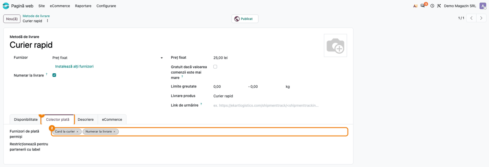
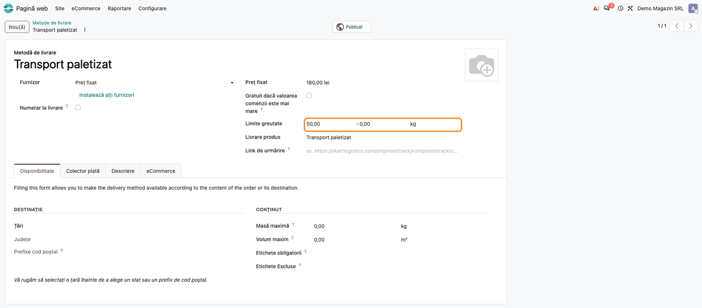
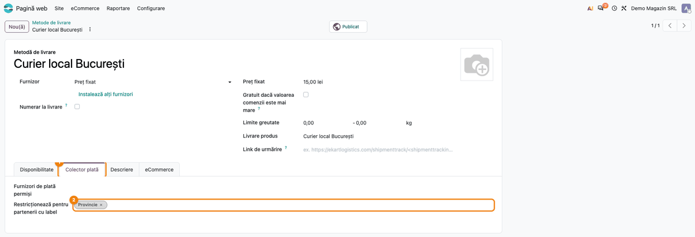
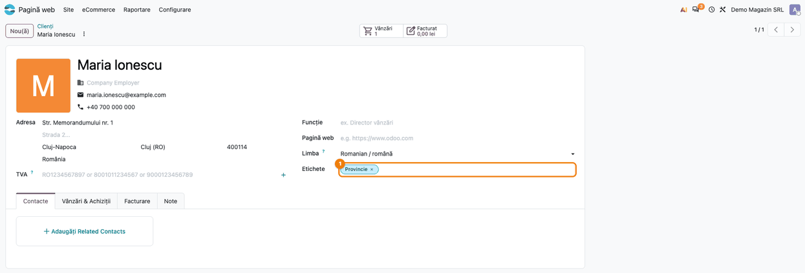
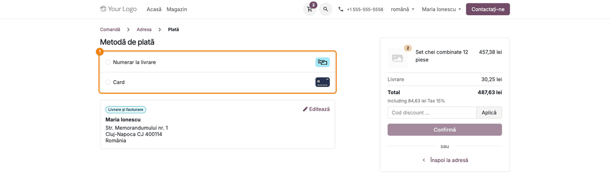
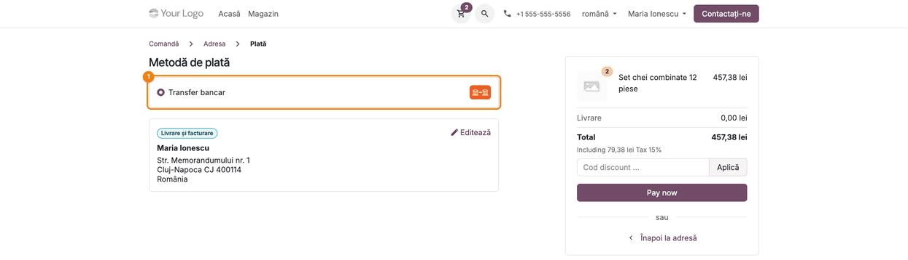
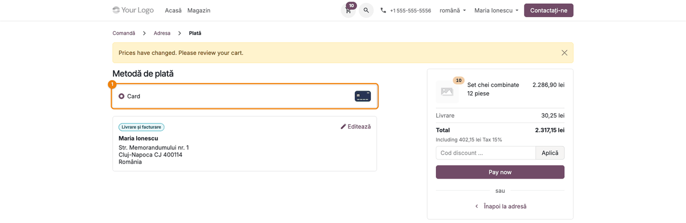

# Fișă Modul: Metode de livrare și de plată filtrate în checkout-ul magazinului online

**Modul:** `deltatech_website_delivery_and_payment`
**Utilizator principal:** Administrator magazin online / responsabil vânzări online
**Prioritate:** 🟡 Medie (controlează ce livrări și ce plăți vede clientul la finalizarea comenzii; fără impact contabil)

---

## 1. Scop business

Un magazin online nu poate oferi orice plată cu orice livrare: rambursul are sens doar cu
curierul, la ridicarea din depozit se plătește altfel, comenzile mari nu se mai trimit cu plata la
livrare, iar unii clienți (restanțieri, clienți din provincie pentru un curier local) nu trebuie să
vadă anumite opțiuni. Modulul filtrează, în checkout-ul magazinului, **metodele de livrare** și
**furnizorii de plată** după patru reguli configurate în backend:

- **furnizorii de plată permiși** pe fiecare metodă de livrare;
- **limita de valoare** a unui furnizor de plată (totalul comenzii, cu TVA);
- **limitele de greutate** ale unei metode de livrare (greutatea estimată a coșului);
- **etichetele clientului** care ascund o metodă de livrare sau un furnizor de plată.

Clientul vede doar ce i se potrivește, fără mesaje de eroare și fără ca operatorul să corecteze
comanda după plasare.

## 2. Bază legală și context

Modulul nu are un temei legal propriu. Contextul este operațional: regulile comerciale ale
magazinului (cu ce curier se poate plăti ramburs, până la ce valoare, cine are dreptul la plata la
livrare) se aplică automat la finalizarea comenzii. Condițiile de livrare și plată afișate în
termenii magazinului trebuie să spună aceleași lucruri ca regulile configurate aici.

## 3. Utilizatori și roluri

- **Administrator magazin online** — configurează metodele de livrare și furnizorii de plată.
  Are nevoie de drepturile **Administrare: Setări**: meniul **Pagină web → Configurare →
  eCommerce** și furnizorii de plată sunt accesibili doar acestui grup.
- **Responsabil vânzări** — pune etichetele pe clienți (**Pagină web → eCommerce → Clienți** sau
  aplicația Contacte).
- **Clientul magazinului** — vede în checkout doar metodele de livrare și de plată filtrate.

Roluri recomandate pentru testare:
- un administrator cu drepturi **Administrare: Setări** și acces la Vânzări (pentru meniul
  **eCommerce → Clienți**);
- un client cu cont pe portal (utilizator portal), cu adresă completă, ca să treacă de pasul
  **Adresa** al checkout-ului.

## 4. Conturi și date implicate

Modulul nu folosește conturi contabile și nu creează documente; nu schimbă nici prețurile, nici
taxele comenzii. Adaugă câmpuri de configurare:

| Unde | Câmp (RO / EN) | Ce face |
|---|---|---|
| Metoda de livrare, rândul de sub preț | **Limite greutate** / *Weight limits* (min - max) | Metoda apare doar dacă greutatea estimată a coșului e între minim și maxim; 0 = limită neverificată. |
| Metoda de livrare, tab **Plată** / *Payment Acquirer* | **Furnizori de plată permiși** / *Payments Provider Allowed* | Cu această metodă se oferă doar furnizorii din listă; listă goală = toți. |
| Metoda de livrare, tab **Plată** | **Ascunsă pentru partenerii cu eticheta** / *Restrict for partners with label* | Metoda nu apare dacă **compania** clientului are una dintre etichete. |
| Furnizorul de plată, tab-ul **Restrictions** | **Limită valoare** / *Value Limit* | Peste acest total al comenzii (cu TVA) furnizorul nu se mai oferă; 0 = fără limită. |
| Furnizorul de plată, tab-ul **Restrictions** | **Ascuns pentru etichetele** / *Restrict Label* | Furnizorul nu apare dacă **compania** clientului are una dintre etichete. |

La ambele reguli de etichete se citesc etichetele **companiei** clientului (partenerul comercial),
atât la **metodele de livrare**, cât și la **furnizorii de plată**. Eticheta pusă pe firmă se aplică
tuturor persoanelor ei de contact; o etichetă pusă doar pe persoana de contact nu se citește. Pentru
o persoană fizică, compania este chiar ea.

Modulul mai adaugă un **Logo** pe formularul metodei de livrare, afișat în checkout înaintea numelui
metodei, și un câmp **Furnizor de plată** în tab-ul **Vânzări & Achiziții** al contactului: furnizorul
preferat al clientului. Pe pasul **Plată**, metoda de plată a acestui furnizor (citit pe compania
clientului) este preselectată, dacă furnizorul e permis pentru comandă.

Date minime pentru demo (cele din capturi, toate de exemplu):
- furnizori de plată activi și publicați: **Transfer bancar**, **Numerar la livrare** (limită
  1.500 lei, ascuns pentru eticheta „Client restant”) și **Card la curier** (furnizor manual cu
  metoda de plată **Card**);
- metode de livrare publicate: **Curier rapid** (25 lei, permite Numerar la livrare și Card la
  curier), **Ridicare din depozit** (gratuit, permite doar Transfer bancar), **Transport paletizat**
  (180 lei, de la 50 kg) și **Curier local București** (15 lei, ascuns pentru eticheta „Provincie”);
- clientul **Maria Ionescu**, utilizator portal din Cluj-Napoca, cu eticheta „Provincie”;
- un coș cu 2 × „Set chei combinate 12 piese” (189 lei, 1,5 kg/buc.).

## 5. Configurare inițială

1. Instalați modulul (depinde de `website_sale_stock`, deci aduce magazinul online și stocul).
2. Din **Pagină web → Configurare → eCommerce → Furnizori de plată**, activați furnizorii folosiți
   și publicați-i pe site (butonul **Publicat**). Pentru un furnizor manual suplimentar (ex. **Card
   la curier**), duplicați **Transfer bancar** (⚙ → **Duplicare**), redenumiți-l și rescrieți
   mesajul din tab-ul **Messages**, care altfel afișează datele contului bancar. În Odoo 20 un
   furnizor manual nu are tab-ul **Payment Methods**: clientul vede metoda de plată a furnizorului
   (în capturi, **Card** pentru Card la curier).
3. Creați etichetele de client (ex. „Provincie”, „Client restant”) direct din câmpul **Etichete** al
   contactului sau din aplicația Contacte.
4. Din **Pagină web → Configurare → eCommerce → Metode de livrare**, creați metodele de livrare și
   publicați-le. Pentru plata ramburs, bifați și opțiunea standard **Numerar la livrare** pe metoda
   de livrare care o acceptă (vezi secțiunea 7).
5. Pe furnizorii și metodele de livrare cu restricții, completați câmpurile din secțiunea 4, după
   pașii de mai jos.

## 6. Flux de utilizare

### Pasul 1 — Furnizorii de plată permiși cu o metodă de livrare

**Pagină web → Configurare → eCommerce → Metode de livrare**, deschideți metoda (ex. **Curier
rapid**) și mergeți pe tab-ul **Plată** ①. În **Furnizori de plată permiși** ② alegeți furnizorii
care se pot folosi cu această livrare (ex. **Numerar la livrare** și **Card la curier**). Dacă lăsați
câmpul gol, metoda de livrare acceptă toți furnizorii activi.



### Pasul 2 — Limitele de greutate ale unei metode de livrare

Pe aceeași listă, deschideți o metodă destinată coletelor grele (ex. **Transport paletizat**). Sub
preț, pe rândul propriu **Limite greutate** (evidențiat în captură), completați minimul și maximul, în unitatea de greutate afișată
la capătul rândului (kg). Metoda apare în checkout doar când greutatea estimată a coșului (greutatea
produsului × cantitate, pe liniile cu bunuri, fără servicii și fără linia de livrare) este între cele
două valori; o valoare 0 nu se verifică.
În exemplu, 50 - 0 înseamnă „de la 50 kg în sus, fără maxim”.



### Pasul 3 — Metodă de livrare ascunsă pentru o etichetă de client

Deschideți metoda care nu trebuie oferită unor clienți (ex. **Curier local București**), tab-ul
**Plată** ①, și completați **Ascunsă pentru partenerii cu eticheta** ② (ex. „Provincie”). Clienții
a căror **companie** are una dintre aceste etichete nu mai văd metoda în checkout; pentru o persoană
fizică, compania este chiar ea.



### Pasul 4 — Limita de valoare și etichetele unui furnizor de plată

**Pagină web → Configurare → eCommerce → Furnizori de plată**, deschideți furnizorul (ex.
**Numerar la livrare**). În tab-ul **Restrictions** (netradus în Odoo 20), sub **Valoare maximă**:
- **Limită valoare** ① — totalul comenzii, cu TVA și cu transportul inclus, peste care furnizorul nu
  se mai oferă (ex. 1.500 lei); la un total egal cu limita, furnizorul rămâne disponibil. Limita se
  compară cu totalul în moneda comenzii, fără conversie;
- **Ascuns pentru etichetele** ② — furnizorul nu apare pentru clienții a căror companie are una
  dintre etichete (ex. „Client restant”).


### Pasul 5 — Etichetele clientului

**Pagină web → eCommerce → Clienți**, deschideți clientul (ex. **Maria Ionescu**) și completați
câmpul **Etichete** ①. Aici, eticheta „Provincie” ascunde metoda **Curier local București**. Pentru
o persoană de contact a unei firme, rețineți regula din secțiunea 4: contează etichetele de pe firmă,
atât la livrare, cât și la plată.



### Pasul 6 — Pe site: pasul de livrare filtrat

Clientul autentificat finalizează comanda din coș cu **Finalizare comanda** și ajunge la pasul **Adresa**,
unde alege **Metoda de livrare**.

1. **Găsiți pe ecran** — lista **Metoda de livrare** ① arată metodele rămase după filtrare, cu
   prețul fiecăreia.
2. **Verificați** — cu un coș de 3 kg (2 × 1,5 kg) și un client cu eticheta „Provincie” apar doar
   **Curier rapid** (25,00 lei) și **Ridicare din depozit** (Gratis); **Transport paletizat** lipsește
   (sub 50 kg), iar **Curier local București** lipsește (eticheta „Provincie”). Totalul din dreapta
   include livrarea aleasă și TVA-ul (487,63 lei).
3. **Continuați** — clientul alege metoda și apasă **Confirmă**, ca să treacă la pasul **Plată**.


### Pasul 7 — Pe site: pasul de plată cu Curier rapid

1. **Găsiți pe ecran** — lista **Metodă de plată** ①. Clientul vede numele **metodei de plată**
   (Card, Numerar la livrare), nu numele furnizorului din backend (Card la curier).
2. **Verificați** — cu **Curier rapid** apar doar **Card** (furnizorul Card la curier) și
   **Numerar la livrare**, adică furnizorii permiși la Pasul 1; **Transfer bancar** lipsește.
   Totalul cu TVA (487,63 lei) este sub limita de 1.500 lei, deci Numerar la livrare rămâne
   disponibil.
3. **Continuați** — clientul alege metoda și apasă **Achită acum**.



### Pasul 8 — Pe site: pasul de plată cu Ridicare din depozit

Dacă la Pasul 6 clientul alege **Ridicare din depozit**, pasul de plată se schimbă:

1. **Găsiți pe ecran** — lista **Metodă de plată** ①.
2. **Verificați** — apare doar **Transfer bancar**, singurul furnizor permis pe Ridicare din depozit;
   Card și Numerar la livrare nu mai apar. Livrarea din rezumat este cea a metodei alese.
3. **Continuați** — **Achită acum**.



### Pasul 9 — Pe site: comandă peste limita de valoare

Clientul mărește cantitatea la 10 bucăți și revine la plată cu **Curier rapid**.

1. **Găsiți pe ecran** — lista **Metodă de plată** ① și totalul din rezumat.
2. **Verificați** — totalul cu TVA este 2.317,15 lei, peste limita de 1.500 lei a furnizorului
   Numerar la livrare, deci rămâne doar **Card**. Dacă dintr-o combinație de reguli nu mai rămâne
   niciun furnizor, în locul listei apare alerta standard **Nicio metodă de plată disponibilă**
   (vezi secțiunea 9).
3. **Continuați** — **Achită acum** cu metoda rămasă.



### Note de monografie și raportare

Modulul **nu generează note contabile** și nu modifică documentele contabile. Comanda de vânzare,
factura și încasarea (inclusiv plata ramburs prin curier) se înregistrează exact ca în fluxul
standard al magazinului online; modulul decide doar ce opțiuni vede clientul înainte de plasarea
comenzii. Nu există raport sau export propriu.

## 7. Legături cu alte module / declarații

| Modul | Rol |
|---|---|
| `website_sale` / `website_sale_stock` | Checkout-ul magazinului (pașii Adresa și Plată) pe care îl filtrează modulul. |
| `delivery` | Metodele de livrare, greutatea estimată a coșului și furnizorul standard **Numerar la livrare**, oferit doar pe metodele de livrare cu bifa **Numerar la livrare**. |
| `payment` / `payment_custom` | Furnizorii de plată și metodele de plată afișate clientului. |
| `deltatech_website_delivery_and_payment` | Regulile suplimentare: furnizori permiși pe livrare, limite de greutate, limită de valoare, etichete. |

**Ce e automat:** filtrarea metodelor de livrare la pasul **Adresa** și a metodelor de plată la
pasul **Plată**, la fiecare încărcare a paginii, după coșul și clientul curent. Regulile de plată
(furnizori permiși, limită de valoare, etichete) se aplică și când clientul plătește din portal o
ofertă trimisă pe email; cele de livrare, doar în checkout-ul site-ului. Furnizorul se verifică din
nou la crearea tranzacției: un furnizor nepermis pentru comandă este refuzat cu un mesaj, inclusiv în
plata rapidă (express checkout, ex. Google Pay / Apple Pay), unde metoda de livrare se alege după
furnizor. În plata rapidă nu apar metodele de livrare ai căror furnizori permiși nu acceptă plata
rapidă.

**Ce rămâne manual:** etichetele pe clienți, configurarea limitelor și a listelor de furnizori,
alinierea cu regulile standard ale Odoo:
- bifa standard **Numerar la livrare** pe metoda de livrare se aplică **în plus**: furnizorul
  Numerar la livrare apare doar dacă metoda are bifa **și** (dacă lista e completată) furnizorul e
  în **Furnizori de plată permiși**;
- câmpul standard **Valoare maximă** (tab-ul Restrictions al furnizorului, chiar deasupra) și **Limită valoare**
  din acest modul se aplică amândouă; folosiți unul singur, ca regula să fie ușor de citit;
- câmpul standard **Masă maximă** (tab-ul Disponibilitate al metodei de livrare) se aplică și el,
  pe lângă **Limite greutate**; la fel, **Etichete obligatorii** și **Etichete Excluse** din același
  tab se referă la etichetele de **produs**, nu la cele de client.

## 8. Verificări pentru consultant

- [ ] Pe o metodă de livrare cu **Furnizori de plată permiși** completat, pasul **Plată** arată doar
      metodele de plată ale acelor furnizori.
- [ ] Pe o metodă de livrare cu lista goală, pasul **Plată** arată toți furnizorii activi și
      publicați (cu excepția celor ascunși de limită sau de etichete).
- [ ] Un coș sub **Limite greutate** minim (sau peste maxim) nu mai vede metoda la pasul **Adresa**;
      la limită exactă metoda apare.
- [ ] Un client cu eticheta din **Ascunsă pentru partenerii cu eticheta** nu vede metoda; pentru o
      persoană de contact, eticheta trebuie să fie pe **firmă**.
- [ ] Un client cu eticheta din **Ascuns pentru etichetele** (furnizor) nu vede furnizorul; pentru o
      persoană de contact, eticheta trebuie să fie pe **firmă**.
- [ ] O comandă cu totalul (cu TVA și transport) peste **Limită valoare** nu vede furnizorul; la un
      total egal cu limita îl vede.
- [ ] Rambursul apare doar pe metodele de livrare cu bifa standard **Numerar la livrare**.
- [ ] **Logo** pe metoda de livrare apare în checkout înaintea numelui metodei.
- [ ] **Furnizor de plată** pe firma clientului preselectează metoda lui de plată la pasul **Plată**,
      când furnizorul e permis pentru comandă.

## 9. Mesaje de eroare frecvente

| Mesaj | Cauză | Remediere |
|---|---|---|
| „Ne pare rău, nu putem expedia comanda dvs.” la pasul **Plată** | După filtrare (greutate, etichete, plus regulile standard de destinație) nu a rămas nicio metodă de livrare pentru coș și adresă. | Verificați **Limite greutate** și etichetele clientului; asigurați o metodă de livrare fără restricții, ca rezervă. |
| „Nicio metodă de plată disponibilă” (alertă la pasul **Plată**) | Intersecția dintre **Furnizori de plată permiși**, limita de valoare și etichete a eliminat toți furnizorii. | Adăugați în lista metodei de livrare un furnizor fără limită de valoare (ex. Transfer bancar). |
| Numerar la livrare nu apare deși e în **Furnizori de plată permiși** | Metoda de livrare nu are bifa standard **Numerar la livrare**, totalul depășește **Limită valoare** sau clientul are o etichetă restricționată. | Bifați **Numerar la livrare** pe metoda de livrare; verificați limita și etichetele. |
| Eticheta pusă pe persoana de contact nu ascunde nici metoda de livrare, nici furnizorul | Se citesc etichetele firmei (partenerul comercial), nu ale persoanei de contact. | Puneți eticheta pe firmă. |

## 10. Capturi de ecran

Capturile sunt **generate automat** de `tests/test_screenshots.py` (mixinul `ScreenshotCase` din
`deltatech_doc_screenshots`, import defensiv), cu interfața în română, pe compania de exemplu „Demo
Magazin SRL” în RON. Aceleași ecrane, cu interfața în engleză, sunt în `static/description/en/`,
pentru `readme/USAGE.md`. Datele sunt de exemplu, fără date reale de client.

| Fișier | Ce arată |
|---|---|
| `01_livrare_furnizori_permisi.png` | Metoda Curier rapid, tab-ul Plată, cu furnizorii permiși. |
| `02_livrare_limite_greutate.png` | Metoda Transport paletizat, cu limitele de greutate 50 - 0. |
| `03_livrare_restrictie_eticheta.png` | Metoda Curier local București, ascunsă pentru eticheta Provincie. |
| `04_furnizor_plata_restrictii.png` | Furnizorul Numerar la livrare, grupul Restricții. |
| `05_client_etichete.png` | Clientul Maria Ionescu, cu eticheta Provincie. |
| `06_site_pas_livrare.png` | Pasul Adresa din checkout, cu metodele de livrare filtrate. |
| `07_site_plata_curier.png` | Pasul Plată cu Curier rapid: Card și Numerar la livrare. |
| `08_site_plata_ridicare.png` | Pasul Plată cu Ridicare din depozit: doar Transfer bancar. |
| `09_site_plata_peste_limita.png` | Pasul Plată peste limita de 1.500 lei (total 2.317,15 lei): doar Card. |

Regenerare:

```bash
./odoo/odoo-bin -c odoo.conf -d <db> -i deltatech_website_delivery_and_payment,deltatech_doc_screenshots \
    --test-tags=/deltatech_website_delivery_and_payment:TestDeliveryPaymentScreenshots --stop-after-init
```

## 11. Observații pentru manual

- Spuneți explicit că etichetele se citesc pe firma clientului, nu pe persoana de contact, atât la
  livrare, cât și la plată.
- Clientul vede **metodele de plată** (Card, Transfer bancar), nu numele furnizorilor din backend;
  în manual, numiți furnizorii astfel încât consultantul să-i recunoască după metoda afișată.
- Recomandați o metodă de livrare și un furnizor de plată fără restricții, ca rezervă, ca să nu se
  blocheze nicio comandă.
- Regulile standard Odoo (Numerar la livrare pe metoda de livrare, Valoare maximă, Masă maximă) se
  aplică în paralel cu cele ale modulului; menționați-le în același capitol.
- **Logo** pe metoda de livrare apare în lista de livrare din checkout, iar **Furnizor de plată** pe
  firma clientului preselectează metoda de plată; amândouă sunt opționale.
