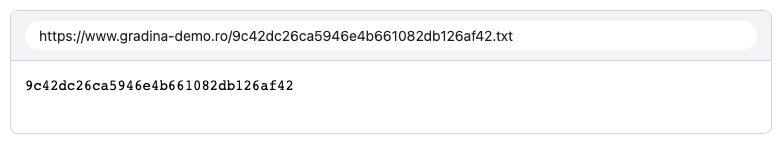
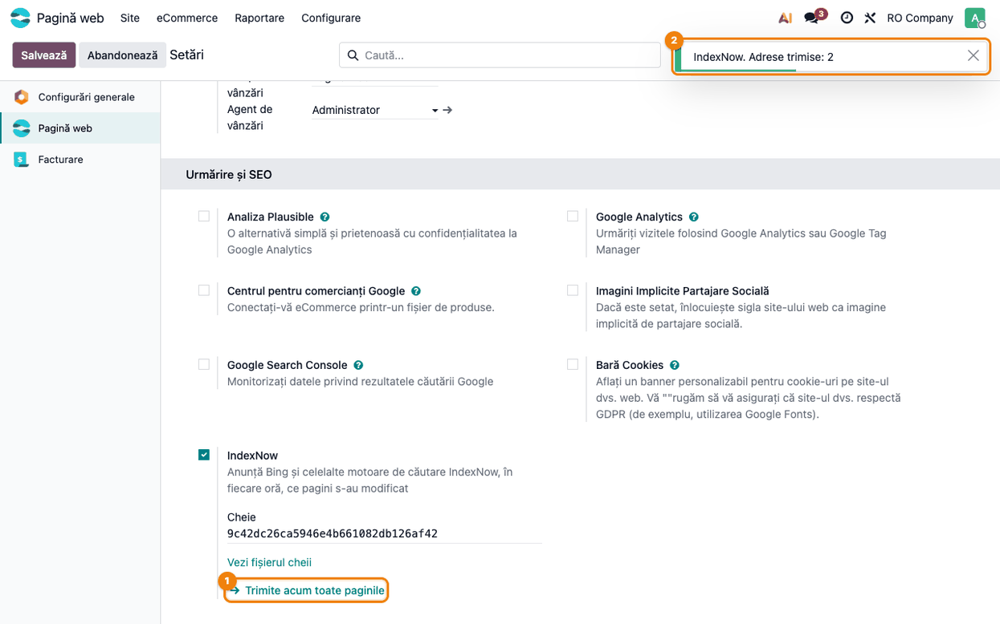

# Fișă Modul: Anunțarea paginilor noi către motoarele de căutare (IndexNow)

**Modul:** `deltatech_website_indexnow`
**Utilizator principal:** Administrator website, responsabil marketing / SEO
**Prioritate:** 🟢 Scăzută (vizibilitate în căutări; nu generează documente contabile)

---

## 1. Scop business

Un motor de căutare află de o pagină nouă sau modificată abia când trece din nou pe site, uneori
după zile sau săptămâni. [IndexNow](https://www.indexnow.org) este un protocol deschis prin care
site-ul anunță singur motoarele de căutare că o pagină s-a schimbat. Îl folosesc Bing, Yandex, Seznam
și Naver, care își transmit între ele adresele primite. Prin Bing, paginile ajung mai repede și în
căutarea din ChatGPT și Copilot. Modulul publică fișierul cheii, care dovedește că site-ul este al
firmei, și trimite o dată pe oră adresele paginilor publicate sau modificate de la ultima rulare:
pagini, pagini dinamice, produse, bloguri și articolele lor, evenimente, posturi, cursuri și
conținutul lor, articole Knowledge publicate pe site, după aplicațiile instalate.

## 2. Bază legală și context

Nu există o obligație legală. IndexNow este un protocol public, la fel ca `robots.txt` și
`sitemap.xml`. Google nu folosește IndexNow: pentru Google, harta site-ului se trimite în continuare
din Google Search Console. Modulul trimite doar adrese de pagini deja publice, domeniul și cheia, la
`api.indexnow.org`. Nu trimite conținutul paginilor și nici date despre clienți sau vizitatori.

## 3. Utilizatori și roluri

- **Administrator website**: activează IndexNow, păstrează sau înlocuiește cheia și face prima
  trimitere a tuturor paginilor.
- **Responsabil marketing / SEO**: urmărește rezultatul ultimei trimiteri din Setări și, în Bing
  Webmaster Tools, adresele primite prin IndexNow.

Roluri recomandate pentru testare:
- un administrator cu acces la **Pagină web → Configurare → Setări**;
- modul developer, doar pentru acțiunea planificată (**Setări → Tehnic → Acțiuni planificate**);
- o fereastră privată de browser, pentru fișierul cheii văzut ca vizitator.

## 4. Conturi și date implicate

Modulul nu folosește conturi contabile și nu creează documente. Adaugă în Setările website-ului
setarea **IndexNow**, cu câmpurile **Cheie**, **Ultima rulare** și rezultatul ei, plus acțiunea
planificată **Site web: IndexNow**, care rulează o dată pe oră.

Date minime pentru demo:
- un website cu **Domeniu** completat; adresele trimise și fișierul cheii pornesc de la el;
- câteva pagini publicate și indexate;
- opțional, produse publicate (`website_sale`) sau articole de blog (`website_blog`).

## 5. Configurare inițială

1. Instalați modulul `deltatech_website_indexnow` (depinde doar de `website`). IndexNow rămâne
   oprit până îl activați: modulul nu trimite nimic fără acordul administratorului.
2. Verificați domeniul website-ului (**Pagină web → Configurare → Setări**, câmpul **Domeniu**). El
   trebuie să fie adresa publică a site-ului, de exemplu `https://www.firma.ro`.
3. Dacă site-ul este verificat în Bing Webmaster Tools, nu e nevoie de altă configurare acolo:
   Bing recunoaște site-ul după fișierul cheii.

## 6. Flux de utilizare

### Pasul 1 — Activarea IndexNow din Setări

Mergeți la **Pagină web → Configurare → Setări**, secțiunea **Urmărire și SEO**, setarea
**IndexNow**. Bifați caseta setării ① și apăsați **Salvează**. La salvare, modulul generează o
cheie de 32 de caractere, afișată în câmpul **Cheie** ②. Dacă aveți deja o cheie, generată de
exemplu pe site-ul indexnow.org, scrieți-o în locul celei generate și salvați. Cheia are între 8 și
128 de litere, cifre sau cratime; altfel, Odoo refuză salvarea. Linkul **Vezi fișierul cheii** ③
deschide fișierul publicat.

Din momentul activării, acțiunea planificată trimite în fiecare oră paginile modificate. Paginile
existente deja nu se trimit automat: pentru ele folosiți o dată butonul de la pasul 3.


### Pasul 2 — Fișierul cheii

Linkul **Vezi fișierul cheii** deschide `https://<domeniu>/<cheie>.txt`. Pagina conține doar cheia,
ca text simplu, fără antetul sau subsolul site-ului. Captura arată adresa deasupra răspunsului
serverului, ca în bara browserului. Motoarele de căutare citesc acest fișier ca să
verifice că adresele trimise vin chiar de la proprietarul site-ului.

**Ce verificați:**
- fișierul se deschide și dintr-o fereastră privată, fără autentificare;
- adresa începe cu domeniul public al website-ului, nu cu adresa internă a serverului;
- textul afișat este identic cu valoarea din câmpul **Cheie**.



### Pasul 3 — Prima trimitere a tuturor paginilor

Înapoi în Setări, apăsați **Trimite acum toate paginile** ①. Modulul trimite o singură dată
adresele tuturor paginilor publicate și indexate, plus produsele, articolele de blog și celelalte
înregistrări publicate ale aplicațiilor instalate. În colțul din dreapta sus apare notificarea cu
rezultatul ②, de exemplu „Adrese trimise: 2”. Dacă trimiterea eșuează, notificarea rămâne pe
ecran până o închideți și spune cauza (vezi secțiunea 9).

După reîncărcarea paginii, sub buton apare rândul **Ultima rulare**, cu data și rezultatul
trimiterii. Același rând se actualizează și după fiecare rulare a acțiunii planificate. Cel mai
des veți vedea acolo **Nimic de trimis**: rularea a reușit, dar nicio pagină nu s-a schimbat în
ultima oră.

**Ce verificați:**
- notificarea este verde și arată un număr de adrese apropiat de numărul paginilor publice;
- în Bing Webmaster Tools, la **IndexNow**, adresele apar ca primite în câteva ore.



### Note de monografie și raportare

Modulul nu generează note contabile și nu are rapoarte. Pe website se păstrează doar data ultimei
rulări, rezultatul ei și momentul până la care modificările au fost trimise. La o eroare, momentul
nu avansează, iar aceleași pagini se trimit din nou la rularea următoare. Dacă IndexNow este
oprit și apoi pornit din nou, momentul rămâne cel vechi: prima rulare trimite și paginile
modificate cât timp IndexNow a fost oprit.

## 7. Legături cu alte module / declarații

| Modul / proces | Rol în flux | Tip legătură |
|---|---|---|
| `website` | paginile publicate și indexate, domeniul, setările | dependență (manifest) |
| `website_sale` | produsele publicate | opțional, detectat automat |
| `website_blog`, `website_event`, `website_hr_recruitment`, `website_slides` | bloguri și articole, evenimente, posturi, cursuri și conținutul lor publicate | opțional, detectat automat |
| `website_knowledge` (Enterprise) | articolele Knowledge publicate pe site | opțional, detectat automat |
| Paginile dinamice (`website.controller.page`) | listele și fișele de înregistrări publicate ca pagini | automat, cu `website` |
| `sitemap.xml` (standard Odoo) | harta site-ului pentru Google și pentru Bing | complementar |
| `deltatech_website_llms_txt` | rezumatul site-ului pentru asistenții AI | complementar |

Ce este automat: cheia, fișierul cheii, trimiterea orară a paginilor modificate (inclusiv
conținutul editat în constructorul de site), câte o cheie pentru fiecare website.
Ce rămâne manual: activarea, prima trimitere a tuturor paginilor și trimiterea hărții site-ului în
Google Search Console.

## 8. Verificări pentru consultant

- [ ] După activare și salvare, câmpul **Cheie** are o valoare de 32 de caractere.
- [ ] O cheie scrisă de mână se păstrează la salvare; o cheie cu spații sau mai scurtă de 8
      caractere este refuzată; o cheie ștearsă se generează din nou la salvare.
- [ ] `https://<domeniu>/<cheie>.txt` răspunde, din fereastră privată, doar cu cheia.
- [ ] Cu IndexNow debifat, fișierul cheii răspunde cu 404.
- [ ] **Trimite acum toate paginile** afișează o notificare verde cu numărul de adrese trimise.
- [ ] O pagină modificată în constructorul de site apare la următoarea rulare a acțiunii
      **Site web: IndexNow** (rulați-o manual din **Setări → Tehnic → Acțiuni planificate**).
- [ ] O pagină nepublicată sau scoasă din indexare nu este trimisă.
- [ ] Pe o bază cu mai multe website-uri, fiecare are cheia lui și trimite doar paginile lui.

## 9. Mesaje de eroare frecvente

| Mesaj / simptom | Cauză probabilă | Remediere |
|-----------------|-----------------|-----------|
| `HTTP 403: fișierul cheii nu a fost găsit la ...` | fișierul cheii nu răspunde la adresa din mesaj: domeniul website-ului nu este cel public sau un proxy din fața serverului nu lasă să treacă `/<cheie>.txt` | corectați **Domeniu** în Setări și deschideți **Vezi fișierul cheii** |
| `HTTP 422: adresele nu aparțin domeniului ...` | adresele trimise au alt domeniu decât cel al cheii | completați **Domeniu** cu adresa publică a site-ului |
| `HTTP 429: prea multe cereri, rularea următoare încearcă din nou` | prea multe trimiteri într-un timp scurt | nu e nevoie de nimic: rularea următoare trimite din nou |
| `HTTP 400: cererea nu este validă` sau `HTTP <cod>` | IndexNow a refuzat cererea dintr-un motiv neprevăzut | rularea următoare încearcă din nou; dacă eroarea se repetă, verificați domeniul și cheia |
| `Nimic de trimis` | nu este o eroare: nicio pagină nu s-a schimbat de la rularea anterioară | nimic |
| `Eroare: ...` (timeout, conexiune) | serverul Odoo nu poate ieși spre `api.indexnow.org` | verificați accesul la internet al serverului; rularea următoare încearcă din nou |
| `Cheia IndexNow trebuie să aibă între 8 și 128 de caractere: litere, cifre sau cratime.` | cheia scrisă are spații, alte semne sau e prea scurtă | folosiți doar litere, cifre și cratime |

## 10. Capturi de ecran

Capturile sunt generate automat din `tests/test_screenshots.py` (mixinul `ScreenshotCase` din
`deltatech_doc_screenshots`, import defensiv), în română, pe compania „RO Company”. Trimiterea către
IndexNow este simulată în test. Aceleași shot-uri dau și capturile în engleză din
`static/description/en/`, folosite de `readme/USAGE.md`.

| Fișier | Pas | Ce arată |
|---|---|---|
| `01_setare_indexnow.png` | Pasul 1 | setarea **IndexNow** bifată, cu cheia și linkul Vezi fișierul cheii |
| `02_fisier_cheie.png` | Pasul 2 | fișierul cheii, servit la `/<cheie>.txt`, cu adresa deasupra |
| `03_trimitere_pagini.png` | Pasul 3 | notificarea după **Trimite acum toate paginile** |

Regenerare:

```bash
./odoo/odoo-bin -c odoo.conf -d <db> -i deltatech_website_indexnow,deltatech_doc_screenshots \
    --test-tags=fise_screenshots --stop-after-init
```

## 11. Observații pentru manual

Explicați că IndexNow grăbește doar reindexarea și nu garantează poziția în rezultate. Precizați că
Google nu folosește protocolul, deci harta site-ului rămâne de trimis în Google Search Console.
Recomandați prima trimitere a tuturor paginilor imediat după activare și verificarea, după câteva
ore, a adreselor primite în Bing Webmaster Tools. Menționați că modulul anunță doar paginile
publicate: o pagină depublicată sau ștearsă iese din rezultate când motorul de căutare o găsește
din nou, cu eroare 404.
