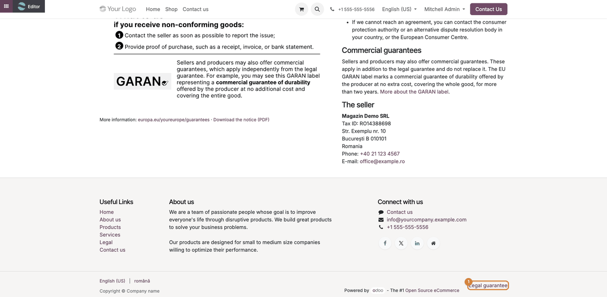
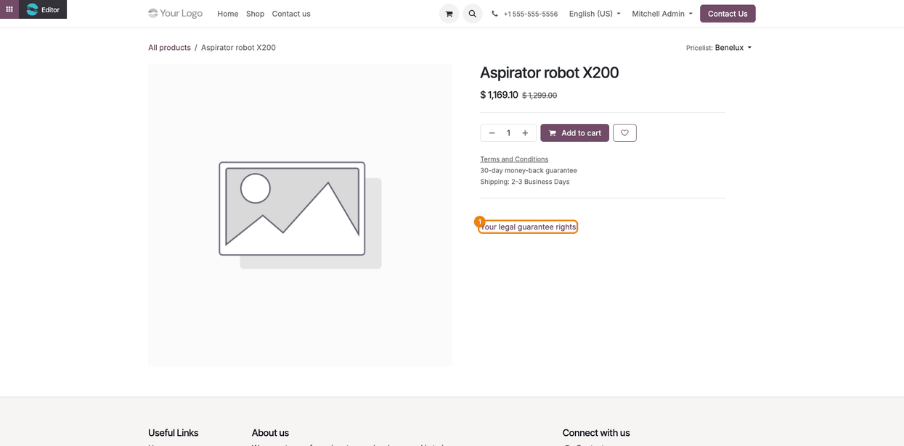
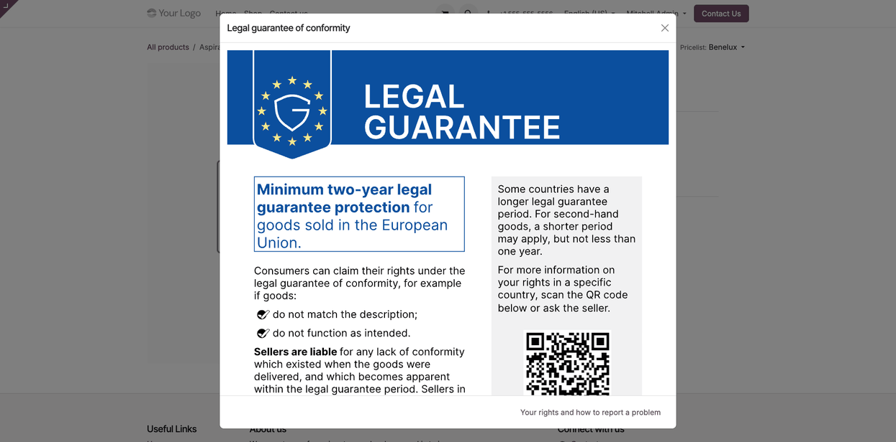

=========================
EU Legal Guarantee Notice
=========================

..
   !!!!!!!!!!!!!!!!!!!!!!!!!!!!!!!!!!!!!!!!!!!!!!!!!!!!
   !! This file is generated by oca-gen-addon-readme !!
   !! changes will be overwritten.                   !!
   !!!!!!!!!!!!!!!!!!!!!!!!!!!!!!!!!!!!!!!!!!!!!!!!!!!!
   !! source digest: sha256:6246ebaa6ee04754b44570beedff6527497812314119eebe1f8cd4b43e1b527d
   !!!!!!!!!!!!!!!!!!!!!!!!!!!!!!!!!!!!!!!!!!!!!!!!!!!!

.. |badge1| image:: https://img.shields.io/badge/maturity-Beta-yellow.png
    :target: https://odoo-community.org/page/development-status
    :alt: Beta
.. |badge2| image:: https://img.shields.io/badge/github-dhongu%2Fdeltatech-lightgray.png?logo=github
    :target: https://github.com/dhongu/deltatech/tree/20.0/deltatech_website_legal_guarantee
    :alt: dhongu/deltatech
.. |badge_fisa| image:: https://img.shields.io/badge/-Fi%C8%99%C4%83%20consultant-2ea44f.png
    :target: https://github.com/dhongu/deltatech/blob/20.0/deltatech_website_legal_guarantee/readme/FISA_CONSULTANT.md
    :alt: Fișă consultant

|badge1| |badge2| |badge_fisa|

Displays on the website the harmonised notice of the European Union on
the legal guarantee of conformity, mandatory for sellers of goods to
consumers from 27 September 2026:

- Commission Implementing Regulation (EU) 2025/1960, Annex I (design and
  content of the notice);
- Directive (EU) 2024/825, which introduces Article 22a in Directive
  2011/83/EU;
- Directive (EU) 2019/771 on contracts for the sale of goods, the source
  of the summary of consumer rights shown on the page.

The module adds:

- the public page ``/garantie``, with the full official notice, the link
  to the "Your Europe" portal (the same destination as the QR code), the
  notice as PDF, the consumer rights in short, how to report a problem
  and the seller details;
- the link "Legal guarantee" in the footer, in the copyright row;
- on the product page and at the payment step, the link "Your legal
  guarantee rights", which opens the notice on the first click, as
  recommended by the Commission's practical guidelines (DG JUST, April
  2026).

The notice is the official file published by the European Commission, in
colour and unmodified, in the language of the page, for all 24 official
EU languages (English for any other language). The page and the links
are translated into the same languages (AI-assisted translation).

The summary of rights follows the Directive; where national law adds
rules, a country block is shown for the country of the website company.
The module ships the block for Romania (GEO no. 140/2021, ANPC); other
countries are added with a template ``national_<country code>``.

In *Website → Configuration → Settings*, section *EU legal guarantee
notice*, you choose, for each website, where the link to the notice
appears: footer, product page, payment step. All are ticked by default.
The page uses the phone, e-mail, tax ID and address of the website
company; extra content (for example your own service terms) is added
from the website editor, in the areas above and below the page content.

**Table of contents**

.. contents::
   :local:

Use Cases / Context
===================

The harmonised notice is an obligation of the seller at store level, not
per product. The Commission's guidelines recommend, for online shops,
showing it as a general reminder on the website, with the full and
legible notice, plus a link to the "Your Europe" portal. The GARAN label
(the commercial guarantee of durability offered by the producer) is a
separate, per-product obligation and is not covered by this module.

The guidelines also recommend including the notice in the order
confirmation e-mail; the e-mail templates are ``noupdate`` and are
adapted per customer.

The official files (PDF, PNG, JPG, SVG, in all EU languages):
https://commission.europa.eu/publications/high-resolution-vector-files-eu-notice-and-label-product-guarantees_en

Usage
=====

Once installed, the notice is available on the website without further
setup.

1. Open **Website → Configuration → Settings**, section **EU legal
   guarantee notice**, and tick where the link to the notice should
   appear for each website: **footer**, **product page** and
   **checkout**. All three are ticked by default.

   |Website settings, EU legal guarantee notice section: three ticked
   options, link in footer, legal guarantee on product page and legal
   guarantee at checkout|

2. Check the public page ``/garantie``. It shows the full official
   notice (a click on the image opens the PDF), the link to the "Your
   Europe" portal, a short summary of the consumer rights, how to report
   a problem and the seller details taken from the website company
   (name, tax ID, address, phone, e-mail). The notice is shown in the
   language of the page for all 24 official EU languages, and in English
   for any other language. The summary of rights follows Directive (EU)
   2019/771; for a company in Romania a block with the national rules
   (GEO no. 140/2021, ANPC) is added.

   |The public legal guarantee page: the official EU notice on the left,
   consumer rights, national rules, how to report a problem and the
   seller details on the right|

3. With the footer option ticked, the link **Legal guarantee** appears
   in the copyright row on every page.

   |Website footer: the Legal guarantee link, highlighted, in the
   copyright row|

4. With the product page option ticked, the link **Your legal guarantee
   rights** appears on the product page, under the product details. The
   same link appears at checkout, under the billing address, when the
   checkout option is ticked.

   |Product page: the Your legal guarantee rights link, highlighted,
   under the Add to cart button|

5. A click on the link opens the notice in a window, so the customer
   keeps the product page or the cart.

   |The window opened by the link, showing the official EU notice in
   English|

Extra content, such as your own service terms, can be added from the
website editor, in the areas above and below the page content.

.. |Website settings, EU legal guarantee notice section: three ticked options, link in footer, legal guarantee on product page and legal guarantee at checkout| image:: https://raw.githubusercontent.com/dhongu/deltatech/20.0/deltatech_website_legal_guarantee/static/description/en/01_setari_website.png
.. |The public legal guarantee page: the official EU notice on the left, consumer rights, national rules, how to report a problem and the seller details on the right| image:: https://raw.githubusercontent.com/dhongu/deltatech/20.0/deltatech_website_legal_guarantee/static/description/en/02_pagina_garantie.png

Changelog
=========

20.0.1.0.0 (2026-11-13)
-----------------------

- Migration to 20.0: ``_display_address(without_name=True)``,
  ``base.default_website`` in tests, ``additional_title.translate`` on
  the page layout.

19.0.1.0.0 (2026-11-13)
-----------------------

- First version: generic EU module, successor of
  ``l10n_ro_website_legal_guarantee`` (Romanian suite). Official notice
  in the 24 EU languages, translations in all EU languages, generic
  summary of rights after Directive (EU) 2019/771, optional country
  block (Romania included), seller address without the repeated company
  name.

Bug Tracker
===========

Bugs are tracked on `Terrabit Issues <https://www.terrabit.ro/helpdesk>`_.
In case of trouble, please check there if your issue has already been reported.

Do not contact contributors directly about support or help with technical issues.

Credits
=======

Authors
-------

* Terrabit
* Dorin Hongu

Contributors
------------

- `Terrabit <https://www.terrabit.ro>`__:

  - Dorin Hongu <dhongu@gmail.com>

Do not contact contributors directly about support or help with
technical issues.

Maintainers
-----------

.. |maintainer-dhongu| image:: https://github.com/dhongu.png?size=40px
    :target: https://github.com/dhongu
    :alt: dhongu

Current maintainer:

|maintainer-dhongu| 

This module is part of the `dhongu/deltatech <https://github.com/dhongu/deltatech/tree/20.0/deltatech_website_legal_guarantee>`_ project on GitHub.

You are welcome to contribute.