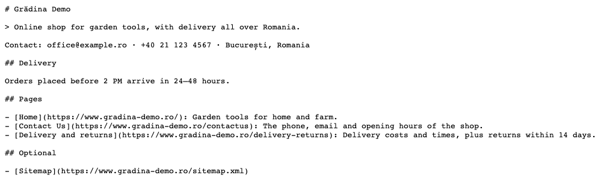

================
Website llms.txt
================

..
   !!!!!!!!!!!!!!!!!!!!!!!!!!!!!!!!!!!!!!!!!!!!!!!!!!!!
   !! This file is generated by oca-gen-addon-readme !!
   !! changes will be overwritten.                   !!
   !!!!!!!!!!!!!!!!!!!!!!!!!!!!!!!!!!!!!!!!!!!!!!!!!!!!
   !! source digest: sha256:2c7fec0981650fb7143bf11663d37f3ffb1f204ef16555d0b268d8df357a7697
   !!!!!!!!!!!!!!!!!!!!!!!!!!!!!!!!!!!!!!!!!!!!!!!!!!!!

.. |badge1| image:: https://img.shields.io/badge/maturity-Beta-yellow.png
    :target: https://odoo-community.org/page/development-status
    :alt: Beta
.. |badge2| image:: https://img.shields.io/badge/github-dhongu%2Fdeltatech-lightgray.png?logo=github
    :target: https://github.com/dhongu/deltatech/tree/19.0/deltatech_website_llms_txt
    :alt: dhongu/deltatech
.. |badge_fisa| image:: https://img.shields.io/badge/-Fi%C8%99%C4%83%20consultant-2ea44f.png
    :target: https://github.com/dhongu/deltatech/blob/19.0/deltatech_website_llms_txt/readme/FISA_CONSULTANT.md
    :alt: Fișă consultant
.. |badge_tests| image:: https://img.shields.io/badge/-11%20automated%20tests%20%C2%B7%2092%25%20code%20coverage-2ea44f.png
    :target: https://app.codecov.io/gh/dhongu/deltatech/tree/19.0/deltatech_website_llms_txt
    :alt: 11 automated tests · 92% code coverage

|badge1| |badge2| |badge_fisa| |badge_tests|

Publishes ``/llms.txt`` on your Odoo website: a short Markdown summary
of the site, in the `llms.txt <https://llmstxt.org>`__ format, that
ChatGPT, Claude, Perplexity and other AI assistants read to understand
who you are and which pages matter, instead of guessing from the HTML.

- **Generated from the website**: The site name, a summary, the contact
  details of the company, the published and indexed pages (with their
  meta description), the shop and its categories when eCommerce is
  installed, and the sitemap.
- **Your words first**: A summary and a free Markdown text (delivery
  areas, payment, returns, what an assistant should know before
  recommending you) are written per website, in the *llms.txt* tab of
  the website form, full width.
- **Full control when needed**: A custom file, when filled in, is served
  as is instead of the generated one; the file can also be switched off
  per website.
- **One file per website**: On a multi-website database each domain
  serves its own file, with its own pages and categories.

**Data published:** only what is already public on the website
(published pages, shop categories, the company email, phone, city and
country) and the texts you write for it.

**Table of contents**

.. contents::
   :local:

Configuration
=============

1. Go to *Website > Configuration > Settings*, section *Tracking & SEO*:
   keep the *llms.txt* setting checked and click *Edit llms.txt*.
2. In the *llms.txt* tab of the website, write a one or two sentence
   *llms.txt Summary*; without it the meta description of the homepage
   is used.
3. Optionally add *llms.txt Details* in Markdown, or a *Custom llms.txt*
   to replace the generated content.
4. Click *View llms.txt* to check the file served at
   ``https://<your-domain>/llms.txt``.

Usage
=====

1. Go to *Website > Configuration > Settings*, section *Tracking & SEO*.
   Keep the *llms.txt* setting checked and click *Edit llms.txt*.

   |Website settings, Tracking and SEO section: the llms.txt setting
   checked, with the Edit llms.txt and View llms.txt links highlighted|

2. In the *llms.txt* tab of the website, write the *llms.txt Summary*
   (who you are and what you sell) and, optionally, *llms.txt Details*
   in Markdown (delivery, payment, returns). Save, then click *View
   llms.txt*.

   |The llms.txt tab of the Grădina Demo website: Publish llms.txt
   checked, the llms.txt Summary of the shop, llms.txt Details with a
   Delivery section in Markdown, an empty Custom llms.txt and the View
   llms.txt link|

3. The file is served at ``https://<your-domain>/llms.txt``: the website
   name and the summary, the company contact, your details, the
   published and indexed pages with their meta description, the shop
   categories (with eCommerce) and the sitemap. Pages without a
   description in their SEO settings use the one set in their template,
   as theme pages do.

   |The /llms.txt file of the Grădina Demo website at|
   `www.gradina-demo.ro <http://www.gradina-demo.ro>`__\ |: title,
   summary after the > sign, the Contact line with email, phone, city
   and country, the Delivery section from the details, then Pages with
   Home, Contact Us and Delivery and returns, each with its description,
   and Optional with the Sitemap|

.. |Website settings, Tracking and SEO section: the llms.txt setting checked, with the Edit llms.txt and View llms.txt links highlighted| image:: https://raw.githubusercontent.com/dhongu/deltatech/19.0/deltatech_website_llms_txt/static/description/en/01_setare_llms_txt.png
.. |The llms.txt tab of the Grădina Demo website: Publish llms.txt checked, the llms.txt Summary of the shop, llms.txt Details with a Delivery section in Markdown, an empty Custom llms.txt and the View llms.txt link| image:: https://raw.githubusercontent.com/dhongu/deltatech/19.0/deltatech_website_llms_txt/static/description/en/02_tab_llms_txt.png

.. |: title, summary after the > sign, the Contact line with email, phone, city and country, the Delivery section from the details, then Pages with Home, Contact Us and Delivery and returns, each with its description, and Optional with the Sitemap| image:: https://raw.githubusercontent.com/dhongu/deltatech/19.0/deltatech_website_llms_txt/static/description/en/03_fisier_llms_txt.png

Changelog
=========

History
=======

19.0.1.1.0 (2026-11-02)
-----------------------

- The pages without a meta description in their SEO settings take the
  one set in their template (``<t t-set="website_meta_description">``),
  as the pages of a theme do: theme pages have no SEO field of their
  own, so they were listed without a description.
- The summary, the details and the custom file move from the settings to
  a new *llms.txt* tab of the website form (*Website > Configuration >
  Websites*), full width, for longer Markdown. The settings keep the
  *llms.txt* checkbox, with the links *Edit llms.txt* and *View
  llms.txt*.
- Romanian translation (``i18n/ro.po``).
- The *View llms.txt* link in the settings no longer logs the warning
  ``"<a>" tag with "btn" class must have "button" role`` at
  installation.

19.0.1.0.0 (2026-10-16)
-----------------------

- Initial release: ``/llms.txt`` generated per website from its pages,
  shop categories and company contact, with a summary, Markdown details
  or a fully custom file set in the settings.

Bug Tracker
===========

Bugs are tracked on `Terrabit Issues <https://www.terrabit.ro/helpdesk>`_.
In case of trouble, please check there if your issue has already been reported.

Do not contact contributors directly about support or help with technical issues.

Credits
=======

Authors
-------

* Terrabit
* Dorin Hongu

Maintainers
-----------

.. |maintainer-dhongu| image:: https://github.com/dhongu.png?size=40px
    :target: https://github.com/dhongu
    :alt: dhongu

Current maintainer:

|maintainer-dhongu| 

This module is part of the `dhongu/deltatech <https://github.com/dhongu/deltatech/tree/19.0/deltatech_website_llms_txt>`_ project on GitHub.

You are welcome to contribute.