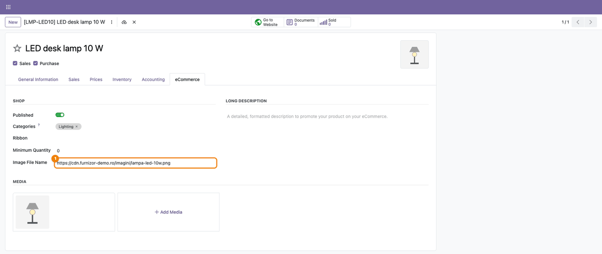
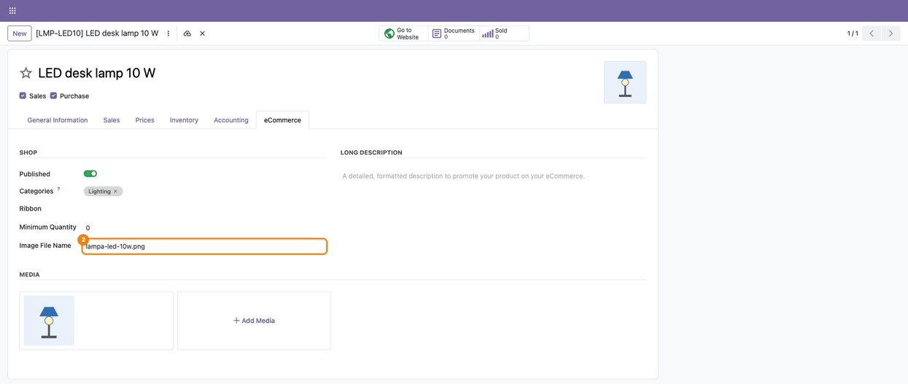

======================
Product Image from URL
======================

..
   !!!!!!!!!!!!!!!!!!!!!!!!!!!!!!!!!!!!!!!!!!!!!!!!!!!!
   !! This file is generated by oca-gen-addon-readme !!
   !! changes will be overwritten.                   !!
   !!!!!!!!!!!!!!!!!!!!!!!!!!!!!!!!!!!!!!!!!!!!!!!!!!!!
   !! source digest: sha256:89612bbfbf7a08a5732796a784f2e2cd95b0a52b2fd973552efabae0b2956204
   !!!!!!!!!!!!!!!!!!!!!!!!!!!!!!!!!!!!!!!!!!!!!!!!!!!!

.. |badge1| image:: https://img.shields.io/badge/maturity-Mature-brightgreen.png
    :target: https://odoo-community.org/page/development-status
    :alt: Mature
.. |badge2| image:: https://img.shields.io/badge/github-dhongu%2Fdeltatech-lightgray.png?logo=github
    :target: https://github.com/dhongu/deltatech/tree/20.0/deltatech_website_product_url_image
    :alt: dhongu/deltatech
.. |badge_fisa| image:: https://img.shields.io/badge/-Fi%C8%99%C4%83%20consultant-2ea44f.png
    :target: https://github.com/dhongu/deltatech/blob/20.0/deltatech_website_product_url_image/readme/FISA_CONSULTANT.md
    :alt: Fișă consultant

|badge1| |badge2| |badge_fisa|

Loads product images from a web address instead of a file: paste the
address of the image (``https://...``) and Odoo downloads it.

- **Main product image**: The address pasted in **Image File Name**
  (product form, tab **Sales**) sets the product image; the field then
  keeps only the file name.
- **Extra images**: The address pasted in the **Image Name** of an extra
  image (**Ecommerce Media**) loads that image.
- **Import**: Updating existing products by import with the **Image File
  Name** column loads their images.
- **Safe download**: Only public ``http``/``https`` addresses are
  fetched, each redirect is checked, the answer must be an image of at
  most 10 MB, and only users allowed to edit products can trigger it.

**Table of contents**

.. contents::
   :local:

Usage
=====

1. Open the product (*Website > eCommerce > Products*), tab **Sales**.
   In the **Ecommerce Shop** group, paste the address of the image,
   starting with ``https://``, in **Image File Name**.

   |Product form, Sales tab: the image address typed in Image File Name
   (1); the product has no image yet|

2. Leave the field: Odoo downloads the image and sets it as the product
   image, and the field keeps only the file name. Save the product. If
   the address stays in the field, the image could not be loaded.

   |The product image loaded from the address (1) and Image File Name
   reduced to lampa-led-10w.png (2)|

3. For an extra image of the product (**Ecommerce Media**), paste the
   address in its **Image Name** and leave the field: the image is
   downloaded in the same way. Press **Save** in the image window, then
   save the product.

   |The extra image window over the product: Image Name (1) became the
   file name, the downloaded image (2) replaced the old one, and the
   Save button (3)|

4. Check the product page in the shop (**Go to Website**): the main
   image and the extra image come from the addresses.

   |The product page in the shop: the first thumbnail is the main image
   and the second one, selected (1), is the extra image shown large|

Updating existing products by import (with their ID column) loads the
images too, when the **Image File Name** column holds web addresses.
Products created by the import keep the address as text, without image.

Only public ``http``/``https`` addresses are fetched, the answer must be
an image of at most 10 MB and only users allowed to edit products can
trigger the download.

.. |The extra image window over the product: Image Name (1) became the file name, the downloaded image (2) replaced the old one, and the Save button (3)| image:: https://raw.githubusercontent.com/dhongu/deltatech/20.0/deltatech_website_product_url_image/static/description/en/03_imagine_suplimentara_url.png
.. |The product page in the shop: the first thumbnail is the main image and the second one, selected (1), is the extra image shown large| image:: https://raw.githubusercontent.com/dhongu/deltatech/20.0/deltatech_website_product_url_image/static/description/en/04_produs_magazin_imagine.png

Changelog
=========

19.0.1.0.7 (2026-11-04)
-----------------------

- Consultant sheet (``readme/FISA_CONSULTANT.md``), usage steps and
  description in English, with screenshots generated by
  ``tests/test_screenshots.py``.

19.0.1.0.6 (2026-10-22)
-----------------------

- Listed on Odoo Apps as *Product Image from URL* (was *eCommerce
  Product Image URL Link*). The technical name
  ``deltatech_website_product_url_image`` does not change.

19.0.1.0.5 (2026-10-17)
-----------------------

- Fix: saving or renaming a product image, or setting the image file
  name on a product, no longer fails with ``AttributeError`` on servers
  with Werkzeug 3 (Python 3.12+); URLs are now detected with the
  standard library.

19.0.1.0.4 (2026-10-07)
-----------------------

- Security: loading a product image from a URL no longer lets the server
  reach internal addresses (SSRF). Only public http/https hosts are
  fetched, every redirect is revalidated, the response is limited in
  time and size and must be an image, and only users allowed to edit
  products can trigger the download.

19.0.1.0.3 (2026-10-04)
-----------------------

- Add unit tests covering image loading from URL on product templates
  and product images (write and onchange).

19.0.1.0.2 (2026-09-29)
-----------------------

- Own module icon, instead of the generic gears it had.

Bug Tracker
===========

Bugs are tracked on `Terrabit Issues <https://www.terrabit.ro/helpdesk>`_.
In case of trouble, please check there if your issue has already been reported.

Do not contact contributors directly about support or help with technical issues.

Credits
=======

Authors
-------

* Terrabit
* Dorin Hongu

Maintainers
-----------

.. |maintainer-dhongu| image:: https://github.com/dhongu.png?size=40px
    :target: https://github.com/dhongu
    :alt: dhongu

Current maintainer:

|maintainer-dhongu| 

This module is part of the `dhongu/deltatech <https://github.com/dhongu/deltatech/tree/20.0/deltatech_website_product_url_image>`_ project on GitHub.

You are welcome to contribute.