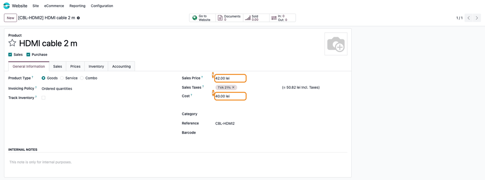
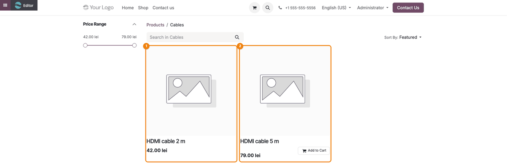
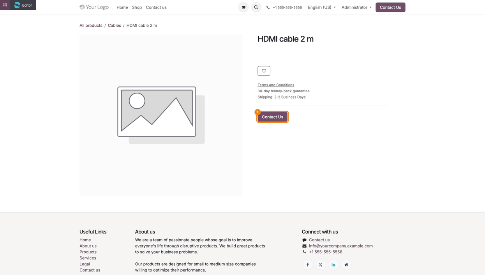
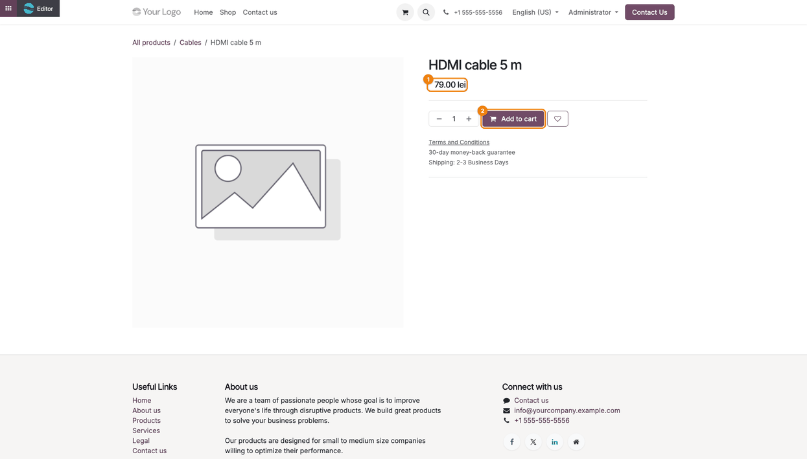

=============================
Website Cost Price Protection
=============================

..
   !!!!!!!!!!!!!!!!!!!!!!!!!!!!!!!!!!!!!!!!!!!!!!!!!!!!
   !! This file is generated by oca-gen-addon-readme !!
   !! changes will be overwritten.                   !!
   !!!!!!!!!!!!!!!!!!!!!!!!!!!!!!!!!!!!!!!!!!!!!!!!!!!!
   !! source digest: sha256:582ed57b678f5fc5df673866f48e9adcc81d5a865460d7cf290acb4f8c5f33d0
   !!!!!!!!!!!!!!!!!!!!!!!!!!!!!!!!!!!!!!!!!!!!!!!!!!!!

.. |badge1| image:: https://img.shields.io/badge/maturity-Beta-yellow.png
    :target: https://odoo-community.org/page/development-status
    :alt: Beta
.. |badge2| image:: https://img.shields.io/badge/github-dhongu%2Fdeltatech-lightgray.png?logo=github
    :target: https://github.com/dhongu/deltatech/tree/20.0/deltatech_website_sale_cost_price
    :alt: dhongu/deltatech
.. |badge_fisa| image:: https://img.shields.io/badge/-Fi%C8%99%C4%83%20consultant-2ea44f.png
    :target: https://github.com/dhongu/deltatech/blob/20.0/deltatech_website_sale_cost_price/readme/FISA_CONSULTANT.md
    :alt: Fișă consultant

|badge1| |badge2| |badge_fisa|

This module extends the standard eCommerce option **Prevent Sale of Zero
Priced Product**: the shop also stops selling a product when its price
is lower than its cost price plus a minimum margin.

For such a product the customer no longer sees the price and the **Add
to Cart** button, but the **Contact Us** button (the same behaviour as
for zero priced products), and the cart button disappears from the
product list.

Key features:

- **Cost price protection**: the website price (after the website
  pricelist) is compared with the product cost (**Cost** field).
- **Minimum margin**: a margin percentage set on the website (with 10%,
  the price must be at least 110% of the cost).
- **Tax aware**: the cost (kept without taxes) is increased with the
  taxes when the website displays prices with taxes.
- **Currency conversion**: the cost is converted to the website
  currency.

**Table of contents**

.. contents::
   :local:

Usage
=====

1. Go to *Website > Configuration > Settings*, section **eCommerce**.
   Check **Prevent Sale of Zero Priced Product**: the module fields
   appear next to it. Leave **Cost Price Includes Tax** unchecked when
   the product cost is kept without taxes (on a website showing prices
   without taxes this option does not remove the tax from the cost: keep
   the cost without taxes and leave it unchecked), set **Cost Price
   Margin %** (e.g. 10) and save.

   |Website settings: Prevent Sale of Zero Priced Product checked (1),
   Cost Price Includes Tax unchecked (2) and Cost Price Margin % set to
   10 (3)|

2. On the product (*Website > eCommerce > Products*, tab **General
   Information**), the **Sales Price** is compared with the **Cost**
   plus the margin. Here 42.00 is below 40.00 + 10% = 44.00, so the
   product cannot be bought online. The compared price is the website
   price, after the website pricelist.

   |Product form: Sales Price 42.00 (1) and Cost 40.00 (2)|

3. In the shop, the product below the threshold has no cart button in
   the product list, while the other one is sold as usual.

   |Shop category: the product below the threshold (1) without cart
   button, the other one (2) with Add to Cart|

4. On its product page, the price and **Add to Cart** are replaced by
   the **Contact Us** button (the **Button URL** from the settings).

   |Product page of the blocked product: only the Contact Us button (1)|

5. A product above the threshold shows its price and **Add to Cart** as
   usual.

   |Product page of an allowed product: the price (1) and Add to Cart
   (2)|

Check the shop as a visitor (private window): users of the *Settings*
group can still add a blocked product to the cart.

.. |Website settings: Prevent Sale of Zero Priced Product checked (1), Cost Price Includes Tax unchecked (2) and Cost Price Margin % set to 10 (3)| image:: https://raw.githubusercontent.com/dhongu/deltatech/20.0/deltatech_website_sale_cost_price/static/description/en/01_setari_pret_cost.png

Changelog
=========

19.0.1.0.3 (2026-10-22)
-----------------------

- Listed on Odoo Apps as *Website Cost Price Protection* (was *Website
  Sale Cost Price*), with the same title on the Apps banner. The
  technical name ``deltatech_website_sale_cost_price`` does not change.

19.0.1.0.2 (2026-09-29)
-----------------------

- Own module icon, instead of the generic gears it had.

Bug Tracker
===========

Bugs are tracked on `Terrabit Issues <https://www.terrabit.ro/helpdesk>`_.
In case of trouble, please check there if your issue has already been reported.

Do not contact contributors directly about support or help with technical issues.

Credits
=======

Authors
-------

* Terrabit
* Voicu Stefan

Maintainers
-----------

.. |maintainer-VoicuStefan2001| image:: https://github.com/VoicuStefan2001.png?size=40px
    :target: https://github.com/VoicuStefan2001
    :alt: VoicuStefan2001

Current maintainer:

|maintainer-VoicuStefan2001| 

This module is part of the `dhongu/deltatech <https://github.com/dhongu/deltatech/tree/20.0/deltatech_website_sale_cost_price>`_ project on GitHub.

You are welcome to contribute.