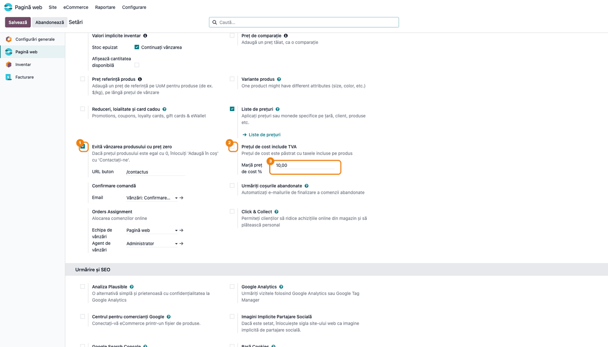
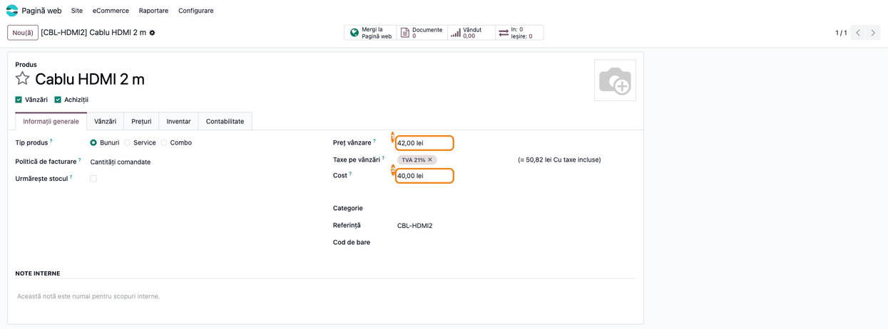
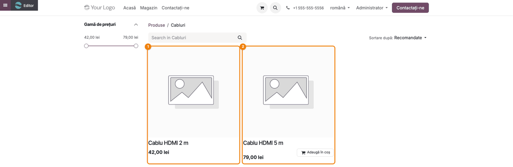
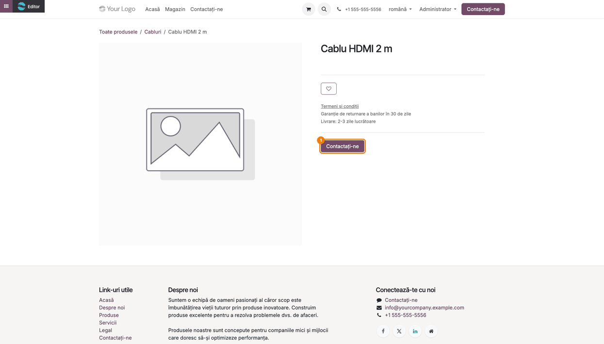
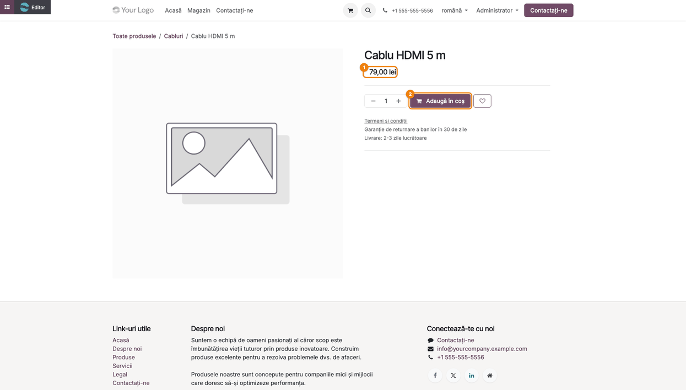

# Fișă Modul: Protecția prețului de cost în magazinul online

**Modul:** `deltatech_website_sale_cost_price`
**Utilizator principal:** Administrator magazin online (eCommerce) / responsabil prețuri
**Prioritate:** 🟡 Medie (oprește vânzarea online în pierdere când prețul sau costul sunt greșite; nu are efect contabil)

---

## 1. Scop business

Într-un magazin online cu multe produse, un preț de vânzare introdus greșit, o reducere din lista de
prețuri prea mare sau un cost care a crescut după o recepție pot face ca un produs să fie vândut sub
costul lui, fără ca cineva să observe la timp. Odoo standard are doar opțiunea **Evită vânzarea
produsului cu preț zero**, care oprește vânzarea produselor cu preț 0.

Modulul `deltatech_website_sale_cost_price` extinde această opțiune: magazinul oprește vânzarea și
atunci când prețul de vânzare este **mai mic decât costul** produsului, plus o **marjă minimă** în
procente, stabilită pe site. Pentru un astfel de produs, clientul nu mai vede prețul și butonul
**Adaugă în coș**, ci butonul **Contactați-ne**, iar în lista de produse butonul de coș dispare.

## 2. Bază legală și context

Modulul nu are temei legal specific: este o regulă comercială internă a magazinului online, fără efect
asupra documentelor contabile sau fiscale. Context pentru consultant:

- **Costul** comparat este costul produsului din Odoo (câmpul **Cost** de pe produs), adică cel
  calculat de evaluarea stocului (cost mediu, FIFO) sau introdus manual (cost standard). Corectitudinea
  regulii depinde deci de corectitudinea costului.
- Regula se aplică doar **în magazinul online**. Ofertele și comenzile de vânzare create din backend nu
  sunt verificate.

## 3. Utilizatori și roluri

| Rol | Ce face |
|---|---|
| Administrator magazin online (*Pagină web / Administrator*, acces la Setări) | Activează regula și stabilește marja minimă |
| Responsabil prețuri / catalog | Ține la zi prețul de vânzare, listele de prețuri și costul produselor |
| Vizitator sau client al magazinului | Nu poate cumpăra online produsele sub prag; vede **Contactați-ne** |
| Administrator Odoo (grupul *Setări*) | Poate adăuga totuși produsul în coș dacă ajunge la el (vezi secțiunea 9) |

**Roluri recomandate la testare:** un utilizator administrator pentru configurare; o fereastră privată
a browserului (vizitator neautentificat) sau un utilizator portal pentru verificarea în magazin.

## 4. Conturi și date implicate

Modulul **nu generează note contabile** și nu atinge conturi. Date minime pentru demo:

- două produse publicate pe site, în categoria de magazin **Cabluri**, cu TVA 21%:
  - **Cablu HDMI 2 m** (cod `CBL-HDMI2`): preț de vânzare 42,00 lei, cost 40,00 lei;
  - **Cablu HDMI 5 m** (cod `CBL-HDMI5`): preț de vânzare 79,00 lei, cost 60,00 lei;
- pe site: **Evită vânzarea produsului cu preț zero** bifat, **Prețul de cost include TVA** nebifat,
  **Marjă preț de cost %** = 10.

Pragul de vânzare este costul înmulțit cu (1 + marja / 100):

| Produs | Preț vânzare | Cost | Prag (cost + 10%) | Rezultat în magazin |
|---|---|---|---|---|
| Cablu HDMI 2 m | 42,00 lei | 40,00 lei | 44,00 lei | 42 < 44: vânzare oprită, **Contactați-ne** |
| Cablu HDMI 5 m | 79,00 lei | 60,00 lei | 66,00 lei | 79 ≥ 66: se vinde normal |

Câmpurile adăugate de modul, pe site (în *Setări*, secțiunea **eCommerce**):

- **Prețul de cost include TVA**: spune dacă costul din produs e păstrat cu TVA inclus (vezi limitarea
  din secțiunea 9);
- **Marjă preț de cost %**: marja minimă peste cost, în procente (0 = prețul trebuie doar să nu fie
  sub cost).

## 5. Configurare inițială

1. Instalați modulul (depinde de **eCommerce**, `website_sale`, și de **Evaluarea stocului**,
   `stock_account`).
2. Verificați că produsele vândute online au costul completat corect (câmpul **Cost**). Un produs cu
   cost 0 nu este oprit de modul.
3. Configurați regula pe site, ca la pasul 1 din fluxul de mai jos. Setările sunt **pe site**: într-o
   instalare cu mai multe site-uri, fiecare are bifa și marja lui.

## 6. Flux de utilizare

### Pasul 1 — Activați regula și stabiliți marja minimă

**Meniu:** *Pagină web → Configurare → Setări*, secțiunea **eCommerce**.

1. Bifați **Evită vânzarea produsului cu preț zero** (opțiunea standard Odoo). Abia după bifare apar
   câmpurile modulului, în dreapta.
2. Lăsați **Prețul de cost include TVA** nebifat: costul din produs este, uzual, fără TVA. Pe un site
   cu prețurile afișate fără TVA, bifa nu scoate TVA-ul din cost (vezi secțiunea 9), deci nu o
   folosiți acolo.
3. Completați **Marjă preț de cost %** (de exemplu 10). Cu 0, se oprește doar vânzarea sub cost.
4. Apăsați **Salvează**.



### Pasul 2 — Verificați prețul de vânzare și costul produsului

**Meniu:** *Pagină web → eCommerce → Produse*, deschideți produsul, tabul **Informații generale**.

1. **Găsiți pe ecran** **Preț vânzare** și **Cost**.
2. **Comparați** prețul cu pragul: costul plus marja din setări. Pentru **Cablu HDMI 2 m**, 42,00 lei
   este sub pragul de 40,00 × 1,10 = 44,00 lei, deci produsul nu se va putea cumpăra online.

Comparația se face cu prețul pe care îl vede clientul în magazin, adică după aplicarea listei de
prețuri a site-ului (inclusiv reducerile ei), nu doar cu **Preț vânzare** din produs. La produsele cu
variante, pagina produsului și adăugarea în coș compară prețul și costul fiecărei variante; lista din
magazin nu ascunde butonul de coș la aceste produse (vezi secțiunea 9).



### Pasul 3 — Lista de produse din magazin

**Meniu:** magazinul online, *Magazin →* categoria **Cabluri**.

1. **Găsiți pe ecran** cele două produse.
2. **Verificați** că produsul sub prag (**Cablu HDMI 2 m**) apare cu prețul, dar **fără** butonul
   **Adaugă în coș**, iar produsul peste prag (**Cablu HDMI 5 m**) are butonul.



### Pasul 4 — Pagina produsului oprit de la vânzare

**Meniu:** în magazin, clic pe **Cablu HDMI 2 m** (sau butonul **Mergi la Pagină web** din produs).

1. **Găsiți pe ecran** zona de sub numele produsului.
2. **Verificați** că prețul, cantitatea și **Adaugă în coș** lipsesc, iar în locul lor apare butonul
   **Contactați-ne**. Butonul duce la adresa din **URL buton** din setări (implicit `/contactus`).



### Pasul 5 — Pagina produsului vândut normal

**Meniu:** în magazin, clic pe **Cablu HDMI 5 m**.

1. **Verificați** că prețul (79,00 lei) și butonul **Adaugă în coș** apar ca de obicei.



### Note de monografie și raportare

Modulul nu generează note contabile și nu apare în rapoarte sau declarații. Nu există monografie
contabilă asociată.

## 7. Legături cu alte module / declarații

| Modul | Rol |
|---|---|
| `website_sale` (eCommerce) | Opțiunea **Evită vânzarea produsului cu preț zero**, butonul **Contactați-ne** și **URL buton**; modulul extinde aceeași regulă |
| `stock_account` (Evaluarea stocului) | Costul produsului (cost mediu, FIFO sau standard), cu care se compară prețul |
| `product` / listele de prețuri | Prețul de vânzare și reducerile din lista de prețuri a site-ului, care dau prețul comparat |

**Ce e automat:** calculul pragului (cost, ajustat cu TVA când e cazul, convertit în moneda site-ului,
plus marja), ascunderea prețului și a butonului de coș, afișarea butonului **Contactați-ne**,
refuzul adăugării în coș.

**Ce rămâne manual:** stabilirea marjei, corectarea prețului sau a costului produselor oprite,
răspunsul la cererile venite prin **Contactați-ne**.

## 8. Verificări pentru consultant

- [ ] Câmpurile **Prețul de cost include TVA** și **Marjă preț de cost %** apar în *Setări*,
      secțiunea **eCommerce**, doar după bifarea **Evită vânzarea produsului cu preț zero**.
- [ ] Un produs cu prețul sub cost + marjă nu are butonul de coș în listă și afișează
      **Contactați-ne** pe pagina lui.
- [ ] Un produs cu prețul peste prag se vinde normal.
- [ ] Cu **Marjă preț de cost %** = 0, se oprește doar vânzarea sub cost; un preț egal cu costul
      este permis.
- [ ] O reducere din lista de prețuri a site-ului care duce prețul sub prag oprește vânzarea.
- [ ] Debifarea **Evită vânzarea produsului cu preț zero** dezactivează și verificarea costului.
- [ ] Verificarea în magazin se face ca vizitator (fereastră privată), nu ca administrator Odoo.
- [ ] Dacă site-ul afișează prețurile **cu TVA**, verificați lista de produse și adăugarea în coș
      pentru produsele aflate aproape de prag (vezi secțiunea 9).

## 9. Mesaje de eroare frecvente

Modulul nu afișează mesaje proprii: semnalul pentru client este lipsa prețului și butonul
**Contactați-ne**.

| Ce vede operatorul | Cauză | Remediere |
|---|---|---|
| Produsul apare cu **Contactați-ne**, deși prețul pare corect | Prețul după lista de prețuri a site-ului e sub cost + marjă, sau costul a crescut (ex. după o recepție mai scumpă) | Verificați **Cost** și reducerile din lista de prețuri; corectați prețul sau marja |
| Produsul se vinde deși e sub cost | Costul produsului este 0 sau **Evită vânzarea produsului cu preț zero** este debifat | Completați costul; bifați opțiunea în *Setări* |
| Câmpurile modulului nu apar în *Setări* | **Evită vânzarea produsului cu preț zero** nu este bifat | Bifați opțiunea; câmpurile apar imediat |
| Administratorul poate adăuga în coș un produs oprit | Utilizatorii din grupul *Setări* sunt exceptați la adăugarea în coș | Testați ca vizitator, în fereastră privată |
| Produs cu mai multe variante, sub prag, are buton de coș în listă | În listă se verifică produsul în ansamblu, al cărui cost e 0 când are mai multe variante | Oprirea se vede pe pagina produsului (**Contactați-ne**) și la adăugarea în coș |
| Pe un site cu prețuri afișate **fără TVA**, cu **Prețul de cost include TVA** bifat, produse corect prețuite sunt oprite | Comportament greșit al modulului: TVA-ul nu se scade din cost, iar pragul iese mai mare cu cota TVA | Lăsați bifa nebifată și țineți costul fără TVA |
| Pe un site cu prețuri afișate **cu TVA**, un produs apropiat de prag are **Adaugă în coș** pe pagina lui, dar nu și în listă, iar clientul nu-l poate pune în coș | Comportament greșit al modulului (vezi mai jos) | Până la corectare: țineți prețurile cu o rezervă față de prag sau afișați prețurile fără TVA |

**Limitare cunoscută (prețuri afișate cu TVA).** Când site-ul afișează prețurile cu TVA, iar costul e
fără TVA, pagina produsului compară prețul cu TVA cu costul plus TVA (corect), dar lista de produse și
adăugarea în coș compară prețul **fără** TVA cu costul **plus** TVA. Exemplu: preț 79 lei, cost 60 lei,
TVA 21%, marjă 10%: pagina produsului permite vânzarea (95,59 ≥ 79,86), dar lista ascunde butonul de
coș, iar clientul primește refuz la adăugarea în coș (79 < 79,86). Nu sunt afectate produsele al căror
preț fără TVA este cel puțin cost × (1 + marjă) × (1 + cota TVA); în exemplu, cel puțin 79,86 lei.

## 10. Capturi de ecran

Capturile sunt **generate automat** de testul `tests/test_screenshots.py` (mixinul `ScreenshotCase`
din `deltatech_doc_screenshots`, import defensiv), în română, pe compania „RO Company" în RON, cu
prețurile din magazin afișate fără TVA. Capturile din magazin sunt făcute ca administrator: lista și
pagina produsului arată la fel ca pentru un vizitator (excepția administratorului ține doar de
adăugarea în coș). Regenerare:

```bash
./odoo/odoo-bin -c odoo.conf -d <db> -i deltatech_website_sale_cost_price,deltatech_doc_screenshots \
    --test-tags=/deltatech_website_sale_cost_price:TestCostPriceScreenshots --stop-after-init
```

| Fișier | Ce arată |
|---|---|
| `01_setari_pret_cost.png` | Setările site-ului: regula activată, costul fără TVA, marja de 10% |
| `02_produs_pret_cost.png` | Produsul oprit: prețul de vânzare și costul |
| `03_magazin_lista_produse.png` | Lista din magazin: produsul oprit fără coș, celălalt cu coș |
| `04_produs_blocat_magazin.png` | Pagina produsului oprit, cu **Contactați-ne** |
| `05_produs_permis_magazin.png` | Pagina produsului peste prag, cu preț și **Adaugă în coș** |

Capturile în engleză pentru `readme/USAGE.md` (Odoo Apps) se generează din aceleași shot-uri, în
`static/description/en/`.

## 11. Observații pentru manual

- Explicați pragul cu un exemplu numeric (cost × (1 + marjă/100)); operatorii confundă marja cu
  adaosul calculat la preț.
- Menționați că regula ține cont de reducerile din lista de prețuri a site-ului: o promoție agresivă
  poate opri vânzarea unor produse.
- Recomandați verificarea în fereastră privată: ca administrator, unele verificări nu se aplică.
- Pentru site-urile cu prețuri afișate cu TVA, păstrați nota din secțiunea 9 până la corectarea
  modulului.
