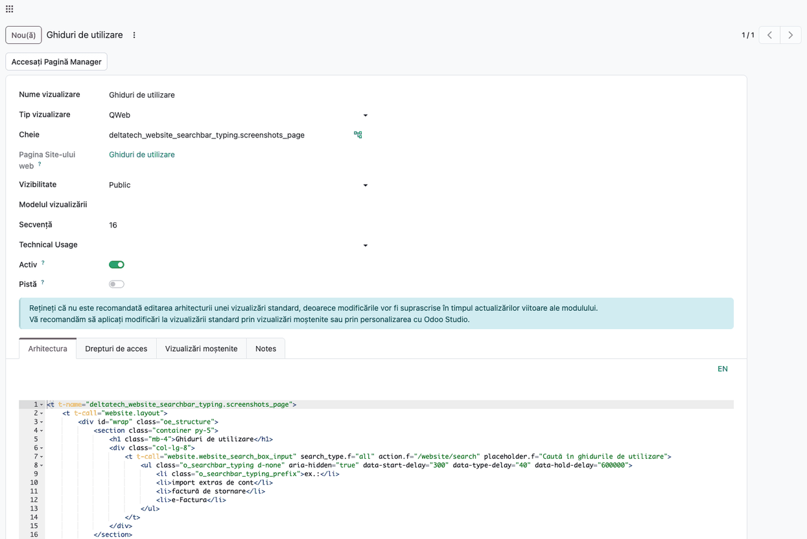
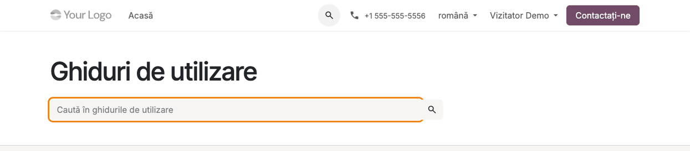

# Fișă Modul: Exemple de căutare scrise în caseta de căutare

**Modul:** `deltatech_website_searchbar_typing`
**Utilizator principal:** Administrator website, Designer website
**Prioritate:** 🟢 Scăzută (îmbunătățire de prezentare a site-ului, fără impact contabil sau legal)

---

## 1. Scop business

Un vizitator care ajunge la o casetă de căutare goală nu știe întotdeauna ce poate căuta acolo: un
cod de piesă, o denumire de produs, un subiect din ghidurile de utilizare. Modulul face ca textul
de ajutor din casetă (placeholder-ul) să scrie, literă cu literă, câteva exemple de căutări, unul
după altul: exemplul se scrie, rămâne o clipă pe ecran, se șterge și urmează următorul. Vizitatorul
vede dintr-o privire ce fel de termeni găsesc rezultate. Animația pornește doar pe casetele de
căutare în care administratorul a pus exemple; restul site-ului rămâne neschimbat.

## 2. Bază legală și context

Nu există o obligație legală. Contextul este cel de accesibilitate și uzabilitate a site-ului:
modulul respectă preferința vizitatorului pentru mișcare redusă (setarea de sistem „reduce
motion", `prefers-reduced-motion`), se oprește definitiv la primul click sau la prima tastă și
păstrează pentru cititoarele de ecran un nume stabil al casetei, ca să nu fie citită fiecare literă
care se schimbă.

## 3. Utilizatori și roluri

- **Administrator** — adaugă lista de exemple din vizualizarea paginii (Setări → Tehnic, cere
  drepturi de administrare).
- **Designer website** — adaugă lista din editorul HTML al Website Builder, în modul de dezvoltare.
- **Ambii** aleg exemplele.
- **Vizitatorul site-ului** (public sau autentificat) — vede exemplele scrise în casetă.

Roluri recomandate pentru testare:
- Administrator cu **modul de dezvoltare** activ (pentru vizualizările paginii).
- Un utilizator portal sau o fereastră privată de browser, ca vizitator.

## 4. Conturi și date implicate

Modulul nu folosește conturi contabile, nu creează documente și nu adaugă câmpuri în baza de date.
Este o componentă a site-ului (JavaScript), care citește exemplele direct din pagina afișată.

Date minime pentru demo:
- o pagină de website cu o casetă de căutare (snippet-ul standard de căutare sau șablonul
  `website.website_search_box_input`);
- în formularul casetei, o listă ascunsă cu clasa `o_searchbar_typing`: câte un element `li`
  pentru fiecare exemplu și, opțional, un element `li` cu clasa `o_searchbar_typing_prefix` pentru
  textul afișat în fața fiecărui exemplu (de ex. „ex.:”).

## 5. Configurare inițială

1. Instalați modulul `deltatech_website_searchbar_typing` (depinde doar de `website`). Instalarea
   singură nu schimbă nimic pe site.
2. Activați **modul de dezvoltare** (Setări → Instrumente de dezvoltare → Activează modul de dezvoltare).
3. Alegeți pagina și caseta de căutare pe care doriți exemplele (de ex. pagina de ghiduri sau de
   căutare a produselor).
4. Alegeți 3–5 exemple care chiar găsesc rezultate pe site: un vizitator care copiază un exemplu
   trebuie să găsească ceva.

## 6. Flux de utilizare

### Pasul 1 — Adăugarea listei de exemple în formularul de căutare

Ca administrator, accesați **Setări → Tehnic → Interfață utilizator → Vizualizări**, căutați
vizualizarea paginii după numele sau cheia ei și deschideți tab-ul **Arhitectura**. În interiorul
casetei de căutare adăugați lista ascunsă de exemple:

```xml
<t t-call="website.website_search_box_input"
   search_type.f="all" action.f="/website/search"
   placeholder.f="Caută în ghidurile de utilizare">
    <ul class="o_searchbar_typing d-none" aria-hidden="true">
        <li class="o_searchbar_typing_prefix">ex.:</li>
        <li>import extras de cont</li>
        <li>factură de stornare</li>
        <li>e-Factura</li>
    </ul>
</t>
```

- clasa `d-none` și `aria-hidden="true"` ascund lista: fără ele, exemplele apar ca listă sub casetă
  și sunt citite de cititoarele de ecran;
- fiecare `li` este un exemplu; elementul cu clasa `o_searchbar_typing_prefix` (opțional) apare în
  fața fiecărui exemplu, urmat de un spațiu;
- folosiți `li`, nu `span`: Odoo traduce fiecare `li` ca termen separat, deci exemplele se traduc
  cu pagina, ca orice alt text;
- viteza se poate schimba cu atribute pe elementul `o_searchbar_typing`, în milisecunde:
  `data-start-delay` (1500, până la prima literă), `data-type-delay` (70, pe literă scrisă),
  `data-hold-delay` (1800, cât rămâne exemplul complet), `data-erase-delay` (30, pe literă ștearsă),
  `data-next-delay` (400, până la exemplul următor).

Salvați vizualizarea.

**Atenție:** editarea directă a arhitecturii (ca în captură) e potrivită doar pentru paginile create
în site. Pe un șablon standard (de ex. pagina de căutare a produselor), Odoo afișează avertismentul
că modificările se pierd la următoarea actualizare a modulului. Acolo lista se pune printr-o
vizualizare moștenită (xpath în corpul `t-call`-ului sau în formularul `o_searchbar_form`), de
obicei într-un modul al clientului. Designerul website poate pune lista și într-un snippet de
căutare, din editorul HTML al Website Builder.



### Pasul 2 — Vizitatorul vede exemplele scrise în casetă

Deschideți pagina pe site ca vizitator. După o scurtă pauză, placeholder-ul casetei scrie primul
exemplu, cu prefixul în față („ex.: import extras de cont”), îl ține o clipă, îl șterge și trece la
următorul, în buclă.

**Ce verificați pe ecran:**
- exemplele apar în ordinea din listă, fiecare precedat de prefix;
- caseta rămâne goală (exemplul e doar text de ajutor, nu valoare introdusă);
- pe un vizitator cu „reduce motion” activ în sistem, caseta arată doar placeholder-ul inițial;
- pe pagina tradusă (de ex. `/ro/...` sau `/en/...`), exemplele apar în limba paginii, dacă au fost
  traduse.


### Pasul 3 — La click în casetă revine textul inițial

Vizitatorul dă click în casetă (sau începe să tasteze). Animația se oprește definitiv pe pagina
respectivă, iar placeholder-ul inițial („Caută în ghidurile de utilizare”) revine. Căutarea și
lista de sugestii (autocomplete) funcționează ca de obicei.



### Note de monografie și raportare

Modulul nu generează note contabile și nu are rapoarte. Nu scrie nimic în baza de date: animația
rulează doar în browserul vizitatorului.

## 7. Legături cu alte module / declarații

| Modul / proces | Rol în flux | Tip legătură |
|---|---|---|
| `website` | caseta de căutare (snippet-ul de căutare și șablonul `website.website_search_box_input`), cu sugestiile standard | dependență (manifest) |
| `website_sale`, pagini de ghiduri / Knowledge | pagini pe care se pune de obicei caseta cu exemple (căutare produse, căutare în ghiduri) | utilizare, fără dependență |

Ce este automat: scrierea și ștergerea exemplelor, oprirea la click sau la tastare, pauza cât timp
tab-ul browserului e ascuns sau caseta nu e vizibilă pe ecran, respectarea preferinței de mișcare
redusă și numele accesibil al casetei.
Ce rămâne manual: alegerea paginilor și a exemplelor, traducerea lor și, opțional, viteza animației.

## 8. Verificări pentru consultant

- [ ] După instalare, fără listă de exemple, nicio casetă de căutare nu se schimbă.
- [ ] Pe caseta cu listă, exemplele se scriu în ordine, fiecare cu prefixul în față.
- [ ] La click în casetă sau la prima tastă, animația se oprește și revine placeholder-ul inițial.
- [ ] Căutarea și sugestiile funcționează normal după oprirea animației.
- [ ] Cu „reduce motion” activ în sistemul de operare, animația nu pornește.
- [ ] Animația nu rulează în Website Builder (modul de editare a paginii).
- [ ] Exemplele traduse apar în limba paginii.
- [ ] Fiecare exemplu găsește rezultate când e căutat pe site.

## 9. Mesaje de eroare frecvente

| Mesaj / simptom | Cauză probabilă | Remediere |
|-----------------|-----------------|-----------|
| Placeholder-ul nu se animă deloc | lista nu are clasa `o_searchbar_typing`, nu e în interiorul formularului de căutare, sau nu are niciun exemplu | mutați lista în corpul `t-call`-ului / al formularului `o_searchbar_form` și verificați clasa |
| Formularul iese fără placeholder sau fără adresa de căutare | parametrii șablonului au fost dați cu `t-set` în corpul `t-call`; pe Odoo 20 nu mai ajung în șablonul apelat | dați-i ca atribute pe `t-call`: `search_type.f="..."`, `action.f="..."`, `placeholder.f="..."` |
| Animația nu pornește pe calculatorul unui vizitator | vizitatorul are activă preferința de mișcare redusă, sau caseta are deja text introdus | comportament intenționat |
| Exemplele nu se traduc pe pagina în altă limbă | exemplele au fost puse în `span`-uri (traduse ca un singur bloc) sau nu au fost traduse | folosiți câte un `li` pe exemplu și traduceți pagina |
| Animația se oprește imediat după încărcare | caseta primește focus automat (de ex. căutarea din antet, care se deschide cu cursorul în casetă) | puneți exemplele pe o casetă care nu primește focus la deschidere |

## 10. Capturi de ecran

Capturile (`static/description/`) sunt generate automat din `tests/test_screenshots.py` (mixinul
`ScreenshotCase` din `l10n_ro_doc_screenshots`, import defensiv), în limba română. Chenarul
portocaliu marchează caseta de căutare; nu e starea de focus. Etichetele rămase în engleză din
captura 1 („Technical Usage”, „Notes”) vin din traducerea nucleului Odoo.

1. `01_lista_exemple.png` — lista de exemple în arhitectura vizualizării paginii.
2. `02_placeholder_exemplu.png` — placeholder-ul casetei scrie un exemplu de căutare.
3. `03_focus_placeholder_initial.png` — după click în casetă, revine placeholder-ul inițial.

Regenerare:

```bash
.venv/bin/python odoo/odoo-bin -c odoo.conf -d <db> -i deltatech_website_searchbar_typing,l10n_ro_doc_screenshots \
    --test-tags=fise_screenshots --stop-after-init
```

## 11. Observații pentru manual

Subliniați că modulul nu face nimic singur: exemplele se adaugă pe fiecare casetă dorită, iar
alegerea lor contează mai mult decât animația. Exemplele bune sunt scurte și găsesc rezultate.
Evitați caseta din antet, care se deschide cu cursorul în ea și oprește animația imediat. Pentru
vizitatorii care au cerut mișcare redusă, caseta rămâne cu textul de ajutor obișnuit.
