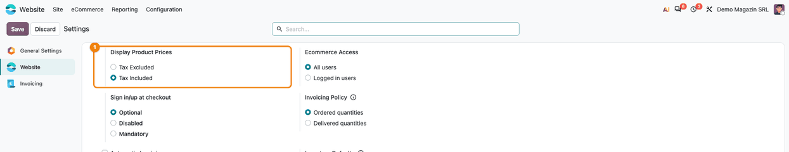

======================
Website VAT Validation
======================

..
   !!!!!!!!!!!!!!!!!!!!!!!!!!!!!!!!!!!!!!!!!!!!!!!!!!!!
   !! This file is generated by oca-gen-addon-readme !!
   !! changes will be overwritten.                   !!
   !!!!!!!!!!!!!!!!!!!!!!!!!!!!!!!!!!!!!!!!!!!!!!!!!!!!
   !! source digest: sha256:1ff14033b45662efe2dfd3cb3b339a4d59529e49f0eef21ddf2b3cf841ea6573
   !!!!!!!!!!!!!!!!!!!!!!!!!!!!!!!!!!!!!!!!!!!!!!!!!!!!

.. |badge1| image:: https://img.shields.io/badge/maturity-Mature-brightgreen.png
    :target: https://odoo-community.org/page/development-status
    :alt: Mature
.. |badge2| image:: https://img.shields.io/badge/github-dhongu%2Fdeltatech-lightgray.png?logo=github
    :target: https://github.com/dhongu/deltatech/tree/19.0/deltatech_website_vat_validation
    :alt: dhongu/deltatech
.. |badge_fisa| image:: https://img.shields.io/badge/-Fi%C8%99%C4%83%20consultant-2ea44f.png
    :target: https://github.com/dhongu/deltatech/blob/19.0/deltatech_website_vat_validation/readme/FISA_CONSULTANT.md
    :alt: Fișă consultant
.. |badge_tests| image:: https://img.shields.io/badge/-10%20automated%20tests%20%C2%B7%2089%25%20code%20coverage-2ea44f.png
    :target: https://app.codecov.io/gh/dhongu/deltatech/tree/19.0/deltatech_website_vat_validation
    :alt: 10 automated tests · 89% code coverage

|badge1| |badge2| |badge_fisa| |badge_tests|

Cleans the address form of the website checkout and of the customer
portal and stops a logged-in customer from registering a tax code or an
e-mail address that already belongs to another customer. It also keeps
the website price display setting (with or without taxes) from being
reset in the background.

The format of the tax code is checked by Odoo itself (``base_vat``). The
Romanian checks of the tax code (ANAF look-up, personal numeric code,
struck-off company) are in ``l10n_ro_website_anaf`` (l10n-romania): this
module stays country-neutral.

Features
--------

- **Trimmed values**: the spaces before and after the tax code, the
  e-mail and the phone typed in the address form are removed.
- **Duplicate tax code blocked**: a logged-in customer cannot use a tax
  code that another customer already has. The codes are compared without
  their country prefix and spaces, so ``RO 12 34 567``, ``ro1234567``
  and ``1234567`` are the same code.
- **Duplicate e-mail blocked**: a logged-in customer cannot use an
  e-mail address of another account; the message asks to log in with
  that account or to use another address.
- **Messages that say what to do**: for a tax code already in use, the
  customer is asked to get access from a colleague who has an account,
  to send an access request from the ``/b2b`` page (with
  ``deltatech_b2b_portal``) or to contact the shop. The messages never
  name the account found.
- **No false duplicates**: the customer's own company and its contacts
  are not duplicates, and the phone is not checked, since colleagues
  share the company phone and relatives a home phone.
- **Guest checkout unchanged**: the duplicate checks run only for
  logged-in customers. For an anonymous visitor the message would tell
  anyone that an e-mail address or a tax code belongs to an existing
  customer.
- **Company created at checkout**: a person who fills in a company name
  and a tax code in the billing address buys for that company. The
  company is created as a partner with this address and tax code, the
  person becomes its contact and the order is invoiced to the company.
  Only for a tax code no other customer has: a visitor (not logged in)
  who types the tax code of a customer keeps it on their own address and
  is not attached to that company, so they never see its documents.
- **Price display kept**: the website setting *Display Product Prices*
  (tax included or excluded) keeps its saved value when Odoo recomputes
  it, for example after the address of the company's own partner is
  updated by an ANAF sync. Without the module, Odoo puts it back to tax
  excluded.

Update from a version before 19.0.0.2.0
---------------------------------------

The ANAF checks moved to ``l10n_ro_website_anaf``. A database that had
them (``l10n_ro_partner_create_by_vat`` installed) gets
``l10n_ro_website_anaf`` installed with the update, when l10n-romania is
on the addons path; otherwise the log says to add it.

**Table of contents**

.. contents::
   :local:

Usage
=====

The module has no settings of its own. Its checks run when a
**logged-in** customer saves an address form: the **Address** step of
the website checkout, and **My Account → Edit information** (the
**Details** page) or **Addresses** in the customer portal. A visitor
checking out without an account is not checked, so the form cannot be
used to find out who is a customer.

**1. A tax code of another company, at checkout**

In the cart, the customer clicks **Checkout** and reaches the
**Address** step, where their addresses are shown as cards. The pencil
on the billing address card opens **Edit address**. In **VAT** they type
the tax code of a company that already has an account, here
``ro 12 34 567`` (lower case, spaces around and inside), and click
**Confirm**. The spaces are removed and the code is compared without its
country prefix, so it matches ``RO1234567`` of an existing customer. The
**VAT** field is marked in red and the message above the form asks the
customer to get access from a colleague or to contact the shop. The
company found is not named. With ``deltatech_b2b_portal``, the message
points to the access request form of the ``/b2b`` page instead.

|Address step of the checkout: the VAT field with ro 12 34 567 marked in
red and, above the form, the message that a company with this tax code
already has an account, asking to get access from a colleague or to
contact the shop|

**2. An e-mail address of another account, at checkout**

On the same step, an **Email** that belongs to another customer is
refused: the field is marked in red and the message asks the customer to
log in with that account or to use another address.

|Address step of the checkout: the Email field with an address of
another customer marked in red and the message that this e-mail address
belongs to another account|

**3. The same check in the customer portal**

In **My Account → Edit information**, the same tax code is refused with
the same message when the customer clicks **Save Address**; nothing is
saved.

|Details page of the customer portal: the VAT field with ro 12 34 567
marked in red and the message that a company with this tax code already
has an account|

What is not a duplicate: the tax code and e-mail of the customer's own
company and of its contacts, and any phone number, since colleagues
share the company phone and relatives a home phone.

**4. Display Product Prices keeps its value**

In **Website → Configuration → Settings**, section **eCommerce**, choose
**Display Product Prices**: **Tax Excluded** or **Tax Included**. Odoo
recomputes this setting whenever the fiscal country of the website
company is recomputed, for example after the address of the company's
own partner is rewritten by a partner sync, and without the module it
falls back to **Tax Excluded**. With the module, the saved value stays.

|Website settings: Display Product Prices highlighted, with Tax Included
selected|

.. |Address step of the checkout: the VAT field with ro 12 34 567 marked in red and, above the form, the message that a company with this tax code already has an account, asking to get access from a colleague or to contact the shop| image:: https://raw.githubusercontent.com/dhongu/deltatech/19.0/deltatech_website_vat_validation/static/description/en/01_cod_fiscal_duplicat_checkout.png
.. |Address step of the checkout: the Email field with an address of another customer marked in red and the message that this e-mail address belongs to another account| image:: https://raw.githubusercontent.com/dhongu/deltatech/19.0/deltatech_website_vat_validation/static/description/en/02_email_duplicat_checkout.png
.. |Details page of the customer portal: the VAT field with ro 12 34 567 marked in red and the message that a company with this tax code already has an account| image:: https://raw.githubusercontent.com/dhongu/deltatech/19.0/deltatech_website_vat_validation/static/description/en/03_cod_fiscal_duplicat_portal.png

Changelog
=========

19.0.0.3.0 (2026-11-13)
-----------------------

- A person who fills in a company name and a tax code in the billing
  address at checkout gets the company created as a partner, with this
  address and tax code, and becomes its contact: the order is invoiced
  to the company. Only for a tax code no other customer has; a visitor
  who types the tax code of a customer is not attached to that company.

19.0.0.2.1 (2026-11-03)
-----------------------

- Description rewritten to match the code: duplicate e-mail check,
  checks only for logged-in customers, tax code compared without prefix
  and spaces, messages, price display setting kept. It no longer claims
  to validate the tax code format, which Odoo itself does. Shorter
  summary and banner to match.
- Consultant sheet (readme/FISA_CONSULTANT.md, in Romanian), usage page
  (readme/USAGE.md) and screenshots in Romanian and English, generated
  by ``tests/test_screenshots.py``: tax code and e-mail refused at
  checkout and in the portal, price display setting kept.

19.0.0.2.0 (2026-10-12)
-----------------------

- The Romanian checks of the tax code moved to ``l10n_ro_website_anaf``
  (l10n-romania): ANAF look-up, personal numeric code (CNP) message,
  company not found or struck off refused, legal name and empty fields
  from ANAF, notes on the cart for an inactive company or ANAF
  unavailable. An OPL-1 module cannot depend on the AGPL-3
  ``l10n_ro_partner_create_by_vat`` it used, and the ANAF code was
  written twice. This module keeps the country-neutral part: trimmed
  values and the duplicate tax code and e-mail checks.
- On update, a database that had the ANAF check
  (``l10n_ro_partner_create_by_vat`` installed) gets
  ``l10n_ro_website_anaf`` installed, when l10n-romania is on the addons
  path; otherwise a warning in the log says to add it.

19.0.0.1.0 (2026-10-11)
-----------------------

- The ANAF data no longer overwrites what the customer typed: the
  street, city, zip and county from ANAF fill only the empty fields. The
  partner name stays the legal name of the company from ANAF, the name
  the invoice (e-Factura) is issued to; with
  ``l10n_ro_website_anaf_prefill`` the customer sees it before
  submitting.
- A struck-off company (registration state "RADIERE" at ANAF) is
  refused: it no longer exists and cannot be the buyer.
- A fiscally inactive company can order; the cart gets an internal note
  for the salesperson (VAT code cancelled: invoice with VAT, without
  reverse charge, check the collection).

19.0.0.0.9 (2026-10-11)
-----------------------

- Duplicate check of a logged-in customer, clearer and fairer:

  - a tax code (VAT) already used by another customer now says what to
    do: ask a colleague who has access, or send an access request from
    the /b2b page (with ``deltatech_b2b_portal``), or contact us.
    Before: "An other partner already exists with the same ...";
  - an e-mail address of another account asks to log in with that
    account or use another address;
  - the tax code is compared without its country prefix and spaces
    (``RO12345678`` = ``12345678``);
  - the customer's own company and its contacts are no longer
    duplicates;
  - the phone is no longer checked: colleagues share the company phone,
    relatives a home phone.

- The messages never name the account found.

19.0.0.0.8 (2026-10-11)
-----------------------

- ANAF unavailable no longer blocks the checkout. The VAT number is
  looked up with a 5 s timeout (instead of 30 s) and the answer is read
  in three ways: company found (the address is filled in, as before),
  company not found (the number is refused, as before), service
  unavailable (the number is accepted as typed, the address is kept and
  the cart gets an internal note for the salesperson). Before, a down or
  slow ANAF refused every VAT number with "not valid according to ANAF".
- A personal numeric code (CNP) typed in the VAT field gets its own
  message, asking an individual to leave the field empty, instead of
  "not valid according to ANAF".

19.0.0.0.7 (2026-10-09)
-----------------------

- Apps Store banner (banner.json).

19.0.0.0.6 (2026-09-29)
-----------------------

- Own module icon, instead of the generic gears it had.

19.0.0.0.5 (2026-09-25)
-----------------------

- Security: ``_validate_address_values`` no longer runs the duplicate
  check (VAT, email, phone) for the public user. An anonymous visitor
  could submit ``/shop/address/submit`` with any email or phone and
  learn from the "An other partner already exists with the same ..."
  error whether it belonged to an existing customer. It also blocked
  existing customers from checking out as guests. Logged-in users keep
  the duplicate check; the VAT format and ANAF validation are unchanged
  for everyone.

19.0.0.0.4 (2026-09-23)
-----------------------

- Translatable strings in code use ``self.env._()`` instead of ``_()``,
  the Odoo 19 convention (pylint-odoo ``prefer-env-translation``). The
  translated messages are unchanged.

19.0.0.0.3 (2026-09-23)
-----------------------

- Overrides that call ``super()`` without returning its result now pass
  it on (pylint-odoo ``missing-return``). The parent methods return
  ``None`` today, so the behavior is unchanged.

19.0.0.0.2 (2026-08-21)
-----------------------

- Add: ``website.show_line_subtotals_tax_selection`` ("Display Product
  Prices") is a computed+stored field with no Romanian override, so
  ``website_sale`` resets it to ``tax_excluded`` on every recompute of
  ``company_id.account_fiscal_country_id`` - triggered, for example, by
  any write on the company's own partner address (e.g. a nightly ANAF
  partner sync). The new
  ``Website._compute_show_line_subtotals_tax_selection`` override
  preserves the previously saved value instead of letting it reset
  silently, without forcing either option.

19.0.0.0.1 (2026-08-13)
-----------------------

- Fix: ``_validate_address_values`` still required ``is_main_address``,
  a parameter Odoo 19 no longer passes - the 19.0 migration kept the
  18.0 signature. Any address submitted from the website raised a
  ``TypeError`` (500) as soon as this module was installed. The
  parameter is dropped; anything else the caller adds still travels
  through ``**_kwargs``.

Bug Tracker
===========

Bugs are tracked on `Terrabit Issues <https://www.terrabit.ro/helpdesk>`_.
In case of trouble, please check there if your issue has already been reported.

Do not contact contributors directly about support or help with technical issues.

Credits
=======

Authors
-------

* Terrabit
* Dorin Hongu

Maintainers
-----------

.. |maintainer-dhongu| image:: https://github.com/dhongu.png?size=40px
    :target: https://github.com/dhongu
    :alt: dhongu

Current maintainer:

|maintainer-dhongu| 

This module is part of the `dhongu/deltatech <https://github.com/dhongu/deltatech/tree/19.0/deltatech_website_vat_validation>`_ project on GitHub.

You are welcome to contribute.