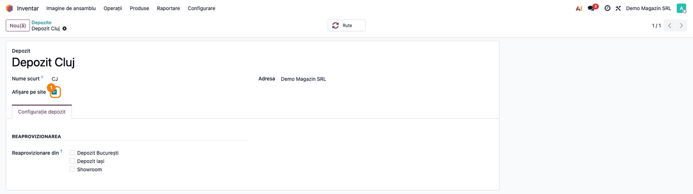
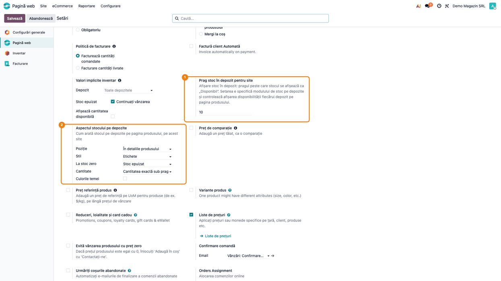
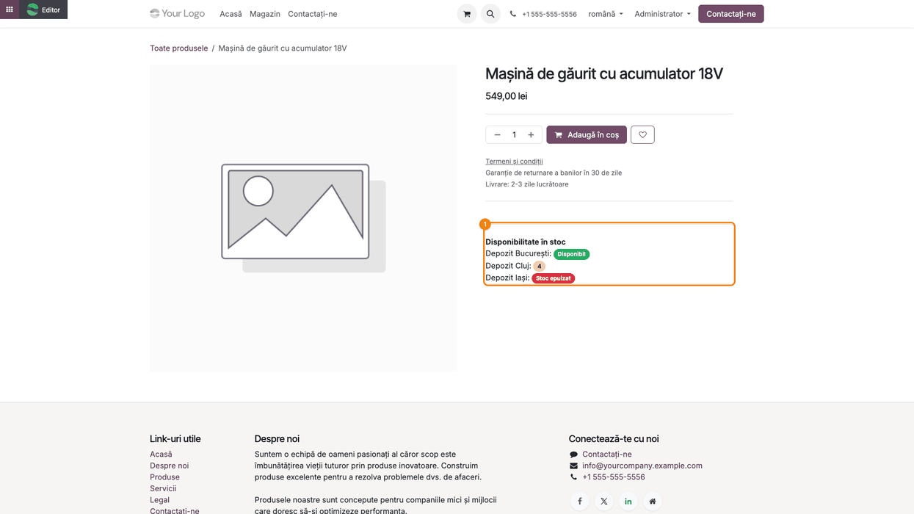
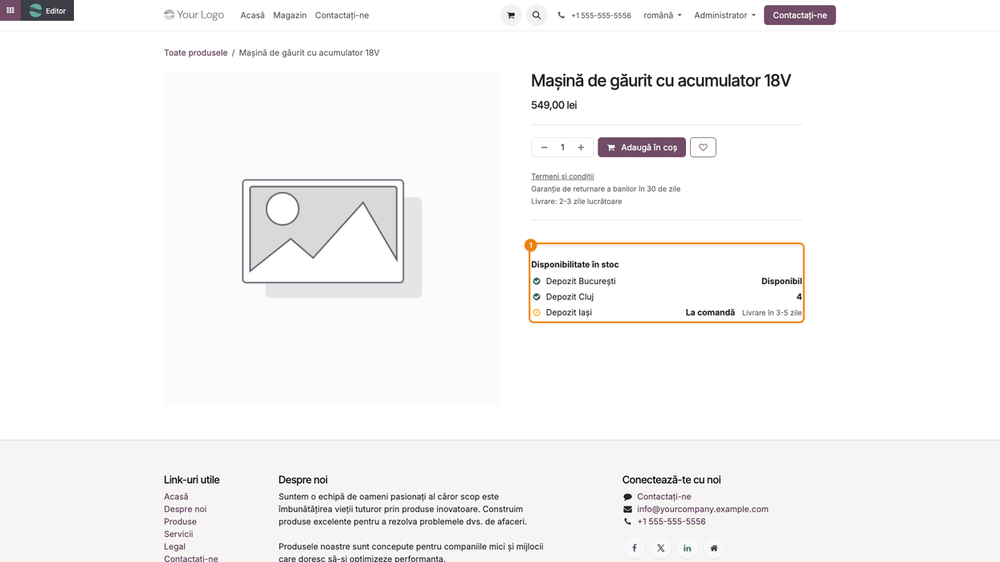
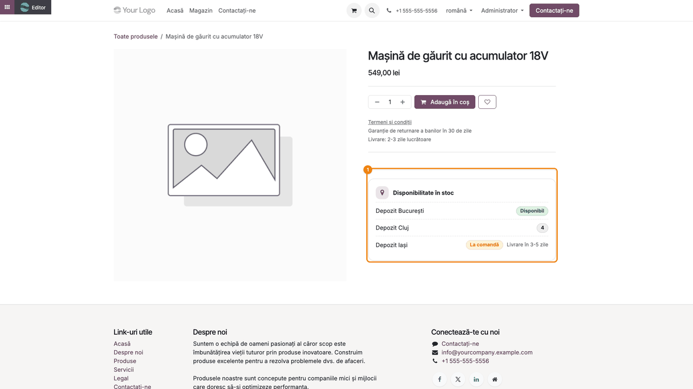
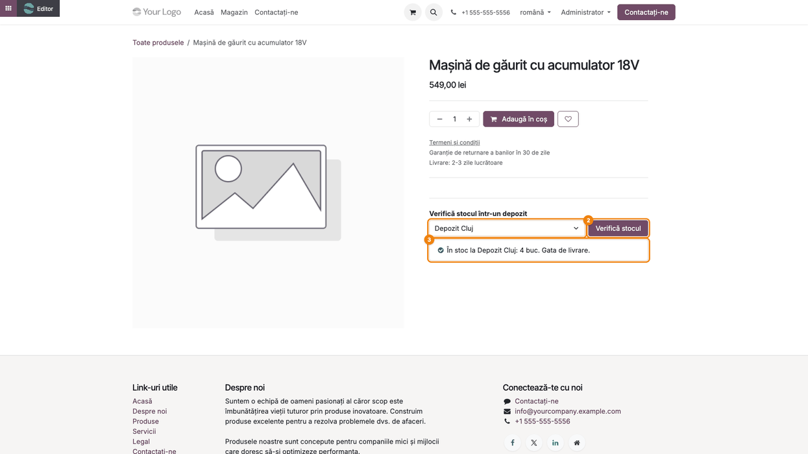
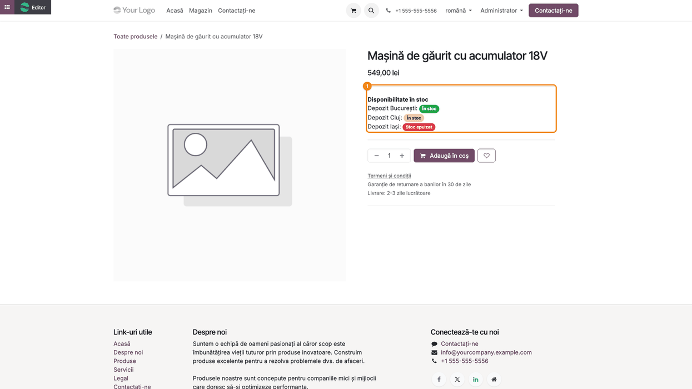
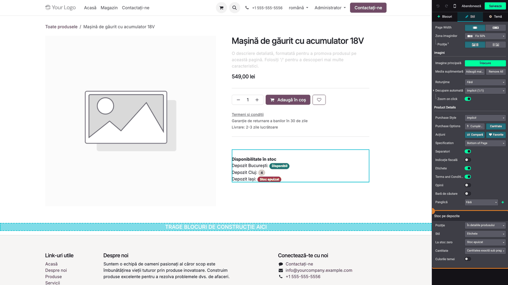

# Fișă Modul: Stocul pe depozite pe pagina produsului din magazin

**Modul:** `deltatech_website_warehouse_stock`
**Utilizator principal:** Administrator / designer website, responsabil vânzări online, gestionar
**Prioritate:** 🟡 Medie (influențează decizia de cumpărare și ridicarea din magazin; fără impact contabil)

---

## 1. Scop business

Clientul care cumpără online de la o firmă cu mai multe depozite sau magazine vrea să știe, înainte
să comande, **unde** se găsește produsul: îl poate ridica azi din depozitul apropiat sau trebuie
adus? Modulul afișează pe pagina produsului din magazin stocul fiecărui depozit ales, direct pe
pagină, fără clicuri sau ferestre suplimentare. Peste un prag configurabil (implicit 10) nu se arată
cantitatea exactă, ci doar **Disponibil**, ca stocurile mari să nu fie expuse concurenței. Aspectul
blocului (etichete, listă cu pictograme, card sau selector de depozit), mesajul la stoc zero („Stoc
epuizat” sau „La comandă” cu o notă), afișarea cantității, culorile și poziția pe pagină se aleg
per site, din setări sau direct din editorul de website.

Modulul completează funcția standard **Click & Collect** (`website_sale_collect`), care alege
punctul de ridicare abia la finalizarea comenzii: aici clientul vede distribuția stocului încă de pe
pagina produsului.

## 2. Bază legală și context

Nu există o obligație legală specifică modulului. Contextul este cel de informare corectă a
cumpărătorului: stocul afișat este o informație orientativă, calculată la încărcarea paginii, nu o
rezervare. Dacă magazinul promite ridicarea din depozit, termenii de vânzare trebuie să precizeze că
disponibilitatea se confirmă la comandă.

## 3. Utilizatori și roluri

- **Gestionar / responsabil inventar** — alege, pe fiecare depozit, dacă stocul lui apare pe site
  (drepturi de **Administrator** în Inventar, ca să aibă meniul **Configurare**).
- **Administrator website** — stabilește pragul și aspectul blocului din **Pagină web → Configurare →
  Setări**.
- **Designer website** — schimbă aspectul direct din editorul de website (grupul **Designer**
  al aplicației Pagină web; ceilalți utilizatori nu văd secțiunea **Stoc pe depozite** în editor).
- **Vizitatorul magazinului** — vede stocul pe depozite pe pagina produsului.

Roluri recomandate pentru testare:
- Administrator cu drepturi de **Administrator** în Inventar și **Designer** pe site.
- O fereastră privată de browser, ca vizitator public.

## 4. Conturi și date implicate

Modulul nu folosește conturi contabile și nu creează documente. Adaugă:
- pe depozit, bifa **Afișare pe site** (bifată implicit, inclusiv pe depozitele create după
  instalare);
- în setări, **Prag stoc în depozit pentru site** — un singur prag pentru toată baza (parametru de
  sistem), chiar dacă îl editați din setările unui site;
- pe fiecare site, opțiunile grupului **Aspectul stocului pe depozite**: **Poziție**, **Stil**, **La
  stoc zero**, **Notă** (textul de după „La comandă”), **Cantitate**, **Culorile temei**.

Cantitatea afișată pentru un depozit = stocul disponibil din locația de stoc principală a depozitului
(cu sublocațiile ei) **minus toate ieșirile planificate** din ea, confirmate dar nevalidate: livrări, transferuri către
alt depozit, consum de componente în producție, retururi la furnizor.
Se iau doar depozitele **companiei site-ului**, cu **Afișare pe site** bifat.

| Cantitate calculată | Text afișat (implicit) | Culoare etichetă |
|---|---|---|
| peste prag (ex. 50 la pragul 10) | **Disponibil** | verde |
| peste 0 și până la prag, inclusiv (ex. 4) | cantitatea exactă, fără zecimale când e întreagă | culoarea secundară a temei (gri / bej) |
| 0 sau negativă | **Stoc epuizat** sau, la alegere, **La comandă** | roșu / galben |

Cu **Cantitate = Doar starea**, primele două rânduri afișează amândouă **În stoc**, dar culoarea
etichetei rămâne diferită peste și sub prag; pentru diferențe mai discrete folosiți **Culorile temei**.

Date minime pentru demo (folosite și în capturi):
- **Depozit București** cu 50 buc., **Depozit Cluj** cu 4 buc., **Depozit Iași** fără stoc — toate
  cu **Afișare pe site** bifat;
- un depozit **Showroom** cu 2 buc., cu **Afișare pe site** debifat (nu trebuie să apară);
- produsul stocabil și publicat **Mașină de găurit cu acumulator 18V**, preț 549 lei;
- pragul lăsat la 10.

## 5. Configurare inițială

1. Instalați modulul `deltatech_website_warehouse_stock` (se instalează și `website_sale_stock`).
2. Pe fiecare depozit (**Inventar → Configurare → Depozite**, sub antetul **Gestiunea depozitului**) verificați bifa **Afișare pe site**:
   debifați-o la depozitele care nu vând către clienți (showroom, tranzit, service).
3. În **Pagină web → Configurare → Setări**, stabiliți pragul și aspectul blocului (Pasul 2).
4. Opțional, rafinați aspectul direct pe pagina produsului, din editorul de website (Pasul 8).

## 6. Flux de utilizare

### Pasul 1 — Alegeți depozitele afișate pe site

**Inventar → Configurare → Depozite**, deschideți depozitul. Sub **Nume scurt** apare bifa
**Afișare pe site** ①. Doar depozitele bifate apar pe pagina produsului, în ordinea listei de
depozite. Un depozit nou are bifa activă: dacă nu vreți să apară, debifați-o imediat după creare.



### Pasul 2 — Pragul și aspectul blocului, în setările site-ului

**Pagină web → Configurare → Setări**, secțiunea magazinului, lângă **Valori implicite inventar**:
- **Prag stoc în depozit pentru site** ① — peste această cantitate se afișează **Disponibil** în
  locul numărului (implicit 10). Pragul e comun tuturor site-urilor;
- **Aspectul stocului pe depozite** ② — pentru site-ul selectat în setări:
  - **Poziție**: **În detaliile produsului** (implicit) sau **După preț**;
  - **Stil**: **Etichete** (implicit), **Listă cu pictograme**, **Card** sau **Selector de depozit**;
  - **La stoc zero**: **Stoc epuizat** (implicit) sau **La comandă**; la „La comandă” apare și
    rândul **Notă** (ex. „Livrare în 3-5 zile”), afișat după mesaj;
  - **Cantitate**: **Cantitatea exactă sub prag** (implicit) sau **Doar starea**;
  - **Culorile temei**: etichete nuanțate pe culorile site-ului, lizibile pe temele întunecate, în
    locul etichetelor pline verde / gri / roșu.

Apăsați **Salvează**. Cu valorile implicite, blocul apare ca etichete în detaliile produsului (Pasul 3).



### Pasul 3 — Pagina produsului, stilul implicit (Etichete)

Vizitatorul deschide pagina produsului din **Magazin**. În detaliile produsului, sub butonul **Adaugă
în coș**, apare blocul **Disponibilitate în stoc** ①, cu un rând pe depozit.

**Ce verificați pe ecran:**
- **Depozit București** (50 buc., peste prag): eticheta verde **Disponibil**;
- **Depozit Cluj** (4 buc., sub prag): eticheta în culoarea secundară a temei (gri / bej) cu
  cantitatea **4**;
- **Depozit Iași** (fără stoc): eticheta roșie **Stoc epuizat**;
- **Showroom** (debifat la Pasul 1) **nu** apare;
- dacă niciun depozit nu e afișat pe site, blocul lipsește cu totul.



### Pasul 4 — Stilul „Listă cu pictograme”, cu „La comandă” la stoc zero

Cu **Stil = Listă cu pictograme**, **La stoc zero = La comandă** și **Notă = Livrare în 3-5 zile**,
fiecare depozit are o linie: bifă verde pentru stoc, ceas galben pentru „La comandă”, numele
depozitului și starea în dreapta. Nota apare după **La comandă**. Cu **La stoc zero = Stoc epuizat**,
pictograma depozitului fără stoc este un cerc cu „×”.



### Pasul 5 — Stilul „Card”, cu culorile temei

**Stil = Card** încadrează depozitele într-o casetă cu titlul **Disponibilitate în stoc** și
pictograma de locație, un rând pe depozit, cu eticheta în dreapta. În captură este bifat și
**Culorile temei**: etichetele sunt nuanțe deschise peste fundalul paginii (verde pentru stoc, neutru
sub prag, galben pentru „La comandă”), nu culori pline.



### Pasul 6 — Stilul „Selector de depozit”

**Stil = Selector de depozit** afișează lista **Verifică stocul într-un depozit**. Clientul alege
depozitul ① și apasă **Verifică stocul** ② (sau doar schimbă depozitul din listă). Sub listă apare
mesajul ③:
- cu stoc: „În stoc la Depozit Cluj: 4 buc. Gata de livrare.” (cu **Doar starea**, fără cantitate:
  „În stoc la … Gata de livrare.”);
- fără stoc, cu **La comandă**: „Momentan nu e pe raft la …. Se aduce la comandă.”, urmat de notă;
- fără stoc, cu **Stoc epuizat**: „Stoc epuizat la ….”.

Cantitățile sunt deja în pagină: butonul nu face o cerere nouă la server, deci mesajul reflectă
stocul de la încărcarea paginii.



### Pasul 7 — Poziția „După preț” și cantitatea „Doar starea”

Cu **Poziție = După preț**, blocul se mută imediat sub preț, deasupra butonului **Adaugă în
coș**. În captură, **Cantitate = Doar starea**: atât București (50), cât și Cluj (4) arată **În
stoc**, fără cantitate; Iași rămâne **Stoc epuizat**.

Două excepții, gestionate automat:
- cu stilul de cumpărare încadrat (rândul **Purchase Style**, netradus în Odoo 19, = **În cutie**,
  din secțiunea **Product Details** a editorului), blocul se pune imediat sub caseta care
  conține prețul;
- dacă produsul nu poate fi adăugat în coș, blocul rămâne în detaliile produsului.



### Pasul 8 — Aceleași opțiuni din editorul de website

Ca designer, pe pagina produsului apăsați **Editor** (stânga sus), apoi **clic pe blocul de stoc**.
În panoul din dreapta, fila **Stil**, apare secțiunea **Stoc pe depozite** cu **Poziție**, **Stil**,
**La stoc zero**, **Cantitate** și **Culorile temei**.

Acestea **sunt** setările site-ului din Pasul 2, nu ale paginii: o schimbare se scrie imediat în
setări, pagina se reîncarcă și noul aspect se aplică tuturor paginilor de produs ale site-ului.
**Abandonează** nu anulează o opțiune deja schimbată — reveniți la valoarea anterioară din același
panou. **Nota** de după „La comandă” se completează doar din setări (Pasul 2). În editor, nuanțele
etichetelor pot diferi ușor; aspectul final este cel din pagina publică.



### Note de monografie și raportare

Modulul nu generează note contabile, nu are rapoarte și nu rezervă stoc: doar afișează stocul
calculat la încărcarea paginii. Nu modifică nici coșul, nici comanda.

## 7. Legături cu alte module / declarații

| Modul / proces | Rol în flux | Tip legătură |
|---|---|---|
| `website_sale_stock` | pagina produsului, setările de stoc ale magazinului (unde se inserează pragul și aspectul) | dependență (manifest) |
| `website` | editorul de website (secțiunea **Stoc pe depozite**), site-ul și compania lui | dependență (manifest) |
| `stock` | depozitele, locațiile de stoc, stocul disponibil și ieșirile planificate | indirect (prin `website_sale_stock`) |
| `website_sale_collect` (Click & Collect) | alegerea punctului de ridicare la finalizarea comenzii | complementar, nu e cerut |
| Recepții, livrări, transferuri din Inventar | modifică stocul afișat pe depozit | indirect |

Ce este automat: calculul stocului pe fiecare depozit afișat, la fiecare încărcare a paginii;
alegerea textului și a culorii după prag; filtrarea pe compania site-ului; poziția de rezervă când
„După preț” nu se poate aplica.
Ce rămâne manual: alegerea depozitelor afișate (bifa pe depozit, inclusiv pe cele noi), pragul,
aspectul blocului și nota la „La comandă”.

## 8. Verificări pentru consultant

- [ ] Depozitele cu **Afișare pe site** debifat nu apar pe pagina produsului; un depozit nou apare
  automat (bifa e activă implicit).
- [ ] Depozitele altei companii nu apar pe site-ul unei companii, chiar dacă au bifa activă.
- [ ] Peste prag: **Disponibil** (verde); peste 0 și până la prag, inclusiv: cantitatea exactă
  (culoarea secundară a temei); la 0 sau negativ: **Stoc epuizat** (roșu) sau **La comandă** (galben).
- [ ] O livrare confirmată, încă nevalidată, scade cantitatea afișată în depozitul ei.
- [ ] Schimbarea pragului în setări schimbă textul pe toate site-urile.
- [ ] **Doar starea** afișează **În stoc** în locul cantității, inclusiv sub prag.
- [ ] Cu **La comandă** și o **Notă** completată, nota apare după mesaj în toate stilurile.
- [ ] Cele patru stiluri (Etichete, Listă cu pictograme, Card, Selector de depozit) se afișează
  corect; în selector, **Verifică stocul** afișează mesajul depozitului ales.
- [ ] **După preț** pune blocul sub preț; cu stilul de cumpărare încadrat, sub casetă.
- [ ] O opțiune schimbată din editor apare și în **Pagină web → Configurare → Setări** (și invers).
- [ ] Fără niciun depozit afișat, blocul **Disponibilitate în stoc** nu apare deloc.

## 9. Mesaje de eroare frecvente

| Mesaj / simptom | Cauză probabilă | Remediere |
|-----------------|-----------------|-----------|
| Secțiunea **Stoc pe depozite** lipsește din panoul editorului | utilizatorul nu are drepturi de **Designer** pe site | acordați grupul **Designer** (aplicația Pagină web) sau schimbați opțiunea din setări |
| „Doar designerii site-ului pot schimba afișarea stocului.” | o cerere directă de schimbare a opțiunii, făcută de un utilizator fără drepturi de **Designer** (protecția serverului) | ca mai sus |
| „Opțiune necunoscută pentru stocul pe depozite: …” | o cerere directă către server cu o opțiune care nu se poate schimba din editor (de exemplu nota de la stoc zero) | schimbați opțiunea din **Pagină web → Configurare → Setări** (Pasul 2) |
| „Valoare invalidă … pentru …” | o cerere directă către server cu o valoare care nu există în lista opțiunii | alegeți valoarea din panoul editorului sau din setări; lista arată doar valorile permise |
| Blocul **Disponibilitate în stoc** nu apare deloc | niciun depozit al companiei site-ului nu are **Afișare pe site** bifat; sau vizualizarea **Warehouse Stock** a fost dezactivată | bifați depozitele; cu modul de dezvoltare, **Setări → Tehnic → Interfață utilizator → Vizualizări**, căutați „Warehouse Stock” și reactivați-o |
| Un depozit nu apare deși are stoc | bifa **Afișare pe site** e debifată, depozitul e al altei companii, sau locația lui de stoc principală nu e de tip internă | verificați bifa, compania și locația de stoc a depozitului |
| Pe site apare un depozit nou, nedorit | bifa **Afișare pe site** e activă implicit pe depozitele noi | debifați-o pe depozit |
| Cantitatea afișată e mai mică decât stocul din Inventar | se scad toate ieșirile planificate din locația de stoc (livrări, transferuri către alt depozit, consum în producție, retururi), confirmate dar nevalidate | comportament normal; verificați mișcările în așteptare care ies din depozit |
| **Disponibil** la un produs cu 8 buc., deși pragul dorit e 10 | pragul a fost schimbat (e comun pentru toate site-urile) | verificați **Prag stoc în depozit pentru site** |
| **Poziție = După preț** nu mută blocul | produsul nu poate fi adăugat în coș (blocul rămâne în detalii) | comportament normal; verificați că produsul e de vânzare și are preț |

## 10. Capturi de ecran

Capturile (`static/description/`) se generează automat din `tests/test_screenshots.py`, cu mixinul
`ScreenshotCase` din `deltatech_doc_screenshots` (import defensiv; testul se sare dacă modulul de
tooling lipsește). Sunt în **limba română** (interfața și site-ul), pe compania **Demo Magazin SRL**
în RON, cu datele din secțiunea 4. Etichetele modulului sunt traduse; unele etichete standard
Odoo 19 din editor și din setări (ex. „Product Details”, „Purchase Style”) apar încă în engleză.

| # | Fișier | Conținut |
|---|---|---|
| 1 | `01_depozit_afisare_site.png` | formularul **Depozit Cluj**, cu bifa **Afișare pe site** |
| 2 | `02_setari_stoc_depozite.png` | **Pagină web → Configurare → Setări**: pragul și grupul **Aspectul stocului pe depozite** |
| 3 | `03_pagina_produs_etichete.png` | pagina produsului, stilul **Etichete** (Disponibil / 4 / Stoc epuizat) |
| 4 | `04_stil_lista_la_comanda.png` | stilul **Listă cu pictograme**, cu **La comandă** și nota „Livrare în 3-5 zile” |
| 5 | `05_stil_card.png` | stilul **Card**, cu **Culorile temei** |
| 6 | `06_stil_selector.png` | stilul **Selector de depozit**, după **Verifică stocul** pe Depozit Cluj |
| 7 | `07_dupa_pret_doar_starea.png` | blocul **După preț**, cu **Cantitate = Doar starea** |
| 8 | `08_editor_optiuni.png` | editorul de website, secțiunea **Stoc pe depozite** a blocului selectat |

Regenerare:

```bash
./odoo/odoo-bin -c odoo.conf -d <db> -i deltatech_website_warehouse_stock,deltatech_doc_screenshots \
    --test-tags=/deltatech_website_warehouse_stock:TestWarehouseStockScreenshots --stop-after-init
```

## 11. Observații pentru manual

Explicați clientului că stocul afișat este orientativ (calculat la încărcarea paginii, fără
rezervare) și că pragul protejează stocurile mari de ochii concurenței. Subliniați că bifa **Afișare
pe site** e activă pe orice depozit nou, deci depozitele interne (tranzit, service) trebuie debifate.
Pragul este unic pe bază, iar aspectul se alege per site. Opțiunile din editor sunt setările
site-ului, nu ale unei pagini, și nu se anulează cu **Abandonează**. Mesajul selectorului folosește
„buc.” indiferent de unitatea de măsură a produsului: pentru produse vândute la kg sau metru,
preferați stilurile fără mesaj (Etichete, Listă, Card) sau **Doar starea**.
