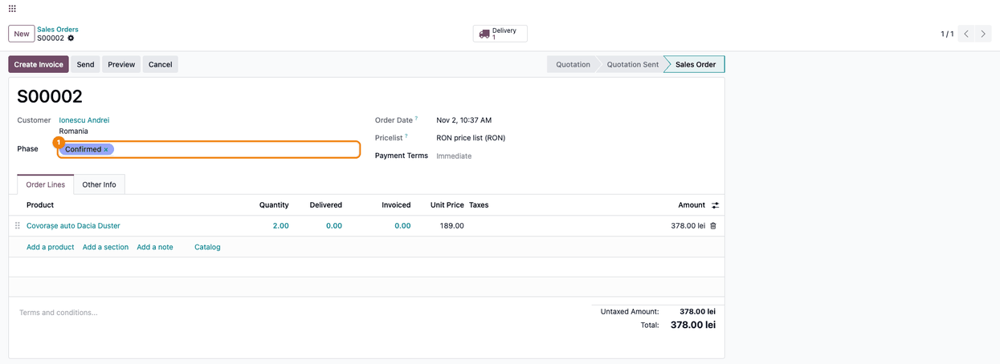
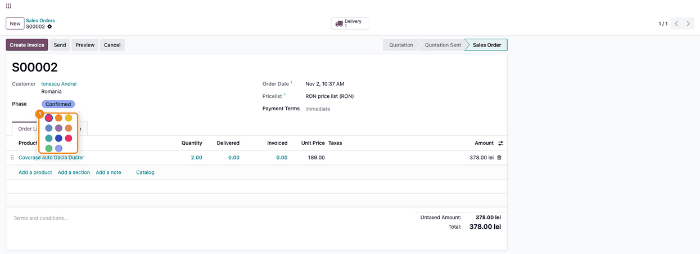

=====================
Many2one Badge Widget
=====================

..
   !!!!!!!!!!!!!!!!!!!!!!!!!!!!!!!!!!!!!!!!!!!!!!!!!!!!
   !! This file is generated by oca-gen-addon-readme !!
   !! changes will be overwritten.                   !!
   !!!!!!!!!!!!!!!!!!!!!!!!!!!!!!!!!!!!!!!!!!!!!!!!!!!!
   !! source digest: sha256:edc1adf130aa9fe46283985331ec6abe370d389009455a5f630d275c3129c8c1
   !!!!!!!!!!!!!!!!!!!!!!!!!!!!!!!!!!!!!!!!!!!!!!!!!!!!

.. |badge1| image:: https://img.shields.io/badge/maturity-Production%2FStable-green.png
    :target: https://odoo-community.org/page/development-status
    :alt: Production/Stable
.. |badge2| image:: https://img.shields.io/badge/license-LGPL--3-blue.png
    :target: http://www.gnu.org/licenses/lgpl-3.0-standalone.html
    :alt: License: LGPL-3
.. |badge3| image:: https://img.shields.io/badge/github-dhongu%2Fdeltatech-lightgray.png?logo=github
    :target: https://github.com/dhongu/deltatech/tree/19.0/deltatech_widget_many2one_badge
    :alt: dhongu/deltatech
.. |badge_fisa| image:: https://img.shields.io/badge/-Fi%C8%99%C4%83%20consultant-2ea44f.png
    :target: https://github.com/dhongu/deltatech/blob/19.0/deltatech_widget_many2one_badge/readme/FISA_CONSULTANT.md
    :alt: Fișă consultant
.. |badge_tests| image:: https://img.shields.io/badge/-3%20automated%20tests-2ea44f.png
    :target: https://github.com/dhongu/deltatech/tree/19.0/deltatech_widget_many2one_badge/tests
    :alt: 3 automated tests

|badge1| |badge2| |badge3| |badge_fisa| |badge_tests|

A custom widget that displays Many2one fields as colored badges, similar
to ``many2many_tags``.

Features
========

- ✅ Displays as a colored badge in readonly mode
- ✅ Click on badge to change color via color picker popover (edit mode)
- ✅ Remove button (``×``) appears on hover over the badge
- ✅ Autocomplete input for selecting a new value when field is empty
- ✅ Supports customizable ``color_field`` option
- ✅ Compatible with the standard Odoo colors (1–11 from the picker, 0
  for no color)
- ✅ Modern rounded badge design

Installation
============

1. Copy the ``deltatech_widget_many2one_badge`` folder into your Odoo
   ``addons`` directory
2. Restart the Odoo server
3. Enable Developer Mode
4. Go to Apps → Update Apps List
5. Search for "Many2one Badge Widget"
6. Click Install

Usage
=====

1. Make sure the related model has a ``color`` field

--------------

.. code:: python

   class MyCategory(models.Model):
       _name = 'my.category'
       _description = 'My Category'

       name = fields.Char(string='Name', required=True)
       color = fields.Integer(string='Color', default=0)

2. Use the widget in your view

--------------

.. code:: xml

   <field name="category_id"
          widget="many2one_badge"
          options="{'color_field': 'color'}"/>

3. Available options

--------------

+-----------------+--------------------------------------+-------------+
| Option          | Description                          | Default     |
+=================+======================================+=============+
| ``color_field`` | Name of the integer field on the     | ``'color'`` |
|                 | related model that stores the color  |             |
|                 | index                                |             |
+-----------------+--------------------------------------+-------------+

.. code:: xml

   <!-- Example with a custom color field -->
   <field name="status_id"
          widget="many2one_badge"
          options="{'color_field': 'badge_color'}"/>

Full Example
============

Python model
------------

.. code:: python

   # models/task.py
   from odoo import models, fields

   class Task(models.Model):
       _name = 'my.task'
       _description = 'My Task'

       name = fields.Char(string='Name', required=True)
       category_id = fields.Many2one('my.category', string='Category')
       priority_id = fields.Many2one('my.priority', string='Priority')

   class Category(models.Model):
       _name = 'my.category'
       _description = 'Task Category'

       name = fields.Char(string='Name', required=True)
       color = fields.Integer(string='Color', default=0)

   class Priority(models.Model):
       _name = 'my.priority'
       _description = 'Task Priority'

       name = fields.Char(string='Name', required=True)
       color = fields.Integer(string='Badge Color', default=0)

XML view
--------

.. code:: xml

   <record id="view_task_form" model="ir.ui.view">
       <field name="name">my.task.form</field>
       <field name="model">my.task</field>
       <field name="arch" type="xml">
           <form>
               <sheet>
                   <group>
                       <field name="name"/>
                       <field name="category_id"
                              widget="many2one_badge"
                              options="{'color_field': 'color'}"/>
                       <field name="priority_id"
                              widget="many2one_badge"
                              options="{'color_field': 'color'}"/>
                   </group>
               </sheet>
           </form>
       </field>
   </record>

   <record id="view_task_tree" model="ir.ui.view">
       <field name="name">my.task.tree</field>
       <field name="model">my.task</field>
       <field name="arch" type="xml">
           <tree>
               <field name="name"/>
               <field name="category_id" widget="many2one_badge"
                      options="{'color_field': 'color'}"/>
               <field name="priority_id" widget="many2one_badge"
                      options="{'color_field': 'color'}"/>
           </tree>
       </field>
   </record>

Available Colors
================

Odoo provides 12 predefined colors (indices 0–11). The badge color
picker offers 1–11; index 0 (no color) is set from the related record's
own form.

===== ===============
Index Color
===== ===============
0     No color (grey)
1     Red
2     Orange
3     Yellow
4     Cyan
5     Purple
6     Almond
7     Teal
8     Blue
9     Raspberry
10    Green
11    Violet
===== ===============

Troubleshooting
===============

Badge is not colored
--------------------

**Problem**: The badge appears but without color.

**Solution**: Make sure the related model has the ``color`` field (or
the field specified in ``color_field``) and that it contains a non-zero
integer value.

Widget not working after install
--------------------------------

**Problem**: Module is installed but the widget has no effect.

**Solution**:

1. Clear browser cache (Ctrl+Shift+R)
2. Restart the Odoo server
3. Check the browser console for JavaScript errors

Color not saved after clicking
------------------------------

**Solution**: Ensure the user has write access to the related model
(e.g. ``my.category``), since the color is saved directly on the related
record via ``orm.write``.

Contributing
============

Contributions are welcome! Please open an issue or pull request on the
project repository.

**Table of contents**

.. contents::
   :local:

Usage
=====

The module has no menus of its own: the badge appears on the fields
where other modules use it. The steps below use the sale order phase
from ``deltatech_sale_stage``; the purchase order phase
(``deltatech_purchase_phase``) behaves the same way.

1. Go to **Sales → Orders → Orders**. The **Phase** column shows the
   phase of each order as a colored badge, one color per phase.

   |Sales Orders list with six confirmed orders; the Phase column shows
   the colored badges Confirmed, Order sent, Delivered and Shipped; the
   Delivered badge on the third row is highlighted|

2. Open an order. The **Phase** field shows the badge; hovering it shows
   **×**, which removes the value and brings back the search box to pick
   another phase.

   |Sales order S00002 for Ionescu Andrei: the Phase field with the blue
   Confirmed badge and the × to remove it|

3. Click the badge to open the color picker (11 colors). The chosen
   color is saved on the phase right away, not on the order, so every
   order with that phase shows the new color. Saving it requires write
   access on the phases (Sales / Administrator).

   |Sales order S00002 with the color picker open under the Confirmed
   badge: 11 colored circles to choose the phase color from|

The colors of all the badges on screen are read with a single request to
the server.

.. |Sales Orders list with six confirmed orders; the Phase column shows the colored badges Confirmed, Order sent, Delivered and Shipped; the Delivered badge on the third row is highlighted| image:: https://raw.githubusercontent.com/dhongu/deltatech/19.0/deltatech_widget_many2one_badge/static/description/en/01_lista_comenzi_faze.png

Changelog
=========

19.0.1.0.4
==========

- One ``read`` for the colors of all the badges on screen, instead of
  one ``read`` per badge: a list of 80 orders sent 80 extra requests to
  the server, each time it was displayed. The color is also no longer
  read again when the record changes but the value stays the same.
- Consultant sheet (``readme/FISA_CONSULTANT.md``) and usage page, with
  screenshots generated by ``tests/test_screenshots.py`` on the sale
  order phase of ``deltatech_sale_stage``. The color table in the
  description now matches the Odoo 19 palette.

19.0.1.0.3
==========

- Own module icon, instead of the generic gears it had.

Changelog
=========

19.0.1.0.2 (2026-09-28)
-----------------------

- Fix: the Hoot unit tests never ran. Hoot only executes modules whose
  name ends in ``.test``, so ``many2one_badge_field.test.esm.js`` was
  loaded but silently skipped ("Passed 0 tests"). Renamed it to
  ``many2one_badge_field.test.js``.
- Added ``tests/test_js.py``, so the Hoot tests run with the Python test
  suite (and in CI).
- The edit mode test now checks removing the value, picking another
  partner from the autocomplete and saving; a new test checks that
  clicking the badge opens the color picker and writes the chosen color
  on the partner. The edit mode test is desktop only: on mobile the
  autocomplete opens a dialog instead of a dropdown.

Bug Tracker
===========

Bugs are tracked on `Terrabit Issues <https://www.terrabit.ro/helpdesk>`_.
In case of trouble, please check there if your issue has already been reported.

Do not contact contributors directly about support or help with technical issues.

Credits
=======

Authors
-------

* Terrabit
* Dorin Hongu

Maintainers
-----------

This module is part of the `dhongu/deltatech <https://github.com/dhongu/deltatech/tree/19.0/deltatech_widget_many2one_badge>`_ project on GitHub.

You are welcome to contribute.